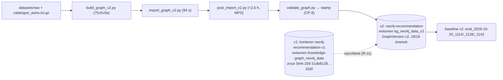
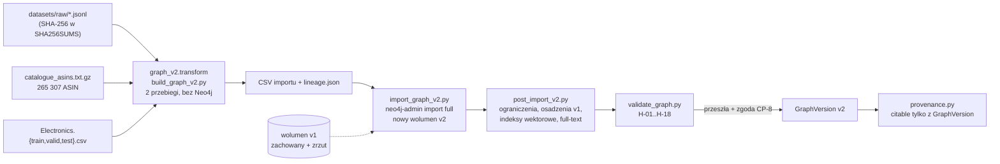
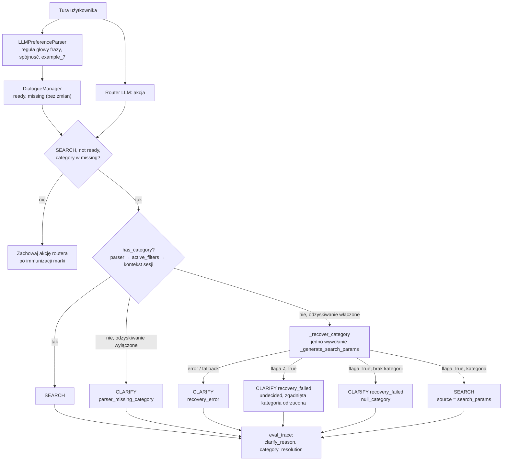
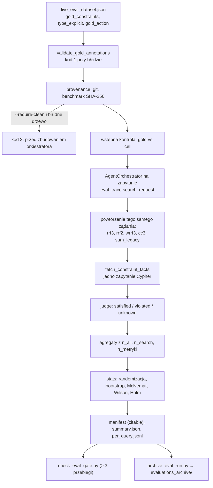
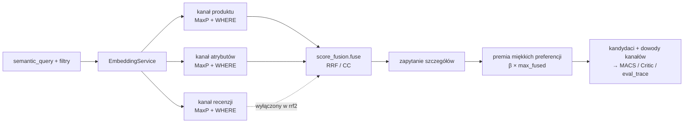
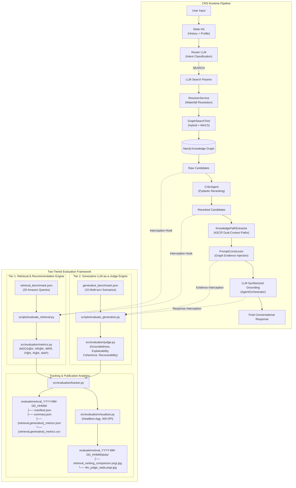
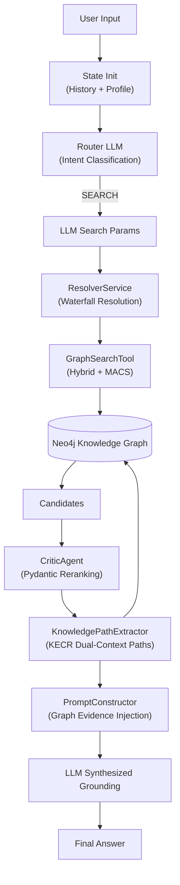
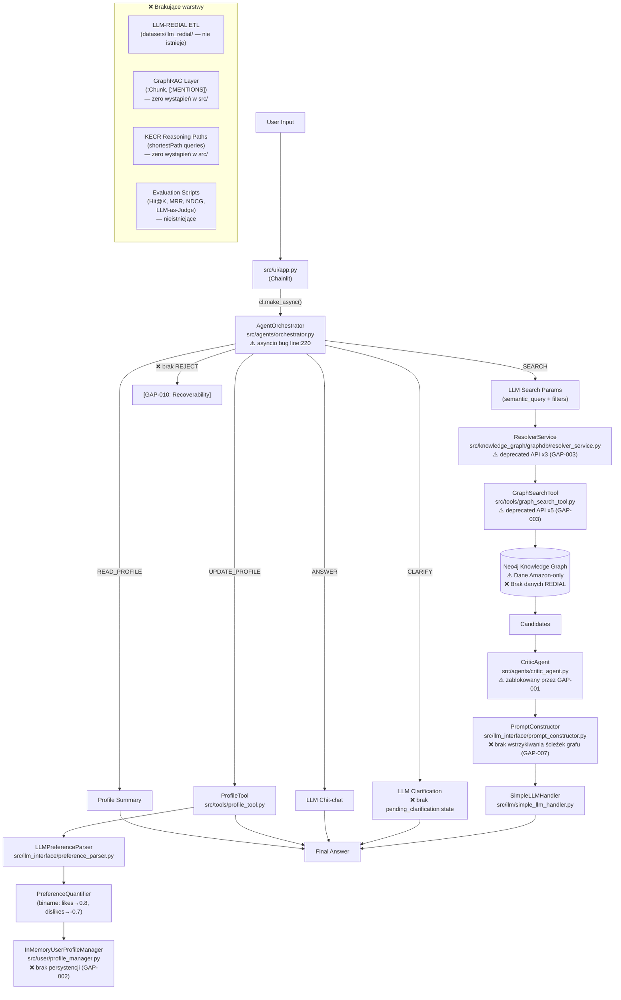
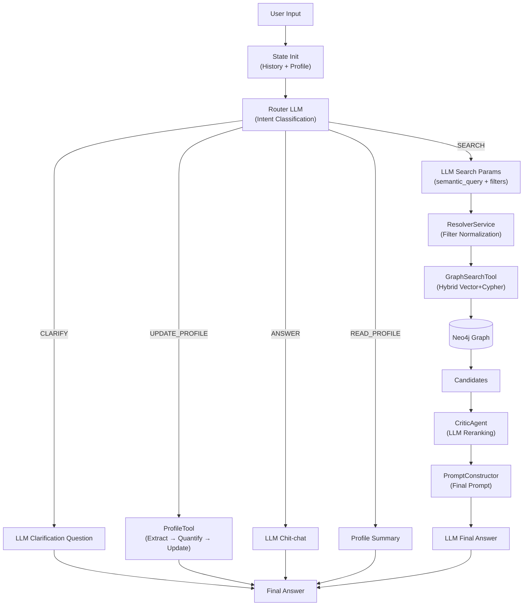
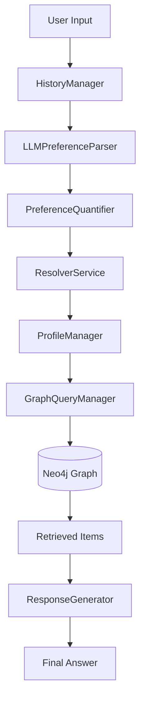

# Raport Stanu Projektu: System Rekomendacji 2.0 (Knowledge Graph)

> **Konwencja**: Każda sekcja datowana opisuje stan systemu na dany dzień.
> Najnowsze zmiany są na górze. Starsze wpisy poniżej stanowią historię projektu.

---

## 📅 2026-10-20 (Graph v2 wykonany: zbudowany, zwalidowany, opieczętowany i zmierzony; F4 zakończone)

### Changelog (względem stanu z 2026-10-19, wpis „Graph v2 — przebudowa fundamentu danych")

> **Kontekst**: Wpis z 2026-10-19 opisywał wyłącznie kod potoku; żadna operacja na grafie nie była wtedy wykonana. Ten wpis opisuje **wykonanie** runbooka (punkty kontrolne CP-1 … CP-9) na gałęzi `feature/afp-002-vector-aggregation`. Źródło główne: `graph_versions/v2/RUNBOOK_LOG.md`, uzupełniająco `graph_versions/v2/preflight_report.json`, `graph_versions/v2/pilot/pilot_report.json`, `graph_versions/v2/validation_report.json`, `graph_versions/v2/baseline_comparison.json`, `graph_versions/v1/DUMP.json` oraz pozycja F4 w `production_artifacts/Implementation_Plan.md` (F4.1 … F4.7 oznaczone `[x]`). Liczby poniżej pochodzą z tych plików; nie ponowiono żadnych pomiarów na żywym grafie.
>
> **Odniesienie do Vision Report**: realizuje decyzje 2026-10-19-018 … 021 (przywrócenie uziemienia §4 „Knowledge Graph as Grounding”). Nie zmienia kierunku strategicznego, nie dodaje trenowania modeli ani nowego zbioru danych. Wpis nie wymaga nowej decyzji w Vision Report; po stronie metryk wynika jedna otwarta kwestia (redefinicja `review-coverage-bias@K`, patrz „Nadal brakuje”).
>
> **Zakres commitów** (kolejność wykonania):
>
> | Commit | Opis |
> |---|---|
> | `8306d9b` | poprawka braku pamięci MPS (pre-flight i osadzanie) |
> | `e6183d0` | zapis CP-1 |
> | `75c5c0a` | zapis CP-2 … CP-4; **czysty commit transformacji** (`--require-clean`) |
> | `d4f338b` | linie pochodzenia (lineage) |
> | `8c35d68` | pilot |
> | `8b10a35`, `0a32604` | trzy błędy po imporcie (patrz „Korekty”) |
> | `35e395c` | graf v2 zbudowany, zwalidowany i opieczętowany |
> | `79f21e6` | profil uruchomieniowy (R-11) i pre-check R-12 |
> | `012b780`, `4248d03` | poprawka A-7: lista dozwolonych ścieżek dla dokumentacji i `docker-compose` |
> | `65a0ba0` | przebiegi baseline v2 (cytowalne) i porównanie v1 / v2 |

#### 🔴 Nowe komponenty (nieopisane w poprzednim raporcie)

1.  **Aktywny graf v2 (Critical):** Neo4j 5.14.0 działa na wolumenie Docker `kg_neo4j_data_v2` (compose, `.env`: `NEO4J_DATA_VOLUME=kg_neo4j_data_v2`). Liczności z `validation_report.json` (`graph_version: v2`, `passed: true`, utworzony 2026-10-20T02:22:44Z):

    | Element | v1 | v2 |
    |---|---|---|
    | `ParentProduct` | 265 307 (z czego **104 281 duchów**) | 265 307 (**8 bez tytułu**; udział 0,393058 → 0,00003) |
    | `Review` | 1 629 426 | 3 382 248 |
    | `User` | 471 474 | 2 594 661 |
    | `Brand` | 40 998 | 49 663 |
    | `Category` | 71 | 38 |
    | `Attribute` | 47 335 | 36 187 |
    | `Taxon` (drzewo kategorii, `BROADER`, `IN_TAXON`) | brak | **1 183** (maks. głębokość 7, 3 korzenie) |
    | Pokrycie produktów osadzoną recenzją | 0,021541 (2,2%) | **0,999951 (99,995%)** |

    Relacje v2: `ABOUT_PRODUCT` i `WROTE` po 3 382 248, `HAS_BRAND` 264 274, `BELONGS_TO_CATEGORY` 261 664, `HAS_ATTRIBUTE` 190 043, `IN_TAXON` 248 053, `BROADER` 1 180. W v2 nie istnieją już etykiety `Variant`, `Product`, `PriceRange` ani relacje `RATED`, `REVIEWS`, `IN_PRICE_RANGE`, `IS_VARIANT_OF`, `SUBCATEGORY_OF` (kontrola R-08 pokazuje je jako `null` w v2; bramka H-16 „no legacy schema” = 0).
2.  **Węzeł `GraphVersion` v2 (High):** `(:GraphVersion {version: 'v2', validation_passed: true})` zapisany 2026-10-20T08:20:05Z poleceniem `post_import_v2.py stamp … --confirm-validation-sha256 d8a68b7f…8af` (lineage `3f985952…86ec`, commit kodu `75c5c0a`, commit pieczęci `0a32604`, Neo4j 5.14.0). Dopiero od tego momentu przebiegi live są cytowalne wg `src/evaluation/provenance.py` (powód `graph_version_not_validated` znika).
3.  **Artefakty w `graph_versions/` (git):** `graph_versions/v2/build_params.json` (zatwierdzony w CP-1; `product_content_rule = "title_description"`, `embedding_device = "mps"`, partia kodowania 32), `catalogue_asins.txt.gz` (SHA-256 `76d882ab…f528`), `preflight_report.json` (SHA-256 `3c2804ff49968f6490a04e300ee0c4ddfbe8c269c053caf0afe442fdfc03f5d1`), `pilot/pilot_report.json`, `import_run.json`, `validation_report.json` (SHA-256 **`d8a68b7f…8af`**; pełny skrót `d8a68b7f2ac1589353fc8d32b6b00646dfe4e2aca98150b1964f8f1e6b1bb8af`), `baseline_comparison.json`, `RUNBOOK_LOG.md`; `graph_versions/v1/DUMP.json`.
4.  **Zrzut v1 (High, ścieżka wycofania):** `~/neo4j-backups/kg_v1_20261019_2234/neo4j.dump`, 2 717 863 893 bajtów, SHA-256 **`51db81286ef04f4a780a37833ed5d6d47d1ecc9737ea16ca9043c20af6c0026f`** (sprawdzony niezależnie `shasum`; zapis w `graph_versions/v1/DUMP.json`, `created_at` 2026-10-19T22:35:27Z). Opcjonalny test odtworzenia (`restore-test`) **nie został uruchomiony**.
5.  **Cytowalne przebiegi baseline v2 (High):** `eval_2026-10-20_1114`, `_1128`, `_1142`, zarchiwizowane (`evaluations_archive/`), `graph_version` = v2 zwalidowany. Szczegóły w sekcji „Weryfikacja”.

#### 🟡 Korekty / Modyfikacje istniejących komponentów

1.  **Przebieg wykonania — punkty kontrolne (wszystkie zatwierdzone przez użytkownika 2026-10-20):**
    *   **CP-1 (R-1, pre-flight):** raport bez nieudanych sekcji (SHA-256 `3c2804ff49968f6490a04e300ee0c4ddfbe8c269c053caf0afe442fdfc03f5d1`), uruchomiony na `82a1bb9` z niezatwierdzoną poprawką MPS (dwa wcześniejsze przebiegi zawiesiły się w P-04 i nie zapisały raportu; poprawka w `8306d9b`). Pomiary: 8 produktów bez tytułu, 0 produktów katalogu bez surowych metadanych, **3 382 248** zachowanych recenzji (60 521 zduplikowanych identyfikatorów recenzji scalono), 1 081 137 recenzji do osadzenia, 2 594 661 użytkowników, 265 294 produkty z co najmniej jedną recenzją, 1 183 węzły taksonów, 17 254 produkty bez ścieżki kategorii, 151 262 bez ceny; osadzanie na MPS przy partii 32 (335 tekstów/s; partia 64 kończyła się brakiem pamięci); szczytowy RSS próby 3,6 GB (cel 3 GB, zaakceptowany przez użytkownika), 72 GB wolnego miejsca. P-09: osadzenia produktów odtwarzają v1 (19 z 20 identycznych), osadzenia kategorii nie (40% identycznych), bo zmienia się próbka tytułów po uzupełnieniu duchów; uznane za część różnicy v1 → v2. Decyzje: zatwierdzenie `build_params.json` w całości, w tym OQ-1 (jedyny produkt wyłącznie z `features` nie dostaje osadzenia zamiast prawie pustego).
    *   **CP-2 (R-2, bramka startowa):** użytkownik potwierdził, że R2a nie wymaga już grafu v1 (cytowalne przebiegi v1 zarchiwizowane: `evaluations_archive/eval_2026-10-18_2340`, `_2349`, `_2358`, commit `96874f3`). Do `.env` (ignorowany przez git) dodano `NEO4J_DATA_VOLUME` i `NEO4J_DATA_VOLUME_V1` (strażnik importu). R-3: `export_v1_snapshot.py --verify-only` potwierdził niezmienność katalogu (265 307), migawki v1 i celów benchmarku.
    *   **CP-3 (R-4, zatrzymanie v1):** `docker stop neo4j-recommendation` (kod wyjścia 0). Polecenie zatrzymania z runbooka nie pasowało do kontenera (należy do projektu compose `knowledge-graph`, utworzonego ze ścieżki `src/knowledge-graph/docker-compose.yml`); obsłużone w R-9/R-7 przez przemianowanie kontenera.
    *   **CP-4 (R-5, zrzut):** patrz „Nowe komponenty” p. 4; wolumen v1 `knowledge-graph_neo4j_data` był zamontowany tylko przez kontener zrzutu i nie został zmodyfikowany.
    *   **R-6 (transformacja)** na czystym commicie `75c5c0a`: pilot `--sample-mod 20` (13 381 produktów, 171 212 recenzji, 54 668 do osadzenia, 790 taksonów; 6 min, szczyt RSS 1,1 GB) i pełna (265 307 produktów, 3 382 248 recenzji, 1 081 137 do osadzenia, 2 594 661 użytkowników, 49 663 marki, 38 kategorii, 36 187 atrybutów, 1 183 taksony; 2,9 GB CSV; 10,5 min; szczyt RSS **4,2 GB**, czyli powyżej celu NFR-002 ≤ 3 GB i powyżej wcześniejszego oszacowania 3,3 GB). Liczności zgodne z `build_params.json`.
    *   **CP-5 (R-7, pilot):** kontener v1 przemianowany na `neo4j-recommendation-v1` (niezmieniony, zatrzymany), aby compose mógł utworzyć `neo4j-recommendation`. Wolumen roboczy `kg_neo4j_data_v2_pilot`: import 13 s, magazyn 479 MB, pusty raport importu (0 błędnych wierszy). `post_import_v2.py all`: 7,8 min, MPS, partia 32, 0 zdarzeń braku pamięci, 0 przejść na CPU; 5 indeksów wektorowych (procedura), test dymny full-text zaliczony. `validate_graph.py --pilot`: **18/18** bramek twardych. R-07: 20 celów benchmarku poza 5% próbą; próbkowany cel `live_eval_laptop_02` zachował tytuł, cenę, markę i kategorię (recenzje 33 → 20, limit). Ekstrapolacja pełnego budowania (`pilot/pilot_report.json`): import ≈ 4 min, osadzanie ≈ 2,25 h, magazyn ≈ 12,5 GB + 0,5–1 GB logów. Kontener pilota usunięty (`compose down` bez `-v`), wolumen roboczy skasowany.
    *   **CP-6 (R-8, pełny import):** `docker volume create kg_neo4j_data_v2`; `import_graph_v2.py import --execute`: **94 s**, magazyn 4,0 GB, pusty raport importu (0 błędnych wierszy); `graph_versions/v2/import_run.json`.
    *   **CP-7 (R-9, przełączenie, kroki po imporcie, walidacja):** compose uruchomiony na `kg_neo4j_data_v2` z profilem budowania (sterta 4G, cache stron 1G, limit transakcji 600 s). `post_import_v2.py all` uruchomiony odłączony (`nohup`), ok. **2,6 h**: wszystkie etykiety osadzone na MPS przy partii 32 bez braku pamięci (`Review` 1 081 137; `ParentProduct` 265 303, 4 pominięte przez regułę `title_description`; `Brand` 49 663; `Category` 38). Przebieg zatrzymał się na kroku full-text (patrz p. 2). Po poprawkach: `validate_graph.py` → **18/18 bramek twardych**.
    *   **CP-8 (R-10, pieczęć):** użytkownik przejrzał i zatwierdził raport walidacji; zapis `GraphVersion` (patrz „Nowe komponenty” p. 2).
    *   **R-11 (profil uruchomieniowy):** `.env` bez nadpisań budowania; compose odtworzony z stertą 2 GiB, cache stron 2 GiB, limitem transakcji 1 min; `GraphVersion` v2 obecny.
    *   **CP-9 (R-12, baseline):** patrz „Weryfikacja”; zaakceptowany przez użytkownika 2026-10-20. Na tym F4 jest zakończone.
2.  **Trzy błędy kodu znalezione dopiero na pełnym grafie (po zatwierdzonej walidacji pilota), naprawione i zatwierdzone z testami:**
    *   `8b10a35`: (a) test dymny full-text na pojedynczym tokenie nie skalował się (token pasował do 11 828 produktów) i uruchamiał awaryjny indeks `features_text`; zastąpiony testem frazą, z odzyskiwaniem po awarii; (b) 2 węzły `Attribute` z niesparowanymi surogatami nie zostały zapisane zwrotnie, bo zapis dopasowywał ciągi znaków; zapis zwrotny przez `elementId`, z licznikami zapisów.
    *   `0a32604`: zapytanie testu dymnego przekazywało parametr `query=` do `Session.run` (kolizja nazw argumentów); zmieniono na `$search`.
    *   Po poprawkach ponowiono `embed --labels Attribute` (2 osadzone; 36 187 / 36 187) oraz `fulltext-index` (indeks awaryjny usunięty, `features_text` zdjęte z 215 032 produktów, indeks przebudowany na `title`, `description`, `features`, `details_text`; test frazą znalazł produkt na pozycji 1; bramka H-13 w raporcie: `B00006HC8Q`).
3.  **Poprawka A-7 listy dozwolonych ścieżek (`012b780`, `4248d03`; `scripts/graph_ingestion/check_baseline_diff.py`):** pre-check R-12 (`--base 88cdbdf`) zwrócił kod 1: 5 ścieżek poza listą, wszystkie dokumentacja lub infrastruktura (`src/README.md`, `src/knowledge_graph/DOCKER.md`, usunięte `src/knowledge_graph/README.md` i `QUICKSTART.md`, `src/knowledge_graph/docker-compose.yml`). Użytkownik wybrał opcję (a) — rozszerzenie listy; po zmianie: 37 zmienionych ścieżek, wszystkie dozwolone.
4.  **Różnica w liczbie recenzji względem prognozy:** wpis z 2026-10-19 podawał oczekiwane 3 388 842 recenzji (do potwierdzenia w P-02). Zmierzone i zbudowane: 3 382 248. Wcześniejsza liczba pochodziła z szybkiego zliczenia tylko do odczytu, które nie deduplikowało (`preflight_report.json`, P-02: `reference_kept_measured` = 3 388 842). Potok scala 60 521 zduplikowanych identyfikatorów recenzji (ten sam użytkownik, ten sam podrzędny ASIN i ten sam znacznik czasu; `duplicate_review_id` = 60 521, zapis CP-1 w `RUNBOOK_LOG.md`: „3,382,248 kept reviews (60,521 duplicate review IDs collapsed)”). Wyjaśnia to różnicę 6 594 między prognozą a stanem zbudowanym.
5.  **Rozbieżność nazewnicza do odnotowania:** wpis z 2026-10-19 (p. 1) podawał dla v1 1 630 273 recenzje; kontrola R-08 w `validation_report.json` pokazuje dla `Review` w v1 1 629 426 (`WROTE` 1 624 586, `ABOUT_PRODUCT` 1 634 273). Obie liczby są poprawne, ale dotyczą różnych rzeczy: 1 630 273 to liczba wierszy wejściowego pliku v1 `datasets/processed_data/processed_reviews.csv`, a 1 629 426 to liczba węzłów `Review` w grafie v1. Różnica 847 jest zgodna z tym, że w v1 `review_id = md5(user_id-asin-sort_timestamp)`, a znacznik czasu zawsze wynosił 0, więc powtórne recenzje tego samego podrzędnego ASIN-a przez jednego użytkownika zlewały się w jeden węzeł (`Research_Report_Graph_Rebuild.md` N-2: „likely but not verified”, czyli prawdopodobne, niezweryfikowane).

#### ✅ Bez zmian (potwierdzone jako zgodne)

*   Kod czytników i agentów (`src/tools/graph_search_tool.py`, `src/tools/kecr_tool.py`, `src/knowledge_graph/graphdb/resolver_service.py`, `src/agents/orchestrator.py`, `src/agents/critic_agent.py`) nie był modyfikowany w ramach wykonania; baseline v2 uruchomiono na nich bez zmian (NFR-009), a bramka H-15 potwierdziła, że 21 celów legacy-21 jest uziemionych w v2.
*   Fuzja RRF i ramiona ablacji z R1, metryki i archiwum R2a: bez zmian. Neo4j pozostaje w wersji 5.14.0; `vector_search_helper.py` nadal emituje `db.index.vector.queryNodes` (D-4), a indeksy wektorowe są tworzone procedurą.
*   Bramka spurious CLARIFY (RS-23): `check_eval_gate.py --max-spurious-clarify 0` → PASS, 0/21 w każdym z trzech przebiegów v2.
*   Wszystkie 18 bramek twardych H-01 … H-18 zaliczone (H-03: 8 bez tytułu; H-04: brak sygnatury ducha; H-07: maks. 20 recenzji na produkt; H-10: osadzone = kwalifikujące się dla wszystkich pięciu etykiet, 0 złych wymiarów; H-11: maks. wynik próbek 0,9954624 < 0,9999; H-12: wszystkie indeksy ONLINE 100%; H-14: 4 203 porównane, 0 niezgodności importu; H-17: 0 błędów taksonomii).

#### ❌ Nadal brakuje (względem pełnej wizji projektu)

*   **R2b** (stratyfikowany benchmark ~200 + 30 zapytań, podział tuning / test, zamrożenie) — odblokowany, ale niewykonany. Wymaga redefinicji stratum **S1 „cold”** (G-9): w v2 praktycznie wszystkie produkty mają osadzoną recenzję (99,995%), więc definicja „brak recenzji” z decyzji 2026-10-18-014 nie ma już populacji.
*   **Redefinicja `review-coverage-bias@K`:** wg `RUNBOOK_LOG.md` metryka „nie rozdziela już ramion na v2”; zasady jej przeformułowania nie zostały jeszcze określone (to samo dotyczy plasterka `target_review_embedded`).
*   Wyniki baseline v2 mają niską moc (21 zapytań); żadne twierdzenie o poprawie lub pogorszeniu wyszukiwania po przebudowie nie jest poparte istotnością statystyczną. Rozstrzygnąć może dopiero R2b.
*   Test odtworzenia zrzutu v1 (`restore-test`) nie został wykonany; dotychczasowa ścieżka wycofania opiera się na zatrzymanym kontenerze, a zrzut jest drugą, nieprzetestowaną warstwą.
*   Nadal otwarte (odblokowane przez v2, ale niewykonane): AI-03 (ścieżki historyczne KECR; znaczniki czasu recenzji są teraz w grafie, w tej sesji niezweryfikowane zapytaniem), AI-06, RS-03, RS-12; nadal otwarte bez zmian: RS-24, RS-11, B1–B6, Meta-Phase C, dynamiczne schematy domen (2026-09-29-007), pozostałe uwagi L-1 … L-13 i DL-1 … DL-3 z audytu.
*   Brak zweryfikowanego wpływu na `ResolverService` i `GraphSearchTool` poza legacy-21: w v2 kategorie to 38 węzłów `Category` (z 71 w v1) plus drzewo `Taxon`; czytniki nadal używają `Category`, a `Taxon` nie jest jeszcze wykorzystywany przez retrieval (nie sprawdzano kodu pod tym kątem w tej sesji).

#### 🗑️ Usunięte / Zdeprecjonowane

*   **Graf v1 jako aktywny graf.** Pozostaje jako zatrzymany kontener `neo4j-recommendation-v1`, wolumen `knowledge-graph_neo4j_data` (niezmieniony) i zrzut z SHA-256 `51db8128…026f`. Przebiegi live na v1 nie są już cytowalne (brak `GraphVersion`); dowodem dla v1 są wyłącznie zarchiwizowane przebiegi R1 / R2a.
*   104 281 węzłów-duchów, etykiety `Variant`, `Product`, `PriceRange`, relacje `RATED`, `REVIEWS`, `IN_PRICE_RANGE`, `IS_VARIANT_OF`, `SUBCATEGORY_OF` — nieobecne w v2.
*   Pilot: kontener usunięty, wolumen roboczy `kg_neo4j_data_v2_pilot` skasowany.

#### 📊 Weryfikacja

*   **Walidacja grafu:** `validate_graph.py` → 18/18 bramek twardych, raport SHA-256 `d8a68b7f2ac1589353fc8d32b6b00646dfe4e2aca98150b1964f8f1e6b1bb8af`, zatwierdzony w CP-8.
*   **Baseline v2 vs v1** (`graph_versions/v2/baseline_comparison.json`; legacy-21, 3 przebiegi v1: `eval_2026-10-18_2340/_2349/_2358`, 3 przebiegi v2: `eval_2026-10-20_1114/_1128/_1142` na czystym commicie `4248d03`, `--fusion-arms rrf3 rrf2 wrrf3 cc3 sum_legacy`, `gpt-4o-2024-08-06`; średnia na zapytanie po r = 3, test randomizacji parami, bootstrap 95% CI różnicy v2 − v1, korekta Holma między ramionami dla MRR):

    | Ramię | MRR v1 | MRR v2 | Δ | 95% CI | p_Holm |
    |---|---|---|---|---|---|
    | `hybrid@rrf3` | 0,226 | 0,319 | +0,093 | [-0,004; +0,208] | 0,875 |
    | `hybrid@rrf2` | 0,237 | 0,206 | -0,031 | [-0,092; +0,014] | 1,0 |
    | `hybrid@wrrf3` | 0,345 | 0,322 | -0,023 | [-0,103; +0,065] | 1,0 |
    | `hybrid@cc3` | 0,298 | 0,288 | -0,011 | [-0,102; +0,088] | 1,0 |
    | `hybrid@sum_legacy` | 0,176 | 0,144 | -0,032 | [-0,124; +0,058] | 1,0 |
    | `vector_only` | 0,162 | 0,047 | -0,115 | [-0,276; +0,014] | 0,918 |
    | `cypher_only` | 0,148 | 0,056 | -0,093 | [-0,198; -0,011] | 0,875 |

    **Wniosek zgodny z zapisem w logu:** żadne ramię nie zmienia się istotnie (MRR p_Holm ≥ 0,875). Zmiany jednoznacznie dodatnie widać tylko w `rrf3`; ramiona jednokanałowe (`vector_only`, `cypher_only`) spadają, przy czym przedział ufności `cypher_only` nie obejmuje 0 przed korektą wielokrotności, a po korekcie Holma p = 0,875. Dla `rrf3` HR@5 0,286 → 0,397 (p = 0,25), HR@20 0,429 → 0,492 (p = 0,625). Przy n = 21 i szumie LLM między przebiegami test ma niską moc, więc brak istotności nie dowodzi braku efektu.
*   **Bramka spurious CLARIFY:** PASS (0/21 w każdym z trzech przebiegów v2).
*   **Cytowalność:** wszystkie trzy przebiegi v2 oznaczone jako cytowalne (czysty commit, `graph_version` v2 zwalidowany), zarchiwizowane.
*   Nie uruchamiano w tej sesji testów jednostkowych ani zapytań do grafu; wpis opiera się na zapisach i raportach wymienionych na początku.

#### 🔁 Ścieżka wycofania (z `RUNBOOK_LOG.md`, R-11)

1.  Zatrzymać `neo4j-recommendation` (v2).
2.  `docker start neo4j-recommendation-v1` (kontener przemianowany w CP-5, zatrzymany, niezmieniony) albo uruchomić compose z `NEO4J_DATA_VOLUME=knowledge-graph_neo4j_data` (wartość wycofania odnotowana w komentarzu `.env`).
3.  Awaryjnie: odtworzyć `~/neo4j-backups/kg_v1_20261019_2234/neo4j.dump` po sprawdzeniu SHA-256 `51db81286ef04f4a780a37833ed5d6d47d1ecc9737ea16ca9043c20af6c0026f` (odtwarzanie nieprzetestowane).
4.  Skutek: przebiegi live na v1 nie będą cytowalne (brak `GraphVersion`).

#### ➡️ Następne kroki

1.  R2b: zamrożenie stratyfikowanego benchmarku na v2, z redefinicją stratum S1 (G-9).
2.  Redefinicja `review-coverage-bias@K` (i plasterka `target_review_embedded`) dla grafu o pokryciu recenzjami 99,995%.
3.  Odblokowane pozycje: AI-03, AI-06, RS-12, RS-03.
4.  Sugestia: ponieważ wykonanie F4 zmienia podstawę empiryczną wyników R1 / R2a (pula kandydatów bez duchów), warto rozważyć wpis w Decision Log Vision Report przez @pm-research — „Te zmiany wprowadzają istotne zmiany architektoniczne. Czy chcesz, żebym zaktualizował `production_artifacts/Vision_Report.md` z nowym wpisem w Decision Log?” (decyzje 2026-10-19-018 … 021 już istnieją; ten wpis nie jest ich zamiennikiem).

### Zaktualizowana Architektura

Architektura potoku bez zmian względem diagramu z 2026-10-19; zmieniło się to, że wszystkie jego kroki zostały wykonane, a graf aktywny to v2.



---

## 📅 2026-10-19 (Graph v2 — przebudowa fundamentu danych: kod potoku gotowy, żadna operacja na grafie jeszcze nie wykonana)

### Changelog (względem stanu z 2026-10-19, wpis R2a)

> **Kontekst**: Pipeline `/implement` dla przebudowy grafu wiedzy (gałąź `feature/afp-002-vector-aggregation`, zmiany **niezatwierdzone** w git: `git status` pokazuje zmodyfikowane pliki i nieśledzone nowe katalogi). Podstawa: `production_artifacts/Research_Report_Graph_Rebuild.md` (Gate #1, decyzje G-1 … G-12), `production_artifacts/Technical_Specification_Graph_Rebuild.md` (Gate #2, wraz z poprawkami A-1 … A-6 w §13), `production_artifacts/Audit_Report_Graph_Rebuild.md` (**PASS WITH FIXES**, audyt delta: PASS), decyzje Vision Report **2026-10-19-018 … 021** oraz `_bmad-output/brainstorming/brainstorm-kg-attribute-problems-2026-10-18/brainstorm-intent.md` (decyzje K-1 … K-12). Wpis opisuje wyłącznie **kod i dokumentację**. **Żadna operacja na grafie (zatrzymanie v1, zrzut, import, zapis do Neo4j, przełączenie wolumenu) nie została wykonana**; graf aktywny to nadal v1. Wpis R2a powyżej pozostaje bez zmian.
>
> **Odniesienie do Vision Report**: §4 „Knowledge Graph as Grounding” i „bogate węzły strukturalne” nie zachodziły dla v1 (decyzja 2026-10-19-021, p. 5). Przebudowa przywraca tę właściwość, a przez to warunek poprawności metryk z §5. Nie zmienia kierunku strategicznego, nie dodaje trenowania modeli, nie zmienia zbioru danych (nadal wyłącznie Amazon Reviews 2023 Electronics).

#### 🔴 Nowe komponenty (nieopisane w poprzednim raporcie)

1.  **Przyczyna: „duchy” w grafie v1 (ustalenie, Critical):**
    *   **104 281 z 265 307** węzłów `ParentProduct` w v1 (39,3%) to „duchy”: tylko `parent_asin` oraz identyczne osadzenie pustego szablonu, bez tytułu, ceny i kategorii.
    *   Trzy współdziałające przyczyny: (1) niezależne próbkowanie metadanych i recenzji w `AmazonDataProcessor.process_and_save_data` (`src/utils/AmazonDataProcessor.py`), co daje recenzje bez metadanych; (2) `MERGE` produktu w kroku recenzji w `scripts/graph_ingestion/batch_ingest.py`, który tworzył produkt z samej recenzji; (3) osadzanie pustych tekstów w `src/knowledge_graph/graphdb/backfill_embeddings.py`.
    *   Konsekwencje: wyniki R1 i R2a zmierzono na puli kandydatów z ~104 tys. duchami o identycznym wektorze (decyzja 2026-10-19-021 p. 2); 85% z 5 715 produktów z osadzoną recenzją to duchy; atrybuty v1 zawierają tylko Material, Color, Style i Size, a żaden `Attribute` nie ma `numeric_value`.
    *   **Drugie ustalenie (preprocessing v1):** `AmazonDataProcessor.process_reviews_file` czytał pola `helpful_votes` i `sort_timestamp`, a w surowych danych pola nazywają się `helpful_vote` i `timestamp`. Wszystkie **1 630 273** recenzje v1 mają więc 0 głosów i znacznik czasu 0; „20 najbardziej pomocnych” w v1 nie wynikało z pomocności, a plan AI-03 (uzupełnienie znaczników z `processed_reviews.csv`) nie mógłby zadziałać.
2.  **Pakiet transformacji `src/knowledge_graph/graph_v2/` (nowy, Critical):** czysty Python, testowalny bez Neo4j, Dockera i surowych plików. Moduły: `product_mapping.py` (rekord metadanych → produkt, marka, kategoria, atrybuty; FR-006 … FR-009), `taxonomy.py` (`TaxonomyBuilder`, `TaxonIdCollisionError`), `review_selection.py` (`make_review_id`, `TopKSelector`, rangi `cap_rank` i `embed_rank`), `csv_io.py` (sanityzacja i `ImportCsvWriter`), `lineage.py` (składanie linii pochodzenia, niezmienniki, `build_paths`, `FULL_PATHS`, `PILOT_PATHS`), `models.py` (modele Pydantic v2 dla artefaktów JSON, m.in. `BuildParams`), `transform.py` (dwuprzebiegowa orkiestracja, `--dry-run`, `--sample-mod`), `import_command.py` (budowanie poleceń Docker), `validation.py` (bramki jako czyste funkcje; `pilot_build_params`), `graph_queries.py`.
3.  **Podsumowanie decyzji projektowych (poziom ogólny):**
    *   **Źródło (K-1):** surowe pliki Amazon 2023 Electronics z `datasets/raw/` (`meta_Electronics.jsonl`, `Electronics.jsonl`), SHA-256 w `datasets/raw/SHA256SUMS` sprawdzane przez transformację przed odczytem jakichkolwiek danych (niezgodność = kod wyjścia 2, zanim powstanie jakikolwiek plik wyjściowy). Dodatkowo oficjalne podziały `datasets/Electronics.{train,valid,test}.csv`.
    *   **Katalog (K-3):** te same 265 307 produktów (zamrożona lista `graph_versions/v2/catalogue_asins.txt.gz`), duchy uzupełnione z surowych metadanych. Produkty powstają **wyłącznie z metadanych**, nigdy z recenzji; recenzje produktów bez metadanych są odrzucane (`product_missing`).
    *   **Recenzje (K-11, K-12, G-6):** wykluczone pary (`user_id`, `parent_asin`) z podziałów valid i test; potem maksymalnie 20 na produkt wg klucza `(helpful_vote DESC, verified_purchase DESC, timestamp DESC, review_id ASC)`; oczekiwane **3 388 842** recenzji (liczba do potwierdzenia w pre-flight P-02). Na `Review` zapisywane: `timestamp`, `helpful_vote`, `asin`, `in_train_split`, `cap_rank`, `embed_rank`.
    *   **Schemat (K-7, G-3, G-11):** drzewo `Taxon` (`BROADER`, `IN_TAXON`) z surowych list kategorii, nowe nazwy; `p.features`, `p.details_json`, `p.details_text` przechowywane; etykiety, relacje, właściwości i szablony osadzeń z v1 zachowane (czytniki `GraphSearchTool`, `KnowledgePathExtractor`, `ResolverService` działają bez zmian, NFR-009); `numeric_value` nie jest zapisywane.
    *   **Osadzenia (G-4, G-5):** szablony v1, kolejność deterministyczna, pomijanie pustych tekstów; osadzane top-5 recenzji na produkt (~1,1 mln). Wariant z tekstem `features` w osadzeniu produktu (K-6) odroczony do ramienia R3.
    *   **Ładowanie (G-1, G-2, G-10):** `neo4j-admin database import full` w kontenerze `neo4j:5.14.0` do **nowego** wolumenu Docker; wolumen v1 zachowany; Neo4j pozostaje w wersji 5.14.
    *   **Walidacja i cytowalność (G-8):** bramka twarda H-01 … H-18 oraz kontrole raportowe R-01 … R-08; węzeł `GraphVersion` zapisywany tylko po przejściu bramki i zatwierdzeniu użytkownika; przebieg live na grafie bez `GraphVersion` nie jest cytowalny.
    *   **Bezpieczeństwo operacyjne:** dziewięć punktów kontrolnych CP-1 … CP-9 wymagających jawnej zgody użytkownika; **żadna operacja na grafie nie rusza przed bramką startową CP-2**.
4.  **Skrypty `scripts/graph_ingestion/` (7 nowych):**
    *   `preflight_v2.py`: pomiary P-01 … P-10 (tylko odczyt), raport `graph_versions/v2/preflight_report.json`, w tym szczytowe zużycie pamięci próby (`p10_timing.dry_run_peak_rss_bytes`).
    *   `export_v1_snapshot.py`: zamrożenie katalogu, migawka v1 i cele benchmarku na v1; `--verify-only`.
    *   `build_graph_v2.py`: CLI transformacji (`--dry-run`, `--sample-mod`, `--require-clean`, `--build-params`), pliki CSV i `lineage.json` (bajtowo deterministyczne).
    *   `import_graph_v2.py`: podpolecenia `dump`, `restore-test`, `import`; domyślnie tylko loguje polecenie; wykonanie wymaga `--execute --confirm-volume <nazwa>`; odmawia przy wolumenie równym `NEO4J_DATA_VOLUME_V1`, wolumenie w użyciu, braku CSV lub zbyt małej ilości miejsca.
    *   `post_import_v2.py`: `constraints` (8 ograniczeń), `embed`, `vector-indexes` (forma proceduralna `db.index.vector.createNodeIndex`, bo 5.14 nie ma `CREATE VECTOR INDEX`), `fulltext-index` (`product_fulltext_index` z testem dymnym i awaryjnym `features_text`), `stamp`, `all`; strażnik „zły graf” przed każdym podpoleceniem.
    *   `validate_graph.py`: bramki H-01 … H-18 (m.in. brak duchów, integralność referencyjna, wykluczenie podziałów valid/test, limit 20, brak osadzeń pustego szablonu, indeksy online, H-15 uziemienie celów benchmarku), raport `validation_report.json`, kod wyjścia 0 / 1 / 2, tryb `--pilot`.
    *   `check_baseline_diff.py`: sprawdza, że różnica commita bazowego `88cdbdf` względem commita B zawiera wyłącznie ścieżki z listy dozwolonych (kod wyjścia 1 przy ścieżce spoza listy).
5.  **`src/knowledge_graph/graphdb/embedding_templates.py` (nowy):** szablony tekstu osadzeń v1 (`product_text_v1`, `review_text_v1`, `brand_text_v1`, `attribute_text_v1`, `category_text_v1`) z regułą pomijania pustych tekstów (zwracają `None`); współdzielone przez `backfill_embeddings.py`, `backfill_category_embeddings.py` i `post_import_v2.py`.
6.  **Testy (nowe):** `tests/graph_v2/` (13 plików testowych: `test_product_mapping`, `test_taxonomy`, `test_review_selection`, `test_csv_io`, `test_transform`, `test_lineage`, `test_embedding_templates`, `test_check_baseline_diff`, `test_import_command`, `test_post_import`, `test_validation`, `test_validate_graph_collectors` oraz `conftest.py`), `tests/fixtures/graph_v2/` (ręcznie napisane deterministyczne fixtury z syntetycznymi identyfikatorami), `tests/test_legacy_ingest_guards.py` (FR-031 … FR-035), `tests/test_graph_cypher_prompt.py` (FR-036). Wszystkie działają bez Neo4j, Dockera i `datasets/raw/` (NFR-005).

#### 🟡 Korekty / Modyfikacje istniejących komponentów

1.  **Strażniki duchów w starych skryptach (High):**
    *   `scripts/graph_ingestion/batch_ingest.py`: krok recenzji używa `OPTIONAL MATCH (p:ParentProduct {...})` + `WITH row, p WHERE p IS NOT NULL` zamiast `MERGE` produktu; niedopasowane wiersze są liczone i logowane; docstring oznacza skrypt jako legacy v1.
    *   `src/knowledge_graph/graphdb/backfill_embeddings.py` (`BackfillService`): generatory delegują do `embedding_templates`, puste teksty są pomijane i liczone, atrybuty sortowane przed `collect` (deterministyczna kolejność).
    *   `src/knowledge_graph/graphdb/backfill_category_embeddings.py`: próbka kategorii tylko z produktów z tytułem, sortowana `review_count DESC, parent_asin ASC` przed `collect(...)[..5]`.
2.  **Indeksy wektorowe w formie proceduralnej dla Neo4j 5.14:** `src/knowledge_graph/graphdb/create_vector_indexes.cypher` przepisany na `CALL db.index.vector.createNodeIndex(...)` (z odwołaniem do decyzji D-4); `src/knowledge_graph/graphdb/setup_indexes.py` ma moduł-poziomowe `INDEX_SPECS`, wstrzykiwalny konektor, parametr `allow_ddl_fallback` (tylko dla wersji ≥ 5.15) i `.consume()` na wynikach (poprawka audytu M-1: błąd procedury był wcześniej przypisywany następnemu indeksowi); `create_indexes.py` dostał tylko notę, że wymaga Neo4j ≥ 5.15.
3.  **Pochodzenie i cytowalność (High):** `src/evaluation/provenance.py` — `collect_runtime_provenance` dodaje do `graph_snapshot` klucze `graph_version` (właściwości pojedynczego węzła `GraphVersion`, w przeciwnym razie `None`), `products_untitled`, `reviews_embedded`; `evaluate_citable(..., graph=...)` dodaje powody `graph_version_unknown` i `graph_version_not_validated` w trybie `live`. **Skutek:** przebiegi live na grafie v1 (np. po wycofaniu) nie będą cytowalne; dowodem dla v1 są zarchiwizowane przebiegi R1/R2a. `scripts/evaluate_retrieval.py` przekazuje migawkę grafu do `evaluate_citable`; `scripts/archive_eval_run.py` kopiuje `graph_version` do `evaluations_archive/index.json`. Testy: `tests/test_provenance.py`, `tests/test_archive_eval_run.py`.
4.  **`src/knowledge_graph/docker-compose.yml` i `.env.example`:** wolumen danych Neo4j jest **zewnętrzny** i wskazywany przez wymaganą zmienną `NEO4J_DATA_VOLUME` (Compose nie może utworzyć ani usunąć wolumenu grafu, więc `docker compose down -v` go nie usunie); sterta i cache stron z zmiennych (`NEO4J_HEAP`, `NEO4J_PAGECACHE`, domyślnie 2G / 2G), limit transakcji `db.transaction.timeout` (`NEO4J_TX_TIMEOUT`) i retencja logów (`NEO4J_TX_LOG_RETENTION`); nowe zmienne `NEO4J_DATA_VOLUME_V1` i `GRAPH_BACKUP_DIR`.
5.  **`src/llm_interface/prompts/graph_cypher_prompt.py` (G-12):** usunięte linie schematu `Variant` i `PriceRange` oraz relacja `IN_PRICE_RANGE`; reguła „abstract range” zastąpiona regułą bez wymyślania pułapu ceny (sortowanie `pp.price ASC`); przykład „budget headphones” przepisany. Plik poza ścieżką ewaluacji.
6.  **`src/utils/AmazonDataProcessor.py`:** poprawione nazwy pól (`helpful_vote` z zapasowym `helpful_votes`, `timestamp` z zapasowym `sort_timestamp`; kolumny wyjściowe zachowują dotychczasowe nazwy), stabilne sortowanie (`kind="mergesort"`), ostrzeżenie przy `frac < 1.0` (metadane i recenzje próbkowane niezależnie), docstring zabraniający użycia do budowy KG. **Usunięty błąd składniowy sprzed zmian:** zbłąkana cyfra `1` powodowała, że `ast.parse` pliku w HEAD kończył się błędem; obecny plik się parsuje. Logika próbkowania i wartości domyślne bez zmian (moduł nadal obsługuje klasyczne baseline'y).
7.  **`scripts/graph_ingestion/README.md`:** sekcja „Graph v2 (current)” z poleceniami runbooka (R-6, R-7 z jawnymi ścieżkami pilota), dotychczasowa treść pod nagłówkiem legacy v1.
8.  **Zależności:** `seaborn>=0.12` dodane do `requirements.txt` i zainstalowane w `.venv` (zamyka część AI-13; potrzebne, bo bramka H-15 ładuje `scripts/evaluate_retrieval.py`, który przez `src/evaluation/visualizer.py` importuje `seaborn`).
9.  **Poprawki z audytu (kod już uwzględnia):**
    *   **H-1 (High):** `scripts/graph_ingestion/import_graph_v2.py` — strażnik nazwy wolumenu v1 był „fail-open”, gdy `NEO4J_DATA_VOLUME_V1` nie było w środowisku procesu (skrypt nie ładował `.env`); teraz `main` ładuje `.env` (`override=False`), a `--execute` bez tej zmiennej kończy się kodem 2 (`GuardRefused`). Test: `test_refuses_execute_without_v1_volume_name`.
    *   **H-2 (High):** `scripts/graph_ingestion/post_import_v2.py` — strażnik „zły graf” (FR-021) nie odróżniał v1 od v2, gdy `catalogue_missing_in_meta = 0` (ta sama liczba produktów, brak `GraphVersion` w v1); dodano warunek `count(:Taxon) == lineage.counts.nodes["Taxon"]` (`GUARD_TAXON_COUNT_QUERY`, `check_graph_guard`). Test: `test_guard_v1_lookalike_graph` (6 przypadków).
    *   **M-1:** patrz p. 2. **M-2:** `transform.py` zwalnia rekordy produktów po zapisie plików po stronie produktów i usuwa zbiór wykluczeń po przebiegu 1; szacowany szczyt ~3,3 GB (cel NFR-002 ≤ 3 GB jest teraz mierzony w P-10 i oceniany przez użytkownika w CP-1, poprawka A-4).
    *   **Poprawki specyfikacji A-1 … A-6** (§13): m.in. A-3 — `validate_graph.py --pilot` czyta `build_params.json` pełnego buildu, a trzy liczności (H-01, H-08, H-10) bierze z linii pochodzenia pilota (`pilot_build_params`); A-6 — testy kolektorów walidacji na fałszywych sesjach (AC-048).

#### ✅ Bez zmian (potwierdzone jako zgodne)

*   Czytniki grafu: `src/tools/graph_search_tool.py`, `src/tools/kecr_tool.py`, `src/knowledge_graph/graphdb/resolver_service.py`, `src/knowledge_graph/graphdb/vector_search_helper.py` (nadal emituje `db.index.vector.queryNodes`, D-4), `src/agents/orchestrator.py`, `src/agents/critic_agent.py` — bez zmian i zgodnie ze specyfikacją mają działać na v2 bez modyfikacji (NFR-009).
*   `live_eval_dataset.json` i `src/evaluation/live_dataset_generator.py` bez zmian; `validate_benchmark_graph_grounding()` w `scripts/evaluate_retrieval.py` bez zmian (używana jako bramka H-15); zmiana w tym skrypcie dotyczy tylko wywołania `evaluate_citable`.
*   Architektura wyszukiwania i agentów (RRF, router, Critic, KECR) oraz wpis R2a powyżej: bez zmian. Neo4j pozostaje w wersji 5.14 (G-10).

#### ❌ Nadal brakuje (względem pełnej wizji projektu)

*   **Brak wykonania na grafie (najważniejsze):** pre-flight (CP-1, zatwierdzenie `build_params.json`), bramka startowa CP-2, zatrzymanie v1 i zrzut ze skrótem SHA-256 (CP-3, CP-4), transformacja pilotowa i pełna, pilot 5% na wolumenie roboczym (CP-5), pełny import do `kg_neo4j_data_v2` (CP-6), kroki po imporcie i walidacja H-01 … H-18 (CP-7), pieczęć `GraphVersion` (CP-8). Kryteria AC-040 … AC-045 są kontrolami runbooka i nie zostały uruchomione.
*   **Baseline v2:** trzy przebiegi live (r = 3) legacy-21 na commicie B i porównanie v1 / v2 (CP-9, §6.6 specyfikacji). Kierunek zmiany wyników jest nieprzewidywalny (104 tys. dawnych duchów to teraz realni konkurenci). Do tego czasu wszystkie liczby coverage i wyniki R1/R2a są dowodem wyłącznie dla v1.
*   **R2b** (stratyfikowany benchmark, zamrożenie podziału) — czeka na v2 (z redefinicją stratum S1 wg G-9); do przeliczenia na v2: statystyki pokrycia recenzjami i liczba kategorii.
*   Pozycja F4 planu implementacji (`production_artifacts/Implementation_Plan.md`) nie została jeszcze zatwierdzona i nie jest odnotowana w planie; plan nie jest tu modyfikowany.
*   Wciąż otwarte: AI-03 (ścieżki historyczne KECR; odblokowane dopiero przez znaczniki czasu na v2), AI-06, RS-03, RS-12, RS-11, RS-24, B1–B6, Meta-Phase C (wymaga decyzji 2026-10-19-020 o oficjalnych podziałach), dynamiczne schematy domen (2026-09-29-007).
*   Uwagi niskiego priorytetu z audytu, nienaprawione: L-1 … L-13 oraz DL-1 … DL-3 (m.in. L-3 brak weryfikacji SHA-256 plików CSV przed importem, L-13 brak przełącznika `attribute_key` fallback w `post_import_v2.py`, DL-2 wywołanie `build_graph_v2.py` bez argumentów uruchamia pełną transformację).

#### 🗑️ Usunięte / Zdeprecjonowane

*   Z promptu `graph_cypher_prompt.py` usunięto `Variant`, `PriceRange` i `IN_PRICE_RANGE`; w v2 nie powstają też `Variant`, `Product`, `PriceRange`, `RATED` i `REVIEWS`.
*   `AmazonDataProcessor` oznaczony jako zdeprecjonowany dla budowy KG (nadal używany przez klasyczne baseline'y); `batch_ingest.py` i `create_indexes.py` oznaczone jako ścieżki legacy (v1 / Neo4j ≥ 5.15).
*   Wyłączony pomysł przyrostowych zapisów „in place” (K-2): zastąpiony wersjonowaną przebudową (decyzja 2026-10-19-019).

#### 📊 Weryfikacja

*   **Audyt:** PASS WITH FIXES (0 Critical, 2 High — H-1, H-2 — naprawione; 5 Medium — M-1, M-2 naprawione, M-3, M-4, M-5 zamknięte audytem delta). Audyt delta (A-3, A-5, A-6): **PASS**, 3 uwagi Low.
*   **Testy:** pełny zestaw **805 zaliczonych, 5 pominiętych, 0 niezaliczonych** (767 w pierwszym audycie + 38 w delcie); celowane `tests/graph_v2` + `tests/test_legacy_ingest_guards.py` + `tests/test_graph_cypher_prompt.py` + `tests/test_provenance.py` + `tests/test_archive_eval_run.py`: 193 zaliczone. Wykluczono cztery pliki łączące się z Neo4j (`tests/test_category_resolution.py`, `tests/test_challenger_empirical.py`, `tests/test_benchmark_alignment.py`, `tests/test_cypher_ranking.py`). Audyt nie używał Dockera, Neo4j ani surowych plików JSONL.
*   Uwaga: pełny zestaw testów nadal zapisuje przebiegi offline do ignorowanego przez git katalogu `evaluations/` (AI-12, istniejący problem).

#### ➡️ Następne kroki

1.  Zatwierdzenie i commit kodu (obecnie niezatwierdzony), tak by `--require-clean` było spełnione.
2.  Pre-flight i punkty kontrolne runbooka CP-1 … CP-8 (zrzut v1, pilot, pełny import, walidacja, pieczęć), potem baseline v2 (CP-9), a następnie R2b.

### Zaktualizowana Architektura



Diagram opisuje potok zaimplementowany w kodzie; żaden jego krok nie został jeszcze wykonany na grafie.

---

## 📅 2026-10-19 (R2a — fundament ewaluacji, poprawka fałszywego CLARIFY RS-23, archiwum cytowalnych przebiegów)

### Changelog (względem stanu z 2026-10-17, po wdrożeniu R1)

> **Kontekst**: Realizacja wydania R2a z mapy drogowej `production_artifacts/action_items/Retrieval_Score_Redesign_Roadmap.md` (pipeline `/implement`, gałąź `feature/afp-002-vector-aggregation`, zakres `git log 9cbf426..HEAD`). R2 dzieli się na R2a (metryki, poprawka RS-23, archiwum) i R2b (stratyfikowany benchmark); ten wpis opisuje wyłącznie **R2a**. Podstawa: `production_artifacts/Research_Report.md` (R2, zatwierdzony 2026-10-18 na Gate #1), `production_artifacts/Technical_Specification.md` (R2a wraz z poprawkami A-1 … A-13 w §13) oraz decyzje Vision Report **2026-10-18-014 … 017**. R1 pokazał, że wyniki 21 zapytań nie pozwalają odróżnić wariantów fuzji (warianty różniły się w 2 z 21 zapytań), szum między przebiegami LLM jest tak duży jak mierzone efekty (liczba CLARIFY: 0 / 4 / 5), a hash commita w manifeście nie identyfikował ocenianego kodu. R2a usuwa te trzy przeszkody po stronie narzędzi pomiarowych i naprawia przyczynę fałszywych CLARIFY.
>
> **Zakres commitów** (`9cbf426..HEAD`):
>
> | Commit | Opis |
> |---|---|
> | `5446dcf` | `feat(eval)`: fundament ewaluacji R2a i poprawka fałszywego CLARIFY (RS-23), wraz z FR-007a |
> | `93ce435` | archiwizacja przebiegów R1 jako nie-cytowalnego dowodu historycznego |
> | `f3ed804` | dokumenty: raport badawczy R2, specyfikacja R2a, audyt, decyzje Vision 014–017, dokument tezy 10 |
> | `471d77c` | usunięcie nieosiągalnego duplikatu `return` w `_recover_category` (L-10), re-audyt FR-007a |
> | `88cdbdf` | poprawki specyfikacji A-12 i A-13 po re-audycie (**commit bramki**) |
> | `96874f3` | archiwizacja trzech cytowalnych przebiegów bramki R2a i raport bramki |
> | `7fc2d8b` | dokumenty tezy: wkłady 11–12 oraz datowana korekta dokumentu 10 |

#### 🔴 Nowe komponenty (nieopisane w poprzednim raporcie)

1.  **RS-23, warstwa 1: reguły ekstrakcji kategorii (`src/llm_interface/prompts/preference_extract_prompt.py`, `src/llm_interface/preference_parser.py`):**
    *   **Przyczyna (trzy warstwy działające razem).** Pięć fałszywych CLARIFY z `eval_2026-10-17_1937` (`charger_01`, `mouse_02`, `keyboard_01`, `keyboard_02`, `keyboard_03`) miało wspólny wzorzec: rzeczownik określający typ produktu był głową długiej frazy z wieloma modyfikatorami („compact 65W GaN wall charger”). (1) `LLMPreferenceParser` przenosił modyfikatory do `soft_preferences`, a głowę frazy zostawiał tylko w `situational_context`. (2) `DialogueManager._evaluate_dialogue_state` przeliczał gotowość deterministycznie z `category` jako atrybutem krytycznym i nadpisywał własne `ready=true` parsera. (3) Guardrail w `AgentOrchestrator._decide_next_step` zmieniał SEARCH routera na CLARIFY, ignorując `has_category` i uruchamiając się przed `_generate_search_params`, który kategorię by znalazł. Router wybierał SEARCH za każdym razem. Każda warstwa działała zgodnie z projektem; błąd był właściwością ich złożenia.
    *   `PRODUCT_TYPE_RULE`: rzeczownik będący głową frazy z nazwą żądanego produktu jest twardym ograniczeniem `category` (`operator: "include"`, wartość w słowach użytkownika), a wszystkie modyfikatory trafiają do `soft_preferences`. Reguła nie zawiera list kategorii ani reguł fleksji (zgodnie z odrzuceniem reguły liczby mnogiej 2026-10-17).
    *   `CATEGORY_CONSISTENCY_RULE`: jeżeli wiadomość lub własny `situational_context` parsera nazywa typ produktu, `category` jest wymagane i nie może figurować w `missing_critical_attributes`; może być brakujące tylko wtedy, gdy użytkownik nie zdecydował, jaki rodzaj produktu kupić.
    *   `LONG_MODIFIER_EXAMPLE` (`<example_7>`): kurtka turystyczna z siedmioma modyfikatorami, głowa frazy `jacket` staje się `category`. Przykład jest spoza katalogu elektroniki i nie używa żadnego typu produktu z legacy-21 (reguła kontaminacji).
    *   `PRODUCT_TYPE_SCHEMA_HINT` (`preference_parser.py`): jedno zdanie w bloku `<schema_injection>` równoważące istniejące „ALL other specifications MUST be classified as soft_preferences”.
2.  **RS-23, warstwa 2: odzyskiwanie kategorii przed CLARIFY (`src/agents/orchestrator.py`, `src/agents/state.py`):**
    *   `AgentOrchestrator._recover_category()`: gdy guardrail miałby zmienić SEARCH na CLARIFY, najpierw sprawdza źródła kategorii, a dopiero potem pyta. Wywołuje `_generate_search_params` **raz**; wynik jest zapisywany w `state["search_params"]` i ponownie używany przez gałąź SEARCH w `_execute_step` (NFR-001: tura odzyskana kosztuje tyle samo wywołań LLM, co zwykły SEARCH, czyli 3).
    *   Pomocnicze: `_present_category()` (pierwsza użyteczna wartość: ograniczenia twarde sesji → `active_filters` → `current_context.category`; wspólna dla guardraila, immunizacji marki i `parser_category`), `_category_from_hard_constraints()`, `_category_from_filters()`, `_search_history_text()` (wspólny tekst historii dla obu miejsc wywołania), `_resolution_for_trace()`. Stałe `CATEGORY_FILTER_KEYS`, `NULL_CATEGORY_VALUES` (znaczniki pustki: `""`, `none`, `null`, `unknown`, `n/a`, `any`; nie słownik domenowy) i `CLARIFY_REASONS`.
    *   Przełącznik: argument `AgentOrchestrator(category_recovery=...)`, a przy `None` zmienna `ORCH_CATEGORY_RECOVERY` (domyślnie `1`; udokumentowana w `.env.example`). Wyłączenie odtwarza guardrail sprzed R2 z `clarify_reason = "parser_missing_category"` i daje punkt odniesienia dla czułości klaryfikacji w R2b.
    *   Atrybucja w `eval_trace`: `clarify_reason` ∈ {`router`, `router_fallback`, `parser_missing_category`, `recovery_failed`, `recovery_error`} (`null` dla SEARCH) oraz `category_resolution` (`parser_category`, `category`, `source`, `guardrail_triggered`, `recovery_attempted`, `recovery_outcome`, `recovery_product_type_decided`, `recovery_discarded_category`); SEARCH dodatkowo `search_params_source`, `search_params_fallback`, `relaxed_constraints`.
3.  **H-1 i flaga `product_type_decided` (opcja c, FR-007a):**
    *   **H-1 (audyt, High).** W pierwszej wersji odzyskiwania jedyną ochroną przed zgadywaniem była instrukcja w `SEARCH_GENERATION_PROMPT`: ustaw `category = null`, gdy użytkownik nie zdecydował. Dla wypowiedzi „I need a gift for my dad who likes gadgets, around $50.” model zwrócił `category = "gadget"` w 2 z 3 przebiegów QA, a tura kończyła się wyszukiwaniem zamiast pytaniem (naruszenie Vision §2: „does not guess”). Użytkownik wybrał opcję (c) (spec §13 A-11).
    *   `PRODUCT_TYPE_DECIDED_RULE` oraz nowe pole wyjściowe `product_type_decided` (typu boolean, na najwyższym poziomie JSON, między `thought` a `structured_filters`, żeby model deklarował decyzję przed zapisaniem `category`). Ta sama odpowiedź LLM, brak dodatkowego wywołania.
    *   `_recover_category` zwraca `{"category", "outcome", "product_type_decided", "discarded_category"}`; wyniki sprawdzane w kolejności: `error` (wyjątek lub `param_source == "fallback"`) → `undecided` (flaga nie jest literalnie `True`: `false`, brak klucza, `null`, `"true"`, `1`) → `null_category` (flaga `True`, brak użytecznej kategorii) → `found`. Test to tożsamość `raw_flag is not True`, więc system zamyka się bezpiecznie (fail closed). `undecided` i `null_category` kończą się CLARIFY z `clarify_reason = "recovery_failed"`; `CLARIFY_REASONS` bez zmian.
    *   Zakres: flagę czyta wyłącznie `_recover_category`. Gałąź SEARCH scala tylko `structured_filters`, więc flaga nie trafia do `active_filters`, partycji katalogu ani Cypher. Tura z kategorią od parsera wyszukuje niezależnie od flagi.
    *   `recovery_discarded_category` ujawnia każdą zablokowaną „zgadniętą” kategorię (w przypadku H-1: `'gadget'`).
4.  **Metryki dialogu (`src/evaluation/dialogue_metrics.py`, nowy moduł):**
    *   `build_query_record`, `compute_dialogue_metrics`, `search_intersection`, `annotate_target_admission`, `category_from_hard_constraints`, `format_share`.
    *   **Category-extraction recall (CER)** w dwóch wariantach: *parser-only* (ograniczenie twarde `category` w sesji; liczba regresyjna dla AI-07) i *pipeline* (dowolne źródło po odzyskiwaniu).
    *   **Współczynnik fałszywych CLARIFY** (`numerator`, `n`, `query_ids`, `by_reason`) oraz `type_explicit_non_search` (akcje inne niż SEARCH i CLARIFY na zapytaniach z jawnym typem).
    *   **Target-admitting category rate**: czy zastosowany filtr kategorii dopuszcza produkt docelowy (łapie przypadek „obecna, ale zła”), wraz z liczbą kategorii porzuconych przez MACS.
    *   **Czułość i precyzja klaryfikacji** dla zapytań z `gold_action = "CLARIFY"` (na legacy-21 `n/a (n=0)`).
    *   `category_source_counts` (`parser`, `active_filters`, `session_context`, `search_params`, `search_request`, `null`).
5.  **constraint-satisfaction@K, trójwartościowe (`src/evaluation/constraint_satisfaction.py`, nowy moduł, czyste funkcje bez I/O):**
    *   `GoldConstraint`, `parse_gold_constraints`, `validate_gold_annotations`, `constraints_from_search_request`, `brand_matches`, `judge`, `verdict_matrix`, `cs_scores_at_k`, `attribute_names_for`.
    *   Werdykt dla pary (produkt, ograniczenie): `satisfied` / `violated` / `unknown`. Brak faktu (cena `NULL` lub ≤ 0, brak krawędzi marki, brak `numeric_value`) daje `unknown` i **nigdy nie jest liczony jako naruszenie** (zasada P-2). Kategoria jest wyłączona (pokrywa ją `type-precision@K`).
    *   Klucze: `cs_sat`, `cs_viol`, `cs_unk`, `cs_known` (`sat / (sat + viol)`), `violation_free`, `cs_coverage`; wariant żądania (diagnostyka adherencji wyszukiwania) z prefiksem `cs_req_`. Wariant *gold* liczy się od ograniczeń z wypowiedzi, więc braki ekstrakcji i rozszerzenie budżetu przez MACS liczą się przeciw systemowi; wariant *request* liczy się od faktycznie wykonanego `search_request`.
    *   `GraphSearchTool.fetch_constraint_facts()`: jedno sparametryzowane zapytanie Cypher na zapytanie benchmarkowe, na sumie top-20 wszystkich wariantów.
    *   **Pokrycie numeryczne wynosi 0**, bo w grafie żaden węzeł `Attribute` nie ma `numeric_value` (patrz sekcja wyników). Opcja 1 ze specyfikacji: werdykty tylko z `numeric_value`, `graph_attribute_names` puste dla wszystkich 19 ograniczeń numerycznych.
6.  **Adnotacje złotego standardu w `live_eval_dataset.json`:** pola `type_explicit`, `gold_action`, `gold_product_type`, `gold_constraints`, `gold_annotation` dla wszystkich 21 zapytań legacy-21 (12 ograniczeń ceny, 7 marki, 19 numerycznych, razem 38). Adnotacje wyprowadzone **wyłącznie z tekstu wypowiedzi**, nigdy z pól pochodzących z produktu docelowego; istniejące pola bez zmian. `validate_gold_annotations` zwraca błędy, a `scripts/evaluate_retrieval.py` kończy się kodem 1 przy ich wystąpieniu.
7.  **Statystyka sparowana (`src/evaluation/stats.py`, nowy moduł; tylko NumPy i biblioteka standardowa, bez SciPy):**
    *   `paired_randomization_test` (dokładny rozkład po odwróceniu znaków dla ≤ 16 niezerowych różnic, w przeciwnym razie Monte Carlo z ziarnem), `paired_bootstrap_ci`, `mcnemar_exact`, `wilson_ci`, `holm_correction`, `build_comparisons`, `format_comparison`.
    *   Wstępnie zarejestrowane porównania (decyzja 2026-10-18-015): **pierwotne** `rrf3` vs `sum_legacy` oraz `rrf2` vs `rrf3` (RR i NDCG@10, bez korekty); **wtórne** pozostałe pary wariantów (RR, korekta Holma). Populacja: tylko zapytania SEARCH, parowanie po `query_id`, ziarno `20261018`. Wyniki w `summary.json["comparisons"]` i w logu.
    *   Niezależna weryfikacja w audycie: zgodność z `scipy.stats.binomtest`, Wilson i Holm ze `statsmodels`, pełnym wyliczeniem odwróceń znaków.
8.  **Pochodzenie przebiegów i flaga `citable` (`src/evaluation/provenance.py`, nowy moduł):**
    *   `collect_git_provenance`, `collect_benchmark_provenance`, `collect_runtime_provenance`, `evaluate_citable`, `offending_paths`, `file_sha256`. Manifest (`manifest["provenance"]`): `git_commit`, wynik `git describe --always --dirty`, `git_dirty`, `git_dirty_paths`, `git_scope` (`src`, `scripts`), SHA-256 różnicy `git diff HEAD -- src scripts`, pliki nieśledzone, ścieżka / SHA-256 / liczba zapytań benchmarku, alias LLM i **rozwiązane identyfikatory modelu** zwrócone przez API, wersja i edycja Neo4j, migawka grafu (produkty, kategorie, recenzje, produkty z osadzoną recenzją), wersja i ścieżka interpretera Pythona.
    *   `manifest["citable"] = true` tylko gdy: tryb `live`, brak `--sample-size`, brak zmian w `src/` i `scripts/`, benchmark śledzony i niezmodyfikowany. Powody w `citable_reasons`, ostrzeżenia w `citable_warnings`.
    *   Opcja `--require-clean` w `scripts/evaluate_retrieval.py`: odmowa uruchomienia z kodem wyjścia 2 **przed** zbudowaniem orkiestratora, z listą ścieżek.
    *   `SimpleLLMHandler.record_response_model()` i `resolved_model_ids` (`src/llm/simple_llm_handler.py`); `LLMPreferenceParser.extract_preferences` zapisuje identyfikator modelu, tolerując atrapy bez tej metody.
9.  **Archiwum przebiegów (`evaluations_archive/`, `scripts/archive_eval_run.py`):**
    *   Śledzony w git katalog `evaluations_archive/<run_id>/` z `manifest.json`, `summary.json`, `retrieval_metrics.csv`, `per_query.jsonl` (generowany przez `tracker.write_per_query_jsonl`) i `ARCHIVE.json` (SHA-256 każdego pliku, SHA-256, rozmiar i liczba linii niekopiowanego `execution_trace.log`, `archived_at`, `archived_from_commit`). Dodatkowo `evaluations_archive/index.json` i `evaluations_archive/README.md` (polityka: **teza cytuje wyłącznie zarchiwizowane przebiegi**).
    *   Skrypt odmawia archiwizacji przebiegów nie-cytowalnych bez `--legacy --note "<powód>"`, odmawia nadpisania bez `--force`, nie modyfikuje przebiegu źródłowego. Przyjmuje identyfikator przebiegu (np. `eval_2026-10-18_2340`), nie ścieżkę.
    *   Trzy przebiegi z R1 zarchiwizowane wstecznie jako `citable: false`, `legacy: true`, `legacy_reconstructed: true`: `eval_2026-10-09_1336`, `eval_2026-10-17_1846`, `eval_2026-10-17_1937`.
10. **Sprawdzanie bramki (`scripts/check_eval_gate.py`):** `--runs <id> <id> <id> --max-spurious-clarify 0`; sprawdza G-3 … G-6 (≥ 3 przebiegi, `citable`, ten sam commit i hash benchmarku, zero fałszywych CLARIFY, wszystkie akcje SEARCH, `hybrid == hybrid@rrf3`, obecność pięciu wariantów), drukuje tabelę i rozmiar przecięcia zapytań SEARCH; kod wyjścia 0 (PASS) lub 1 (FAIL).
11. **Nowe testy** (zestaw na commicie bramki: **654 zaliczone, 5 pominiętych** (testy live); przed R2a: 453):
    *   `tests/test_preference_prompt_r2.py`, `tests/test_category_recovery.py` (w tym klasy `TestDecidedPrompt`, `TestDecidedGate`, `TestRecoverCategoryDirect`, `TestDecidedScope`), `tests/test_live_eval_gold_annotations.py`, `tests/test_dialogue_metrics.py`, `tests/test_retrieval_metrics_r2.py`, `tests/test_constraint_satisfaction.py`, `tests/test_eval_stats.py`, `tests/test_provenance.py`, `tests/test_archive_eval_run.py`, `tests/test_r2a_audit_fixes.py`.
    *   `tests/integration/test_category_recovery_live.py` (uruchamiany przy `RUN_LIVE_TESTS=1`): `test_decided_gate_fresh_vague_set` i `test_decided_gate_type_explicit_legacy` (AC-039, po 3 przebiegi na zestaw) oraz `test_ambiguous_smoke_recovery_on_and_off` (diagnostyka §7.4, 5 wypowiedzi, z odzyskiwaniem i bez).
12. **Dokumenty tezy:** `thesis/11-doc-evaluation-protocol.md` (protokół ewaluacji ograniczający twierdzenia: trójwartościowe CS, statystyki sparowane, przebiegi cytowalne) i `thesis/12-doc-clarification-gating.md` (diagnoza trzech warstw, instrumentacja atrybucji, bramka fail-closed, wynik negatywny H-1); w obu rozdzielono dowody cytowalne od kontekstu.

#### 🟡 Korekty / Modyfikacje istniejących komponentów

1.  **`AgentOrchestrator._decide_next_step` (`src/agents/orchestrator.py`):**
    *   Guardrail SEARCH → CLARIFY (dawniej bezwarunkowy przy `"category"` w `missing`) uwzględnia teraz `has_category` i odzyskiwanie (FR-006). Powód każdego CLARIFY zapisuje w `clarify_reason`.
    *   `has_category` jest bardziej rygorystyczne niż w pierwotnym tekście specyfikacji (poprawka A-1): wartości-znaczniki pustki i operator `exclude` są ignorowane, a ta sama wartość zasila guardrail, immunizację marki (AFP-004) i `parser_category`. Skutek uboczny: immunizacja marki działa tylko dla użytecznej, niewykluczonej kategorii (wcześniej `{"attribute": "category", "value": null}` mogło ją uruchomić). Test AFP-004 `test_orchestrator_routes_affirmative_brand_to_search` przechodzi bez modyfikacji.
2.  **`SEARCH_GENERATION_PROMPT` (`src/agents/orchestrator.py`):** poprawiony wiersz „actually under 1500” (wcześniej uczył `price_max = 150`, teraz 1500), reguła „Copy numbers exactly as the user states them”, reguła `category = null` przy braku decyzji, pole `product_type_decided`. Pierwszy wiersz promptu pozostał bez zmian (atrapy testowe dopasowują po nim). Funkcja zapasowa `_generate_search_params` zwraca `"param_source": "fallback"` (wyjątek, niepoprawny JSON lub łańcuch `"Error: ..."`), w przeciwnym razie `"llm"`.
3.  **`<example_1>` promptu ekstrakcji:** ograniczenie `operating_system` usunięte z `hard_constraints` i przeniesione do `soft_preferences` (`value: "ChromeOS"`, `polarity: -1.0`), co usuwa sprzeczność z regułą taksonomii; po zmianie każde ograniczenie twarde w przykładach przechodzi `validate_hard_constraint`.
4.  **`GraphSearchTool` (`src/tools/graph_search_tool.py`):** `search()` zapisuje `result["metadata"]["normalized_filters"]` (kopia filtrów po `_normalize_filters`, przed relaksacją MACS); `match_category(asins, category, raw_category=None)` przyjmuje opcjonalnie surową kategorię z żądania (wywołanie bez niej niezmienione); nowa metoda `fetch_constraint_facts()`.
5.  **`src/evaluation/metrics.py`:** każdy blok strategii w `aggregates_by_strategy` ma `n_all`, `n_search` i podblok `search_only`; każda średnia pomijająca `None` ma licznik `n_<metryka>@k`; CLARIFY na zapytaniu z jawnym typem jest pudłem, a CLARIFY na zapytaniu `gold_action = "CLARIFY"` trafieniem (`scored_as: "clarify_gold"`: nadpisane `hit@k`, `strict_hit@k`, `strict_ndcg@k`, `mrr`); `aggregate_rows` przelicza blok dla dowolnego podzbioru; `by_target_review_embedded` (slice `true` / `false` z `n`); mapowania `CS_GOLD_KEYS` / `CS_REQ_KEYS`. Klucze i znaczenie dotychczasowych agregatów R1 bez zmian.
6.  **Etykieta `popularity_bias@K` (`src/evaluation/metrics.py`, `scripts/evaluate_retrieval.py`):** klucz bez zmian, ale `summary.json["metric_labels"]` i logi (`RevCovBias@K`) nazywają ją teraz **review-coverage-bias@K** (udział top-K z produktów mających ≥ 1 osadzoną recenzję; nie jest to popularność). Docstring `compute_popularity_bias_at_k` zaktualizowany.
7.  **`scripts/evaluate_retrieval.py`:** walidacja adnotacji złotego standardu; wstępna kontrola „złoty standard kontra produkt docelowy” (`manifest.configuration.gold_target_check`: sprawdzono 17 produktów docelowych, 38 ograniczeń, 0 naruszeń, 19 nieznanych (wszystkie numeryczne)); werdykty CS dla każdego wariantu i obu wariantów (gold / request); porównania statystyczne i opcje `--stats-resamples`, `--stats-seed`; `per_query.jsonl`; dane uruchomieniowe (identyfikatory modelu, Neo4j, migawka grafu) zbierane **po** pętli zapytań, bo identyfikatory modelu są znane dopiero po wywołaniach LLM; `--require-clean` sprawdza także benchmark (dirty / untracked).
8.  **Dwie stopy bazowe zamiast jednej (poprawka audytu M-1, `compute_review_coverage_base_rates`):** manifest zawiera obok niezmienionego `catalog_popular_share` także `catalog_titled_products`, `review_embedded_products_titled` i `catalog_popular_share_titled`. Zweryfikowane na żywym grafie: 104 281 z 265 307 węzłów `ParentProduct` (39,3%) to „duchy” (bez tytułu, ceny i kategorii, tylko z osadzeniem), a 4 874 z 5 715 produktów z osadzoną recenzją (85,3%) to duchy. Stopa bazowa wynosi więc **2,15%** dla wszystkich węzłów, ale **0,52%** (841 / 161 026) dla produktów z tytułem. **Korekta względem wpisu z 2026-10-17**: tamto porównanie z 2,15% zaniżało siłę obciążenia około 4-krotnie.
9.  **`scripts/archive_eval_run.py` (poprawka audytu M-2):** `--force` usuwał istniejące archiwum, zanim skrypt odmówił archiwizacji przebiegu bez `per_query.jsonl`; wszystkie odmowy następują teraz przed usunięciem (test regresyjny `TestForceDoesNotDeleteOnRefusal`).
10. **Zmiana statusu dowodów z R1 (korekta względem wpisu z 2026-10-17):** przebiegi `eval_2026-10-17_1846` i `eval_2026-10-17_1937` mają w manifeście `git_commit 989c1cd`, ale oceniany kod R1 działał niezatwierdzony i został zatwierdzony później jako `99b8506`. Zarchiwizowano je jako `citable: false` z notą. Wpis R1 pozostaje bez zmian; jego liczby z `eval_2026-10-17_1937` mają od teraz status kontekstu, a tezę cytuje się z przebiegów R2a tam, gdzie mierzą tę samą wielkość.
11. **Pliki konfiguracyjne:** `.env.example` (`ORCH_CATEGORY_RECOVERY=1`), `.gitignore` (`!/evaluations_archive/**/*.csv`, bo globalna reguła `*.csv` ukrywałaby archiwalne pliki CSV; `scripts/graph_ingestion/.ingest_checkpoint.json`, bo nieśledzony plik czasu wykonania oznaczałby każdy przebieg jako nie-cytowalny; `/evaluations/*` pozostaje ignorowane).
12. **Decyzje Vision Report zapisane w ramach R2** (`production_artifacts/Vision_Report.md`):
    *   **2026-10-18-015**: protokół ewaluacji R2 (zamrożony podział, statystyki sparowane, CS@K, reguła RS-02, przebiegi cytowalne). Wdrożone w R2a w części dotyczącej metryk, statystyk, pochodzenia i archiwum; podział i zamrożenie benchmarku czekają na R2b.
    *   **2026-10-18-016**: poprawka fałszywego CLARIFY (RS-23). Wdrożone w całości, z rozszerzeniem o flagę `product_type_decided` (spec A-11).
    *   **2026-10-18-014**: stratyfikowany benchmark v2 (zmiana 2026-10-06-002). **Niewdrożone**, to zakres R2b.
    *   **2026-10-18-017**: nota korygująca. Dynamiczne schematy domen (2026-09-29-007) nie zostały zaimplementowane (`scripts/extract_domain_schemas.py` ani `dynamic_domain_schemas.json` nie istnieją; parser wstrzykuje statyczny `src/llm_interface/domain_schemas.json` z trzema domenami), a warstwa „Lucene full-text” z 2026-09-28-006 jest zastąpiona warstwą z wyrażeniem regularnym na granicach słów (2026-10-07-009).

#### 📊 Wyniki bramki wyjściowej R2a (`88cdbdf`, `evaluations_archive/eval_2026-10-18_2340`, `_2349`, `_2358`)

Trzy kolejne przebiegi na jednym czystym commicie `88cdbdf`, wszystkie `citable: true` (`citable_reasons == []`, `citable_warnings == []`), ten sam SHA-256 benchmarku (`cbbf3621bdfc64f5…`), `gpt-4o-2024-08-06`, Neo4j 5.14.0 community. Raportowano wszystkie przebiegi wykonane na tym commicie (wybór 3 z N jest niedozwolony), żaden nie był powtarzany, brak błędów API. Źródło: `production_artifacts/Audit_Report.md`, sekcja „R2a exit gate (2026-10-18)”. Wszystkie 21 zapytań legacy-21 to SEARCH, więc populacja „wszystkie zapytania” i „tylko SEARCH” pokrywają się (n = 21).

**Bramka:**

| Bramka | Wynik | Dowód |
|---|---|---|
| G-1 | PASS | `pytest tests/`: 654 zaliczone, 5 pominiętych (testy `RUN_LIVE_TESTS`) |
| AC-039 | PASS | (i) świeży zbiór niejednoznaczny: `undecided` w 3/3 przebiegach dla każdej z 8 wypowiedzi; (ii) jawne typy: `found` w 3/3 dla każdej z 8 pozycji |
| G-2 | PASS | `test_fusion_live_regression.py`: 2 zaliczone |
| G-3 | PASS | 3 przebiegi `citable: true`, ten sam commit i hash benchmarku |
| G-4 | PASS | fałszywe CLARIFY 0/21 w każdym przebiegu |
| G-5 | PASS | `type_explicit_non_search` 0/21; wszystkie 21 linii `per_query.jsonl` to SEARCH z `clarify_reason == null` |
| G-6 | PASS | `hybrid == hybrid@rrf3` dla 21/21 zapytań, pięć wariantów obecnych |
| `check_eval_gate.py --max-spurious-clarify 0` | **PASS**, kod 0 | przecięcie zapytań SEARCH: 21 |
| G-7 | PASS | przebiegi zarchiwizowane i zatwierdzone w `96874f3` |
| G-8 | PASS | trzy archiwa legacy (`citable: false`) |

**Dialog (RS-23):**

| Przebieg | Fałszywe CLARIFY | CER parser-only | CER pipeline | Wywołania odzyskiwania | `category_source_counts` | Kategoria dopuszcza cel |
|---|---:|---:|---:|---:|---|---:|
| `eval_2026-10-18_2340` | 0/21 | 21/21 | 21/21 | 0 | parser 21 | 20/21 |
| `eval_2026-10-18_2349` | 0/21 | 21/21 | 21/21 | 0 | parser 21 | 20/21 |
| `eval_2026-10-18_2358` | 0/21 | 21/21 | 21/21 | 0 | parser 21 | 20/21 |

*   **Fałszywe CLARIFY: 4–5 z 21 (R1: `_1846` 4/21, `_1937` 5/21; CER parser-only 17/21 i 16/21) → 0/21 w trzech przebiegach cytowalnych; CER 21/21.** Poprawkę tę w całości tłumaczy reguła promptu (warstwa 1): odzyskiwanie nie zostało wywołane w żadnym przebiegu na legacy-21, bo parser dostarczył każdą kategorię. Ścieżka odzyskiwania jest potwierdzona na żywo wyłącznie przez AC-039 i test dymny.
*   Jedyne chybienie „kategoria dopuszcza cel” to `camera_02` we wszystkich przebiegach (zastosowana kategoria „smart home security bundle” nie dopuszczała celu, MACS porzucił kategorię).
*   **Bez testu istotności przed/po**, celowo: liczby sprzed poprawki pochodzą z nie-cytowalnych przebiegów na różnych stanach kodu, poprawkę opracowano na tych samych 21 zapytaniach (dane strojenia), a przebiegi po poprawce są prawie deterministyczne, nie niezależne. Opis jest czysto opisowy: 9 fałszywych CLARIFY w 42 przebiegach zapytań przed poprawką, 0 w 63 po poprawce.
*   **Diagnostyka dymna §7.4** (nie bramkowa), po każdym przebiegu bramki: CLARIFY **5/5 z odzyskiwaniem i 5/5 bez** (3 z 3 razy). Wypowiedź „gift … gadgets” kończy się `recovery_failed` (`undecided`), bez zablokowanej kategorii; przed FR-007a objaw H-1 (SEARCH dla `'gadget'`) wystąpił w 2 z 3 przebiegów QA.
*   AC-039 (jedyny nieskażony przebieg, `N_PASSES = 3`): w 24/24 wywołaniach zbioru (i) model zwrócił `category: null` i flagę `false`, a w 24/24 wywołaniach zbioru (ii) flagę `true` z oczekiwaną kategorią. Brak wywołania, w którym flaga `false` towarzyszyłaby zgadniętej kategorii, więc **mechanizm fail-closed nie został uruchomiony na żywo**; jego zachowanie potwierdzają tylko testy jednostkowe. Live pokazuje, że samo dodanie pola decyzji zmieniło wyjście kategorii modelu. Zbiór (i) powstał w `5446dcf` przed raportowanym przebiegiem; repozytorium nie może wykluczyć wcześniejszego, nieraportowanego przebiegu live.

**Wyszukiwanie według wariantu** (ścisłe trafienie celu, n = 21; HR bez zmian we wszystkich trzech przebiegach, MRR i NDCG@10 jako średnia z trzech przebiegów):

| Wariant | HR@10 (trafienia, Wilson 95%) | HR@20 (trafienia, Wilson 95%) | MRR R_a / R_b / R_c (średnia) | NDCG@10 (średnia) |
|---|---|---|---|---:|
| `rrf3` (= `hybrid`) | 8/21 [0,208, 0,591] | 9/21 (0,429) [0,245, 0,635] | 0,234 / 0,234 / 0,210 (0,226) | 0,259 |
| `rrf2` | 9/21 [0,245, 0,635] | 9/21 (0,429) [0,245, 0,635] | 0,237 / 0,237 / 0,237 (0,237) | 0,280 |
| `wrrf3` | 11/21 [0,324, 0,717] | 12/21 (0,571) [0,365, 0,755] | 0,361 / 0,337 / 0,337 (0,345) | 0,387 |
| `cc3` | 10/21 [0,283, 0,676] | 10/21 (0,476) [0,283, 0,676] | 0,298 / 0,298 / 0,298 (0,298) | 0,340 |
| `sum_legacy` | 7/21 [0,172, 0,546] | 9/21 (0,429) [0,245, 0,635] | 0,182 / 0,174 / 0,174 (0,176) | 0,208 |
| `vector_only` (kontekst) | 5/21 | 7/21 | 0,162 | 0,174 |
| `cypher_only` (kontekst) | 4/21 | 4/21 | 0,148 | 0,157 |

*   Przebiegi są prawie deterministyczne: w 3 przebiegach × 5 wariantów × 21 zapytań zmieniają się tylko trzy pozycje celu (`phone_03` w `rrf3`, `laptop_02` w `sum_legacy`, `keyboard_02` w `wrrf3`).
*   **Wartości bezwzględne nie są porównywalne z tabelą R1** (np. HR@20 `rrf3` 0,286 w R1): w R1 pięć zapytań kończyło się CLARIFY i liczyło jako pudła, a przebiegi R1 nie są cytowalne. Wzrost nie jest twierdzeniem o fuzji.

**Porównania pierwotne** (wstępnie zarejestrowane; dokładny sparowany test randomizacji; bootstrap 95% CI; ziarno 20261018):

| Porównanie | Przebieg | ΔRR [95% CI] | p (RR) | p (NDCG@10) | HR@20: rozbieżne, McNemar p |
|---|---|---|---:|---:|---|
| `rrf3` − `sum_legacy` | R_a | +0,052 [−0,099, +0,196] | 0,500 | 0,516 | 1–1, 1,0 |
| | R_b | +0,060 [−0,094, +0,209] | 0,469 | 0,492 | 1–1, 1,0 |
| | R_c | +0,036 [−0,109, +0,179] | 0,688 | 0,625 | 1–1, 1,0 |
| `rrf2` − `rrf3` | R_a | +0,003 [0,000, +0,006] | 0,250 | 0,250 | 0–0, 1,0 |
| | R_b | +0,003 [0,000, +0,006] | 0,250 | 0,250 | 0–0, 1,0 |
| | R_c | +0,027 [0,000, +0,075] | 0,125 | 0,125 | 0–0, 1,0 |

*   **Żadne porównanie pierwotne nie jest istotne w żadnym przebiegu**, zgodnie z analizą mocy z raportu R2 (n = 21 nie pozwala odróżnić wariantów; przy 3 różnych niezerowych różnicach najmniejsze osiągalne dokładne p to 0,25). ΔHR@20 dla `rrf2` − `rrf3` wynosi 0 w każdym przebiegu; to dowód wyłącznie po stronie strojenia dla reguły RS-02, której rozstrzygnięcie nastąpi na benchmarku v2 (R2b), a potwierdzenie na zbiorze testowym w R3.
*   **Rodzina wtórna (RR, korekta Holma na 8 testach):** `wrrf3` vs `sum_legacy` odrzucone we wszystkich trzech przebiegach (ΔRR +0,180 / +0,164 / +0,164, p = 0,0039, p_Holm = 0,031); tylko w R_c także `wrrf3` > `rrf3` (p_Holm 0,031) i `wrrf3` > `rrf2` (p_Holm 0,047).
*   **`wrrf3` (wagi 0,60 / 0,25 / 0,15 z AFP-002) prowadzi we wszystkich metrykach, ale pozostaje hipotezą dla R2b, nie twierdzeniem tezy.** Wagi ustalono a priori przed R1 i nie strojono, ale R1 pokazał to samo na tych samych 21 zapytaniach, a trzy przebiegi to powtórzenia tego samego wyniku, nie niezależne potwierdzenia. `rrf3` pozostaje domyślnym wariantem. **n = 21 jest zbiorem wyłącznie po stronie strojenia** (nie jest zamrożonym podziałem testowym, który powstanie w R2b).

**constraint-satisfaction@20** (wariant gold, `rrf3`; pokrycie R_a / R_b / R_c):

| Rodzaj | Pokrycie | satisfied / violated / unknown (R_a) | Przyczyna nieznanych |
|---|---|---|---|
| Cena | 0,539 / 0,541 / 0,528 | 124 / 0 / 106 | cena `NULL` (duchy oraz 48 037 produktów z tytułem bez ceny) |
| Marka | 1,000 / 1,000 / 1,000 | 130 / 0 / 0 | |
| Numeryczne | **0,000 / 0,000 / 0,000** | 0 / 0 / 370 | **brak `Attribute.numeric_value` w całym grafie** |

*   `mean_cs_known@20 = 1,0` (n = 15; n = 14 dla `wrrf3` i `cc3`) i `violation_free@20 = 1,0` (n = 17) dla każdego wariantu w każdym przebiegu; w wariancie żądania `cs_req_known@20 = 1,0` i `cs_req_violation_free@20 = 1,0` (n = 15).
*   **System nie może zweryfikować ani jednej specyfikacji numerycznej względem grafu** (370 z 370 werdyktów to `unknown`). Grafem opartym na faktach można uzasadnić tylko cenę i markę. To dowód na potrzebę RS-11, nie wada metryki.
*   CS@K nie rozróżnia tu wariantów: cena i marka są twardymi filtrami Cypher, MACS nie poszerzył budżetu, a ekstrakcja nie pominęła ceny ani marki, więc `cs_viol = 0` wynika w dużej mierze z konstrukcji. Metryka stanie się informatywna, gdy ekstrakcja coś pominie lub relaksacja poszerzy ograniczenie (zaprojektowane w benchmarku R2b).
*   Odczyt trójwartościowy a dwuwartościowy (kontrfaktyczny odczyt z archiwalnych linii `per_query.jsonl`, wyliczony na potrzeby `thesis/11-doc-evaluation-protocol.md`): przy zliczaniu `unknown` jako naruszeń tylko 17–21% list top-20 jest wolnych od naruszeń, a kolejność wariantów odwraca się (`rrf3` pierwszy, `wrrf3` ostatni), podczas gdy żaden wariant nie narusza żadnego znanego ograniczenia.

**review-coverage-bias@K** (średnia z trzech przebiegów; stopy bazowe 2,15% dla wszystkich węzłów i **0,52%** dla produktów z tytułem):

| Wariant | RCB@5 (× baza wszystkich węzłów / × baza z tytułem) | RCB@20 (× / ×) |
|---|---|---|
| `sum_legacy` | 0,502 (23× / 96×) | 0,239 (11× / 46×) |
| `rrf3` | 0,216 (10× / 41×) | 0,192 (9× / 37×) |
| `cc3` | 0,143 (7× / 27×) | 0,140 (7× / 27×) |
| `rrf2` | 0,054 (2,5× / 10×) | 0,051 (2,4× / 10×) |
| `wrrf3` | 0,038 (1,8× / 7×) | 0,021 (1,0× / 4×) |

*   Replikacja ustalenia R1 na przebiegach cytowalnych: `rrf3` obniża obciążenie na czele listy (0,502 → 0,216 przy K = 5), ale nie przy K = 20 (0,239 → 0,192).
*   Względem bazy dla produktów z tytułem każdy wariant nadal nadreprezentuje produkty z recenzjami (4–10× nawet dla `rrf2` i `wrrf3`). Wariant `rrf2` (bez kanału recenzji) jest lepszą hipotezą zerową niż jakakolwiek stopa bazowa katalogu; nadwyżka nad `rrf2` (+0,162 dla `rrf3`, +0,448 dla `sum_legacy`) szacuje obciążenie wnoszone przez sam kanał recenzji.
*   Tylko 1 z 21 celów (`charger_02`) ma osadzoną recenzję i każdy wariant stawia go na pierwszym miejscu, więc benchmark legacy-21 prawie nie pozwala testować kanału recenzji.

#### ✅ Bez zmian (potwierdzone jako zgodne)

*   Moduł fuzji `src/tools/score_fusion.py` i warianty `FUSION_ARMS` z R1; `hybrid == hybrid@rrf3` na 21/21 zapytań w każdym przebiegu bramki.
*   `CriticAgent`, `KnowledgePathExtractor` (KECR), router dialogowy, MACS, `PromptConstructor`, indeksy wektorowe i schemat grafu.
*   `DialogueManager._evaluate_dialogue_state` (poprawka odbywa się w guardrailu i w prompcie, nie w tej klasie).
*   `requirements.txt` bez zmian (NFR-003); zapytania Cypher dodane w R2a są sparametryzowane i działają na Neo4j 5.14.
*   453 testy sprzed R2a przechodzą bez modyfikacji. Zmieniono trzy testy z samego R2a w `tests/test_category_recovery.py` (flaga `product_type_decided: True` w atrapach testów AC-004, AC-005 i NFR-001 oraz dwa nowe klucze w oczekiwanym słowniku AC-004), uznane w audycie za zachowujące intencję (poprawka specyfikacji A-12).
*   Wybór domyślnego wariantu fuzji: `rrf3` pozostaje domyślny (żaden wynik R2a nie spełnia wstępnie zarejestrowanej reguły zmiany).

#### ❌ Nadal brakuje (względem pełnej wizji projektu)

*   **R2b (następny krok):** generator benchmarku v2 (strata S0–S4 i A, ok. 200 + 30 zapytań z ≥ 12 kategorii, generowanie bez tytułu, kontrola wycieków), zamrożony podział (`sha256(sól + parent_asin) mod 100 < 60` → test, `--split` / `--confirm-test`), przegląd wypowiedzi testowych przez użytkownika, linia bazowa na zbiorze strojenia z r = 3 oraz rozstrzygnięcie RS-02 (reguła z 2026-10-18-015). `wrrf3` czeka tam na test jako wstępnie zarejestrowane porównanie pierwotne na danych wstrzymanych. RS-21 w `Implementation_Plan.md` pozostaje otwarte.
*   **Czułość klaryfikacji na zapytaniach niejednoznacznych nie jest mierzona** (na legacy-21 `n/a (n=0)`). Ochrona Vision §2 („does not guess”) jest na razie tylko diagnostyczna: 5 wypowiedzi dymnych, z których 4 router klaryfikuje, zanim odzyskiwanie mogłoby zadziałać, oraz 8 świeżych wypowiedzi AC-039. Bramka formalna (czułość na warstwie A przy włączonym i wyłączonym odzyskiwaniu nie niższa niż przed poprawką) to R2b. Flaga `product_type_decided` pochodzi z tego samego wywołania LLM co kategoria, więc jest miękką ochroną, nie niezależną weryfikacją.
*   **A-13 (audyt M-4), odroczone do R2b i wymagane przed pierwszym pomiarem warstwy A:** `recovery_product_type_decided` i `recovery_discarded_category` w `per_query.jsonl` oraz `summary.dialogue.recovery_outcome_counts`. Dziś zablokowaną kategorię widać tylko w linii `[STEP 2] Category recovery` pliku `execution_trace.log` (ignorowanego przez git, archiwizowanego jedynie jako SHA-256).
*   **L-12:** `tests/test_session_adapter.py::test_live_eval_phone_01_candidate_recovery` wywołuje OpenAI bez znacznika pomijania; bez środków kończy się błędem 429, a ze środkami domyślny zestaw zużywa tokeny. Dodanie znacznika `RUN_LIVE_TESTS` wymaga zgody użytkownika (AC-009 zabrania edycji testów sprzed R2a).
*   **L-13:** jeśli model umieści `product_type_decided` wewnątrz `structured_filters`, na turze z kategorią od parsera klucz trafiłby do `active_filters` jako miękka preferencja; potrzebny strażnik w scalaniu gałęzi SEARCH (niezaobserwowane).
*   **L-11 / A-12:** test `test_null_like_category_values_do_not_count` (AC-006) nie ćwiczy już markerów pustki od początku do końca (`"N/A"`, `"unknown"`, `"any"` są pokryte tylko testem jednostkowym `_category_from_filters`); poprawka w R2b.
*   **L-14:** `git_describe` ma sufiks `88cdbdf-dirty` we wszystkich trzech manifestach przy `git_dirty: false` i `citable: true` (jedyna zmiana śledzona leży poza zakresem `src/` i `scripts/`). Przebiegi są poprawnie cytowalne, ale czytelnik może źle odczytać sufiks; zalecenie: zawęzić `git describe` do tych samych ścieżek lub opisać różnicę w `evaluations_archive/README.md`.
*   **M-3 i K-3 (duchy):** 104 281 węzłów `ParentProduct` bez tytułu, ceny i kategorii może trafiać do wyników zapytań bez filtra kategorii (np. `camera_02` po porzuceniu kategorii przez MACS; w `vector_only` duchy zajmują 102 z 420 miejsc). Wykluczenie duchów z wyszukiwania (K-3) nie zostało zatwierdzone, w kodzie wyszukiwania nic nie zmieniono.
*   **Otwarte decyzje A-3 / L-1:** `soft_hit@k`, `graded_ndcg@k` i `recall@k` nie są nadpisywane na wierszach `clarify_gold`; rekomendowane nadpisanie tak jak pozostałych metryk, do rozstrzygnięcia przed warstwą A.
*   **RS-11:** pokrycie werdyktów numerycznych wynosi 0%, bo żaden `Attribute` nie ma `numeric_value`.
*   **RS-24 (R3)** — dopasowanie typu produktu niezależne od domeny („present but wrong”, `camera_02`; zapasowe dopasowanie do słownika kategorii katalogu czeka na RS-24). **AI-07**: parser i `_generate_search_params` nadal niezależnie ekstrahują kategorię, a odzyskana kategoria nie jest zapisywana z powrotem do sesji (kolejna tura bez kategorii odzyskuje ją ponownie); CER parser-only jest jego bramką regresyjną. **AI-11**: interpolowany warunek tytułu kategorii w Cypher. Pozostałe uwagi niskiego priorytetu L-2, L-4 … L-9 w `production_artifacts/Audit_Report.md`.
*   **Dokumenty planistyczne:** w `production_artifacts/Implementation_Plan.md` pozycje RS-20 (reszta) i RS-23 w momencie pisania nie mają zaznaczonego statusu ukończenia; aktualizacja wymaga zgody użytkownika.
*   **D-2 … D-4** (Vision Report) oraz wydania R3–R5 mapy drogowej bez zmian. Dynamiczne schematy domen (2026-09-29-007) pozostają niezaimplementowane (nota 2026-10-18-017).
*   **Powiązany kolejny krok (osobny nurt, poza R2a):** decyzje Vision Report 2026-10-19-018 … 021 przebudowują graf jako v2 z surowych plików Amazon Reviews 2023; wszystkie wyniki w tym wpisie są dowodem dla grafu v1.

#### 🗑️ Usunięte / Zdeprecjonowane

*   **Bezwarunkowy guardrail SEARCH → CLARIFY** w `_decide_next_step` (zastąpiony przez `has_category` i odzyskiwanie kategorii); odtwarzalny tylko przez `ORCH_CATEGORY_RECOVERY=0`.
*   **Sprzeczność w `<example_1>`** (`operating_system` jako ograniczenie twarde) oraz wiersz „UPDATE `price_max` to 150” w `SEARCH_GENERATION_PROMPT`.
*   **Nieosiągalny duplikat `return`** na końcu `_recover_category` (usunięty w `471d77c`, L-10).
*   **Status dowodowy trzech przebiegów sprzed R2** (`eval_2026-10-09_1336`, `eval_2026-10-17_1846`, `eval_2026-10-17_1937`): od teraz `citable: false`, wyłącznie kontekst.
*   **Filary 1–2 i rozmiar „14–21 pozycji” z decyzji 2026-10-06-002** są zastąpione decyzją 2026-10-18-014 (zakres R2b; w R2a benchmark legacy-21 zmieniono wyłącznie przez dodanie adnotacji złotego standardu).
*   **Procedura bramki z pierwszego audytu** (`Audit_Report.md`, „Gate Procedure”) jest zastąpiona procedurą z re-audytu FR-007a.

### Zaktualizowana Architektura

**Przepływ decyzji o klaryfikacji (RS-23):**



**Przepływ ewaluacji R2a:**



---

## 📅 2026-10-17 (R1 — fuzja rankingowa, AFP-002 przez RRF)

### Changelog (względem stanu z 2026-10-09, po wdrożeniu AFP-005)

> **Kontekst**: Realizacja wydania R1 z mapy drogowej `production_artifacts/action_items/Retrieval_Score_Redesign_Roadmap.md` (pipeline `/implement`, gałąź `feature/afp-002-vector-aggregation`). Wynik wyszukiwania ma mierzyć, jak dobrze produkt pasuje do prośby użytkownika, a nie ile tekstów o produkcie przypomina zapytanie. Zgodnie z decyzją Vision Report **2026-10-17-013** propozycja AFP-002 została zrealizowana przez Reciprocal Rank Fusion zamiast pierwotnej adaptacyjnej fuzji późnej (niemonotonicznej). Kierunek wynika z sesji burzy mózgów (`_bmad-output/brainstorming/brainstorm-retrieval-score-relevance-2026-10-10/`) i raportu badawczego `production_artifacts/Research_Report.md`.

#### 🔴 Nowe komponenty (nieopisane w poprzednim raporcie)

1.  **Moduł fuzji wyników (`src/tools/score_fusion.py`):**
    *   Czysty moduł Pythona bez I/O: `ChannelHit`, `ChannelEvidence`, `FusedCandidate`, `FusionConfig`, `competition_ranks()`, `fuse()`.
    *   Ranking konkurencyjny w obrębie kanału (remisy dzielą najlepszą pozycję: 1, 2, 2, 4), deduplikacja produktu do jego najlepszego dopasowania (MaxP).
    *   Fuzja RRF `Σ w_c / (k + rank_c)` z `k = 60` oraz alternatywna kombinacja wypukła (CC) znormalizowanych min-max podobieństw.
    *   Warianty ablacyjne `FUSION_ARMS`: `rrf3` (domyślny), `rrf2` (bez kanału recenzji), `wrrf3` (wagi 0.60 / 0.25 / 0.15 z AFP-002), `cc3`, `sum_legacy`. Wybór przez zmienną `RETRIEVAL_FUSION_ARM` (udokumentowaną w `.env.example`).
    *   Znaczenie: każdy produkt liczy się raz na kanał, więc liczba recenzji lub atrybutów nie zawyża już wyniku (koniec „efektu huba”).

2.  **Nowe testy:**
    *   `tests/test_score_fusion.py` (17 testów): brak premii za liczbę dopasowań, wzór RRF, przykład `ret_021` z burzy mózgów, remisy, niezależność od kolejności, warianty, ograniczenie maksymalnego wyniku, konfiguracja środowiskowa.
    *   `tests/test_retrieval_metrics_r1.py` (7 testów): nowe metryki i agregaty per strategia.
    *   `tests/integration/test_fusion_live_regression.py` (2 testy na żywej bazie, uruchamiane przy `RUN_LIVE_TESTS=1`): brak dominacji słuchawek Senso w `ret_001` i ograniczony wynik fuzji; pozycja Logitech C920 w `ret_021` zapisywana jako diagnostyka.

#### 🟡 Korekty / Modyfikacje istniejących komponentów

1.  **`GraphSearchTool` (`src/tools/graph_search_tool.py`):**
    *   `_execute_hybrid_search` i `_execute_vector_search` wykonują teraz jedno zapytanie MaxP na kanał (`_build_channel_query`: `max(score)` na produkt, filtry twarde przed rankingiem, deterministyczne obcięcie `ORDER BY similarity DESC, asin ASC LIMIT $depth`) oraz jedno zapytanie szczegółów (`DETAIL_QUERY`), a następnie fuzję w Pythonie (`_execute_fused_search`).
    *   Dawne zapytanie `UNION` + `sum(score)` zachowano bez zmian jako wariant porównawczy `sum_legacy` (`_execute_legacy_sum_search`).
    *   Każdy wynik zawiera `fused_score`, `soft_bonus` i `fusion.channels` (pozycja, podobieństwo i powód w każdym kanale), co jest pierwszą kolumną planowanego rejestru dowodów (RS-18).
    *   Premia za miękkie preferencje skalowana do zakresu fuzji (`β × max_fused_score`, `β = 0.25`); ścieżka filtrów (`_execute_cypher_search`) i `sum_legacy` zachowują jednostkę 0.2.
    *   Nowe metody `match_category()` i `fetch_review_embedded_asins()` na potrzeby metryk.
    *   Konfiguracja fuzji odczytywana po utworzeniu `Neo4jConnector`, który ładuje `.env` (poprawka z audytu QA).
    *   MACS, Critic, KECR i router pozostały bez zmian.
2.  **`AgentOrchestrator` (`src/agents/orchestrator.py`)** — `eval_trace["search_request"]` zapisuje dokładne argumenty `GraphSearchTool.search`, aby ewaluacja mogła odtworzyć to samo zapytanie w każdym wariancie.
3.  **Metryki (`src/evaluation/metrics.py`)** — nowe `compute_popularity_bias_at_k` i `compute_type_precision_at_k`; `evaluate_retrieval_batch` zwraca `aggregates_by_strategy`. Dotychczasowe agregaty w `summary.json` uśredniały wszystkie strategie razem; bazowy wynik `eval_2026-10-09_1336` przeliczono dla samej strategii hybrid (HR@1 0.048, HR@5 0.190, HR@20 0.381).
4.  **`scripts/evaluate_retrieval.py`** — opcja `--fusion-arms` (tylko tryb live) odtwarza zapisane zapytanie przez każdy wariant jako strategię `hybrid@<wariant>`, w rotowanej kolejności (eliminacja zniekształcenia latencji); manifest zawiera konfigurację fuzji i udział produktów z recenzjami w katalogu.
5.  **Wcześniejsza poprawka na tej gałęzi (commit `f7bbf81`)** — pomijanie pustych miękkich preferencji, obsługa filtrów listowych marki i kategorii, dopasowanie cyfr na granicach liczb.
6.  **Testy istniejące** — `test_graph_search_tool_digit_lookaround_boundaries` używa wariantu `sum_legacy` (sprawdza dopasowanie liczb przy jednostce 0.2). Pełny zestaw: **453 testy zaliczone, 2 pominięte (live)**.

#### 📊 Wyniki ewaluacji (live, `eval_2026-10-17_1937`, 21 zapytań)

| Wariant | HR@1 | HR@5 | HR@20 | NDCG@5 | PopBias@5 | p50 wyszukiwania |
|---|---:|---:|---:|---:|---:|---:|
| `sum_legacy` | 0.238 | 0.286 | 0.286 | 0.259 | 0.337 | 727 ms |
| `rrf3` | 0.238 | 0.286 | 0.286 | 0.262 | 0.212 | 757 ms |
| `rrf2` | 0.238 | 0.286 | 0.333 | 0.262 | 0.062 | 642 ms |
| `wrrf3` | 0.238 | 0.286 | 0.333 | 0.268 | 0.050 | 716 ms |
| `cc3` | 0.238 | 0.286 | 0.333 | 0.268 | 0.088 | 707 ms |

*   Fuzja wyraźnie obniża stronniczość popularności (produkty z recenzjami to 2.15% katalogu). Trafność nie zmienia się mierzalnie: warianty różnią się w 2 z 21 zapytań. `rrf3` pozostaje domyślny do czasu podziału tuning/test w R2.
*   Wzrost HR@1 względem 2026-10-09 (0.048 → 0.238) **nie wynika z fuzji**: `sum_legacy` osiąga ten sam wynik w tym samym przebiegu.
*   Audyt QA: **PASS WITH FIXES** (`production_artifacts/Audit_Report.md`).

#### ✅ Bez zmian (potwierdzone jako zgodne)

*   `CriticAgent`, `KnowledgePathExtractor` (KECR), router dialogowy, `PromptConstructor`, MACS, indeksy wektorowe i schemat grafu.

#### ❌ Nadal brakuje (względem pełnej wizji projektu)

*   **RS-24 (R3)** — dopasowanie typu produktu niezależne od domeny. Filtr kategorii oparty na wyrażeniach regularnych odrzuca Logitech C920 dla „Webcams” (tytuł „Webcam”, kategoria „Computers”). Regułowa obsługa liczby mnogiej dla języka angielskiego została zaimplementowana, odrzucona przez użytkownika (nie przenosi się na modę czy kosmetyki) i wycofana.
*   **RS-23 (R2)** — 4–5 z 21 zapytań traci kategorię podczas ekstrakcji LLM i kończy się akcją CLARIFY.
*   **D-2 … D-4** — decyzje Vision Report: trenowanie małych modeli, korekta HyDE, Cypher 25 vs Neo4j 5.14.
*   Wydania R2–R5 mapy drogowej.

### Zaktualizowana Architektura



---

## 📅 2026-10-09 (AFP-005)

### Changelog (względem stanu po wdrożeniu AFP-004)

> **Kontekst**: Wdrożenie propozycji architektonicznej `AFP-005` (`production_artifacts/Proposed_Fix_Cypher_Ranking_and_Typing.md`): Implementacja deterministycznego rankingu dla czystych zapytań Cypher z wykorzystaniem reguły Bayesa (z ograniczeniem wpływu liczby recenzji) oraz naprawa mechanizmu parsowania atrybutów numerycznych EAV w zapytaniach fallbackowych i w procesie partycjonowania bazy danych.

#### 🔴 Nowe komponenty i testy

1.  **Testy jednostkowe weryfikujące parsowanie i sortowanie (`tests/test_cypher_ranking.py`):**
    *   `test_cypher_search_deterministic_ranking`: Weryfikacja deterministycznego, malejącego rankingu dla wyników filtrowania.
    *   `test_numeric_eav_unit_coercion`: Testowanie na żywej bazie parsowania i odrzucania jednostek (np. `"144 Hz"` $\to$ `144.0`, `"65W"` $\to$ `65.0`).

#### 🟡 Korekty / Modyfikacje istniejących komponentów

1.  **`src/tools/graph_search_tool.py`:**
    *   **Deterministyczny ranking w filtrach (`_execute_cypher_search`)**: Dodano Bayesian Quality Ranking do sortowania zapytań czysto-grafowych.
    *   **Fallback atrybutów EAV (`_build_filters`)**: Zmieniono logikę z `COALESCE(toFloat(a.attribute_value))` na zaawansowany wielostopniowy ekstrakcyjny ciąg instrukcji `split` i `replace` wspierający dziesiątki jednostek bez zwracania `NULL`.

2.  **`scripts/graph_ingestion/batch_ingest.py`:**
    *   **Zaawansowane parsowanie i jednostki (`parse_numeric_attribute`)**: Dodano wstępne parsowanie z użyciem wyrażeń regularnych (`UNIT_ANCHORED_NUMERIC_REGEX`, `STANDALONE_NUMERIC_REGEX`) przed zasileniem bazy do atrybutów.
    *   **Cypher dla partycjonowania**: Zmodyfikowano węzły `Attribute`, tak aby przechowywały też pre-parsowane wartości `numeric_value`.


## 📅 2026-10-07

### Changelog (względem stanu z 2026-10-04)

> **Kontekst**: Wdrożenie propozycji architektonicznej `AFP-003` (`production_artifacts/Proposed_Fix_Category_Resolution.md`): Rozwiązanie taksonomii kategorii, normalizacja semantyczna oraz hierarchiczna filtracja Cypher z tokenizowanym fallbackiem tytułowym. Zmiana usuwa krytyczne wąskie gardło filtracji kategorii, które eliminowało do 81% poprawnych produktów w scenariuszach ewaluacji.

#### 🔴 Nowe komponenty i testy

1.  **Dedykowany Zestaw Testów Normalizacji i Taksonomii Kategorii (`tests/test_category_resolution.py`):**
    *   Weryfikuje kompletne spektrum wymagań i kryteriów akceptacji `AC-003.1` – `AC-003.5`:
        - `test_category_constants_and_ac_compliance`: weryfikacja stałych `CATEGORY_CONFIDENCE == 0.70` oraz `CATEGORY_MARGIN == 0.05` w `GraphSearchTool` i `ResolverService`.
        - `test_category_normalization_plural_resolution`: weryfikacja poprawnej normalizacji form pojedynczych/mnogich (`"mouse"` $\to$ `"Mice"`).
        - `test_category_normalization_margin_check`: weryfikacja ochrony przed dryfem kategorialnym (`"cord"` pozostaje `"cord"` w obliczu bliskich konkurentów z różnych domen, $\Delta s < 0.05$).
        - `test_category_word_boundary_isolation`: weryfikacja izolacji granic słów w Cypher (`"phone"` dopasowuje `"Cell Phones & Accessories"` i `"Fire Phone"`, blokując fałszywe dopasowania do `"Headphones, Earbuds & Accessories"`).
        - `test_category_multi_word_conjunction_title_fallback`: weryfikacja wielowyrazowej koniunkcji tokenów w tytule (`toLower(title) CONTAINS 'mechanical' AND toLower(title) CONTAINS 'keyboard'`).
        - `test_category_resolver_unit_margin_logic`: testy jednostkowe logiki marginesu z syntetycznymi kandydatami.

#### 🟡 Korekty / Modyfikacje istniejących komponentów

1.  **`src/tools/graph_search_tool.py`:**
    *   **Rekalibracja progu pewności i reguła marginesu (`_normalize_filters`)**: Obniżono próg pewności normalizacji kategorii `CATEGORY_CONFIDENCE` z `0.80` na `0.70` oraz zaimplementowano sprawdzanie marginesu `CATEGORY_MARGIN = 0.05`. W przypadku wyszukiwania wektorowego (Tier 3), jeśli konkurent z odrębnej gałęzi taksonomicznej ma wynik zbliżony o mniej niż `0.05`, zapytanie zachowuje oryginalny ciąg tekstowy dla precyzyjnego fallbacku.
    *   **Hierarchiczna filtracja grafowa i tokenizowany fallback (`_build_filters`)**: Zastąpiono sztywny 1-skokowy warunek Cypher relacją wieloskokową `(leaf:Category)-[:SUBCATEGORY_OF*0..3]->(c:Category)` oraz dopasowaniem regex na granicach słów `(?i).*(^|[^a-z])<cat>(s)?([^a-z]|$).*`.
    *   **Koniunkcyjny fallback tytułowy**: Dla kategorii wielowyrazowych (np. `"mechanical keyboard"`, `"external ssd"`) zamiast sztywnego podciągu wprowadzono koniunkcję `AND` tokenów słownych w tytule produktu, zabezpieczając produkty z modyfikatorami w nazwie.

2.  **`src/knowledge_graph/graphdb/resolver_service.py`:**
    *   **Izolacja wyrażeń regularnych w Tier 2 (`_execute_waterfall`)**: Zastąpiono naiwne `toLower(...) CONTAINS ...` wyrażeniem regularnym z granicami słów dla węzłów typu `Category`, eliminując zanieczyszczenia krzyżowe (np. `phone` nie dopasowuje już leksykalnie `Headphones`).
    *   **Metoda walidacji kandydatów (`validate_category_candidates`)**: Dodano formalną metodę walidacji kandydata top-1 pod kątem progu 0.70 oraz marginesu 0.05 względem konkurentów spoza linii taksonomicznej.
    *   **Eksport stałych**: Zdefiniowano stałe modułowe i klasowe `CATEGORY_CONFIDENCE = 0.70` oraz `CATEGORY_MARGIN = 0.05`.

---

## 📅 2026-10-04

### Changelog (względem stanu z 2026-10-02)

> **Kontekst**: Wdrożenie kompleksowego, dwupoziomowego frameworka ewaluacyjnego (Two-Tiered Evaluation Framework) na potrzeby pracy magisterskiej (*"Explainable Hybrid GraphRAG for Conversational Recommendation"*), zgodnie z wymaganiami R1–R4 (decyzja architektoniczna `2026-10-03-008` w `production_artifacts/Vision_Report.md`). Framework obejmuje silnik metryk Information Retrieval dla warstwy wyszukiwania (Tier 1), wielokryterialny silnik sędziowski LLM-as-a-Judge (Tier 2), dedykowane benchmarki testowe w domenie Amazon Electronics, wykonywalne skrypty CLI, wersjonowany system persystencji wyników i automatyczną generację publikacyjnych wykresów 300 DPI, a także kompletny zestaw 66 przechodzących testów (45 E2E + 21 adversarial).

#### 🔴 Nowe komponenty (nieopisane w poprzednim raporcie)

1.  **Silnik Metryk Rankingu i Information Retrieval (`src/evaluation/metrics.py`):**
    *   Implementuje formalne, matematyczne reguły obliczania metryk jakości rankingu i odzyskiwania: $\text{NDCG@K}$ (z obsługą wag binarnych oraz stopniowalnych *graded relevance* i deduplikacją kandydatów z zachowaniem rang *rank-preserving deduplication*), $\text{Hit Rate@K}$ ($\text{HR@K}$), $\text{Mean Reciprocal Rank}$ ($\text{MRR}$), $\text{Precision@K}$, $\text{Recall@K}$ oraz $\text{Mean Average Precision}$ ($\text{MAP@K}$) dla horyzontów odcięcia $K \in \{1, 3, 5, 10, 20\}$.
    *   Dostarcza funkcję wsadową `evaluate_retrieval_batch()` agregującą wyniki per-query oraz średnie dla całego zbioru testowego, gwarantując ścisłe ograniczenie wyników do przedziału $[0.0, 1.0]$ oraz odporność na puste zbiory kandydatów i brak ground-truth (eliminacja błędów dzielenia przez zero).
    *   *Stanowi fundament empirycznej weryfikacji pytań badawczych pracy magisterskiej ($\mathbf{RQ_1}$, $\mathbf{RQ_3}$, $\mathbf{RQ_4}$), umożliwiając rygorystyczne porównanie wyszukiwania hybrydowego GraphRAG z liniami bazowymi (Vector-Only, Cypher-Only).*

2.  **Wielokryterialny Silnik Sędziowski LLM-as-a-Judge (`src/evaluation/judge.py`):**
    *   Implementuje 4-filarową dekompozycję oceny jakości konwersacyjnej i generatywnej:
        - **Groundedness** (zakotwiczenie w wiedzy grafowej): weryfikacja zgodności z faktami z Knowledge Graph wraz z bezwzględną regułą *Hard Dilution Cap Rule* (wykrycie sfabrykowanych atrybutów lub halucynacji obniża ocenę do 1.0 w skali Likerta).
        - **Explainability** (wyjaśnialność i proweniencja): weryfikacja wierności ścieżek wnioskowania topologicznego KECR (*path fidelity*) z karą za fałszywą proweniencję (*fake provenance penalty*).
        - **Coherence** (spójność wieloturowa): ocena utrzymania kontekstu dialogu, retencji ograniczeń użytkownika i wykrywanie opóźnienia kontekstowego (*context lag*).
        - **Recoverability** (odzyskiwalność po negatywnym feedbacku): adaptacja do odrzuceń użytkownika i surowa kara za naruszenie zakazu rekomendacji odrzuconej marki/cechy (*constraint betrayal penalty* – democja do oceny 1.0).
    *   Obsługuje dwa tryby wykonania: deterministyczny tryb offline/mock (natychmiastowa weryfikacja heurystyczna bez wywołań sieciowych, $0.00 kosztu) oraz tryb live z modelami OpenAI (`gpt-4o`, `gpt-4o-mini`) wymuszający ustrukturyzowany format JSON w paradygmacie odwróconego łańcucha myśli (*Inverted Chain-of-Thought*).
    *   *Umożliwia ilościową i powtarzalną ewaluację wymiarów generatywnych CRS ($\mathbf{RQ_2}$, $\mathbf{RQ_5}$, $\mathbf{RQ_6}$), eliminując ograniczenia metryk n-gramowych (BLEU/ROUGE), które karzą poprawną różnorodność językową.*

3.  **Silnik Wersjonowania i Persystencji Badań (`src/evaluation/tracker.py`):**
    *   Zapewnia niezmienne (immutable), wersjonowane rejestrowanie każdego przebiegu ewaluacji w strukturze `evaluations/eval_YYYY-MM-DD_HHMM/` (z automatyczną detekcją i obsługą kolizji sekundowych `_HHMMSS` lub sufiksów numerycznych).
    *   Persystuje kompletny zestaw znormalizowanych artefaktów: `manifest.json` (hash commitu git, znaczniki czasu, hiperparametry, czas wykonania), `retrieval_metrics.json` / `generative_metrics.json` (surowe wyniki JSON), `retrieval_metrics.csv` / `generative_metrics.csv` (spłaszczone tabele dla analiz statystycznych w Pandas/R) oraz syntetyczny plik `summary.json`.
    *   *Gwarantuje 100% powtarzalność eksperymentów naukowych i pełną proweniencję danych pomiarowych na potrzeby publikacji i rozdziału empirycznego pracy dyplomowej.*

4.  **Publikacyjny Silnik Wizualizacji Danych (`src/evaluation/visualizer.py`):**
    *   Wymusza bezgłowy backend renderowania (`matplotlib.use("Agg")`) przed jakimkolwiek importem `pyplot`, całkowicie eliminując błędy braku serwera X11/Cocoa w środowiskach CI/CD i na macOS.
    *   Generuje publikacyjne wykresy o wysokiej rozdzielczości (300 DPI) w formatach PNG i JPG:
        - `plot_retrieval_metrics`: zgrupowane wykresy słupkowe porównujące metryki IR ($\text{NDCG@K}$, $\text{HR@K}$, $\text{MRR}$) pomiędzy strategiami wyszukiwania (Hybrid, Vector-Only, Cypher-Only, Post-Critic).
        - `plot_generative_metrics`: wykresy słupkowe i wieloosiowe wykresy radarowe dla wymiarów LLM-as-a-Judge (skala 1.0–5.0).
        - `plot_comparative_summary`: znormalizowane karty podsumowujące (scorecards).
    *   *Dostarcza gotowe do wklejenia do pracy magisterskiej, estetyczne i typograficznie spójne ryciny badawcze (Seaborn/Matplotlib).*

5.  **Wykonywalne Skrypty Narzędziowe CLI (`scripts/evaluate_retrieval.py` i `scripts/evaluate_generative.py`):**
    *   `scripts/evaluate_retrieval.py`: autonomiczny skrypt wiersza poleceń dla Tier 1 z obsługą flag `--mode {live,offline,mock}`, `--benchmark`, `--k-values`, `--strategies`, `--include-critic` oraz `--output-dir`.
    *   `scripts/evaluate_generative.py`: autonomiczny skrypt wiersza poleceń dla Tier 2 z obsługą flag `--mode {live,offline,mock}`, `--benchmark`, `--judge-model`, `--metrics`, `--sample-size` oraz `--output-dir`.
    *   *Umożliwiają natychmiastowe uruchomienie pełnego potoku ewaluacyjnego zarówno w lokalnym środowisku deweloperskim, jak i w zautomatyzowanych potokach CI/CD.*

6.  **Ustandaryzowane Zbiory Benchmarkowe (`evaluations/benchmarks/`):**
    *   `evaluations/benchmarks/retrieval_benchmark.json`: zbiór 25 zróżnicowanych zapytań zakupowych w kategorii Amazon Electronics (myszy, klawiatury, monitory, słuchawki, laptopy, akcesoria), definiujący zapytania semantyczne, twarde filtry Cypher i zbiory ground-truth ASIN.
    *   `evaluations/benchmarks/generative_benchmark.json`: zbiór 15 scenariuszy dialogowych (w tym zapytania wieloturowe, skrajne oraz testujące reakcję na negatywny feedback) zawierający ground-truth dowody z grafu (`graph_evidence`), ścieżki KECR i historię sesji.
    *   *Tworzy deterministyczny, powtarzalny punkt odniesienia do benchmarkowania obecnych i przyszłych wariantów systemu.*

7.  **Zestawy Testów E2E i Testów Odpornościowych (`tests/test_evaluation_framework_e2e.py` i `tests/test_evaluation_adversarial.py`):**
    *   `tests/test_evaluation_framework_e2e.py`: 45 testów End-to-End w 4 poziomach (Tiers 1–4: Feature Coverage, Boundary Cases, Cross-Feature Interactions, Real-World Application Scenarios).
    *   `tests/test_evaluation_adversarial.py`: 21 testów odpornościowych (Tier 5 Adversarial Hardening) testujących singularności matematyczne (puste zbiory, $k \le 0$, float $k$, duplikaty ASIN, ujemne wagi), parsowanie zniekształconego JSON-a, próby obejścia zakazu rekomendacji odrzuconej marki oraz kolizje współbieżnych folderów ewaluacyjnych.
    *   Dokumentacja infrastruktury: `TEST_INFRA.md` oraz raport gotowości `TEST_READY.md`. Wszystkie 66 testów kończy się wynikiem 100% PASS.

#### 🟡 Korekty / Modyfikacje istniejących komponentów

1.  **`production_artifacts/Vision_Report.md`** — Dodano formalny wpis w Decision Log: `📅 2026-10-03-008: Two-Tiered Evaluation Framework for CRS Master's Thesis`, definiujący architekturę ewaluacji, wymiary pomiarowe Tier 1 i Tier 2 oraz decyzję o rezygnacji z metryk BLEU/ROUGE na rzecz LLM-as-a-Judge i metryk IR.
2.  **`src/tools/kecr_tool.py`** — Znormalizowano format wyjściowy `PathExtractionResult` oraz ścieżki dowodowe wstrzykiwane do promptu, umożliwiając bezpośrednie przechwytywanie grafowych ścieżek wnioskowania przez moduł ewaluacji `judge.py`.
3.  **`src/agents/orchestrator.py` & `src/llm_interface/prompt_constructor.py`** — Ujednolicono punkty przechwytywania (interception hooks) dla kandydatów przed i po weryfikacji CriticAgent oraz zapewniono transparentne przekazywanie sekcji `[GRAPH EVIDENCE]` do analizy zakotwiczenia odpowiedzi (Groundedness).

#### ✅ Bez zmian (potwierdzone jako zgodne)

*   `GraphSearchTool` (`src/tools/graph_search_tool.py`) — hybrydowe wyszukiwanie z algorytmem MACS.
*   `CriticAgent` (`src/agents/critic_agent.py`) — pydanticowa ewaluacja kandydatów i kompromisów jakościowych.
*   `DialogueManager` (`src/dialog_manager/dialogue_manager.py`) — zarządzanie stanem dialogu i profilowaniem sesji.
*   `ResolverService` (`src/tools/resolver_service.py`) — kaskadowe dopasowywanie encji i normalizacja filtrów.
*   Interfejs Chainlit (`src/ui/app.py`) — interfejs użytkownika bez zmian.

#### ❌ Nadal brakuje (względem pełnej wizji projektu)

*   Trwała persystencja wieloturowa MemoCRS bazująca na bazie SQLite / `SqliteSaver` (`sqlite_profile_manager.py`, `sqlite_history_manager.py` — GAP-B2).
*   Jawne śledzenie stanu dojaśniania `pending_clarification` w ramach kontekstu sesji (GAP-B3).
*   Klasyczne linie bazowe Meta-Fazy C (Collaborative Filtering w `scikit-surprise` oraz Content-Based w `lightfm` trenowane na podzbiorze Amazon Reviews 2023).

### Zaktualizowana Architektura (jeśli zmieniła się)



---

## 📅 2026-10-02

### Raport z Audytu Stanu Projektu (Pipeline `/audit-state`)

> **Kontekst**: Wpis podsumowujący audyt stanu projektu. Decyzją użytkownika, brakujące testy integracyjne dla KECR oraz ewaluacje (GAP-A6) z Meta-Fazy A zostają odroczone do czasu pełnego zasilenia bazy danych. Zespół przechodzi bezpośrednio do Meta-Fazy B (persystencja MemoCRS).

#### 📊 Pokrycie Faz (stan na dziś)
* **Foundation (Faza 0 & 1)**: 100%
* **Meta-Faza A**: 70% (logika wdrożona, wstrzymano testy i ewaluacje)
* **Meta-Faza B**: 0%
* **Meta-Faza C & D**: 0%

#### 🔄 Potwierdzone przepływy (End-to-End)
* **Flow 1: Recommendation (SEARCH)** — ✅ W pełni okablowane. Ścieżki KECR są poprawnie ekstrahowane przez `KnowledgePathExtractor` i wstrzykiwane przez `PromptConstructor`.

#### 📋 Zidentyfikowane Luki i Nowy Priorytet Wdrożeń
Audyt zidentyfikował brak persystencji jako główną blokadę dla funkcji wieloturowych. Zatwierdzona kolejność (Implementation Order) na najbliższy sprint:

1. **[GAP-B2] MemoCRS Persistent Memory** (🔴 Krytyczny) — implementacja `sqlite_profile_manager.py` oraz `sqlite_history_manager.py`.
2. **[GAP-B3] CLARIFY Path Structural Deficiency** (🟡 Średni) — dodanie śledzenia `pending_clarification` do stanu sesji.
3. *[ZAWIESZONE]* GAP-A4-TESTS, GAP-A5-TESTS, GAP-A6 (do czasu pełnego importu danych).

---

## 📅 2026-10-01

### Changelog (względem stanu z 2026-09-29)

> **Kontekst**: Wdrożenie Fazy A4 (KECR Path Extraction), dostarczającej zaawansowany mechanizm wyciągania wieloskokowych ścieżek wnioskowania z Knowledge Graph. Integruje on dane z historii użytkownika z bieżącymi intencjami konwersacyjnymi (Dual-Context).

#### 🔴 Nowe komponenty (nieopisane w poprzednim raporcie)

1.  **Ekstraktor Ścieżek Wiedzy (`KnowledgePathExtractor` w `src/tools/kecr_tool.py`):**
    *   Implementuje złożone zapytanie Cypher (Unified Dual-Context Cypher Query) do ekstrahowania ścieżek wnioskowania: historycznych (współzakupy, lojalność wobec marki, zbieżne atrybuty/kategorie ważone funkcją zaniku w czasie) oraz konwersacyjnych (bieżące filtry użytkownika).
    *   Wprowadza dynamiczną wagę bazową (Gating Alpha), balansując wyniki historyczne względem bieżących intencji konwersacyjnych. Zwraca ustandaryzowaną strukturę `PathExtractionResult`.
    *   *Umożliwia pełną przejrzystość rekomendacji (Explainable GraphRAG) poprzez łączenie twardych faktów historycznych z miękkimi preferencjami.*

#### 🟡 Korekty / Modyfikacje istniejących komponentów

1.  **`AgentOrchestrator` (`src/agents/orchestrator.py`)** — Zintegrowano nową warstwę KECR na etapie `3d.5`, bezpośrednio po działaniu CriticAgent. Zwrócone ścieżki (evidence) są bezpośrednio przekazywane do `PromptConstructor`, kończąc pipeline Explainable GraphRAG zdefiniowany w Meta-Fazie A.
2.  **Testy Jednostkowe Orkiestratora (`tests/test_agent_orchestrator.py`)** — Zaktualizowano asercje i mockowanie z uwzględnieniem nowo wstrzykniętej zależności `kecr_tool`.

#### ✅ Bez zmian (potwierdzone jako zgodne)

*   `CriticAgent` — nadal rygorystycznie przeprowadzający weryfikację z modelem LLM.
*   `GraphSearchTool` — hybrydowe wyszukiwanie wraz z progresywną relaksacją (MACS).
*   `DialogueManager` i `SessionAdapter` — stabilne zarządzanie cyklem życia sesji i ekstrahowaniem preferencji.
*   `PromptConstructor` — struktura promptów jest niezmienna, przetwarza dostarczone `graph_reasoning_paths`.

#### ❌ Nadal brakuje (względem pełnej wizji projektu)

*   Pełna integracja środowiska LangGraph dla persystencji MemoCRS bazującego na `SqliteSaver` (Meta-Faza B).
*   Potok ewaluacyjny Meta-Fazy C (Classic Baseline Comparison - scikit-surprise, lightfm).

### Zaktualizowana Architektura (jeśli zmieniła się)



## 📅 2026-09-27

### Changelog (względem stanu z 2026-09-23)

> **Kontekst**: Wdrożenie fundamentów Meta-Fazy B (MemoCRS, zarządzanie sesją), restrukturyzacja agentów oraz dodanie zautomatyzowanego potoku ewaluacji dla pracy magisterskiej.

#### 🔴 Nowe komponenty (nieopisane w poprzednim raporcie)

1.  **Nowa warstwa danych i modelowania sesji (`src/dialog_manager/session_schema.py` & `session_adapter.py`):**
    *   Wprowadzono ustandaryzowany schemat Pydantic (`SessionContext`, `ExtractedPreferences`) dla twardego typowania preferencji użytkownika i stanu konwersacji.
    *   Dodano `SessionAdapter` jako warstwę kompatybilności dla starszego formatu orkiestratora.
    *   *Stanowi to krytyczny fundament pod wdrożenie trwałej persystencji (MemoCRS) w Meta-Fazie B.*
2.  **`DialogueManager` (`src/dialog_manager/dialogue_manager.py`):**
    *   Nowy, scentralizowany menedżer przepływu. Integruje ekstrakcję przez LLM z persystencją stanu sesji, oddzielając zarządzanie dialogiem od logiki routingu.
3.  **Framework Ewaluacyjny (Benchmark) (`tests/benchmarks/scripts/run_benchmark.py`):**
    *   Zbudowano potężny zestaw narzędzi i testów (`tests/benchmarks/`) do zautomatyzowanej ewaluacji strategii promptów LLM (Zero-Shot, Few-Shot, CoT). Framework generuje wizualizacje (Seaborn) i statystyki skuteczności ekstrakcji.
4.  **Ewaluator Pracy Magisterskiej (`.agents/skills/thesis_evaluator/SKILL.md`):**
    *   Nowa rola agentowa `@thesis-evaluator` odpowiedzialna za audyt wprowadzanych zmian pod kątem rygoru naukowego i automatyczne strukturyzowanie rozdziałów w katalogu `thesis/` (wygenerowano `1-doc-dialogue-state.md` oraz `2-doc-preference-benchmark.md`).

#### 🟡 Korekty / Modyfikacje istniejących komponentów

1.  **`LLMPreferenceParser` i Prompty (`src/llm_interface/preference_parser.py`)**:
    *   Przebudowane tak, by wymuszać ustrukturyzowane wyjście JSON poprzez Pydantic. Znacznie zredukowano ryzyko błędów parsowania.
2.  **`ProfileTool` (`src/tools/profile_tool.py`)**:
    *   Gruntownie zrefaktoryzowany pod ścisłą integrację z nowym `SessionAdapter` i `DialogueManager`.
3.  **Architektura Agent Skills**:
    *   Zmigrowano luźne pliki konfiguracyjne agentów (z plików `*.md` na nową strukturę `SKILL.md` w podfolderach `skills/`), ułatwiając odkrywalność i modularność.
4.  **Rozszerzenie testów E2E**:
    *   Ogromna rozbudowa zestawu testów pokrywająca cały nowy cykl zarządzania sesją dialogową.

#### ✅ Bez zmian (potwierdzone jako zgodne)

*   Mechanizmy bezpośredniego wyszukiwania na grafie (`GraphSearchTool`, Cypher resolver) w `src/tools/` i `src/knowledge_graph/`.
*   Zasady działania `CriticAgent`.
*   Interfejs Chainlit (`src/ui/app.py`).

#### ❌ Nadal brakuje (względem pełnej wizji projektu)

*   Implementacja GraphRAG (brak chunków tekstu, brak połączeń `MENTIONS` w grafie).
*   Pełna integracja `LangGraph` dla orkiestratora z bazą `SqliteSaver` (zadeklarowana w Meta-Fazie B w zaktualizowanym raporcie wizji).


## 📅 2026-09-23 (F1.1 Introspection)

### Changelog (Foundation F1.1 Completion)

> **Kontekst**: Ewaluacja stanu aktualnej bazy wiedzy Neo4j.

#### ✅ Zrealizowane zadania
1. **[GAP-F1.1]**: Uruchomiono zestaw skryptów inspekcyjnych na żywej bazie danych Neo4j. Wyniki zostały zapisane w `graph_state_snapshot.md`.
   - **Odkrycie**: Baza Neo4j zawiera dokładnie 30 węzłów `ParentProduct`, 30 `User` oraz 4,847 `Review`. Embeddingi są w 100% wygenerowane dla węzłów strukturalnych. Wskazuje to, że obecna baza już stanowi bardzo dobrą (miniaturową) próbę badawczą (bardzo zbliżoną do tego co miał wygenerować GAP-F2/F3).

#### 🔜 Następne kroki
Przejście do analizy, czy obecny rozmiar bazy wymaga faktycznie wygenerowania nowego podzbioru F2/F3, czy też możemy potraktować tę bazę jako gotowy "Curated Subset" dla Meta-Fazy A.

## 📅 2026-09-23

### Changelog (Foundation F0 Completion)

> **Kontekst**: Rozwiązanie dwóch kluczowych problemów blokujących Fazy F0 przed budową Grafu Wiedzy.

#### ✅ Zrealizowane zadania
1. **[GAP-011]**: Dodano zależność `langgraph>=1.0.0` do pliku `requirements.txt`.
2. **[GAP-003]**: Pomyślnie zmigrowano przestarzałą funkcję `CALL db.index.vector.queryNodes` do nowej składni Cypher 25 `VECTOR SEARCH` w pliku `vector_search_helper.py`. Zapytania wykorzystują teraz predykat `SEARCH node IN (VECTOR INDEX ...) SCORE AS score`, a dotychczasowe filtry zostały odpowiednio dostosowane.

#### 🔜 Następne kroki
Przejście do realizacji **F1.1** (Uruchomienie zapytań inspekcyjnych na żywej bazie Neo4j) oraz **F2** (Wyodrębnienie zestawu wyselekcjonowanych danych z Amazona do CSV).

## 📅 2026-09-19

### Changelog (względem stanu z 2026-07-11)

> **Kontekst**: Niniejszy wpis dokumentuje wyniki sesji audytu `/audit-state` (w tym inspekcję kodu, ocenę aktualności wizji oraz analizę luk). 

#### 🔴 Nowe odkrycia i status projektu
- Wizja projektu i zaktualizowany dwuosiowy plan wdrożeniowy (Faza F0 -> Meta-Faza A -> Meta-Faza B) pozostają **aktualne**.
- Kod zyskał asynchroniczność w głównym orkiestratorze (GAP-001) oraz zaktualizowano DDL dla wektorowych indeksów Neo4j, ale wyszukiwanie wciąż korzysta z przestarzałej funkcji `CALL db.index.vector.queryNodes()` (częściowy brak realizacji GAP-003).
- **Zablokowana Faza F3 (Budowa Grafu)**: Skrypt `extract_curated_subset.py` pobiera odpowiednie ID, ale nie generuje przefiltrowanych plików CSV z recenzjami i metadanymi. Z tego powodu nie ma jeszcze odpowiednio przygotowanej bazy danych `kg_curated`.
- **Raport stanu grafu (`graph_state_snapshot.md`)** istnieje, lecz wciąż nie wypełniono go prawdziwymi statystykami z Neo4j (GAP-F1.1).

#### 📋 Zidentyfikowane luki i kolejność prac (Next Sprint)
Zatwierdzona kolejność wdrożeń (Implementation Order) zapobiegająca tworzeniu funkcji na niepełnych fundamentach:
1. **[GAP-003]** Migracja `vector_search_helper.py` do składni Cypher 25 `VECTOR SEARCH`.
2. **[GAP-011]** Dodanie brakującej zależności `langgraph>=1.0.0` do `requirements.txt`.
3. **[GAP-F1.1]** Wykonanie kwerend z `graph_state_snapshot.md` na bazie Neo4j celem zapisania aktualnego stanu.
4. **[GAP-F2]** Rozszerzenie `extract_curated_subset.py` o faktyczne zapisywanie odfiltrowanych wierszy do CSV.
5. **[GAP-F3]** Zbudowanie od zera i zaludnienie grafu na przygotowanym podzbiorze w nowej bazie `kg_curated`.
6. Przejście do implementacji silnika rekomendacji (Meta-Faza A).
## 📅 2026-07-08

### Changelog (względem stanu z 2026-06-21)

> **Kontekst**: Niniejszy wpis dokumentuje wyniki sesji audytu `/audit-state` przeprowadzonej w dniach 2026-07-05 do 2026-07-08. Audyt objął trzy fazy: ocenę aktualności Wizji (@pm-research), inspekcję kodu (@inspector) oraz walidację luk (@pm-specs). Zakończył się decyzją o **strategicznym resecie wszystkich faz** ze względu na krytyczne odkrycie dotyczące błędnej podstawy danych.

---

#### 🔴 Nowe odkrycia (nieudokumentowane w poprzednim raporcie)

Inspekcja kodu przeprowadzona przez @inspector w dniu 2026-07-05 potwierdziła istnienie i poprawne okablowanie następujących komponentów, których obecność nie była wcześniej zweryfikowana względem planu implementacji:

1. **`AgentOrchestrator` (`src/agents/orchestrator.py`)**
   - Główny entry point systemu MAS z klasyfikacją intencji przez LLM.
   - Obsługuje 5 akcji: `SEARCH`, `CLARIFY`, `UPDATE_PROFILE`, `ANSWER`, `READ_PROFILE`.
   - Routuje żądania proceduralnym kodem Python (nie LangGraph StateGraph — patrz sekcja korekty).
   - Wdrożony jako `ConversationState` TypedDict w `src/agents/state.py`.

2. **`CriticAgent` (`src/agents/critic_agent.py`)**
   - 123-liniowy agent asynchroniczny do rerankingu kandydatów (Context-Aware Reranking).
   - Używa `asyncio.gather()` do równoległej ewaluacji produktów przez LLM.
   - Zwraca `fit_score` (0–100), `reasoning`, `is_recommended` per produkt.
   - Podłączony do orkiestratora w liniach 213–231.

3. **`GraphSearchTool` (`src/tools/graph_search_tool.py`)**
   - 350-liniowa implementacja hybrydowego wyszukiwania: HYBRID (Vector ANN + Cypher WHERE), VECTOR_ONLY, FILTER_ONLY.
   - Normalizacja filtrów przez `ResolverService` (brand, category, attribute).
   - Metoda `fetch_product_attributes()` pobiera węzły `HAS_ATTRIBUTE` i `Review` dla kontekstu krytyka.
   - Aktywnie używa 4 indeksów wektorowych Neo4j: `product_embedding_index`, `brand_embedding_index`, `category_embedding_index`, `attribute_embedding_index`.

4. **`ProfileTool` (`src/tools/profile_tool.py`)**
   - Wrapper spinający `ProfileManager` + `LLMPreferenceParser` + `PreferenceQuantifier`.
   - Metoda `update_preferences_from_conversation()` — pełny pipeline: Extract → Normalize → Quantify → Update.

5. **`EmbeddingService` (`src/knowledge_graph/graphdb/embedding_service.py`)**
   - Oparty na `sentence-transformers` (`all-MiniLM-L6-v2`).
   - Używany przez `ResolverService`, `GraphSearchTool`, `BackfillService`.

6. **`SimpleLLMHandler` (`src/llm/simple_llm_handler.py`)**
   - Zunifikowany handler LLM z obsługą synchroniczną (`query()`) i asynchroniczną (`aquery()`).
   - Implementuje `LLMHandlerInterface` z `src/llm/abstract_llm_handler.py`.

7. **`ConversationState` TypedDict (`src/agents/state.py`)**
   - Wspólny schemat stanu orkiestratora: `messages`, `next_step`, `active_filters`, `user_profile`.

8. **UI Chainlit (`src/ui/app.py`)**
   - Interfejs czatowy z funkcjami `start_chat()` i `main()`.
   - Wrappuje `AgentOrchestrator` przez `cl.make_async()`.

---

#### 🟡 Korekty opisu istniejących komponentów

1. **LangGraph — nieużywany mimo deklaracji w planie implementacji**
   - Plan implementacji (Faza 2) wskazywał LangGraph jako framework orkiestracji.
   - Inspekcja wykazała: **zero importów LangGraph w całym katalogu `src/`**. Nie ma go też w `requirements.txt`.
   - `AgentOrchestrator` implementuje routing wyłącznie proceduralnym kodem Python (`if/elif`), nie grafem `StateGraph`.
   - Decyzja PM: zaakceptowane odchylenie — proceduralne podejście dostarcza równoważną funkcjonalność. Zalecane: wprowadzić LangGraph przez `SqliteSaver` jako implementację GAP-002 (persystencja MemoCRS), co nada mu uzasadnienie funkcjonalne.

2. **MemoCRS — wyłącznie in-memory, brak persystencji między sesjami**
   - `InMemoryUserProfileManager` (`src/user/profile_manager.py`) przechowuje dane w słowniku `self.profiles` — tracone przy każdym restarcie procesu.
   - `InMemoryHistoryManager` (`src/conversation/history_manager.py`) analogicznie — max 20 tur, in-memory.
   - Brak jakiegokolwiek backendu persystencji: brak Redis, SQLite, bazy danych.
   - Brak semantycznego wyszukiwania historycznych preferencji między sesjami.
   - PM zdegradowała ten element do statusu **🔴 Krytyczny** (wcześniej: 🟠 Wysoki) — MemoCRS jest jednym z czterech filarów architektury zgodnie z Vision Report sekcja 3.

3. **`PreferenceQuantifier` — wagi binarne, nie gradientowe**
   - Stosuje **stałe wagi binarne**: `likes → 0.8`, `dislikes → -0.7`.
   - Brak mapowania słów kluczowych na intensywność sentymentu.
   - Metoda abstrakcyjna `quantify()` rzuca `NotImplementedError` (zgodnie z projektem); konkretna klasa `HeuristicQuantificationStrategy` działa poprawnie.

4. **`ResponseGenerator` (`src/llm_interface/response_generator.py`) — kod martwy**
   - 70-liniowa klasa zaimplementowana, ale nigdzie niezaimportowana w aktywnym flow.
   - Aktywny flow używa `PromptConstructor` + `SimpleLLMHandler.query()` bezpośrednio.
   - Ukryta rozbieżność konfiguracji: `ResponseGenerator.__init__()` tworzy własną instancję `ChatOpenAI` niezależnie od wstrzykniętego `llm_handler`.

5. **`PreferenceAgentFlow` (`src/dialog_manager/preference_agent_flow.py`) — legacy, zastąpiony**
   - Implementuje pipeline Fazy 0 — nadal funkcjonalny, ale nie jest aktywnym entry pointem.
   - Korzysta z dynamicznej manipulacji ścieżkami przez `importlib`.

---

#### ⚠️ Krytyczne błędy techniczne (odkryte podczas audytu)

1. **`asyncio.get_event_loop()` w `orchestrator.py:220` (GAP-001 — 🔴 Krytyczny)**
   - `run()` jest metodą synchroniczną. Wywołuje `asyncio.get_event_loop().run_until_complete()` by uruchomić async `CriticAgent.evaluate_candidates()`.
   - W kontekście Chainlit (`cl.make_async()` wrapper w `src/ui/app.py`) — Chainlit już prowadzi pętlę zdarzeń asyncio. Wywołanie `run_until_complete()` w działającej pętli rzuca `RuntimeError: This event loop is already running`.
   - **System produkcyjnie nie działa** za każdym razem gdy flow dochodzi do krytyka.

2. **Deprecated API Neo4j w `graph_search_tool.py` i `resolver_service.py` (GAP-003 — 🟠 Wysoki)**
   - 5 wystąpień `CALL db.index.vector.queryNodes()` w `src/tools/graph_search_tool.py` (linie 109, 139).
   - 3 wystąpienia w `src/knowledge_graph/graphdb/resolver_service.py` (linie 34, 67, 101).
   - Metoda `db.index.vector.createNodeIndex()` w `create_vector_indexes.cypher` — deprecated.
   - Procedura `db.index.vector.queryNodes()` zdeprecjonowana w Neo4j 2026.04 — przy każdym upgrade Neo4j przestanie działać.
   - Wymagana migracja do Cypher 25 `VECTOR SEARCH` / `CREATE VECTOR INDEX` DDL.

3. **`#TODO TEMPORARY DISABLED` w `neo4j_connector.py:62` (S-001 — 🟠 Wysoki)**
   - Walidacja konfiguracji wyłączona — brakujące zmienne środowiskowe nie są zgłaszane.

4. **`openai>=0.27.0` w `requirements.txt` — latentny konflikt zależności (AI-002 — 🟠 Wysokie ryzyko)**
   - `langchain-openai>=0.3.x` wymaga API OpenAI v1.x. Jeśli pip zainstaluje `openai==0.28.x`, cały stack LangChain nie zaimportuje się poprawnie.

---

#### 🔄 Strategiczny reset — Zmiana Strategii Danych (2026-07-08)

> [!CAUTION]
> To jest najważniejsze odkrycie całego audytu. Wszystkie dotychczasowe prace na grafie wiedzy, embeddingach i indeksach wektorowych oparto na **błędnej podstawie danych**. Narusza to fundamentalną strategię projektu opisaną w Vision Report sekcja 4.

**Odkrycie**: Cały Knowledge Graph, pipeline embeddingów oraz 4 indeksy wektorowe zostały zbudowane wyłącznie na danych **Amazon Electronics** — bez żadnego powiązania z datasetu LLM-REDIAL.

**Dowody z inspekcji kodu:**
- `datasets/llm_redial/` — **katalog nie istnieje** — dane nigdy nie zostały pobrane
- `graph-builder/sample_ingest.py` (1285 linii) — zakodowane na stałe: `Electronics.jsonl` / `meta_Electronics.jsonl`
- `backfill_embeddings.py` — embeduje węzły `Attribute`, `Brand`, `Category`, `ParentProduct` pochodzące wyłącznie z Amazon
- `create_vector_indexes.cypher` — indeksuje węzły ze źródła Amazon przy użyciu zdeprecjonowanego API `db.index.vector.createNodeIndex()`
- Wyszukiwanie frazy „REDIAL" w całej bazie kodu (`src/`, `scripts/`, `datasets/`): **0 dopasowań** w jakimkolwiek pliku `.py` lub `.cypher`

**Naruszenie strategii Vision Report:**
Vision Report sekcja 4 („Dual-Dataset Graph Construction") definiuje wymagany porządek:
> *„LLM-REDIAL dataset will serve as the conversational and behavioral foundation. [...] Only the items specifically present in the selected LLM-REDIAL domains will be extracted from the massive Amazon catalog."*

Zamiast tego wykonano: Amazon dane pierwsze → REDIAL nigdy nierozpoczęte.

**Konsekwencje:**
- Graf może zawierać produkty z Amazon, które nie pojawiają się w żadnym dialogu LLM-REDIAL
- Embeddingi wygenerowane dla węzłów bez gwarancji pokrycia itemów REDIAL
- Wszystkie 4 indeksy wektorowe indeksują węzły ze złego źródła
- Cała praca nad ETL, embeddingami i indeksami musi zostać **powtórzona** z poprawną kolejnością danych

**Decyzja użytkownika (2026-07-08):**
- **Wszystkie fazy zresetowane do `[ ]` (NOT DONE / NOT VERIFIED)**
- Plan implementacji przepisany z uwzględnieniem poprawnej kolejności pipeline'u
- Faza 1 rozszerzona do 6 kroków (zamiast 4) z REDIAL-first podejściem
- Dodano krytyczną notatkę strategiczną do każdej fazy w planie implementacji

**Nowa wymagana kolejność pipeline'u:**
```
1. LLM-REDIAL Dataset Acquisition & Item Extraction
   → klonowanie LitGreenhand/LLM-Redial, ekstrakcja unikalnych ID itemów
2. Schema Definition (REDIAL-first)
   → węzły (:User), (:Dialogue), (:Turn), (:Item) z LLM-REDIAL
3. Amazon Metadata Enrichment
   → wyłącznie dla itemów obecnych w LLM-REDIAL canonical set
4. Lexical Graph Construction (GraphRAG)
   → chunkowanie opisów i recenzji, węzły (:Chunk), relacje [:MENTIONS]
5. Semantic Embedding Generation
   → nowe embeddingi dla węzłów opartych na REDIAL
6. Vector Index Configuration
   → nowe indeksy (Cypher 25 DDL) dla nowych węzłów
```

---

#### ❌ Nadal brakuje / Zresetowane do NOT DONE

**Faza 0 (❌ NOT VERIFIED — kod istnieje, ale nie zweryfikowany z REDIAL-first grafem):**
- Schemat Knowledge Graph i inicjalna ingestia — wymaga ponownej walidacji po ustanowieniu grafu REDIAL-first
- `LLMPreferenceParser` — kod istnieje, ale nie testowany na danych REDIAL
- Deterministyczne mapowanie Cypher — istnieje, wymaga ponownej walidacji
- Zarządzanie sesją i profilem — istnieje, wymaga GAP-001 fix

**Faza 1 (❌ NOT DONE — 0% ukończenia):**
- Akwizycja datasetu LLM-REDIAL — katalog `datasets/llm_redial/` nie istnieje
- Schemat Neo4j REDIAL-first — niezdefiniowany, brak węzłów `(:User)`, `(:Dialogue)`, `(:Turn)`, `(:Item)`
- Wzbogacenie metadanych Amazon (wyłącznie dla itemów REDIAL) — nierozpoczęte
- Leksykalny graf GraphRAG — brak węzłów `(:Chunk)`, brak relacji `[:MENTIONS]` (zero wystąpień w całym `src/`)
- Generowanie embeddingów (REDIAL-first) — istniejące embeddingi są dla danych Amazon
- Konfiguracja indeksów wektorowych (Cypher 25) — istniejące indeksy używają deprecated API i dotyczą danych Amazon

**Faza 2 (❌ NOT VERIFIED — kod istnieje, ale produkcyjnie broken):**
- `GraphSearchTool` — istnieje, ale używa 5× deprecated `db.index.vector.queryNodes()`
- `AgentOrchestrator` — istnieje, ale `asyncio.get_event_loop()` line 220 powoduje `RuntimeError` w produkcji
- `CriticAgent` — istnieje, ale zablokowany przez GAP-001
- MemoCRS persystencja — `InMemoryUserProfileManager` traci dane przy restarcie

**Faza 3 (❌ NOT STARTED):**
- Ekstrakcja ścieżek rozumowania (KECR) — brak zapytań `shortestPath()` w całym kodzie
- Generowanie odpowiedzi z wyjaśnieniem — `PromptConstructor` nie wstrzykuje ścieżek grafu
- Mechanizm Recoverability — brak akcji `REJECT` w routerze, brak `excluded_asins` w `active_filters`
- Skrypty ewaluacji ilościowej (Hit@K, MRR, NDCG) — nieistniejące
- Framework LLM-as-Judge — nieistniejący

---

#### 📋 Zidentyfikowane luki (GAP-001 do GAP-013)

| ID | Nazwa | Priorytet | Faza | Status blokowania |
|----|-------|-----------|------|-------------------|
| GAP-001 | asyncio Event Loop Conflict w `orchestrator.py:220` | 🔴 Krytyczny | Faza 2 (bug) | Blokuje GAP-002 |
| GAP-002 | ProfileManager Persistence — MemoCRS Incomplete | 🔴 Krytyczny | Faza 2 | Wymaga GAP-001 |
| GAP-003 | Deprecated Neo4j Vector API (8 wystąpień) | 🟠 Wysoki | Faza 2 / Pre-Faza 3 | Blokuje GAP-008 |
| GAP-004 | LLM-REDIAL Dataset Migration (brak jakichkolwiek skryptów ETL) | 🟠 Wysoki | Faza 1 | Blokuje GAP-005, GAP-008 |
| GAP-005 | Lexical GraphRAG Layer (brak `:Chunk` / `[:MENTIONS]`) | 🟠 Wysoki | Faza 1 / Faza 3 | Wymaga GAP-004 |
| GAP-006 | KECR Reasoning Path Extraction (brak `shortestPath()`) | 🟠 Wysoki (podniesiony z Medium) | Faza 3 | Wymaga GAP-005, GAP-003 |
| GAP-007 | Explainable Response Generation (`PromptConstructor` bez ścieżek grafu) | 🟠 Wysoki (podniesiony z Medium) | Faza 3 | Wymaga GAP-006 |
| GAP-008 | Quantitative Retrieval Evaluation (brak skryptów Hit@K, MRR, NDCG) | 🟡 Średni | Faza 3 | Wymaga GAP-004, GAP-003 |
| GAP-009 | LLM-as-Judge Evaluation Framework | 🔵 Niski | Faza 3 | Wymaga GAP-007, GAP-008 |
| GAP-010 | Recoverability Mechanism Absent (brak akcji `REJECT`, brak `excluded_asins`) | 🟠 Wysoki (nowy) | Faza 2 / Faza 3 | Wymaga GAP-001 |
| GAP-011 | `requirements.txt` Dependency Hygiene (`openai>=0.27.0`, brak `langgraph`) | 🟡 Średni (nowy) | Infrastruktura | Brak zależności |
| GAP-012 | CLARIFY Path Structural Deficiency (brak `pending_clarification` w stanie) | 🟡 Średni (nowy) | Faza 2 | Wymaga GAP-001 |
| GAP-013 | `ResponseGenerator` Dead Code (`src/llm_interface/response_generator.py`) | 🔵 Niski (nowy) | Faza 2 (dług techniczny) | Brak zależności |

**Kolejność implementacji (zatwierdzona przez PM):**
1. GAP-001 + GAP-011 (równolegle) → 2. GAP-003 + GAP-004 (równolegle) → 3. GAP-002 + GAP-012 (równolegle) → 4. GAP-005 → 5. GAP-006 → 6. GAP-010 + GAP-007 (równolegle) → 7. GAP-008 → 8. GAP-009 → 9. GAP-013

---

#### 📊 Aktualne statusy technologiczne

| Technologia | Status | Wymagane działanie |
|-------------|--------|-------------------|
| LangGraph v1.2.7 LTS | ✅ Aktualny | `create_react_agent` deprecated → zmigrować na `create_agent` |
| Neo4j vector procedures (`db.index.vector.queryNodes`) | ⚠️ DEPRECATED (Neo4j 2026.04) | Migracja do Cypher 25 `VECTOR SEARCH` — wymagana przed jakimkolwiek upgrade Neo4j |
| `all-MiniLM-L6-v2` (sentence-transformers) | ⚠️ WATCH | Nie jest SOTA; rozważyć BGE-M3 lub ModernBERT Embed dla warstwy GraphRAG (Faza 3) |
| LLM-REDIAL dataset (GitHub: `LitGreenhand/LLM-Redial`) | ✅ Aktualny | Potwierdzić dostęp do pełnego datasetu (email do autorów); dane nie zostały jeszcze pobrane |
| OpenAI `text-embedding-3-small` | ✅ Aktualny | Bez zmian; zachować dla pracy magisterskiej |
| `openai>=0.27.0` w `requirements.txt` | 🟠 Krytyczny błąd | Zmienić na `openai>=1.0.0` natychmiast |

---

### Zaktualizowana Architektura (stan po audycie, 2026-07-08)



---

*Wpis sporządzony przez @historian w dniu 2026-07-08. Opisuje wyłącznie fakty zweryfikowane przez bezpośrednią inspekcję kodu źródłowego oraz dokumenty produkcyjne wygenerowane podczas sesji audytu `/audit-state` (2026-07-05 do 2026-07-08). Żaden kod nie został zmodyfikowany podczas tworzenia tego wpisu.*

---

## 📅 2026-06-21

### Changelog (względem stanu z 2026-02-07)

#### 🔴 Nowe komponenty (nieopisane w poprzednim raporcie)

1.  **Multi-Agent Orchestrator (`AgentOrchestrator` w `src/agents/orchestrator.py`):**
    *   Nowy **główny entry point** systemu, zastępujący `PreferenceAgentFlow` jako aktywny flow.
    *   Implementuje wzorzec **Router / State Machine** z klasyfikacją intencji przez LLM.
    *   Obsługuje akcje: `SEARCH`, `CLARIFY`, `ANSWER`, `UPDATE_PROFILE`, `READ_PROFILE`.
    *   Stan konwersacji zarządzany przez `ConversationState` (TypedDict w `src/agents/state.py`).

2.  **CriticAgent (`src/agents/critic_agent.py`):**
    *   Agent do **kontekstowego rerankingu** (Context-Aware Reranking) kandydatów.
    *   Asynchronicznie ewaluuje produkty (via `asyncio.gather`) pod kątem dopasowania do profilu użytkownika.
    *   Zwraca `fit_score` (0-100), `reasoning`, `is_recommended` per produkt.
    *   Prompt w języku polskim — "Ekspert ds. Weryfikacji Jakości Produktów".

3.  **GraphSearchTool (`src/tools/graph_search_tool.py`):**
    *   Narzędzie do **hybrydowego wyszukiwania** w Knowledge Graph.
    *   Trzy strategie: **HYBRID** (Vector + Cypher), **VECTOR_ONLY**, **FILTER_ONLY**.
    *   Używa `product_embedding_index` Neo4j do semantycznego wyszukiwania ANN.
    *   Integruje `ResolverService` do normalizacji filtrów (brand, category) z progami ufności.

4.  **ProfileTool (`src/tools/profile_tool.py`):**
    *   Wrapper narzędziowy spinający `ProfileManager` + `LLMPreferenceParser` + `PreferenceQuantifier`.
    *   Metoda `update_preferences_from_conversation()` — pełny pipeline: Extract → Normalize → Quantify → Update.

5.  **EmbeddingService (`src/knowledge_graph/graphdb/embedding_service.py`):**
    *   Serwis embeddingów oparty na `sentence-transformers` (`all-MiniLM-L6-v2`).
    *   Używany przez `ResolverService`, `GraphSearchTool`, `BackfillService`.

6.  **SimpleLLMHandler (`src/llm/simple_llm_handler.py`):**
    *   Zunifikowany handler LLM z obsługą synchroniczną (`query()`) i asynchroniczną (`aquery()`).
    *   Implementuje `LLMHandlerInterface` (`src/llm/abstract_llm_handler.py`).

7.  **UI Chainlit (`src/ui/app.py`):**
    *   Interfejs czatowy do interakcji z systemem rekomendacji.

#### 🟡 Korekty opisu istniejących komponentów

1.  **`PreferenceQuantifier`** — poprzedni raport twierdził, że nadaje wagi typu `"uwielbiam" > "lubię"` (granularne ważenie sentymentu). **To nieprawda.** Quantifier stosuje **stałe wagi binarne**: `likes → 0.8`, `dislikes → -0.7`. Brak mapowania słów kluczowych na intensywność.

2.  **`ResolverService`** — poprzedni przykład `"tani" → PriceRange` jest **mylący**. Resolver obsługuje `resolve_brand()`, `resolve_attribute()`, `resolve_category()` przez wyszukiwanie wektorowe. **Nie obsługuje PriceRange** — cena jest filtrem numerycznym (`price_max`, `price_min`).

3.  **`ProfileManager` (`InMemoryUserProfileManager`)** — opisany jako „trwały profil". W rzeczywistości jest **wyłącznie in-memory** i ginie po restarcie. Mergowanie preferencji jest proste — nadpisuje istniejące wartości.

4.  **Wyszukiwanie** — raport twierdził, że system polega wyłącznie na Text-to-Cypher i brakuje indeksów wektorowych. **Nieprawda.** System aktywnie używa 4 indeksów wektorowych Neo4j:
    *   `product_embedding_index`, `brand_embedding_index`, `attribute_embedding_index`, `category_embedding_index`.

#### ✅ Bez zmian (potwierdzone jako zgodne)

*   `PreferenceAgentFlow` w `src/dialog_manager` — istnieje, pipeline Fazy I działa zgodnie z opisem (choć nie jest już głównym entry pointem).
*   `LLMPreferenceParser` w `src/llm_interface` — wyciąga preferencje z tekstu przez LLM tool-calling.
*   `GraphQueryManager` + `ExternalLLMCypherGenerator` w `src/knowledge_graph/graphdb` — tłumaczy język naturalny na Cypher.
*   `HistoryManager` w `src/conversation` — zarządza kontekstem sesji (in-memory, max 20 turns).
*   Pipeline ASTE (`aspect_pipeline.py`) — oparty na PyABSA, funkcjonalny.
*   `backfill_embeddings.py` — backfill embeddingów tekstowych dla 4 typów węzłów.

#### ❌ Nadal brakuje (względem pełnej wizji projektu)

*   **GraphRAG** — brak chunkowania recenzji, węzłów `(:Chunk)`, relacji `[:MENTIONS]`, entity linking.
*   **GNN / KGAT** — brak trenowania grafowych sieci neuronowych.
*   **FAISS** — brak dedykowanego indeksu FAISS (ale Neo4j vector indexes pełnią zbliżoną rolę).
*   **Trwała pamięć profilu** — `ProfileManager` jest in-memory, brak persystencji (np. Redis/DB).

### Zaktualizowana Architektura (Faza II — obecna)



---

## 📅 2026-02-07

### Stan Flow Rekomendacji (Faza I — MVP)

Obecny flow rekomendacji stanowi **Fazę I (MVP)**, zrealizowaną zgodnie z planem `phase_i_agentic_preference_extraction`. Jest to system oparty na **Agentowej Ekstrakcji Preferencji** oraz deterministycznym wyszukiwaniu w grafie (Text-to-Cypher).

#### ✅ Co jest zrobione (Zaimplementowane):
1.  **Orkiestracja Agentowa (`PreferenceAgentFlow`):**
    *   Centralny punkt sterowania w `src/dialog_manager`.
    *   Spina proces: Pobranie historii -> Ekstrakcja preferencji (LLM) -> Kwantyfikacja (Wagi) -> Budowa Profilu -> Generowanie zapytania.
2.  **Ekstrakcja & Uziemianie (Extraction & Resolution):**
    *   `LLMPreferenceParser` skutecznie wyciąga intencje z tekstu.
    *   `PreferenceQuantifier` nadaje wagi (np. "uwielbiam" > "lubię").
    *   `ResolverService` mapuje luźne określenia użytkownika na konkretne węzły w grafie (np. "tani" -> `PriceRange`).
3.  **Retrieval (Wyszukiwanie):**
    *   `GraphQueryManager` (wspierany przez `ExternalLLMCypherGenerator`) tłumaczy język naturalny na zapytania Cypher do Neo4j.
    *   System potrafi znaleźć produkty spełniające twarde kryteria logiczne.
4.  **ETL & NLP (Offline):**
    *   Zaimplementowano pipeline **ASTE (Aspect Sentiment Triplet Extraction)** (`aspect_pipeline.py`) oparty na PyABSA.

#### ❌ Czego brakuje (względem planu "Budowa Knowledge Graphu"):
1.  **GraphRAG (Warstwa Leksykalna):**
    *   Brakuje mechanizmu RAG na poziomie fragmentów tekstu (Chunks).
    *   System nie potrafi "wyjąć" konkretnego zdania z recenzji jako dowodu dla rekomendacji (np. "użytkownik X napisał, że bateria trzyma 10h").
    *   Brak węzłów `(:Chunk)` i relacji `[:MENTIONS]` łączących tekst z encjami.
2.  **GNN & Embeddingi Grafowe (KGAT):**
    *   W kodzie brak mechanizmu trenowania **Grafowych Sieci Neuronowych (KGAT)**.
    *   Brak logiki rekomendacji opartej na wektorach z grafu (Collaborative Filtering + Semantyka).
    *   `backfill_embeddings.py` sugeruje jedynie proste embeddingi tekstowe.
3.  **Wyszukiwanie Hybrydowe (FAISS/ANN):**
    *   Obecne wyszukiwanie polega na generowaniu zapytań Cypher (Text-to-Cypher).
    *   Brak indeksu wektorowego (FAISS), który pozwalałby na szybkie, "rozmyte" wyszukiwanie podobnych semantycznie produktów w dużej skali.

### Architektura Agentowa (Faza I)

Architektura jest nowoczesna, modularna i zgodna z zasadami **SOLID**. Została zaprojektowana w oparciu o wzorzec **Orchestrator-Workers**.

#### Kluczowe Komponenty:

1.  **Orkiestrator (`PreferenceAgentFlow` w `src/dialog_manager`):**
    *   "Mózg" operacji. Zarządza stanem i deleguje zadania.
    *   Nie wykonuje logiki biznesowej bezpośrednio, lecz koordynuje pracę agentów.

2.  **Pamięć i Stan (State Management):**
    *   **Krótkoterminowa (`HistoryManager`):** Przechowuje kontekst bieżącej sesji.
    *   **Długoterminowa (`ProfileManager`):** Buduje trwały profil użytkownika z ważonymi preferencjami.

3.  **Percepcja (Extraction Layer `src/llm_interface`):**
    *   `LLMPreferenceParser` & `PromptConstructor`: Oddzielają logikę "rozmowy" od logiki biznesowej.

4.  **Działanie (Data Access `src/knowledge-graph`):**
    *   `GraphQueryManager`: Warstwa abstrakcji nad Neo4j. Ukrywa skomplikowany Cypher przed resztą aplikacji.

#### Diagram Przepływu Danych (Faza I):



### Rekomendowane Następne Kroki (z perspektywy Fazy I)

Aby przejść do Fazy II i zrealizować pełną wizję projektu, należy skupić się na:

1.  **Implementacja GraphRAG:**
    *   Dodać logikę chunkowania recenzji i tworzenia węzłów `(:Chunk)`.
    *   Zintegrować linkowanie fragmentów do encji (Entity Linking).
2.  **Budowa Indeksu Wektorowego (FAISS):**
    *   Wdrożyć FAISS dla szybkiego wyszukiwania podobieństw (ANN).
3.  **Trening GNN (KGAT):**
    *   Zaimplementować model KGAT do uczenia się relacji w grafie.

## [2026-07-11] - F0: Usprawnienia Infrastrukturalne (Przed-Faza A/B)

### Zrealizowane w tej aktualizacji
Zgodnie z decyzją 2026-07-11-004 z Raportu Wizji (odłożenie integracji LLM-REDIAL i praca na wycinku danych Amazon), przeprowadzono obowiązkowe poprawki infrastrukturalne w celu przygotowania bazy kodu do dalszych prac nad silnikiem rekomendacji (Faza F0).

*   **Naprawa pętli zdarzeń asyncio (GAP-001)**: Główny klasa `AgentOrchestrator` została w pełni przepisana na asynchroniczną (`async def`). Usunięto obejście z `cl.make_async` w Chainlit, naprawiając tym samym błąd uruchomieniowy w produkcji. Zintegrowano bezpośrednie wywołania `await` dla zapytań LLM oraz `CriticAgent`.
*   **Aktualizacja API wektorowego Neo4j (GAP-003)**:
    *   Scentralizowano wszystkie zapytania wyszukiwania wektorowego w nowym pliku `vector_search_helper.py`, co pozwoli na łatwiejszą migrację do składni Cypher 25 `VECTOR SEARCH` w przyszłości.
    *   Całkowicie usunięto przestarzałą funkcję `CALL db.index.vector.createNodeIndex`.
    *   Wszystkie skrypty tworzące indeksy (`create_vector_indexes.cypher`, `create_indexes.py`, `backfill_category_embeddings.py`) zostały zaktualizowane o nowoczesną składnię DDL `CREATE VECTOR INDEX ... IF NOT EXISTS`.
*   **Oczyszczanie zależności (GAP-011)**:
    *   Oczyszczono `requirements.txt` ze zbędnych paczek (przeniesiono do `requirements-legacy.txt`).
    *   Wymuszono wersję `openai>=1.0.0` oraz dodano `pytest-asyncio`.
    *   Utworzono plik konfiguracyjny `.env.example` dla łatwiejszego wdrażania projektu.
    *   Przywrócono domyślną walidację zmiennych środowiskowych w `Neo4jConnector`.

### Stan w stosunku do Raportu Wizji
Krok ten zamyka sekcję F0 (Infrastructure Prerequisites) z dokumentu Implementation Plan. Kolejnym etapem będzie przygotowanie wyselekcjonowanego podzbioru danych Amazon (Faza F2) oraz zasilenie nowej bazy grafowej `kg_curated` (Faza F3).

## 📅 2026-09-29

### Realizacja Fazy A1 i A2: Soft-Scored Hybrid Retrieval & Critic Reranking
W pełni zrealizowano kluczowe postulaty badawcze z Fazy A (zgodnie z `Implementation_Plan.md`), wdrażając hybrydowy silnik rekomendacyjny odporny na błędy parsowania (Zero-Result Dead Ends) i dbający o transparentność.

#### ✅ Zrealizowane w tej aktualizacji (Faza A1)
*   **MACS (Progressive Relaxation)**: Wbudowano w `GraphSearchTool` mechanizm kaskadowego łagodzenia wymogów. Gdy zapytanie zwraca mniej niż 3 kandydatów, system automatycznie (1) zwiększa budżet o 15%, a w ostateczności (2) całkowicie odrzuca twardy filtr kategorii, bazując wyłącznie na podobieństwie wektorowym.
*   **Explicit Constraint Taxonomy**: Przebudowano `preference_extract_prompt.py`, co zmusza LLM do sztywnego oddzielania twardych granic (np. maksymalna cena) od miękkich preferencji (np. specyfikacje techniczne, takie jak 144Hz czy typ matrycy).
*   **Soft Additive Scoring**: Zaimplementowano skryptowe, addytywne punktowanie miękkich preferencji na poziomie Pythona, które dynamicznie podbija trafność (score) wektorowych kandydatów w oparciu o obecność pożądanych cech.
*   **Poprawka błędu `NaN Price Liquidation`**: Zapytania Cypher wykorzystują teraz warunek `IS NULL OR`, przez co asortyment z brakującymi cenami nie jest bezwzględnie wyrzucany z wyników filtrowania.
*   **Oczyszczenie infrastruktury**: Przeniesiono skrypty ładujące graf z nieprawidłowego katalogu `graph-builder` do `scripts/graph_ingestion/`. 

#### ✅ Zrealizowane w tej aktualizacji (Faza A2)
*   **Selection-then-Rerank (CriticAgent)**: Przebudowano agenta `CriticAgent`, wprowadzając metodę `evaluate_candidate_tradeoffs` opartą o Pydantic, wymuszając zwracanie ścisłej struktury JSON.
*   **Obrona przed "Zdradą Semantyczną"**: Zaimplementowano weryfikację techniczną (atrybuty) i funkcjonalną (recenzje). CriticAgent wczytuje fragmenty rzeczywistych recenzji, by np. ukarać produkt o opinii "szybko się psuje", jeśli użytkownik szukał czegoś "trwałego".
*   **Human-in-the-Loop przy kompromisach**: System nie podejmuje już arbitralnych decyzji finansowych. Jeśli MACS musiał nagiąć budżet, CriticAgent generuje bezpośrednie, zrozumiałe pytanie do użytkownika z prośbą o akceptację kompromisu.

#### Testy i Walidacja
*   Utworzono integracyjne i jednostkowe skrypty testowe: `tests/test_graph_search_tool_macs.py` i `tests/test_critic_agent.py`, przywrócono poprawne działanie pętli `asyncio.run`. W pełni zweryfikowano rygorystyczne filtrowanie i generowanie odpowiedniego powiadomienia kompromisowego.

### Realizacja Fazy A3: Explainable GraphRAG Injection Slots (PromptConstructor)
Wdrożono architekturę przygotowującą system do generowania rekomendacji silnie opartych na strukturze grafu (Explainable GraphRAG), zgodnie z wytycznymi pracy magisterskiej.

#### ✅ Zrealizowane w tej aktualizacji (Faza A3)
*   **Modyfikacja PromptConstructor**: Rozszerzono główną metodę `construct_recommendation_prompt` o nowy parametr `graph_reasoning_paths`, który przyjmuje surowe ścieżki (evidence) wyciągnięte z bazy Neo4j.
*   **Dynamiczna Iniekcja Kontekstu**: Stworzono dedykowaną logikę odpowiedzialną za wstrzykiwanie bloku `[GRAPH EVIDENCE]` do kontekstu modelu językowego, zachowując przy tym pełną kompatybilność wsteczną (fallback), jeśli ścieżki grafowe są niedostępne.
*   **Synthesized Grounding (Ochrona przed amnezją)**: System Instruction dla LLM został zmodyfikowany tak, aby zmuszał model do syntetyzowania argumentacji. Zamiast ograniczać LLM wyłącznie do faktów z grafu, zmusza go do argumentowania poprzez łączenie **Jordana (Kontekst Rozmowy / Preferencje)** z **Faktami z Grafu**. To zapobiega robotycznym odpowiedziom ignorującym prośby użytkownika.

#### Testy i Walidacja
*   Napisano testy jednostkowe `tests/test_prompt_constructor.py` weryfikujące poprawność generowania promptów w zależności od obecności parametrów grafowych.

---

## 📅 2026-10-07

### Realizacja Poprawek Architektonicznych AFP-003 oraz AFP-001 (Ewaluacja i Rozwiązywanie Kategorii)

W odpowiedzi na analizę awarii w sesji ewaluacyjnej `eval_2026-10-07_0222` (zidentyfikowaną w `production_artifacts/Vision_Report.md`), zrealizowano kompleksowy pakiet poprawek architektonicznych usuwających sztuczne zaniżanie trafności rekomendacji (metric collapse) oraz blokady odfiltrowywania produktów w grafie wiedzy.

#### 1. Rozwiązanie Problemu Taksonomii Kategorii i Hierarchii Grafu (AFP-003)
Zgodnie ze specyfikacją `production_artifacts/Proposed_Fix_Category_Resolution.md`:
* **Rekalibracja progu semantycznego i kontrola marginesu**: Obniżono stałą `CATEGORY_CONFIDENCE` z 0.80 do 0.70 w `GraphSearchTool` i `ResolverService`. Wprowadzono warunek marginesu kandydata $\ge 0.05$ przy wyszukiwaniu wektorowym, co umożliwia poprawne mapowanie form l. pojedynczej i mnogiej (`mouse` $\to$ `Mice` z podobieństwem ~0.797) bez ryzyka błędnego przypisywania wieloznacznych zapytań międzydomenowych (`cord`, `adapter`).
* **Dopasowanie leksykalne z granicami słów (Word-Boundary Regex)**: Zastąpiono naiwne dopasowanie podciągów (`CONTAINS`) wyrażeniem regularnym `(?i).*(^|[^a-z])<cat>(s)?([^a-z]|$).*` w Tier 2 `ResolverService` oraz w klauzulach filtrujących Cypher, eliminując fałszywe dopasowania (np. `"phone"` pasujące do `"Headphones"`).
* **Wielopoziomowa taksonomia podkategorii (Hierarchical Graph Traversal)**: Zastąpiono sztywne 1-skokowe relacje `[:BELONGS_TO_CATEGORY]` zmienno-długościowym przechodzeniem grafu `(leaf:Category)-[:SUBCATEGORY_OF*0..3]->(c:Category)` w zapytaniach Cypher, co pozwala odnajdywać specyficzne podkategorie należące do wyższych węzłów taksonomicznych.
* **Tokenizowana koniunkcja tytułu (Token Conjunction Fallback)**: Dla kategorii wielowyrazowych (`"mechanical keyboard"`, `"external ssd"`) wprowadzono sprawdzanie koniunkcji tokenów słownych w tytule produktu zamiast wymogu wystąpienia ścisłego, nieprzerwanego ciągu znaków.
* **Weryfikacja**: Utworzono dedykowany zestaw testów `tests/test_category_resolution.py` (6/6 testów zakończonych sukcesem).

#### 2. Uziemienie Zbioru Ewaluacyjnego i Zestrojenie Benchmarku (AFP-001)
Zgodnie ze specyfikacją `production_artifacts/Proposed_Fix_Benchmark_Alignment.md`:
* **Przepięcie domyślnego zbioru benchmarkowego**: Zmieniono domyślny parametr `--benchmark` w `scripts/evaluate_retrieval.py` z przestarzałego pliku `evaluations/benchmarks/retrieval_benchmark.json` (gdzie 96% ASIN-ów nie istniało lub było uszkodzone w bazie Neo4j) na w pełni uziemiony zbiór `live_eval_dataset.json` (21 zweryfikowanych scenariuszy powiązanych z istniejącymi węzłami `ParentProduct`).
* **Korekta limitu budżetowego (`live_eval_charger_01`)**: Zaktualizowano `price_max` z `$50.0` do `$60.0` (oraz treść zapytania użytkownika) w `live_eval_dataset.json`, dostosowując filtr do rzeczywistej ceny katalogowej ładowarki UGREEN 65W GaN ($55.99) i usuwając paradoks samowykluczenia ze zbioru trafień.
* **Przedstartowa bramka weryfikacji uziemienia grafowego (`validate_benchmark_graph_grounding`)**: Wbudowano w `scripts/evaluate_retrieval.py` zautomatyzowaną kontrolę spójności przed uruchomieniem ewaluacji. Skrypt natychmiast przerywa działanie z błędem `ValueError`, jeśli jakikolwiek docelowy ASIN nie istnieje w Neo4j, posiada `title = NULL`, jest węzłem odizolowanym (`degree == 0`) lub narusza twardy filtr cenowy.
* **Wieloaspektowa ewaluacja i metryki z wagami (Graded & Soft Metrics)**: Zaktualizowano `src/evaluation/metrics.py` oraz moduł raportujący w `scripts/evaluate_retrieval.py` o jednoczesne obliczanie:
  - `strict_hit@{k}` oraz `soft_hit@{k}` (uwzględniające alternatywne produkty tożsame `peer_asins`),
  - `strict_ndcg@{k}` oraz `graded_ndcg@{k}` (uwzględniające stopniowalną trafność modeli zastępczych z mapowaniem wag `graded_relevance`),
  - Agregatów: `mean_strict_hr@{k}`, `mean_soft_hr@{k}`, `mean_graded_ndcg@{k}` i `mean_strict_ndcg@{k}` przy zachowaniu pełnej kompatybilności wstecznej kluczy wynikowych.
* **Weryfikacja**: Utworzono zestaw testów `tests/test_benchmark_alignment.py` (5/5 testów zakończonych sukcesem) weryfikujący wszystkie kryteria akceptacji AC-001.1 do AC-001.5.

---

## 📅 2026-10-09

### Realizacja Poprawki Architektonicznej AFP-004 (Realineacja Schematu Promptów i Eliminacja Inwersji Marek)

W odpowiedzi na analizę awarii zapytania 16 (`ret_016`) w sesji ewaluacyjnej `eval_2026-10-07_0222` (udokumentowaną w `production_artifacts/Proposed_Fix_Prompt_Constraint_Inversion.md`), zrealizowano kompleksowy pakiet zmian usuwających błąd inwersji intencji użytkownika przy zadawaniu kryteriów marek oraz blokadę routingu dialogowego:

#### 1. Uwolnienie Ograniczeń Taksonomii w Prompcie Ekstrakcji (`preference_extract_prompt.py`)
* Usunięto restrykcyjną regułę zabraniającą wprowadzania pożądanych marek do `hard_constraints` (która zezwalała na atrybut `brand` wyłącznie z operatorem `exclude`).
* Wprowadzono pełne wsparcie dla deklaratywnych marek afirmatywnych (`operator: "equal"` lub `"include"` dla zapytań typu *"from LG"*, *"Apple laptop"*) obok wykluczeń (`operator: "exclude"` dla zapytań typu *"no HP"*).
* Zaktualizowano definicję i przykłady w promptach systemowych oraz `schema_injection` w `preference_parser.py`.

#### 2. Walidacja i Obsługa Schematu w Parserze Preferencji (`preference_parser.py`)
* Zdefiniowano mapę dopuszczalnych operatorów `VALID_OPERATORS` oraz funkcję walidacji `validate_hard_constraint(constraint: Dict[str, Any]) -> bool`, która dopuszcza operatory `equal`, `include` i `exclude` dla atrybutu `brand`.
* Zapewniono automatyczne parsowanie i sanitizację twardych ograniczeń marek afirmatywnych bez odrzucania ich do ograniczeń miękkich ani przekształcania w wykluczenia.

#### 3. Czyszczenie Sprzecznych Kluczy Filtrów (`session_adapter.py`)
* Zaktualizowano adapter `hard_constraints_to_structured_filters`: przy mapowaniu afirmatywnej marki (`brand`) automatycznie usuwane są przestarzałe klucze wykluczeń (`exclude_brand`, `brand_exclude`) i odwrotnie, eliminując sprzeczności logiczne w stanie sesji.

#### 4. Immunizacja Routera Dialogowego (`AgentOrchestrator._decide_next_step`)
* Zaimplementowano regułę immunizacji routera: w przypadku, gdy użytkownik podał zarówno kategorię produktu, jak i afirmatywną markę, system automatycznie kieruje akcję do `SEARCH`, zamiast wstrzymywać interakcję zbędnym przejściem do akcji `CLARIFY`.
* Usunięto podatność na błąd typu `AttributeError` przy przetwarzaniu `item_attrs` w logice rerankingu i ewaluacji CriticAgenta.

#### 5. Odporne Dopasowanie Marek w Cypherze (`GraphSearchTool._build_filters`)
* Rozszerzono warunek filtru marki w Cypherze o niewrażliwe na wielkość liter wzajemne zawieranie ciągów (`toLower(b.name) = toLower($brand) OR toLower(b.name) CONTAINS toLower($brand) OR toLower($brand) CONTAINS toLower(b.name)`), co pozwala bezbłędnie łączyć zapytania ze sformalizowanymi węzłami korporacyjnymi w Neo4j (np. `Samsung Electronics` vs `Samsung`).

#### 6. Weryfikacja i Testy
* Utworzono dedykowany zestaw testów `tests/test_prompt_constraint_inversion.py` (5/5 testów zakończonych sukcesem), pokrywający kryteria akceptacji AC-004.1 do AC-004.5.
* Przeprowadzono pełny zestaw testów regresyjnych (78/78 testów zaliczonych).


