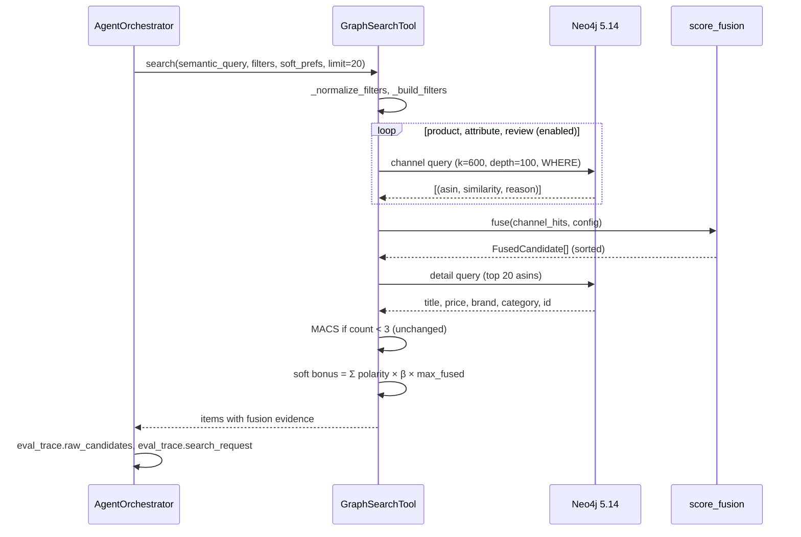

# Technical Specification: R1 — Rank-Based Multi-Channel Fusion (AFP-002 via RRF)

**Date**: 2026-10-17
**Author**: Product Manager Agent (@pm-specs)
**Status**: Approved 2026-10-17 (Gate #2). Open questions 1–3 resolved as recommended: `channel_depth = 100`; `sum_legacy` kept until the R2 thesis tables, then removed; `rrf3` stays the default until the R2 tuning split.
**Related Research**: `production_artifacts/Research_Report.md` (approved 2026-10-17), Vision decision 2026-10-17-013
**Roadmap**: Release R1 of `production_artifacts/action_items/Retrieval_Score_Redesign_Roadmap.md` (RS-01, RS-05, RS-02, RS-20 part)
**Branch**: `feature/afp-002-vector-aggregation`
**Previous specification**: The Phase A4 KECR specification previously at this path is preserved in git history (`git show f2d4939:production_artifacts/Technical_Specification.md`).

---

## 1. Executive Summary

`GraphSearchTool` ranks candidates by `sum(score)` over every product, attribute and review node that matches the query. A product with many attributes or reviews therefore collects many small scores and outranks better matches (hub bias). This specification replaces the sum with **one ranked list per channel**, where each product appears once with its best similarity (MaxP), and fuses the lists with **Reciprocal Rank Fusion** (`k = 60`, equal weights) in Python. The same per-channel lists feed four ablation arms (RRF over 2 channels, weighted RRF, convex combination, and the legacy sum), which the live evaluation compares on the same LLM-extracted search requests. The soft-preference bonus is rescaled to the fused-score range. Every candidate carries its per-channel ranks and similarities, and the evaluation adds `popularity-bias@K`, `type-precision@K` and per-strategy aggregates.

---

## 2. Requirements

### 2.1 Functional Requirements

| ID | Requirement | Priority | Description |
|----|-------------|----------|-------------|
| FR-001 | Per-channel MaxP lists | Must | Each enabled channel (`product`, `attribute`, `review`) runs one parameterised Cypher query that returns each `ParentProduct` **once**, with its maximum similarity in that channel and the reason text of that best match. Hard filters (`_build_filters`) are applied inside the channel query, before ranking. |
| FR-002 | Deterministic truncation | Must | Each channel list is ordered by `similarity DESC, parent_asin ASC` and truncated at `channel_depth` (default 100). |
| FR-003 | Competition ranking | Must | Within a channel, products with equal similarity share the best rank (1, 2, 2, 4). |
| FR-004 | RRF fusion (default) | Must | `score(p) = Σ_c w_c / (rrf_k + rank_c(p))` over enabled channels in which `p` appears. Defaults: `rrf_k = 60`, `w_c = 1.0`. A product absent from a channel gets 0 from it. |
| FR-005 | Ablation arms | Must | Named presets selectable per call and by environment variable: `rrf3` (default), `rrf2` (review channel off), `wrrf3` (weights 0.60 / 0.25 / 0.15), `cc3` (convex combination of per-channel min-max-normalised MaxP similarities, α = 1/3 each), `sum_legacy` (the current `sum(score)` Cypher, unchanged). |
| FR-006 | Fused ordering tie-break | Must | Fused candidates are sorted by `score DESC`, then number of channels matched `DESC`, then best similarity `DESC`, then `parent_asin ASC`. |
| FR-007 | Both search paths | Must | FR-001 … FR-006 apply to `_execute_hybrid_search` (with filters) and `_execute_vector_search` (no filters). `_execute_cypher_search` (filter-only) is unchanged. |
| FR-008 | Soft-bonus rescale | Must | Each matched soft preference adds `polarity × soft_bonus_unit`, where `soft_bonus_unit = β × max_fused_score(config)`, `β = 0.25`. For `sum_legacy` the unit stays 0.2. Matching rules (title / brand / match-reason substring, digit boundaries) are unchanged. |
| FR-009 | Fusion evidence on every item | Must | Each returned item keeps its current keys (`title`, `price`, `brand`, `category`, `score`, `id`, `asin`, `match_reasons`) and adds `fused_score`, `soft_bonus` and `fusion` = `{method, channels: {<channel>: {rank, similarity, reason}}}`. `match_reasons` holds the best reason of each channel the product appeared in. |
| FR-010 | Search request in `eval_trace` | Must | `AgentOrchestrator._execute_step` records `eval_trace["search_request"]` = the exact `search_kwargs` passed to `GraphSearchTool.search` (semantic query, catalog filters, soft preferences, limit). `search_metadata` gains the active fusion config. |
| FR-011 | Arm replay in evaluation | Must | `scripts/evaluate_retrieval.py --fusion-arms rrf2 wrrf3 cc3 sum_legacy` replays each SEARCH query's `search_request` through `orchestrator.graph_tool.search(..., fusion_config=FUSION_ARMS[arm])` and scores it as strategy `hybrid@<arm>`. Live mode only. |
| FR-012 | Per-strategy aggregates | Must | `evaluate_retrieval_batch` also returns `aggregates_by_strategy`. They are written to `summary.json` and logged per strategy. The existing pooled `aggregates` stay for backward compatibility and are labelled pooled in the log. |
| FR-013 | `popularity-bias@K` | Must | Share of the top-K candidates that belong to the review-embedded product set (products with ≥ 1 `Review` carrying an embedding; 5,715 on 2026-10-14). Fetched once per live run. The catalogue base rate is written to the manifest. |
| FR-014 | `type-precision@K` | Must | Share of the top-K candidates that satisfy the benchmark's requested category, using the same category predicate as `_build_filters` (taxonomy traversal or title match). The requested category comes from the benchmark item (`structured_filters.category`, else `category`), not from LLM extraction. |
| FR-015 | Regression checks | Must | Live-only tests replay `ret_021` and `ret_001` from `evaluations/benchmarks/retrieval_benchmark.json` (corrected 2026-10-17; the queries are not in `live_retrieval_benchmark.json`) through `GraphSearchTool` with `rrf3`. `ret_001`: Senso `B01G8JO5F2` is not ranked 1st and no fused score exceeds `max_fused_score` (AC-002.5 restated). `ret_021`: the C920 `B006JH8T3S` rank is **recorded as a diagnostic, not gated** (amended 2026-10-17, see §11). |
| FR-016 | Configuration | Should | `RETRIEVAL_FUSION_ARM` (default `rrf3`) selects the preset. An unknown name logs a warning and falls back to `rrf3`. Documented in `.env.example`. |

### 2.2 Non-Functional Requirements

| ID | Requirement | Target | Description |
|----|-------------|--------|-------------|
| NFR-001 | Latency | p50 hybrid search ≤ 1.5 × `sum_legacy` in the same run | 3 channel queries + 1 detail query replace one UNION query. Measured and reported per arm in the live eval. |
| NFR-002 | Determinism | Identical output for identical DB state and input | Fixed ordering keys in Cypher and Python; no randomness. |
| NFR-003 | Testability | Fusion logic testable without Neo4j | `score_fusion.py` is pure Python with no I/O. |
| NFR-004 | Safety | Parameterised Cypher only in new queries | Values travel as `$params`. The pre-existing interpolated category title condition is untouched (tracked as AI-11). |
| NFR-005 | Compatibility | No change to router, Critic, KECR, MACS logic | Consumers keep the same item keys; MACS still relaxes on `count < 3`. |
| NFR-006 | Neo4j version | Runs on Neo4j 5.14 | Uses `build_vector_search_query` (`db.index.vector.queryNodes`). Cypher 25 `VECTOR SEARCH` is out of scope (decision D-4). |

---

## 3. Architecture & Tech Stack

### 3.1 Technology Choices

| Layer | Technology | Justification |
|-------|-----------|---------------|
| Channel retrieval | Neo4j 5.14 vector indexes via `build_vector_search_query` | Unchanged indexes; one query per channel so each list is ranked after filters |
| Within-channel aggregation | Cypher `max(score)` (MaxP) | Standard passage-to-document aggregation (Dai & Callan, 2019) |
| Fusion | Pure Python (`src/tools/score_fusion.py`) | Unit-testable, exposes ranks for `eval_trace`, one set of lists feeds all arms |
| Configuration | Frozen `dataclass` presets + env var | Matches the project's env-driven config; no new dependency |
| Metrics | `numpy` (already used in `src/evaluation/metrics.py`) | No new dependency |

### 3.2 Component Architecture

```mermaid
flowchart LR
    Q[semantic_query + filters] --> E[EmbeddingService.embed_query]
    E --> P[product channel<br/>MaxP + WHERE]
    E --> A[attribute channel<br/>MaxP + WHERE]
    E --> R[review channel<br/>MaxP + WHERE]
    P --> F[score_fusion.fuse<br/>rank → RRF / CC]
    A --> F
    R -. off in rrf2 .-> F
    F --> D[detail query<br/>title, price, brand, category]
    D --> S[soft bonus<br/>β × max_fused]
    S --> O[items + fusion evidence<br/>→ MACS / Critic / eval_trace]
    Q -. sum_legacy arm .-> L[legacy UNION + sum(score)]
    L --> S
```

### 3.3 Integration with Existing System

- **`src/tools/graph_search_tool.py` — `GraphSearchTool`**: `_execute_hybrid_search` and `_execute_vector_search` delegate to a new `_execute_fused_search`, unless the config is `sum_legacy`, which keeps today's Cypher in `_execute_legacy_sum_search`. The additive scoring block in `search()` reads the unit from the active config.
- **`src/tools/score_fusion.py`** (new): data classes, presets and the fuser. No Neo4j import.
- **`src/agents/orchestrator.py` — `AgentOrchestrator._execute_step`**: adds `search_request` to `eval_trace` (STEP 3c). Candidates already flow into `eval_trace["raw_candidates"]`, so fusion evidence reaches the trace without further change. The Critic, KECR and the router are untouched.
- **`src/evaluation/metrics.py`**: two new metric functions; `evaluate_retrieval_batch` gains optional inputs and per-strategy aggregates.
- **`scripts/evaluate_retrieval.py`**: `--fusion-arms`, arm replay, review-embedded set, category matching, per-strategy logging.
- **Knowledge Graph**: read-only. No schema, index or data change.

---

## 4. API / Interface Design

### 4.1 New Interfaces (`src/tools/score_fusion.py`)

```python
CHANNELS: Tuple[str, ...] = ("product", "attribute", "review")

@dataclass(frozen=True)
class ChannelHit:
    """One product's best match inside one channel."""
    asin: str
    similarity: float
    reason: str

@dataclass(frozen=True)
class ChannelEvidence:
    """Rank and similarity of a fused candidate in one channel."""
    rank: int
    similarity: float
    reason: str

@dataclass(frozen=True)
class FusedCandidate:
    """A product after cross-channel fusion."""
    asin: str
    score: float
    channels: Dict[str, ChannelEvidence]

@dataclass(frozen=True)
class FusionConfig:
    """Fusion method, enabled channels and their parameters."""
    name: str = "rrf3"
    method: str = "rrf"                     # "rrf" | "cc" | "sum"
    channels: Tuple[str, ...] = CHANNELS
    weights: Dict[str, float] = field(default_factory=lambda: {c: 1.0 for c in CHANNELS})
    rrf_k: int = 60
    channel_depth: int = 100
    ann_k_per_limit: int = 30               # ANN k = limit × ann_k_per_limit (today's 600 at limit 20)
    soft_bonus_beta: float = 0.25

    def max_fused_score(self) -> float: ...       # rrf: Σ w_c/(k+1); cc: Σ α_c = 1.0; sum: nan (unbounded)
    def soft_bonus_unit(self) -> float: ...        # rrf/cc: β × max_fused_score(); sum: 0.2
    def to_dict(self) -> Dict[str, Any]: ...       # for metadata / manifest
    @classmethod
    def from_env(cls) -> "FusionConfig": ...       # RETRIEVAL_FUSION_ARM, fallback rrf3 with warning

FUSION_ARMS: Dict[str, FusionConfig]  # rrf3, rrf2, wrrf3, cc3, sum_legacy

def competition_ranks(hits: Sequence[ChannelHit]) -> Dict[str, ChannelEvidence]: ...
def fuse(channel_hits: Mapping[str, Sequence[ChannelHit]], config: FusionConfig) -> List[FusedCandidate]: ...
```

Behaviour notes:
- `competition_ranks` deduplicates by `asin` (keeps the highest similarity), sorts by `(-similarity, asin)` and assigns competition ranks. It is defensive against unsorted input, so `fuse` is order-independent.
- `fuse` ignores channels not in `config.channels`. CC normalises each channel's list with min-max; a constant list normalises to 1.0. CC weights are `weights` renormalised to sum to 1 over enabled channels.
- `fuse` raises `ValueError` for `method == "sum"`; the legacy arm never reaches it.

### 4.2 Modified Interfaces

| Interface | Change |
|---|---|
| `GraphSearchTool.__init__(db_connector, embedding_service, resolver, fusion_config: Optional[FusionConfig] = None)` | Stores `self.fusion_config = fusion_config or FusionConfig.from_env()`. |
| `GraphSearchTool.search(..., fusion_config: Optional[FusionConfig] = None)` | Per-call override, used by arm replay. Passed to the hybrid / vector paths and to the soft-bonus unit. |
| `GraphSearchTool._execute_hybrid_search(text, filters, raw_filters, limit, config)` | Routes to `_execute_fused_search` or `_execute_legacy_sum_search`. |
| `GraphSearchTool._execute_vector_search(text, limit, config)` | Same routing with no filters. |
| `GraphSearchTool._execute_fused_search(text, where_clauses, params, limit, config, strategy)` (new) | Runs channel queries, fuses, fetches details, returns the standard result dict. |
| `GraphSearchTool._execute_legacy_sum_search(...)` (new, private) | Today's UNION + `sum(score)` Cypher, moved verbatim. |
| `GraphSearchTool._build_channel_query(channel, where_str) -> str` (new) | Returns the channel Cypher (§5.2). |
| `GraphSearchTool.match_category(asins, category) -> Set[str]` (new, public) | Returns the subset of `asins` satisfying the `_build_filters` category predicate. Used by `type-precision@K`. |
| `GraphSearchTool.fetch_review_embedded_asins() -> Set[str]` (new, public) | Returns products with ≥ 1 embedded review. Used by `popularity-bias@K`. |
| `compute_popularity_bias_at_k(retrieved, popular, k) -> Optional[float]` (new, `metrics.py`) | `|top-k ∩ popular| / |top-k|`; `None` when nothing is retrieved. |
| `compute_type_precision_at_k(retrieved, in_type, k) -> Optional[float]` (new, `metrics.py`) | Same shape. |
| `evaluate_retrieval_batch(predictions, ground_truth, k_values, popular_asins: Optional[Set[str]] = None, type_match: Optional[Dict[str, Set[str]]] = None)` | Adds `popularity_bias@k` / `type_precision@k` per row when inputs are given, and `aggregates_by_strategy` (means skip `None`). |
| `scripts/evaluate_retrieval.py` CLI | New `--fusion-arms` (names from `FUSION_ARMS`, live mode only; unknown names are a CLI error). |

---

## 5. Data Model / State Management

### 5.1 New Data Structures

See §4.1. The returned item gains:

```python
{
  "asin": "B006JH8T3S", "title": "...", "price": 59.99, "brand": "Logitech",
  "category": ["Webcams"], "id": "4:...", 
  "score": 0.0451,                 # fused_score + soft_bonus (what everything downstream sorts by)
  "fused_score": 0.0328,
  "soft_bonus": 0.0123,
  "match_reasons": ["Product Title Match", "Attribute Match: Video Capture Resolution=1080p"],
  "fusion": {
    "method": "rrf3",
    "channels": {
      "product":   {"rank": 2,  "similarity": 0.781, "reason": "Product Title Match"},
      "attribute": {"rank": 14, "similarity": 0.702, "reason": "Attribute Match: ..."}
    }
  }
}
```

### 5.2 Data Flow

Channel query template (attribute channel shown; `<WHERE>` is the joined `_build_filters` clauses or `true`):

```cypher
CALL db.index.vector.queryNodes('attribute_embedding_index', $k, $vector)
YIELD node AS hit, score
MATCH (node:ParentProduct)-[:HAS_ATTRIBUTE]->(hit)
WHERE <WHERE>
WITH node, score,
     'Attribute Match: ' + hit.attribute_name + '=' + coalesce(hit.attribute_value, hit.normalized_value, '') AS reason
ORDER BY score DESC
WITH node, max(score) AS similarity, head(collect(reason)) AS reason
RETURN node.parent_asin AS asin, similarity, reason
ORDER BY similarity DESC, asin ASC
LIMIT $depth
```

- **product**: `YIELD node AS node, score` then `WHERE <WHERE>`; one row per product already; reason `'Product Title Match'`.
- **review**: `MATCH (hit)-[:ABOUT_PRODUCT]->(node:ParentProduct)`; reason `'Review Match: ' + coalesce(hit.review_title, '')`.
- Channel weights 0.8 / 0.9 are dropped: ranks make them meaningless; per-channel weights live in `FusionConfig.weights`.

Detail query for the fused top `limit`:

```cypher
MATCH (node:ParentProduct) WHERE node.parent_asin IN $asins
OPTIONAL MATCH (node)-[:HAS_BRAND]->(b:Brand)
OPTIONAL MATCH (node)-[:BELONGS_TO_CATEGORY]->(c:Category)
RETURN node.parent_asin AS asin, node.title AS title, node.price AS price, b.name AS brand,
       collect(DISTINCT c.name) AS category, elementId(node) AS id
```

Items are assembled in fused order; an ASIN missing from the detail result (deleted between queries) is dropped and logged.



### 5.3 State Changes

- `ConversationState` / `SessionContext`: none.
- `eval_trace`: new key `search_request`; `search_metadata` gains `fusion` (`FusionConfig.to_dict()`) and `channel_queries` (`{channel: cypher}`); `cypher` holds the channel queries joined with `// channel: <name>` headers so the existing telemetry print still works.
- Evaluation artifacts: `summary.json` gains `aggregates_by_strategy`; the manifest gains `fusion_default`, `fusion_arms` and `catalog_popular_share`.

---

## 6. Implementation Phases

| Phase | Scope | Dependencies | Estimated Effort |
|-------|-------|-------------|-----------------|
| 1 | `score_fusion.py` + `tests/test_score_fusion.py` | — | S |
| 2 | `GraphSearchTool` channel queries, fused path, legacy path, soft-bonus unit, `match_category`, `fetch_review_embedded_asins` + mocked tests | 1 | M |
| 3 | Orchestrator `search_request`; metrics; eval script arms, per-strategy aggregates; `.env.example` | 2 | M |
| 4 | Live regression tests (`RUN_LIVE_TESTS=1`) and the live eval for all arms (Anaconda Python, `--mode live`) | 3 | S (+ run time) |

---

## 7. File Structure

### New Files
- `src/tools/score_fusion.py` — fusion data classes, presets, `competition_ranks`, `fuse`.
- `tests/test_score_fusion.py` — pure unit tests for fusion (AC-001 … AC-006).
- `tests/test_retrieval_metrics_r1.py` — tests for the two new metrics and per-strategy aggregates.
- `tests/integration/test_fusion_live_regression.py` — `ret_021` / `ret_001` live checks, skipped unless `RUN_LIVE_TESTS=1`.

### Modified Files
- `src/tools/graph_search_tool.py` — fused search path, legacy arm, soft-bonus unit, two helper queries.
- `src/agents/orchestrator.py` — `eval_trace["search_request"]`.
- `src/evaluation/metrics.py` — new metrics, optional inputs, `aggregates_by_strategy`.
- `scripts/evaluate_retrieval.py` — `--fusion-arms`, replay, metric inputs, per-strategy logging, manifest fields.
- `tests/test_graph_search_tool.py` — fused-path tests with a mocked session (AC-007 … AC-011).
- `tests/test_agent_orchestrator.py` — `search_request` present in `eval_trace` (AC-012).
- `.env.example` — `RETRIEVAL_FUSION_ARM`.

---

## 8. Acceptance Criteria

| ID | Criterion | Verification Method |
|----|-----------|-------------------|
| AC-001 | A product matched by 50 attribute nodes gets exactly the same channel contribution as one matched by 1 node with the same best similarity. | Unit test (`fuse`) and Cypher inspection (`max(score)`, one row per product) |
| AC-002 | RRF score equals `Σ w_c / (60 + rank_c)` for a hand-computed 3-channel example (incl. the brainstorm's `ret_021` six-product example: order QuickCam, Mic, C920, NoName, Ring, Cover for `rrf3`; C920, NoName, Mic, QuickCam, Cover, Ring for `rrf2`). | Unit test |
| AC-003 | Tied similarities receive competition ranks (1, 2, 2, 4); output order is identical under any permutation of input lists. | Unit test |
| AC-004 | `rrf2` ignores review hits; `wrrf3` applies 0.60 / 0.25 / 0.15; `cc3` min-max-normalises, maps a constant list to 1.0 and stays within [0, 1]. | Unit test |
| AC-005 | `max_fused_score` is `3/61` for `rrf3`, `2/61` for `rrf2`, `1/61` for `wrrf3`, `1.0` for `cc3`; no fused score exceeds it. | Unit test |
| AC-006 | `RETRIEVAL_FUSION_ARM` selects the preset; an unknown value logs a warning and yields `rrf3`. | Unit test (`monkeypatch`) |
| AC-007 | With mocked channel results, `search()` returns items in fused order with `fused_score`, `soft_bonus`, `fusion.channels[*].rank/similarity` and the original keys. | Unit test (mocked session) |
| AC-008 | The soft bonus of one matched preference at polarity 1.0 equals `0.25 × max_fused_score`; a candidate trailing by more than `n_matched × unit` cannot overtake. `sum_legacy` keeps the 0.2 unit. | Unit test |
| AC-009 | `sum_legacy` executes Cypher containing `sum(score)`; the default path contains no `sum(score)` and runs one query per enabled channel plus one detail query. | Unit test (captured Cypher) |
| AC-010 | New channel and detail queries carry user values only as parameters (`$vector`, `$k`, `$depth`, `$asins`, filter params). | Unit test (captured Cypher + params) |
| AC-011 | MACS still triggers on `< 3` results through the fused path and records `relaxed_constraints`. | Unit test (mocked session) |
| AC-012 | `eval_trace["search_request"]` equals the kwargs passed to `GraphSearchTool.search`, and `search_metadata["fusion"]["name"]` is the active arm. | Unit test (`test_agent_orchestrator.py`) |
| AC-013 | `compute_popularity_bias_at_k` / `compute_type_precision_at_k` return the correct share, `None` for empty input; `aggregates_by_strategy` has one entry per strategy and skips `None`. | Unit test |
| AC-014 | Live: Senso `B01G8JO5F2` not 1st for `ret_001`; all fused scores ≤ `max_fused_score`. The C920 `B006JH8T3S` rank for `ret_021` is recorded (diagnostic; amended 2026-10-17, see §11). | Live integration test (`RUN_LIVE_TESTS=1`) |
| AC-015 | Live eval (`--mode live --fusion-arms rrf2 wrrf3 cc3 sum_legacy`, Anaconda Python) completes and reports, per strategy: HR@1/5/10/20, strict NDCG@5, MRR, `popularity-bias@{5,20}`, `type-precision@{5,20}`, p50 latency. Compared against the hybrid-only baseline of `eval_2026-10-09_1336` (HR@1 0.048, HR@5 0.190, HR@10 0.238, HR@20 0.381, strict NDCG@5 0.110, MRR 0.100) and against `hybrid@sum_legacy` in the same run. `popularity-bias@20` of `hybrid` (rrf3) is lower than `hybrid@sum_legacy`. Results are reported as measured, whether or not hit rate improves. | Live eval run + report |
| AC-016 | Full existing test suite passes (`python -m pytest tests/ -v --tb=short`). | Test run |

---

## 9. Risks & Mitigations

| Risk | Impact | Probability | Mitigation |
|------|--------|-------------|-----------|
| RRF does not beat a tuned convex combination (Bruch et al., 2023). | Medium | Medium | `cc3` runs as an arm from the same lists; no tuning before the R2 split. |
| Attribute ties: one attribute node links up to 20,969 products, so the cut at `channel_depth` inside a tie group falls by `parent_asin`, not relevance. | Medium | High | Competition ranking keeps tied products equal; other channels separate them. The real fix is IDF / AND-matching (RS-03, R3). Reported as a known limitation. |
| ANN-before-filter: `k = 600` nodes may contain few eligible products under tight filters, so channel lists are short and MACS fires. | Medium | Medium | Unchanged from today; ranking after the filter at least keeps ranks honest. Fixed by adaptive order (RS-07, R3). |
| Review channel favours the 2.2% review-embedded products. | Medium | High | `rrf2` arm and `popularity-bias@K` measure it. |
| Latency: four round trips instead of one. | Low | Medium | Same session, small result sets (`LIMIT $depth`); NFR-001 measured per arm. |
| 21 queries are too few to choose a default arm. | High | High | R1 does not switch the default on these numbers; choice deferred to R2 (Open Question 3). |

---

## 10. Open Questions

1. **Channel depth**: default `channel_depth = 100` (5 × the 20-candidate limit), ANN `k` stays 600. Acceptable?
2. **Legacy arm lifetime**: keep `sum_legacy` in code until the R2 thesis tables are produced, then remove? (Recommended: yes.)
3. **Default arm**: keep `rrf3` as the default regardless of the R1 numbers, and choose the final default only on the R2 tuning split? (Recommended: yes; 21 queries cannot support the choice.)

---

## 11. Amendments During Implementation (2026-10-17)

1. **C920 check (AC-002.4) is a diagnostic, not a gate.** Live diagnosis showed fusion cannot satisfy it:
   - The category filter rejects the C920 for "Webcams": its title says "Webcam" and its only category is "Computers". 22 products pass "Webcams", 742 pass "Webcam".
   - Even when eligible, its title similarity to the query is 0.547 (0.551 for the raw utterance), rank 114 of 742 under exact scoring; AFP-002's 0.773 does not reproduce with the current embeddings.
   - A rule-based English plural fix was implemented and **rejected by the user**: it does not extend to other domains (fashion, cosmetics) and mishandles cases such as glasses/glass. It was reverted. Domain-agnostic product-type matching is scheduled as **RS-24** in R3 (roadmap).
2. **Filter-only bonus unit.** `_execute_cypher_search` scores are on a Bayesian-rating scale (≈ 25), so filter-only results keep the 0.2 bonus unit; only fused results use `β × max_fused_score`. Consistent with FR-007 (filter-only path unchanged).
3. **Arm replay order** rotates per query in `scripts/evaluate_retrieval.py`, so no arm always runs first (first-run latency biased `rrf3` in `eval_2026-10-17_1846`).
4. **Spurious CLARIFY** on 4 of 21 queries (missed category extraction) is out of R1 scope and scheduled as **RS-23** in R2.

