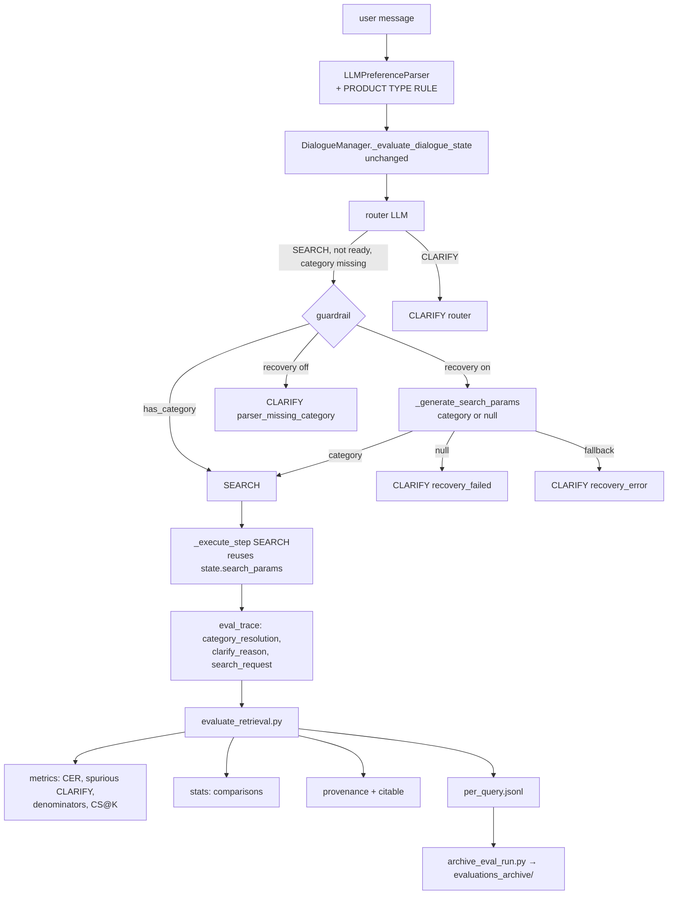

# Technical Specification: R2a — Evaluation Metrics, Spurious-CLARIFY Fix (RS-23) and Citable Run Archive

**Date**: 2026-10-18
**Author**: Product Manager Agent (@pm-specs)
**Status**: Approved 2026-10-18 (Gate #2). Appendix A annotations approved; open questions 1–8 resolved as recommended. Amendments added 2026-10-18 post-audit (§13): A-1 … A-10 record the accepted engineer deviations and QA findings; A-11 records the H-1 decision, **option (c)** (`product_type_decided` flag, new FR-007a).
**Related Research**: `production_artifacts/Research_Report.md` (R2, approved 2026-10-18 at Gate #1; decisions R2-D1 … R2-D8), Vision decisions 2026-10-18-014+ (R2)
**Roadmap**: Release R2a of `production_artifacts/action_items/Retrieval_Score_Redesign_Roadmap.md` (RS-23, RS-20 rest, run archiving; prepares RS-21 / RS-02 for R2b)
**Branch**: `feature/afp-002-vector-aggregation` (or a follow-up branch cut from it)
**Previous specification**: The R1 specification (rank-based multi-channel fusion) previously at this path is preserved in git history (`git show 9cbf426:production_artifacts/Technical_Specification.md`).

---

## 1. Executive Summary

Four to five of the 21 legacy queries name a product type plainly but end as CLARIFY. The parser puts the head noun of a long noun phrase into `situational_context` instead of a `category` hard constraint. `DialogueManager._evaluate_dialogue_state` then marks the turn not ready, and the guardrail in `AgentOrchestrator._decide_next_step` switches the router's SEARCH to CLARIFY. The second category source, `_generate_search_params`, never runs on such turns.

R2a fixes this in two layers, both domain-agnostic:
- **Option A**: a product-type (head-noun) rule, a consistency rule and one long-modifier example in the extraction prompt. Example 1 no longer puts `operating_system` into `hard_constraints`.
- **Option C**: a category-recovery step before the guardrail clarifies. The recovered search parameters are reused by the SEARCH branch, so no turn calls `_generate_search_params` twice.

It also fixes the "1500 → 150" line in `SEARCH_GENERATION_PROMPT`.

On the evaluation side, R2a adds:
- category-extraction recall, target-admitting category rate, spurious-CLARIFY rate and clarification recall;
- an explicit denominator on every aggregate;
- three-valued constraint-satisfaction@K against hand-annotated gold constraints for the 21 legacy queries;
- a seeded statistics helper with pre-registered arm comparisons;
- a hardened run manifest with a `citable` flag, and a git-tracked `evaluations_archive/`.

The exit gate is zero spurious CLARIFY on legacy-21 in each of three repeated live runs at one clean commit.

---

## 2. Requirements

### 2.1 Functional Requirements

#### A. RS-23 option A: extraction prompt (`src/llm_interface/prompts/preference_extract_prompt.py`)

| ID | Requirement | Priority | Description |
|----|-------------|----------|-------------|
| FR-001 | Product-type rule | Must | Add the rule text in §4.1.1 (`PRODUCT_TYPE_RULE`) to rule 4.A. When the user names the kind of product, the parser must emit `{"attribute": "category", "operator": "include", "value": <head noun in the user's words>}`. All modifiers go to `soft_preferences`. The rule has no category list, no plural, singular or lemma instruction, and no word from the legacy-21 product types. |
| FR-002 | Long-modifier example | Must | Add `<example_7>` (§4.1.3, `LONG_MODIFIER_EXAMPLE`): a product with seven modifiers whose head noun becomes `category` and whose modifiers become soft preferences. **Contamination rule**: the example must not come from any legacy-21 utterance and must not use a legacy-21 product type (webcam, camera, bundle, smartphone, phone, iPhone, charger, adapter, mouse, headphones, earbuds, laptop, Chromebook, keyboard). |
| FR-003 | Remove the taxonomy contradiction | Must | In `<example_1>`, remove the `operating_system` hard constraint. Add it to `soft_preferences` as `{"category": "operating_system", "value": "ChromeOS", "polarity": -1.0, "confidence": 1.0, "evidence": "I definitely do not want ChromeOS"}`. After the change, every hard constraint in every example passes `validate_hard_constraint` (`src/llm_interface/preference_parser.py`). |
| FR-004 | Consistency rule | Must | Add the rule text in §4.1.2 (`CATEGORY_CONSISTENCY_RULE`) to rule 5. If the message or the parser's own `situational_context` names a product type, a `category` hard constraint is required and `category` must not appear in `missing_critical_attributes`. `category` may be listed as missing only when the user has not decided what kind of product to buy. |
| FR-005 | Schema-injection hint | Should | `LLMPreferenceParser._default_system_prompt` adds one sentence to the `<schema_injection>` block: "The product type the user names is the `category` hard constraint (see PRODUCT TYPE RULE); only its modifiers are soft_preferences." This balances the block's existing "ALL other specifications MUST be classified as soft_preferences". |

#### B. RS-23 option C: category recovery (`src/agents/orchestrator.py`, `src/agents/state.py`)

| ID | Requirement | Priority | Description |
|----|-------------|----------|-------------|
| FR-006 | Recovery before clarifying | Must | When the router returns SEARCH, the turn is not ready, and `"category"` is in `missing_critical_attributes`, `_decide_next_step` checks the category sources in order. (1) `has_category` (active filters, `current_context.category`, an extracted hard constraint): if true, the action stays SEARCH. (2) Otherwise, if recovery is enabled, it calls `_generate_search_params` once. If the result's `structured_filters` contain a usable category (`_category_from_filters`, §4.2.2), the action stays SEARCH. (3) Otherwise the action becomes CLARIFY. _Amended (§13, A-1): `has_category` is the first usable value from the session hard constraints, then `active_filters`, then `current_context.category`; it is shared by the guardrail, the brand immunisation and `parser_category`. Amended (§13, A-11): in step (2) a category counts only when `product_type_decided` is `true` (FR-007a)._ |
| FR-007 | Null category in search params | Must | `SEARCH_GENERATION_PROMPT` gains a rule: `category` is the product type the user asked for, in the user's own words, or `null` when the user has not decided. It must never be guessed (§4.2.3). The fallback branch of `_generate_search_params` (exception, unparsable JSON, or an `"Error: ..."` string from `SimpleLLMHandler.aquery`) returns `"param_source": "fallback"`. Successful parses return `"param_source": "llm"`. _Amended (§13, A-11): the null rule alone did not stop a guessed category (H-1); FR-007a adds the `product_type_decided` flag that recovery requires._ |
| FR-007a | Product-type-decided flag (added 2026-10-18, §13 A-11) | Must | `SEARCH_GENERATION_PROMPT` output gains a top-level boolean `product_type_decided`, produced by the same call (no extra LLM call). `_recover_category` uses the recovered category only when the flag is strictly `true`. Full definition in §13, A-11. |
| FR-008 | One search-param call per turn | Must | `_decide_next_step` stores the recovery result in `state["search_params"]`. The SEARCH branch of `_execute_step` uses `state["search_params"]` when it is set and calls `_generate_search_params` only when it is `None`. Both call sites build the history text with the same helper, `_search_history_text(state)` (the last 6 messages, as in `_execute_step` today). The SEARCH branch then merges filters, demotes specs and builds the request exactly as today. |
| FR-009 | Attribution in `eval_trace` | Must | Every SEARCH and CLARIFY result carries `eval_trace["clarify_reason"]` and `eval_trace["category_resolution"]` (§5.1.1). Values of `clarify_reason`: `null` (SEARCH); `"router"` (the router chose CLARIFY); `"router_fallback"` (router JSON error, and the dialogue fallback is CLARIFY); `"parser_missing_category"` (guardrail fired with recovery disabled, the pre-R2 behaviour); `"recovery_failed"` (recovery ran and returned no category); `"recovery_error"` (the recovery call fell back; fails closed to CLARIFY). SEARCH results also record `search_params_source` (`"recovery"` or `"search_branch"`), `search_params_fallback` (bool) and `relaxed_constraints` (MACS output, `[]` if none). _Amended (§13, A-11): `"recovery_failed"` also covers the new recovery outcome `"undecided"` (flag not `true`); the `CLARIFY_REASONS` set is unchanged._ |
| FR-010 | Recovery switch | Should | `AgentOrchestrator.__init__(..., category_recovery: Optional[bool] = None)`. `None` reads the env var `ORCH_CATEGORY_RECOVERY` (default `"1"`; `"0"`, `"false"` or `"no"` disable it). Disabled reproduces the pre-R2 guardrail exactly, with `clarify_reason = "parser_missing_category"`. Documented in `.env.example`. Purpose: a pre-fix baseline for clarification recall in R2b. |
| FR-011 | "1500 → 150" fix | Must | In `SEARCH_GENERATION_PROMPT`, replace `- If user says "actually under 1500", UPDATE \`price_max\` to 150.` with `- If user says "actually under 1500", UPDATE \`price_max\` to 1500.` Add `- Copy numbers exactly as the user states them; never rescale, round or convert units.` The first line `YOUR GOAL: Help the user find the perfect product by translating their request into search arguments.` stays unchanged (test doubles match on it). |

#### C. Gold annotations (`live_eval_dataset.json`, `src/evaluation/constraint_satisfaction.py`)

| ID | Requirement | Priority | Description |
|----|-------------|----------|-------------|
| FR-012 | Gold schema | Must | Each benchmark item may carry `type_explicit` (bool), `gold_action` (`"SEARCH"` or `"CLARIFY"`), `gold_product_type` (str, informational), `gold_constraints` (list, §5.1.3) and `gold_annotation` (provenance block). `validate_gold_annotations(benchmark) -> List[str]` returns schema errors. `scripts/evaluate_retrieval.py` exits 1 on any error. Items without these fields are valid (backward compatible); their dialogue and CS metrics are excluded with the `n` shown. |
| FR-013 | Legacy-21 hand annotation | Must | Add the annotations in **Appendix A** to all 21 items. They are derived **from the utterance text only**, never from `structured_filters`, `preferences`, `target_title` or other target-derived fields. Existing fields stay unchanged. `graph_attribute_names` for numeric constraints is the only field filled from graph data (§5.1.4), in implementation Phase 2. _See also §13, A-10 (titled review-coverage base rate in the manifest; the audit lists it under FR-013)._ |

#### D. Dialogue and denominator metrics (`src/evaluation/dialogue_metrics.py`, `src/evaluation/metrics.py`)

| ID | Requirement | Priority | Description |
|----|-------------|----------|-------------|
| FR-014 | Category-extraction recall (CER) | Must | Among queries with `type_explicit = true`: **parser-only CER** is the share whose `session_context` hard constraints contain a category (`attribute` ∈ `CATEGORY_FILTER_KEYS`, non-null value). **Pipeline CER** is the share whose `category_resolution.category` is non-null, else whose `search_request.structured_filters` has a category. Both are reported as `{value, numerator, n}`. |
| FR-015 | Target-admitting category rate | Must | Among SEARCH queries whose search request carried a category: the share where the target ASIN satisfies the category predicate as applied, i.e. `GraphSearchTool.match_category([target], normalized_category, raw_category=request_category)`. `normalized_category` is read from `metadata["normalized_filters"]` (new, FR-016), and `request_category` from `search_request.structured_filters`. Reported as `{value, numerator, n}` plus `category_dropped_by_macs` (the count of queries where MACS removed the category). |
| FR-016 | Applied-filter telemetry | Must | `GraphSearchTool.search` writes `result["metadata"]["normalized_filters"]`, a copy of the filters after `_normalize_filters` and before MACS relaxation. `match_category(asins, category, raw_category: Optional[str] = None)` passes `{"category": category}` and `{"category": raw_category or category}` to `_build_filters`. The default call is unchanged. |
| FR-017 | Spurious-CLARIFY rate | Must | Spurious-CLARIFY rate = CLARIFY on `type_explicit` queries / `type_explicit` queries, as `{value, numerator, n, query_ids, by_reason}`. Also reported: `type_explicit_non_search` (ANSWER, ERROR or other non-SEARCH actions on `type_explicit` queries). _Amended (§13, A-5): `type_explicit_non_search` counts actions that are neither SEARCH nor CLARIFY._ |
| FR-018 | Clarification recall | Must | Clarification recall = CLARIFY on `gold_action = "CLARIFY"` queries / `gold_action = "CLARIFY"` queries. Clarification precision = gold-CLARIFY queries among all CLARIFY actions. Both have `value = null` and are logged as `n/a (n=0)` when the denominator is 0. That is the case for legacy-21, where every `gold_action` is SEARCH. _Amended (§13, A-9): the precision denominator is CLARIFY actions on gold-annotated queries._ |
| FR-019 | Explicit denominators | Must | (a) Every strategy block in `aggregates_by_strategy` gains `n_all`, `n_search` and a `search_only` sub-block with the same HR, NDCG, MRR and recall means over SEARCH rows only. (b) Every share metric that skips `None` (`popularity_bias@k`, `type_precision@k`, all `cs_*@k`) gains an `n_<metric>@k` count. (c) **All-queries rule**: CLARIFY on a `type_explicit` query scores 0 (a miss, as today). On a `gold_action = "CLARIFY"` query, `hit@k`, `strict_ndcg@k` and `mrr` score 1.0 if the action is CLARIFY and 0.0 otherwise; such rows carry `scored_as: "clarify_gold"`. (d) `search_intersection(records_by_run) -> Set[str]` returns the query IDs that were SEARCH in every run, and `aggregate_rows(rows, k_values)` recomputes the strategy block on any subset. Rows without an `action` key count as SEARCH (offline and legacy predictions). _Amended (§13, A-3): in (c), `strict_hit@k` is also overridden; `soft_hit@k`, `graded_ndcg@k` and `recall@k` are not, and are decided before R2b._ |
| FR-020 | Review-coverage label | Must | Keep the key `popularity_bias@k`. `summary.json["metric_labels"]["popularity_bias"]` reads `"review-coverage-bias@K: share of top-K from products with >= 1 embedded review (not popularity)"`. Log lines print `RevCovBias@K`. The docstring of `compute_popularity_bias_at_k` is updated to match. _Amended (§13, A-10): the manifest also reports the titled-only base rate._ |
| FR-021 | `target_review_embedded` tag | Must | Each per-query row gets `target_review_embedded = primary_target in popular_asins` (`None` when `popular_asins` is not given). Each strategy block gains `by_target_review_embedded: {"true": {...}, "false": {...}}`, each with `n` and HR@{5,20}, MRR and strict NDCG@10. |

#### E. Constraint-satisfaction@K (RS-20 rest)

| ID | Requirement | Priority | Description |
|----|-------------|----------|-------------|
| FR-022 | Three-valued verdicts | Must | `judge(facts, constraint) -> "satisfied" | "violated" | "unknown"` for each (item, constraint), following the truth table in §4.4.2. Supported kinds: `price`, `brand` (include / exclude) and `numeric`. Category is excluded (covered by `type_precision@K`). Missing facts for an item give `unknown`. |
| FR-023 | CS aggregates | Must | Per query, per strategy and per K, over the deduplicated top-K items × constraints: `cs_sat@k`, `cs_viol@k`, `cs_unk@k` (shares of verdicts); `cs_known@k = sat / (sat + viol)` (`None` if 0); `violation_free@k` (share of items with no violation); `cs_coverage@k = 1 − cs_unk@k`. A query with 0 items or 0 constraints gives `None` and is counted out via `n_*`. Means skip `None`. _Amended (§13, A-4): exact key names._ |
| FR-024 | Two flavours | Must | **Gold**: keys `cs_*@k`, using `gold_constraints` (end to end: parser misses and MACS widening count). **Request**: keys `cs_req_*@k`, using constraints derived from `search_request.structured_filters` by `constraints_from_search_request` (§4.4.3). This flavour is diagnostic retrieval adherence. Both are computed for every strategy, including the arm replays. _Amended (§13, A-4): `violation_free@k` has no `cs_` prefix in the gold flavour; the request flavour prefixes every key with `cs_req_`, including `cs_req_violation_free@k`._ |
| FR-025 | Batched fact fetch | Must | `GraphSearchTool.fetch_constraint_facts(asins, attribute_names) -> Dict[str, Dict[str, Any]]` runs **one** parameterised Cypher per query over the union of all strategies' top-`max_k` ASINs (§5.2.1). It returns price, title, brand names, and the `numeric_value`s of attributes whose lower-cased `attribute_name` is in `attribute_names`. |
| FR-026 | Gold-vs-target pre-flight | Should | In live mode, before the query loop, the target of each item is judged against its gold constraints. Violations are logged as warnings and written to `manifest.configuration.gold_target_check = {checked, violations: [{query_id, constraint, verdict}]}`. They are not fatal, but QA reports any violation to the user (annotation error or bad benchmark item). _Amended (§13, A-8): `gold_target_check` also has `constraints` and `unknown`._ |

#### F. Statistics (`src/evaluation/stats.py`, `scripts/evaluate_retrieval.py`)

| ID | Requirement | Priority | Description |
|----|-------------|----------|-------------|
| FR-027 | Statistics helper | Must | Pure Python, NumPy and the `statistics` stdlib only (no SciPy import; §4.5). Functions: `paired_randomization_test`, `paired_bootstrap_ci`, `mcnemar_exact`, `wilson_ci`, `holm_correction`. Every function is seeded and deterministic. |
| FR-028 | Pre-registered comparisons | Must | `summary.json["comparisons"]` (§5.1.6). **Primary**: (`hybrid@rrf3`, falling back to `hybrid`, vs `hybrid@sum_legacy`) and (`hybrid@rrf2` vs `hybrid@rrf3`). Each is computed on the SEARCH-only population of the run, for RR and strict NDCG@10 (randomization p-value and bootstrap 95% CI of the mean difference) and HR@5 / HR@20 (per-arm Wilson 95% CI, discordant counts, exact McNemar p-value). Primary p-values are reported unadjusted. **Secondary**: every other pair of replayed arms, randomization test on RR, Holm-adjusted within that family. A missing arm gives `"status": "arm_missing"`. Comparisons also appear in the log. |

#### G. Provenance, citable runs and archive

| ID | Requirement | Priority | Description |
|----|-------------|----------|-------------|
| FR-029 | Manifest provenance | Must | `src/evaluation/provenance.py` collects the `manifest["provenance"]` fields in §5.1.5:
- `git_commit`;
- `git describe --always --dirty`;
- `git_dirty` and `git_dirty_paths` (scope `src/`, `scripts/`);
- SHA-256 of `git diff HEAD -- src scripts`;
- untracked files under `src/` and `scripts/`;
- benchmark path, SHA-256, git-dirty flag and query count;
- LLM alias and resolved model IDs;
- Neo4j name, version and edition;
- a graph snapshot (products, categories, reviews, review-embedded products);
- Python version and executable.

The top-level `git_commit` stays for compatibility. _Amended (§13, A-8): provenance also records `git_scope`._ |
| FR-030 | Citable flag and dirty-tree policy | Must | `manifest["citable"] = true` only if all of these hold: mode `live`; no `--sample-size`; `git_dirty = false`; the benchmark file is tracked and unmodified. Otherwise `false`, with each failing condition in `citable_reasons`. Non-blocking issues go to `citable_warnings` (e.g. `model_id_unresolved`, `multiple_model_ids`). By default the eval logs a warning on a dirty tree and continues. `--require-clean` refuses to run, with exit code 2, **before** the orchestrator is built, listing the offending paths. _Amended (§13, A-8): `--require-clean` also refuses a dirty or untracked benchmark._ |
| FR-031 | Resolved model ID | Must | `SimpleLLMHandler` stores `self.model_name` and `self.resolved_model_ids: Set[str]`, plus `record_response_model(response) -> None`, which reads `response.response_metadata.get("model_name")`. `query` and `aquery` call it. `LLMPreferenceParser.extract_preferences` calls `getattr(self.llm_handler, "record_response_model", None)` on the tool-call result. Test doubles without the method are tolerated. |
| FR-032 | Per-query JSONL | Must | Every run writes `per_query.jsonl`, one compact line per query (§5.1.7), via `tracker.write_per_query_jsonl(run_dir, records)`. `manifest.artifacts_generated` lists it. |
| FR-033 | Archive script and directory | Must | `scripts/archive_eval_run.py <run_id>` (§4.6) copies `manifest.json`, `summary.json`, `retrieval_metrics.csv` and `per_query.jsonl` into git-tracked `evaluations_archive/<run_id>/`, and writes `ARCHIVE.json`: the SHA-256 of each copied file, the SHA-256, byte size and line count of `execution_trace.log` (the trace itself is not copied), `archived_at` and `archived_from_commit`. It refuses non-citable or non-live runs unless `--legacy --note "<text>"` is given, refuses to overwrite unless `--force`, and updates `evaluations_archive/index.json`. |
| FR-034 | `.gitignore` | Must | Append `!/evaluations_archive/**/*.csv`, because the global `*.csv` rule would otherwise hide archived CSVs. Append `scripts/graph_ingestion/.ingest_checkpoint.json`: this untracked runtime file under `scripts/` would otherwise mark every run non-citable. `/evaluations/*` stays ignored. |
| FR-035 | Retroactive archive | Must | Archive `eval_2026-10-09_1336`, `eval_2026-10-17_1846` and `eval_2026-10-17_1937` with `--legacy`, `citable: false` and the notes in §4.6.3. Their `per_query.jsonl` is rebuilt from `retrieval_metrics.json` plus the `<<< [END QUERY i/n] ID: … | Status: …` lines of `execution_trace.log`, and marked `legacy_reconstructed: true`. |
| FR-036 | Gate checker | Must | `scripts/check_eval_gate.py --runs <id> <id> <id> [--evaluations-dir evaluations] [--max-spurious-clarify 0]` (§7) checks the R2a exit gate on run directories (or archive folders). It prints a per-run table and the cross-run SEARCH intersection, and exits 0 (PASS) or 1 (FAIL). _Amended (§13, A-8): it fails when fewer than 3 runs are given._ |
| FR-037 | Ambiguous smoke check | Should | `tests/integration/test_category_recovery_live.py` (skipped unless `RUN_LIVE_TESTS=1`) runs the five ambiguous utterances in §7.4 through `AgentOrchestrator`, with recovery on and then off. It records the CLARIFY count and `clarify_reason` per utterance as a diagnostic print. It asserts only that the run completes; it is not a gate, because the outcome is non-deterministic. _Amended (§13, A-11): run once after each gate run and reported as "CLARIFY k/5 with recovery on / off"; the test also prints the new `category_resolution` keys._ |

### 2.2 Non-Functional Requirements

| ID | Requirement | Target | Description |
|----|-------------|--------|-------------|
| NFR-001 | LLM-call budget | ≤ 1 `_generate_search_params` call per turn; +1 call only on guardrail turns that end in CLARIFY | A recovered SEARCH turn makes the same number of LLM calls as a normal SEARCH turn, because of reuse (FR-008). Verified by counting calls in unit tests. |
| NFR-002 | Determinism | Identical outputs for identical inputs | The statistics take an explicit seed (default `20261018`), and exact enumeration is used where specified. Verdicts and aggregates are pure functions. |
| NFR-003 | No new dependencies | `requirements.txt` unchanged | NumPy, pandas (already used by `tracker.py`) and the stdlib (`statistics.NormalDist`, `math.comb`, `hashlib`, `subprocess`, `platform`). |
| NFR-004 | Cypher safety and version | Parameterised; Neo4j 5.14 | New queries (facts, provenance counts) pass values only as `$params`. They use pattern comprehensions and `dbms.components()`, both valid on 5.14. The pre-existing interpolated category title condition is untouched (AI-11). |
| NFR-005 | Backward compatibility | 453 existing tests pass; R1 arm replay unchanged | Existing `summary.json` and `aggregates_by_strategy` keys keep their meaning, and new keys are additive. `hybrid` and `hybrid@rrf3` stay identical per SEARCH query. Benchmarks without gold fields still run. |
| NFR-006 | Domain-agnostic | No vocabulary, lemma or plural rules | The prompt rules, the recovery step and the verdict logic contain no product-category lists and no English inflection rules. The only vocabulary is the per-constraint `graph_attribute_names` for the 21 legacy items, which is evaluation data, not system logic. |
| NFR-007 | Evidence validity | Live mode only | Only `--mode live` runs can be `citable` or archived without `--legacy`. Offline runs are always `citable: false`. |
| NFR-008 | Reporting | Every aggregate carries its `n` | Applies to logs, `summary.json` and the gate output. No share is printed without its denominator. |
| NFR-009 | Archive size | ≤ 1 MB per legacy-21 run | Compact JSONL (top-20 per strategy, one verdict string per item). `execution_trace.log` and `retrieval_metrics.json` are not archived. |
| NFR-010 | No secrets in artifacts | — | Provenance never dumps environment variables. It records only git output, file hashes, versions and counts. |

---

## 3. Architecture & Tech Stack

### 3.1 Technology Choices

| Layer | Technology | Justification |
|-------|-----------|---------------|
| Extraction fix | Prompt text in `preference_extract_prompt.py` | Option A (R2-D4): domain-agnostic and cheap; its non-determinism is handled by r = 3 gating |
| Category recovery | Existing `_generate_search_params` LLM call | Option C (R2-D4): no vocabulary layer before RS-24; at most +1 call and only on turns that would otherwise clarify |
| Verdict facts | One Cypher per query, pattern comprehensions | Batched and parameterised; same brand predicate as `_build_filters` |
| Statistics | NumPy + `statistics.NormalDist` + `math.comb` | R2-D3; no SciPy import keeps the module dependency-free and auditable |
| Provenance | `subprocess` git calls with a 5 s timeout, `hashlib` | R2-D7; an injectable runner keeps it unit-testable |
| Archive | Git-tracked `evaluations_archive/` | R2-D7; thesis text cites only archived runs |

### 3.2 Component Architecture



_Amended (§13, A-11): the recovery node also gives CLARIFY `recovery_failed` when `product_type_decided` is not `true` (outcome `undecided`), even if the call returned a category._

### 3.3 Integration with Existing System

- **`src/agents/orchestrator.py` — `AgentOrchestrator`**: guardrail branch (current lines 252–257), new `_recover_category`, `_category_from_filters`, `_search_history_text`; SEARCH branch reuse (current line 280); CLARIFY result gains `eval_trace`; prompt text fix (current line 58); `_generate_search_params` fallback marker (current lines 630–637).
- **`src/agents/state.py` — `ConversationState`**: three optional keys through a `total=False` base `TypedDict`. `_initialize_state` sets them to `None`.
- **`src/llm_interface/prompts/preference_extract_prompt.py`**: new constants concatenated into `SYSTEM_PROMPT`; example 1 edited; example 7 added. `get_system_prompt()`, `prompt()` and `get_prompt_template()` are unchanged (brace escaping still covers the new JSON).
- **`src/llm_interface/preference_parser.py`**: one sentence in the schema injection; model-ID recording.
- **`src/llm/simple_llm_handler.py`**: `model_name`, `resolved_model_ids`, `record_response_model`.
- **`src/tools/graph_search_tool.py`**: `normalized_filters` in metadata; `match_category(..., raw_category=None)`; `fetch_constraint_facts`.
- **`src/evaluation/`**: new `dialogue_metrics.py`, `constraint_satisfaction.py`, `stats.py`, `provenance.py`; `metrics.py` (denominators, tags, CS aggregation, labels); `tracker.py` (`write_per_query_jsonl`).
- **`scripts/evaluate_retrieval.py`**: gold validation, provenance, `--require-clean`, per-query records, facts fetch, CS verdicts, dialogue metrics, comparisons, JSONL.
- **New scripts**: `scripts/archive_eval_run.py`, `scripts/check_eval_gate.py`.
- **Knowledge Graph**: read-only; no schema, index or data change.
- **Unchanged**: `DialogueManager`, `CriticAgent`, `KnowledgePathExtractor`, `score_fusion.py`, MACS logic, the router prompt.

### 3.4 Interaction with `DialogueManager._evaluate_dialogue_state` (unchanged)

`src/dialog_manager/dialogue_manager.py` lines 476–508 recompute readiness deterministically after every turn:
- the critical attribute is `category`, with synonyms `{category, product_category, product_type, type}`;
- it counts as present if it appears among the accumulated hard-constraint attributes, the soft-preference categories or the soft-preference values;
- the parser's own `ready_for_recommendation` and `missing_critical_attributes` are **discarded** and replaced by this computation.

Consequences for R2a:
1. **Option A works only through the hard constraint.** The consistency rule (FR-004) cannot make a turn ready through the parser's `ready` flag, which is overwritten. Its role is to make the parser self-check and emit the `category` hard constraint. That constraint is what `_evaluate_dialogue_state` counts, and what `session_context_to_structured_filters` turns into `active_filters["category"]`.
2. **Option C acts after the override.** Recovery runs in the orchestrator guardrail, which reads the computed `ready` and `missing`. `DialogueManager` keeps reporting `missing = ["category"]` on a recovered turn. The recovered category exists only in this turn's `state["search_params"]` and the resulting search request. It is **not written back** into the session (Open Question 4). A follow-up turn without a category in the new message therefore triggers the guardrail again. Recovery then runs again, and `_generate_search_params` sees the previous turn in its history text. The parser and the search params remain two sources of truth until AI-07 merges them; AI-07 inherits CER as its regression gate (R2-D4).
3. **Clarify prompt.** On CLARIFY, `_execute_step` still builds its question from `session_context.dialogue_state.missing_critical_attributes` (unchanged), so a `recovery_failed` turn asks about the product type.

---

## 4. API / Interface Design

### 4.1 Extraction prompt text (verbatim; user-reviewable)

#### 4.1.1 `PRODUCT_TYPE_RULE` (inserted after the `category` / `brand` bullets of rule 4.A)

```text
      - PRODUCT TYPE RULE (category):
        * When the user names the kind of product they want, you MUST add the hard constraint
          {"attribute": "category", "operator": "include", "value": <product type>}.
        * The product type is the head of the noun phrase that names the requested product: the noun,
          or fixed compound noun, that says WHAT the product is. Copy it in the user's own words.
        * Every modifier around the head (features, specifications, materials, connectivity, size,
          colour, intended use, quality words) goes to soft_preferences, never into the category value.
        * A product described with many modifiers still has exactly one product type. The longer the
          description, the more carefully you must find its head noun. For example:
          "a breathable lightweight linen midi dress with puff sleeves" -> category "dress";
          "a fragrance-free moisturiser for sensitive skin" -> category "moisturiser";
          "an insulated stainless-steel water bottle that keeps drinks cold all day" -> category "water bottle".
        * Do not invent a product type the user did not state, and do not replace the user's words
          with a broader or narrower type.
```

#### 4.1.2 `CATEGORY_CONSISTENCY_RULE` (appended to rule 5)

```text
     * CONSISTENCY CHECK (category): before answering, compare your output with your own situational_context.
       If the user's message or your situational_context names a product type, then hard_constraints MUST
       contain a "category" constraint, and "category" MUST NOT appear in missing_critical_attributes.
       List "category" as missing ONLY when the user has not decided what kind of product they want
       (for example, they are choosing between different kinds of products, or they describe a need
       without naming a product).
```

#### 4.1.3 `LONG_MODIFIER_EXAMPLE` (`<example_7>`, after `<example_6>`)

- **Input**: `User: I'm after a lightweight waterproof packable down hiking jacket with a removable hood and two zip chest pockets for under $180.`
- **Output**:
  - `session_intent`: `"initial_search"`;
  - `situational_context`: "Hiker looking for a lightweight, waterproof, packable down jacket with a removable hood and zip chest pockets under $180.";
  - `hard_constraints`: `category include "jacket"`, `price less_than 180`;
  - `soft_preferences`: `weight` "lightweight" (0.8), `waterproofing` "waterproof" (0.9), `packability` "packable" (0.7), `insulation` "down" (0.8), `use_case` "hiking" (0.8), `hood` "removable hood" (0.7), `pockets` "two zip chest pockets" (0.6). Each has confidence 0.9 and an evidence quote;
  - `dialogue_state`: ready `true`, missing `[]`, `present_results`.

Implementation note: the three texts are module-level `str` constants, and `SYSTEM_PROMPT` is built by concatenation, so tests can inspect the new text in isolation.

### 4.2 Orchestrator

#### 4.2.1 Signatures

```python
CATEGORY_FILTER_KEYS: Tuple[str, ...] = ("category", "product_category", "product_type", "type", "categories")
NULL_CATEGORY_VALUES: FrozenSet[str] = frozenset({"", "none", "null", "unknown", "n/a", "any"})
CLARIFY_REASONS: FrozenSet[str] = frozenset({"router", "router_fallback", "parser_missing_category",
                                             "recovery_failed", "recovery_error"})

class AgentOrchestrator:
    def __init__(self, ..., candidate_limit: int = 20, category_recovery: Optional[bool] = None) -> None: ...

    @staticmethod
    def _category_from_filters(filters: Any) -> Optional[str]:
        """First usable category value under CATEGORY_FILTER_KEYS (str, or first item of a list);
        None for missing, non-string or NULL_CATEGORY_VALUES (case-insensitive, stripped)."""

    @staticmethod
    def _search_history_text(state: ConversationState) -> str:
        """History text for _generate_search_params: the last 6 messages before the current one."""

    async def _recover_category(self, state: ConversationState) -> Dict[str, Any]:
        """RS-23 option C: one _generate_search_params call; stores the result in state['search_params'].
        Returns {"category": Optional[str], "outcome": "found" | "null_category" | "error"}."""
```

_Amended (§13, A-11): the outcomes are `"found" | "undecided" | "null_category" | "error"`, and the return value also carries `product_type_decided` and `discarded_category`._

#### 4.2.2 Guardrail (replaces current lines 252–257)

```python
elif action == "SEARCH" and not ready and missing and "category" in missing:
    resolution["guardrail_triggered"] = True
    if has_category:
        resolution.update(category=<first present value>, source=<"active_filters"|"session_context"|"parser">)
        # stays SEARCH
    elif not self.category_recovery:
        action, clarify_reason = "CLARIFY", "parser_missing_category"
    else:
        resolution["recovery_attempted"] = True
        rec = await self._recover_category(state)
        resolution["recovery_outcome"] = rec["outcome"]
        if rec["outcome"] == "found":
            resolution.update(category=rec["category"], source="search_params")   # stays SEARCH
        elif rec["outcome"] == "error":
            action, clarify_reason = "CLARIFY", "recovery_error"
        else:
            action, clarify_reason = "CLARIFY", "recovery_failed"
```

- The brand-immunisation branch (`CLARIFY` with category and brand becomes SEARCH) is unchanged and runs first, as today.
- After all overrides, `action == "CLARIFY"` with no reason set gives `clarify_reason = "router"`. In the `except` branch, a CLARIFY fallback gives `"router_fallback"`.
- `state["category_resolution"]` and `state["clarify_reason"]` are always set before returning. The return type `tuple[str, str]` is unchanged.
- The log follows the existing style: `logger.info("[STEP 2] Category recovery: outcome=%s category=%r", ...)`.
- _Amended (§13, A-1): `has_category` and its `source` follow the precedence session hard constraints (`"parser"`) → `active_filters` → `current_context.category`, and the same value drives the brand immunisation. Amended (§13, A-11): `"undecided"` joins the `else` branch (`"recovery_failed"`)._

#### 4.2.3 `SEARCH_GENERATION_PROMPT` changes

In `[OUTPUT FORMAT (JSON)]`, the `"category": "laptop"` line gets the comment `// the product type the user asked for, or null if undecided`. `[RULES]` becomes:

```text
[RULES]
- `category` is the kind of product the user is asking for, in the user's own words (the head noun of the
  product phrase, without its modifiers). If the user has not decided what kind of product they want
  (e.g. they are choosing between kinds of products or only describe a need), set `category` to null.
  Never guess a category.
- Copy numbers exactly as the user states them; never rescale, round or convert units.
- If user says "actually under 1500", UPDATE `price_max` to 1500.
- If user says "show me Dell instead", UPDATE `brand` to "Dell".
- If user says "what about that one?", use context to identify "that one".
```

Merge semantics in the SEARCH branch are unchanged: a `null` value is written into `active_filters`, skipped by the catalog partition (`v is None`), and refilled from the session filters when the session has one.

_Amended (§13, A-11): `[OUTPUT FORMAT (JSON)]` gains the top-level `product_type_decided` boolean, and `[RULES]` gains the `PRODUCT_TYPE_DECIDED_RULE` text given in A-11. The rules above stay as they are._

### 4.3 Graph search tool additions

```python
def match_category(self, asins: List[str], category: Any, raw_category: Optional[str] = None) -> Set[str]: ...
def fetch_constraint_facts(self, asins: List[str], attribute_names: Optional[Sequence[str]] = None) -> Dict[str, Dict[str, Any]]:
    """{asin: {"price": Optional[float], "title": str, "brands": List[str],
               "numeric_attributes": List[{"name": str, "value": float}]}}; {} on error (logged)."""
```

### 4.4 Constraint satisfaction (`src/evaluation/constraint_satisfaction.py`, pure, no I/O)

#### 4.4.1 Types and functions

```python
Verdict = str  # "satisfied" | "violated" | "unknown"
VERDICT_CODE: Dict[str, str] = {"satisfied": "S", "violated": "V", "unknown": "U"}
KINDS = ("price", "brand", "numeric")
OPERATORS = {"price": {"less_than", "greater_than"}, "brand": {"include", "exclude"},
             "numeric": {"greater_than", "less_than", "equal"}}

@dataclass(frozen=True)
class GoldConstraint:
    """One annotated or request-derived constraint."""
    kind: str
    attribute: str
    operator: str
    value: Union[float, str, Tuple[str, ...]]
    unit: Optional[str] = None
    graph_attribute_names: Tuple[str, ...] = ()
    graph_unit_scale: float = 1.0
    tolerance: float = 0.05
    evidence: str = ""

    @property
    def label(self) -> str: ...            # e.g. "price<=60", "brand+Samsung", "storage>=128GB"

def parse_gold_constraints(raw: Sequence[Mapping[str, Any]]) -> List[GoldConstraint]: ...   # ValueError on bad input
def validate_gold_annotations(benchmark: Sequence[Mapping[str, Any]]) -> List[str]: ...
def constraints_from_search_request(search_request: Optional[Mapping[str, Any]]) -> List[GoldConstraint]: ...
def brand_matches(brand_names: Sequence[str], title: Optional[str], value: str) -> bool: ...
def judge(facts: Optional[Mapping[str, Any]], constraint: GoldConstraint) -> Verdict: ...
def verdict_matrix(asins: Sequence[str], facts: Mapping[str, Mapping[str, Any]],
                   constraints: Sequence[GoldConstraint]) -> List[str]: ...   # one "SVU…" string per item
def cs_scores_at_k(verdict_rows: Sequence[str], k: int) -> Optional[Dict[str, Optional[float]]]: ...
def attribute_names_for(constraints: Sequence[GoldConstraint]) -> List[str]: ...   # lower-cased union
```

#### 4.4.2 Verdict truth table

| Kind / operator | Satisfied | Violated | Unknown |
|---|---|---|---|
| `price` `less_than` v | `price > 0` and `price ≤ v` | `price > 0` and `price > v` | `price` is null or ≤ 0, or no facts |
| `price` `greater_than` v | `price > 0` and `price ≥ v` | `price > 0` and `price < v` | as above |
| `brand` `include` v (str or tuple: any-of) | `brand_matches` is true for some value | the item has ≥ 1 `HAS_BRAND` name, none matches, and the title does not contain v | no `HAS_BRAND` name and the title does not contain v |
| `brand` `exclude` v | the item has ≥ 1 brand name, none matches, and the title does not contain v | `brand_matches` is true | no brand name and the title does not contain v |
| `numeric` `greater_than` / `less_than` / `equal` v | some attribute in `graph_attribute_names` has `x = numeric_value × graph_unit_scale` with `x ≥ v` / `x ≤ v` / `|x − v| ≤ tolerance·|v|` | matching attributes exist and none satisfies | no matching attribute with a `numeric_value`, or `graph_attribute_names` is empty |

- Bounds are inclusive, matching `_build_filters` (`node.price <= $price_max`).
- `brand_matches` mirrors the `_build_filters` predicate in Python: case-insensitive equality or mutual containment against each non-empty brand name, or `value in title.lower()`.

#### 4.4.3 Request-derived constraints

| `structured_filters` key | Constraint |
|---|---|
| `price_max` | `price less_than` |
| `price_min` | `price greater_than` |
| `brand` | `brand include` (str) |
| `brands` (list) | `brand include` (tuple, any-of) |
| `exclude_brand` | `brand exclude` |
| `category`, `categories`, other keys | ignored |

Numeric specs never reach `catalog_filters` (they are demoted to soft preferences), so the request flavour has no numeric constraints.

#### 4.4.4 Aggregates (`cs_scores_at_k`)

For the first k rows (deduplicated top-K, in candidate order), with N = items × constraints:

```
cs_sat = #S / N    cs_viol = #V / N    cs_unk = #U / N    cs_coverage = 1 - cs_unk
cs_known = #S / (#S + #V)  (None if #S + #V == 0)
violation_free = #{items with no V} / #items
```

The function returns `None` when there are no items or no constraints (an empty verdict string).

### 4.5 Statistics (`src/evaluation/stats.py`)

```python
DEFAULT_SEED: int = 20261018
DEFAULT_RESAMPLES: int = 10000
EXACT_ENUMERATION_MAX: int = 16          # exact sign-flip enumeration up to 2**16 patterns

@dataclass(frozen=True)
class PairedTestResult:
    n: int; n_nonzero: int; mean_a: float; mean_b: float; mean_diff: float
    p_value: float; method: str                     # "exact" | "monte_carlo"

@dataclass(frozen=True)
class BootstrapCI:
    mean_diff: float; low: float; high: float; confidence: float; n_resamples: int

@dataclass(frozen=True)
class McNemarResult:
    n: int; a_only: int; b_only: int; p_value: float

def paired_randomization_test(a: Sequence[float], b: Sequence[float], n_resamples: int = DEFAULT_RESAMPLES,
                              seed: int = DEFAULT_SEED) -> PairedTestResult: ...
def paired_bootstrap_ci(a: Sequence[float], b: Sequence[float], confidence: float = 0.95,
                        n_resamples: int = DEFAULT_RESAMPLES, seed: int = DEFAULT_SEED) -> BootstrapCI: ...
def mcnemar_exact(a_hits: Sequence[int], b_hits: Sequence[int]) -> McNemarResult: ...
def wilson_ci(successes: int, n: int, confidence: float = 0.95) -> Tuple[Optional[float], Optional[float]]: ...
def holm_correction(p_values: Mapping[str, float], alpha: float = 0.05) -> Dict[str, Dict[str, Any]]: ...
```

Definitions:
- **Randomization test** (two-sided, sign-flip on d = a − b). If `n_nonzero ≤ 16`, the test enumerates all 2^n_nonzero sign patterns: p = #{|mean(s·d)| ≥ |mean(d)| − 1e-12} / 2^n_nonzero. Otherwise it is Monte Carlo with `numpy.random.default_rng(seed)`: p = (count + 1) / (n_resamples + 1). If all differences are 0, p = 1.0. Unequal lengths raise `ValueError`.
- **Paired bootstrap**: resample query indices with replacement (seeded) and use the percentile interval of the mean difference.
- **Exact McNemar**: with discordant counts b (a only) and c (b only), n = b + c, p = min(1, 2·Σ_{i ≤ min(b,c)} C(n, i)·0.5^n); n = 0 gives p = 1.0.
- **Wilson interval**: z = `NormalDist().inv_cdf(1 − (1 − confidence)/2)`; n = 0 gives `(None, None)`.
- **Holm**: sort p-values ascending; adjusted p_(i) = max_{j ≤ i} min(1, (m − j + 1)·p_(j)); reject if adjusted p ≤ α. Returns `{name: {"p": p, "p_holm": adj, "reject": bool}}`.

### 4.6 Archive (`scripts/archive_eval_run.py`)

#### 4.6.1 CLI

```
python scripts/archive_eval_run.py <run_id> [--evaluations-dir evaluations] [--archive-dir evaluations_archive]
                                   [--legacy --note "<text>"] [--force]
```

| Condition | Result |
|---|---|
| Run directory or `manifest.json` missing | Exit 1 |
| Not legacy and (`manifest.citable is not True` or `configuration.mode != "live"`) | Exit 1, prints `citable_reasons` |
| `--legacy` without `--note` | Exit 1 |
| Target folder exists and no `--force` | Exit 1 |

#### 4.6.2 Output

`evaluations_archive/<run_id>/`:
- `manifest.json`: a copy. For legacy runs, the copy gains a top-level `citable: false` and `archive: {legacy: true, note, archived_at}`. The source run is never modified.
- `summary.json` and `retrieval_metrics.csv`: copies.
- `per_query.jsonl`: copied when present; otherwise reconstructed (FR-035) with `legacy_reconstructed: true` and the unavailable fields set to `null`.
- `ARCHIVE.json`: `{run_id, archived_at, archived_from_commit, legacy, files: {name: sha256}, execution_trace: {sha256, bytes, lines} | null}`. The trace is hashed by streaming and never copied.

`evaluations_archive/index.json` is a list of `{run_id, citable, legacy, timestamp, git_commit, benchmark_sha256, note}`, sorted by `run_id`. `evaluations_archive/README.md` (static) states the policy: the thesis cites only archived runs; `citable: false` runs are context, not evidence; traces are referenced by hash.

#### 4.6.3 Retroactive notes (FR-035)

| Run | `--note` |
|---|---|
| `eval_2026-10-09_1336` | "Pre-R2 manifest: `git_commit` (2fdf251) records HEAD only; the working-tree state is unknown. Pre-R1 hybrid-only baseline (0 CLARIFY). Not citable as exact-code evidence." |
| `eval_2026-10-17_1846` | "Pre-R2 manifest: `git_commit` 989c1cd does not identify the evaluated code; R1 ran uncommitted and was committed later as 99b8506. R1 arm comparison, 4 CLARIFY. Not citable as exact-code evidence." |
| `eval_2026-10-17_1937` | "Pre-R2 manifest: `git_commit` 989c1cd does not identify the evaluated code; R1 ran uncommitted (with audit fixes M-1, M-2) and was committed later as 99b8506. R1 audit run, 5 CLARIFY. Not citable as exact-code evidence." |

### 4.7 Modified interfaces (summary)

| Interface | Change |
|---|---|
| `AgentOrchestrator.__init__(..., category_recovery: Optional[bool] = None)` | Recovery switch (FR-010) |
| `AgentOrchestrator._decide_next_step(state) -> tuple[str, str]` | Same signature; recovery; writes `state["category_resolution"]`, `state["clarify_reason"]`, `state["search_params"]` |
| `AgentOrchestrator._execute_step(...)` | Reuses `state["search_params"]`; adds the `eval_trace` keys of FR-009; CLARIFY results gain `eval_trace` |
| `AgentOrchestrator._generate_search_params(...)` | Adds `param_source` (`"llm"` or `"fallback"`) |
| `ConversationState` | Optional keys `search_params`, `category_resolution`, `clarify_reason` |
| `SimpleLLMHandler` | `model_name`, `resolved_model_ids`, `record_response_model` |
| `GraphSearchTool.search` | `metadata["normalized_filters"]` |
| `GraphSearchTool.match_category(..., raw_category=None)` | Optional raw value |
| `GraphSearchTool.fetch_constraint_facts` | New |
| `evaluate_retrieval_batch(predictions, ground_truth, k_values, popular_asins=None, type_match=None)` | Same signature. Reads optional `action`, `cs_gold_verdicts` and `cs_req_verdicts` from each prediction, and `gold_action` / `type_explicit` from ground truth. Adds per-row `action`, `scored_as`, `target_review_embedded`, `cs_*@k`, `cs_req_*@k`; per-strategy `n_all`, `n_search`, `search_only`, `n_*`, `by_target_review_embedded` |
| `scripts/evaluate_retrieval.py` CLI | New `--require-clean`, `--stats-resamples` (default 10000), `--stats-seed` (default 20261018) |
| `tracker.write_per_query_jsonl(run_dir: Path, records: Sequence[Mapping[str, Any]]) -> str` | New |

---

## 5. Data Model / State Management

### 5.1 New Data Structures

#### 5.1.1 `eval_trace` additions

```python
"category_resolution": {
    "parser_category": Optional[str],       # category hard constraint from the session context, if any
    "category": Optional[str],              # category the decision relied on (None when clarifying)
    "source": Optional[str],                # "parser" | "active_filters" | "session_context" | "search_params" | None
    "guardrail_triggered": bool,
    "recovery_attempted": bool,
    "recovery_outcome": Optional[str],      # "found" | "null_category" | "error" | None
},
"clarify_reason": Optional[str],            # None on SEARCH; one of CLARIFY_REASONS on CLARIFY
# SEARCH only:
"search_params_source": str,                # "recovery" | "search_branch"
"search_params_fallback": bool,
"relaxed_constraints": List[str],
```

On SEARCH turns where the parser had a category and the guardrail did not fire: `source = "parser"`, `category = parser_category`, `guardrail_triggered = False`.

_Amended (§13):_
- _A-2: the source precedence is `"parser"` → `"active_filters"` → `"session_context"`; `"search_params"` is used only by recovery._
- _A-6: the per-query `category_source` (§5.1.7) and `summary.dialogue.category_source_counts` also take `"search_request"`._
- _A-11: `recovery_outcome` also takes `"undecided"`, and `category_resolution` gains `recovery_product_type_decided` and `recovery_discarded_category`._

#### 5.1.2 `ConversationState`

```python
class _ConversationStateOptional(TypedDict, total=False):
    """Per-turn routing scratch space (R2a); absent or None unless the router step sets it."""
    search_params: Optional[Dict[str, Any]]
    category_resolution: Optional[Dict[str, Any]]
    clarify_reason: Optional[str]

class ConversationState(_ConversationStateOptional):
    ...  # existing required keys unchanged
```

This uses `total=False` instead of `typing.NotRequired`, for compatibility with the project's typing conventions.

#### 5.1.3 Gold annotation schema (per benchmark item)

```json
"type_explicit": true,
"gold_action": "SEARCH",
"gold_product_type": "wall charger",
"gold_constraints": [
  {"kind": "price", "attribute": "price", "operator": "less_than", "value": 60.0, "evidence": "under $60"},
  {"kind": "brand", "attribute": "brand", "operator": "include", "value": "Apple", "evidence": "official Apple"},
  {"kind": "numeric", "attribute": "output_power", "operator": "equal", "value": 65.0, "unit": "W",
   "tolerance": 0.05, "graph_attribute_names": ["<filled in Phase 2>"], "graph_unit_scale": 1.0,
   "evidence": "compact 65W"}
],
"gold_annotation": {"version": "r2a-1", "source": "hand, utterance text only",
                    "proposed_by": "@pm-specs 2026-10-18", "reviewed_by_user": "<Gate #2 date>"}
```

Validation rules:
- `kind` ∈ `KINDS`, and `operator` ∈ `OPERATORS[kind]`;
- `price` and `numeric` values are numbers > 0;
- a `brand` value is a non-empty string;
- `numeric` requires `unit` and `graph_attribute_names` (a list of lower-case strings, which may be empty);
- `0 < tolerance ≤ 0.5`; `graph_unit_scale > 0`;
- `gold_action` ∈ {`SEARCH`, `CLARIFY`};
- `type_explicit = false` implies `gold_action = CLARIFY`.

#### 5.1.4 Filling `graph_attribute_names` (Phase 2, live graph, read-only)

For each numeric gold constraint, the engineer runs both queries (parameterised):

```cypher
// target's numeric attributes (vocabulary lookup only; the value and operator come from the utterance)
MATCH (p:ParentProduct {parent_asin: $asin})-[:HAS_ATTRIBUTE]->(a:Attribute)
RETURN a.attribute_name AS name, a.attribute_value AS value, a.numeric_value AS numeric_value
ORDER BY name;

// candidate names among the query's peers and target (coverage check)
MATCH (p:ParentProduct)-[:HAS_ATTRIBUTE]->(a:Attribute)
WHERE p.parent_asin IN $pool AND a.numeric_value IS NOT NULL
RETURN toLower(a.attribute_name) AS name, count(DISTINCT p) AS products
ORDER BY products DESC LIMIT 50;
```

`$pool` = `[target_asin] + peer_asins`. Selection rules:
- Choose names whose **meaning** matches the gold attribute and whose unit is the gold unit (or set `graph_unit_scale`).
- Never choose a name only because the target has it.
- If no such name exists, leave the list empty, so every item is `unknown` for that constraint.
- The resulting mapping is listed in the audit report for the user.

#### 5.1.5 Manifest additions

```json
"citable": true,
"citable_reasons": [],
"citable_warnings": [],
"provenance": {
  "git_commit": "…", "git_describe": "99b8506-3-gabc1234", "git_dirty": false, "git_dirty_paths": [],
  "git_diff_sha256": null, "untracked_files": [],
  "benchmark": {"path": "live_eval_dataset.json", "sha256": "…", "git_tracked": true, "git_dirty": false,
                "query_count": 21, "split": null, "salt": null},
  "llm": {"alias": "gpt-4o", "resolved_model_ids": ["gpt-4o-2024-08-06"]},
  "neo4j": {"name": "Neo4j Kernel", "version": "5.14.0", "edition": "…"},
  "graph_snapshot": {"products": 0, "categories": 0, "reviews": 0, "review_embedded_products": 5715},
  "python": {"version": "3.11.x", "executable": "…"},
  "category_recovery": true
}
```

- `git_dirty` covers `src/` and `scripts/`, including untracked files there (`git status --porcelain --untracked-files=all -- src scripts`).
- `git_describe` is the raw repository-wide output, kept for information.
- `git_diff_sha256` is `null` when the diff is empty.
- Graph counts use `CALL dbms.components() YIELD name, versions, edition RETURN name, versions[0] AS version, edition`, `MATCH (p:ParentProduct) RETURN count(p) AS n`, `MATCH (c:Category) RETURN count(c) AS n` and `MATCH (r:Review) RETURN count(r) AS n`. Each failure is logged and stored as `null`.
- `split` and `salt` stay `null` until R2b.

#### 5.1.6 `summary.json` additions

```json
"metric_labels": {"popularity_bias": "review-coverage-bias@K: share of top-K from products with >= 1 embedded review (not popularity)"},
"dialogue": {
  "n_queries": 21,
  "cer_parser": {"value": 0.81, "numerator": 17, "n": 21},
  "cer_pipeline": {"value": 1.0, "numerator": 21, "n": 21},
  "spurious_clarify": {"value": 0.0, "numerator": 0, "n": 21, "query_ids": [], "by_reason": {}},
  "type_explicit_non_search": {"numerator": 0, "n": 21, "query_ids": []},
  "clarification_recall": {"value": null, "numerator": 0, "n": 0},
  "clarification_precision": {"value": null, "numerator": 0, "n": 0},
  "target_admitting_category": {"value": 0.9, "numerator": 18, "n": 20, "category_dropped_by_macs": 1},
  "category_source_counts": {"parser": 17, "search_params": 4},
  "recovery_calls": 4
},
"comparisons": {
  "protocol": "R2-D3", "seed": 20261018, "n_resamples": 10000, "population": "search_only",
  "primary": [
    {"a": "hybrid@rrf3", "b": "hybrid@sum_legacy", "n": 21,
     "rr":       {"mean_a": 0.0, "mean_b": 0.0, "mean_diff": 0.0, "ci95": [0.0, 0.0], "p_randomization": 1.0, "method": "exact"},
     "ndcg@10":  {"...": "same shape"},
     "hr@5":     {"a": {"hits": 6, "n": 21, "wilson95": [0.14, 0.5]}, "b": {"...": "..."},
                  "a_only": 0, "b_only": 0, "p_mcnemar_exact": 1.0},
     "hr@20":    {"...": "same shape"}},
    {"a": "hybrid@rrf2", "b": "hybrid@rrf3", "...": "..."}
  ],
  "secondary": {"metric": "rr", "correction": "holm", "tests": [{"a": "…", "b": "…", "p": 0.0, "p_holm": 0.0, "reject": false}]}
}
```

(The numbers above illustrate the shape only.)

Per strategy, `by_strategy[s]` adds `n_all`, `n_search`, `search_only {n, mean_strict_hr@k, mean_strict_ndcg@k, mean_mrr, mean_recall@k}`, `mean_cs_sat@k` … `mean_cs_coverage@k`, `mean_cs_req_*@k`, `n_<metric>@k` and `by_target_review_embedded`.

#### 5.1.7 `per_query.jsonl` line

```json
{"query_id": "live_eval_charger_01", "action": "SEARCH", "clarify_reason": null,
 "type_explicit": true, "gold_action": "SEARCH", "gold_product_type": "wall charger",
 "parser_category": null, "pipeline_category": "wall charger", "category_source": "search_params",
 "recovery_outcome": "found", "applied_category": {"normalized": "…", "raw": "wall charger"},
 "target_admitted": true, "category_dropped_by_macs": false, "relaxed_constraints": [],
 "target_asin": "B088FHJLR1", "target_review_embedded": false,
 "target_channel_ranks": {"product": 3, "attribute": null, "review": null},
 "gold_constraint_labels": ["price<=60", "output_power=65W", "port_count>=4", "usb_c_port_count>=3"],
 "strategies": {"hybrid": {"top20": ["…"], "target_rank": 4, "cs_gold": ["SUUU", "…"], "cs_req": ["S", "…"]}},
 "latency_ms": 8123.4, "legacy_reconstructed": false}
```

- `target_channel_ranks` comes from the target's `fusion.channels` in `raw_candidates`; it is `null` if the target was not retrieved.
- `target_rank` is 1-based, or `null` when the target is not in the top 20.
- _Amended (§13): `category_source` also takes `"search_request"` (A-6), and `recovery_outcome` also takes `"undecided"` (A-11)._

### 5.2 Data Flow

#### 5.2.1 Constraint-fact query (`GraphSearchTool.fetch_constraint_facts`)

```cypher
UNWIND $asins AS asin
MATCH (p:ParentProduct {parent_asin: asin})
RETURN p.parent_asin AS asin,
       p.price AS price,
       p.title AS title,
       [(p)-[:HAS_BRAND]->(b:Brand) | b.name] AS brands,
       [(p)-[:HAS_ATTRIBUTE]->(a:Attribute)
          WHERE a.numeric_value IS NOT NULL AND toLower(a.attribute_name) IN $attribute_names
        | {name: toLower(a.attribute_name), value: a.numeric_value}] AS numeric_attributes
```

- `$asins` is the deduplicated union of every strategy's top-`max_k` list for the query, typically ≤ 160.
- `$attribute_names` is `attribute_names_for(gold constraints)`; `[]` gives empty lists.
- An ASIN that has vanished is absent from the map, so its verdict is `unknown`.

#### 5.2.2 Turn flow with recovery

```mermaid
sequenceDiagram
    participant O as AgentOrchestrator
    participant P as LLMPreferenceParser
    participant D as DialogueManager
    participant L as LLM (router / search params)
    participant G as GraphSearchTool
    O->>P: extract_preferences(msg)
    P-->>O: hard constraints without category
    O->>D: update_turn → ready=false, missing=[category]
    O->>L: router prompt
    L-->>O: SEARCH
    O->>O: guardrail: has_category? no
    O->>L: _generate_search_params (recovery, once)
    L-->>O: structured_filters.category = "wall charger"
    O->>O: state.search_params = result; source=search_params
    O->>O: _execute_step SEARCH (reuses search_params, no 2nd call)
    O->>G: search(semantic_query, catalog_filters incl. category, ...)
    G-->>O: items + metadata.normalized_filters
    O-->>O: eval_trace: category_resolution, clarify_reason=None, search_request
```

#### 5.2.3 Evaluation flow additions (`run_retrieval_evaluation`)

1. Load the benchmark, compute its SHA-256 and run `validate_gold_annotations` (exit 1 on errors).
2. Collect git provenance. With `--require-clean`, exit 2 if the tree is not clean.
3. Live mode: run the grounding gate (unchanged), then build the orchestrator, fetch `popular_asins` (unchanged), collect runtime provenance and run the gold-vs-target pre-flight (FR-026).
4. Per query: run the orchestrator as today and replay the arms as today. Then:
   - build the per-query record from `session_context`, `eval_trace` and `search_metadata`;
   - compute `target_admitted` with `match_category`;
   - fetch facts once and attach `cs_gold_verdicts` / `cs_req_verdicts` to each prediction.
5. Batch metrics: `evaluate_retrieval_batch` (extended), `compute_dialogue_metrics(records)`, then `build_comparisons(per_query_results, strategies, k_values, seed, n_resamples)`.
6. Persist: manifest (with provenance, `citable`), `save_run_artifacts`, `write_per_query_jsonl`. Then log the `dialogue` block, the per-strategy lines with `n`, and the comparison lines.

_Amended (§13, A-7): runtime provenance (resolved LLM model IDs, Neo4j, graph snapshot) is collected after the query loop, not in step 3._

### 5.3 State Changes

- `SessionContext` and `DialogueManager`: none.
- `ConversationState`: three optional per-turn keys (§5.1.2).
- Evaluation artifacts: `per_query.jsonl` (new); additive `manifest.json` and `summary.json` keys; `evaluations_archive/` (new, tracked).

---

## 6. Implementation Phases

| Phase | Scope | Dependencies | Estimated Effort |
|-------|-------|-------------|-----------------|
| 1 | Prompt option A (FR-001 … FR-005); orchestrator recovery, reuse, attribution and switch (FR-006 … FR-010); "1500" fix (FR-011); `state.py`; unit tests `tests/test_preference_prompt_r2.py`, `tests/test_category_recovery.py` | — | S |
| 2 | Gold schema and validator (FR-012); Appendix A annotations in `live_eval_dataset.json` (FR-013); `graph_attribute_names` discovery (§5.1.4, live graph, read-only); `tests/test_live_eval_gold_annotations.py` | Gate #2 approval of Appendix A | M |
| 3 | `dialogue_metrics.py`, metrics denominators, labels and tags (FR-014 … FR-021); `constraint_satisfaction.py`, `fetch_constraint_facts`, `match_category` raw parameter, `normalized_filters` (FR-015, FR-016, FR-022 … FR-026); tests | 2 | M |
| 4 | `stats.py` (FR-027) and comparisons in the eval (FR-028); `tests/test_eval_stats.py` | 3 | S |
| 5 | `provenance.py`, citable policy, `--require-clean`, model ID (FR-029 … FR-031); `per_query.jsonl` (FR-032); archive script, README, `.gitignore`, retroactive archive (FR-033 … FR-035); gate checker (FR-036); ambiguous smoke test (FR-037); `.env.example`; tests | 3, 4 | S–M |
| 6 | Live verification (§7): full suite, live regression tests, three gate runs, archiving | 1–5, committed clean tree | S (+ ≈ 3 × 7 min run time) |

---

## 7. Exit Gate and Live Verification Protocol (QA)

### 7.1 Gate definition

R2a passes when **all** of the following hold on one final commit:

| # | Check | Source |
|---|---|---|
| G-1 | `python -m pytest tests/ -v --tb=short`: all pass (453 pre-existing + new; live tests skipped) | test run |
| G-2 | `RUN_LIVE_TESTS=1 python -m pytest tests/integration/test_fusion_live_regression.py -v`: 2 passed | test run |
| G-3 | Three live runs R_a, R_b, R_c on the final commit. Each has `manifest.citable == true`, the same `provenance.git_commit` and the same `provenance.benchmark.sha256` | `manifest.json` |
| G-4 | In each run: `summary.dialogue.spurious_clarify.numerator == 0` and `.n == 21` | `summary.json` |
| G-5 | In each run: `type_explicit_non_search.numerator == 0`, and every `per_query.jsonl` line has `action == "SEARCH"` and `clarify_reason == null` | `summary.json`, `per_query.jsonl` |
| G-6 | In each run: `strategies.hybrid.top20 == strategies["hybrid@rrf3"].top20` for every SEARCH query (R1 replay intact), and all five arms are present in `by_strategy` | `per_query.jsonl`, `summary.json` |
| G-7 | Each run is archived with `scripts/archive_eval_run.py <run_id>` (no `--legacy`), and `evaluations_archive/` is committed | git |
| G-8 | The three retroactive archives exist with `citable: false` and the notes in §4.6.3 | `evaluations_archive/` |

### 7.2 Procedure

1. Commit all implementation work. Confirm a clean scope: `git status --porcelain --untracked-files=all -- src scripts live_eval_dataset.json` prints nothing.
2. Run G-1 and G-2.
3. Run three sequential live evaluations with the same interpreter as R1 (Anaconda Python; recorded in `manifest.provenance.python.executable`):
   ```bash
   python scripts/evaluate_retrieval.py --mode live --require-clean --fusion-arms rrf3 rrf2 wrrf3 cc3 sum_legacy
   ```
4. Check the gate:
   ```bash
   python scripts/check_eval_gate.py --runs <R_a> <R_b> <R_c> --max-spurious-clarify 0
   ```
   The script checks G-3 … G-6 and prints, per run:
   - spurious CLARIFY (numerator / n);
   - parser-only and pipeline CER;
   - recovery calls;
   - target-admitting category rate (numerator / n);
   - `citable`;
   - the commit.

   It also prints the size of the cross-run SEARCH intersection and the per-run `hybrid` HR@5 / HR@20 / MRR on that intersection.
5. Archive the three runs (G-7) and commit `evaluations_archive/`.
6. Report in `production_artifacts/Audit_Report.md` (by @qa):
   - the gate table;
   - the parser-only CER per run (diagnostic: shows how much option A alone contributes; not gated);
   - `category_source_counts`;
   - the gold-vs-target pre-flight result;
   - the `graph_attribute_names` mapping;
   - the CS@K coverage per kind;
   - the primary comparisons, with the note that n = 21 cannot separate the arms (R2-D3).

_Amended (§13, A-11): after each gate run, QA runs the ambiguous smoke check (§7.4) once and reports "CLARIFY k/5 with recovery on / off" next to the gate table. This is a diagnostic and does not change G-1 … G-8. The R2a gate is run only after the A-11 implementation is committed and re-audited._

### 7.3 Failure policy

- If any run at the final commit shows a spurious CLARIFY, the gate **fails**. QA records the query, the `clarify_reason` and the `category_resolution` from `per_query.jsonl`.
- After a fix, which may only iterate on legacy-21 (tuning data per R2-D2), all three runs are repeated at the new commit.
- Every run made at the final commit is reported. Selecting 3 of N runs is not allowed.
- A non-citable run (for example, a dirty tree) does not count towards the gate.

### 7.4 Ambiguous smoke set (FR-037, diagnostic only)

These are hand-written, contain no product type, and are not in any benchmark or prompt:
1. "I need a gift for my dad who likes gadgets, around $50."
2. "What would help me take better holiday photos, a new camera or just a better phone?"
3. "I want to start streaming on Twitch, what do I need?"
4. "Can you recommend something for my living room TV?"
5. "My home office feels cluttered, any ideas?"

The test is reported as `CLARIFY k/5` with recovery on and with recovery off, plus `clarify_reason` per utterance. These numbers are the first, informal look at over-searching. The formal gate (clarification recall on the ambiguous stratum ≥ its pre-fix value) is R2b.

_Amended (§13, A-11): these five utterances are now a held-out diagnostic. The FR-007a prompt text must not use them or paraphrases of them. The A-11 acceptance check runs on a separate, fresh vague set (§13, A-11)._

---

## 8. File Structure

### New Files
- `src/evaluation/dialogue_metrics.py`: `category_from_hard_constraints`, `build_query_record`, `compute_dialogue_metrics`, `search_intersection`.
- `src/evaluation/constraint_satisfaction.py`: gold schema, validator, verdicts, CS aggregates (§4.4).
- `src/evaluation/stats.py`: the paired tests, CIs and Holm correction (§4.5).
- `src/evaluation/provenance.py`: `collect_git_provenance(repo_root, paths, runner=None)`, `file_sha256(path)`, `collect_runtime_provenance(orchestrator, popular_count)`, `evaluate_citable(...) -> Tuple[bool, List[str], List[str]]`.
- `scripts/archive_eval_run.py`: archive CLI (§4.6).
- `scripts/check_eval_gate.py`: gate checker (§7).
- `evaluations_archive/README.md`, `evaluations_archive/index.json`, and one folder per archived run.
- `tests/test_preference_prompt_r2.py` (AC-001 … AC-003).
- `tests/test_category_recovery.py` (AC-004 … AC-010; reuses the test doubles of `tests/test_agent_orchestrator.py` by import).
- `tests/test_live_eval_gold_annotations.py` (AC-011).
- `tests/test_dialogue_metrics.py` (AC-012, AC-013, AC-015).
- `tests/test_retrieval_metrics_r2.py` (AC-014, AC-016).
- `tests/test_constraint_satisfaction.py` (AC-017 … AC-020).
- `tests/test_eval_stats.py` (AC-021, AC-022).
- `tests/test_provenance.py` (AC-023, AC-024; git calls through an injected runner, no real repository state).
- `tests/test_archive_eval_run.py` (AC-025, AC-026, AC-029; fixture run directories in `tmp_path`).
- `tests/integration/test_category_recovery_live.py` (AC-033; `RUN_LIVE_TESTS=1`).

### Modified Files
- `src/llm_interface/prompts/preference_extract_prompt.py`: FR-001 … FR-004.
- `src/llm_interface/preference_parser.py`: FR-005, FR-031.
- `src/agents/orchestrator.py`: FR-006 … FR-011.
- `src/agents/state.py`: optional state keys.
- `src/llm/simple_llm_handler.py`: FR-031.
- `src/tools/graph_search_tool.py`: FR-016, FR-025.
- `src/evaluation/metrics.py`: FR-019 … FR-021, FR-023 aggregation.
- `src/evaluation/tracker.py`: `write_per_query_jsonl`.
- `scripts/evaluate_retrieval.py`: FR-012, FR-014 … FR-030, FR-032.
- `live_eval_dataset.json`: Appendix A fields on all 21 items (existing fields untouched).
- `.gitignore`: FR-034.
- `.env.example`: `ORCH_CATEGORY_RECOVERY=1`.

No changes to `app_build/`, `prompts_and_req/`, `production_artifacts/Vision_Report.md` or `docs/changelog/changelog.md`.

---

## 9. Acceptance Criteria

| ID | Criterion | Verification Method |
|----|-----------|-------------------|
| AC-001 | `SYSTEM_PROMPT` contains `PRODUCT_TYPE_RULE`, `CATEGORY_CONSISTENCY_RULE` and `<example_7>`. The new texts contain none of the legacy-21 product types listed in FR-002, and none of the words "plural", "singular", "lemma". | Unit test |
| AC-002 | Every `<example_n>` JSON block parses. All hard constraints in all examples pass `validate_hard_constraint`. Example 1 has `operating_system` only in `soft_preferences`, with polarity −1.0. Example 7 has exactly one `category` hard constraint (`"jacket"`). | Unit test |
| AC-003 | The AFP-004 prompt assertions still hold (`tests/test_prompt_constraint_inversion.py`). The schema injection contains the FR-005 sentence. | Unit test |
| AC-004 | Router SEARCH, parser without category, recovery returning `category = "wall charger"`: action SEARCH; `GraphSearchTool.search` receives `structured_filters["category"] == "wall charger"`; exactly **one** search-params prompt is sent in the turn; `category_resolution.source == "search_params"`; `search_params_source == "recovery"`; `clarify_reason is None`. _Amended (§13, A-11): the recovery double must also return `product_type_decided: true` for the outcome to be `"found"`._ | Unit test (mocks) |
| AC-005 | Recovery returning `category: null`: action CLARIFY, `clarify_reason == "recovery_failed"`, one search-params call, and `GraphSearchTool.search` not called. | Unit test |
| AC-006 | Recovery returning an unparsable response or `"Error: …"`: action CLARIFY, `clarify_reason == "recovery_error"`. | Unit test |
| AC-007 | `active_filters["category"]` set with `missing = ["category"]`: SEARCH with no recovery call; `source == "active_filters"`; exactly one search-params call (in the SEARCH branch). | Unit test |
| AC-008 | Router CLARIFY gives `"router"` with no recovery call. Router JSON error with a CLARIFY fallback gives `"router_fallback"`. `category_recovery=False` (and `ORCH_CATEGORY_RECOVERY=0`) gives `"parser_missing_category"` with 0 recovery calls. | Unit test (`monkeypatch`) |
| AC-009 | Brand immunisation still turns CLARIFY into SEARCH. `test_guardrail_switches_search_to_clarify_when_critical_attributes_missing` and all other existing orchestrator tests pass unmodified. | Unit test |
| AC-010 | `SEARCH_GENERATION_PROMPT` contains ``UPDATE `price_max` to 1500.``, the null-category rule and the copy-numbers rule; it does not contain ``to 150.``; its first line is unchanged. The fallback of `_generate_search_params` has `param_source == "fallback"`. | Unit test |
| AC-011 | `validate_gold_annotations(live_eval_dataset.json) == []`. 21/21 items have `type_explicit = true` and `gold_action = "SEARCH"`. The constraint counts match Appendix A (12 price, 7 brand, 19 numeric). `structured_filters`, `preferences` and `target_*` are unchanged against git HEAD. | Unit test |
| AC-012 | On synthetic records: parser and pipeline CER, the spurious-CLARIFY rate (with `query_ids` and `by_reason`) and clarification recall / precision are correct, with numerators and `n`. A zero denominator gives `value is None`. Records without `type_explicit` are excluded from `n`. | Unit test |
| AC-013 | Target-admitting rate: `match_category` is called with the normalized category **and** `raw_category`. Queries without a category are excluded from `n`. MACS-dropped categories are counted. `match_category(asins, cat)` without `raw_category` produces the same Cypher and params as before. | Unit test (mocked session) |
| AC-014 | `search_only.n` equals the number of SEARCH rows. CLARIFY on a `type_explicit` row is 0 in all-queries means. A gold-CLARIFY row with action CLARIFY scores 1.0 (`scored_as == "clarify_gold"`). Rows without `action` count as SEARCH. `n_popularity_bias@k` equals the number of non-`None` values. Existing R1 keys and values are unchanged on the R1 fixture (`tests/test_retrieval_metrics_r1.py` passes). | Unit test |
| AC-015 | `search_intersection({"r1": recs1, "r2": recs2})` returns only the IDs that were SEARCH in both. `aggregate_rows` on that subset equals a hand computation. | Unit test |
| AC-016 | `summary.json["metric_labels"]["popularity_bias"]` is present and the key `popularity_bias@k` is unchanged. `by_target_review_embedded` gives the correct `n` and HR per slice; it is absent when `popular_asins` is `None`. | Unit test |
| AC-017 | Every cell of the truth table in §4.4.2 has a test: price `None`, 0, at the bound and over it; brand include/exclude with and without `HAS_BRAND` and with title rescue; numeric ≥ / ≤ / = with tolerance and `graph_unit_scale`; empty `graph_attribute_names` gives unknown; missing facts give unknown. | Unit test |
| AC-018 | `cs_scores_at_k` formulas (§4.4.4) hold on a hand example. 0 items or 0 constraints give `None`. `cs_known` is `None` when sat + viol = 0. `cs_coverage == 1 − cs_unk`. Deduplicated top-K is used. | Unit test |
| AC-019 | `constraints_from_search_request` maps `price_max`, `price_min`, `brand`, `brands` and `exclude_brand` per §4.4.3, and ignores category and other keys. | Unit test |
| AC-020 | `fetch_constraint_facts` runs one query per call. User values appear only in `$asins` and `$attribute_names`. Attribute names are lower-cased. An exception returns `{}` and is logged. | Unit test (captured Cypher and params) |
| AC-021 | Statistics test vectors:
- `mcnemar_exact`: 5–0 → p = 0.0625; 6–0 → 0.03125; 9–1 → 0.02148 (±1e-4); 0–0 → 1.0.
- `wilson_ci(6, 21)` ≈ (0.138, 0.500) (±0.005); `wilson_ci(0, 0)` = (None, None).
- `paired_randomization_test` with d = six +1 and fifteen 0 → p = 0.03125, method `exact`; all zeros → 1.0; unequal lengths → `ValueError`.
- `paired_bootstrap_ci`: the same seed gives identical output, and the interval contains the observed mean difference.
- `holm_correction({x: 0.01, y: 0.04, z: 0.03})` gives adjusted p-values 0.03 / 0.06 / 0.06, so only x is rejected at α = 0.05. | Unit test |
| AC-022 | `build_comparisons` produces both primary entries with the fields of §5.1.6. A missing arm gives `status: arm_missing`. Secondary tests are Holm-adjusted. The output is identical across two calls with the same seed. | Unit test |
| AC-023 | Injected git runner:
- a clean tree gives `git_dirty = false` and `git_diff_sha256 = null`;
- a modified or untracked file under `src/` or `scripts/` gives `git_dirty = true`, `citable = false` and a matching `citable_reasons` entry;
- a dirty benchmark gives `citable = false`;
- `--sample-size` gives `citable = false`;
- `--require-clean` on a dirty tree exits 2 before `AgentOrchestrator` is constructed;
- no environment variable values appear in the manifest. | Unit test |
| AC-024 | `record_response_model` stores `response_metadata["model_name"]` and ignores responses without it. Test doubles without the method do not break the parser or the orchestrator. | Unit test |
| AC-025 | `write_per_query_jsonl` writes one valid JSON line per query, with every key of §5.1.7. | Unit test |
| AC-026 | `archive_eval_run.py`:
- refuses a non-citable run without `--legacy`;
- refuses `--legacy` without `--note`;
- refuses to overwrite without `--force`;
- copies the four files and writes `ARCHIVE.json` with correct SHA-256s and trace line count;
- rebuilds `per_query.jsonl` for a legacy fixture, mapping SUCCESS → SEARCH and CLARIFIED → CLARIFY;
- updates `index.json`;
- never modifies the source run. | Unit test (`tmp_path`) |
| AC-027 | `git check-ignore -v evaluations_archive/x/retrieval_metrics.csv` reports no match. `git check-ignore scripts/graph_ingestion/.ingest_checkpoint.json` matches. `evaluations/` is still ignored. | Command check (QA) |
| AC-028 | `evaluations_archive/eval_2026-10-09_1336`, `…_1846` and `…_1937` exist with `citable: false`, `archive.legacy: true`, the §4.6.3 notes and `legacy_reconstructed: true` JSONL. Their CLARIFY counts (0, 4, 5) match the trace status lines. | Inspection (QA) |
| AC-029 | `check_eval_gate.py` returns PASS on a fixture of three compliant runs. It returns FAIL, naming the cause, when there is one spurious CLARIFY, a non-citable run, mixed commits, or a `hybrid` ≠ `hybrid@rrf3` mismatch. | Unit test |
| AC-030 | The full suite passes (453 pre-existing + new; live tests skipped). The live regression tests pass with `RUN_LIVE_TESTS=1`. | Test run (G-1, G-2) |
| AC-031 | Live exit gate: three citable runs at one commit, each with spurious CLARIFY = 0/21 and every action SEARCH; all archived. | §7 (G-3 … G-5, G-7) |
| AC-032 | R1 replay intact in all three gate runs: `hybrid == hybrid@rrf3` per SEARCH query, and all five arms are reported with `n_search`. | §7 (G-6) |
| AC-033 | The ambiguous smoke check runs and its counts (with recovery on and off) appear in the audit report. Diagnostic, not gated. _Amended (§13, A-11): reported after each gate run._ | Live test (`RUN_LIVE_TESTS=1`) + report |
| AC-034 … AC-039 | Added 2026-10-18 for FR-007a; see §13, A-11. | Unit tests + live diagnostic |

---

## 10. Risks & Mitigations

| Risk | Impact | Probability | Mitigation |
|------|--------|-------------|-----------|
| The prompt fix (A) is non-deterministic at temperature 0, as the 0 / 4 / 5 CLARIFY counts across runs show | High | High | Recovery (C) is the safety net; the gate needs 3 runs; parser-only CER is reported separately, so A's own effect is visible |
| Recovery over-searches truly vague requests (Vision §2 "does not guess") | High | Medium | `_generate_search_params` must return null when undecided; the ambiguous smoke set (diagnostic); the R2b ambiguous stratum gate; `ORCH_CATEGORY_RECOVERY=0` baseline. _Amended (§13, A-11): observed in the audit (H-1, 2 of 3 QA passes); probability raised to High. Added mitigation: the `product_type_decided` flag (FR-007a)._ |
| The `product_type_decided` flag (FR-007a) comes from the same LLM call as the category, so it is a soft guard, not independent verification. A call that guesses a category can also claim the type is decided (added 2026-10-18, §13 A-11) | High | Medium | Fail closed on any value other than boolean `true`; `recovery_discarded_category` makes every blocked guess visible; fresh vague set at 3/3 passes (AC-039); the R2b ambiguous stratum measures clarification recall with recovery on and off; independent checks (agreement with the parser, RS-24 vocabulary) stay out of R2a |
| Prompt overfits legacy-21 | Medium | Medium | Contamination rule for the new example and rule texts (FR-002, AC-001); legacy-21 is tuning data by R2-D2; R2b tests on a held-out split |
| Recovered category is not written back to the session, so later turns pay one more LLM call | Low | Medium | Documented (§3.4); AI-07 merges the sources (Open Question 4) |
| Recovered category is wrong but present (`ret_021` "Webcams" pattern) | Medium | Medium | Target-admitting category rate measures it; RS-24 (R3) fixes matching |
| Sparse numeric attribute vocabulary makes most numeric verdicts unknown | Medium | High | Unknown is never scored as a violation (P-2); coverage is printed per kind; this is evidence for RS-11 |
| Gold annotations are subjective (operator policy for bare quantities) | Medium | Medium | Utterance-only rule; explicit policy N1–N4 in Appendix A; user review at Gate #2 (Open Question 1) |
| Untracked runtime files make every run non-citable | Medium | High | `.gitignore` entry for the checkpoint (FR-034); `citable_reasons` lists the paths |
| `git describe --dirty` flags unrelated edits (e.g. `thesis/`) | Low | High | `citable` uses the `src/` / `scripts/` / benchmark scope; `describe` is informational |
| OpenAI response lacks `model_name` | Low | Low | `citable_warnings: model_id_unresolved` (non-blocking) |
| n = 21 cannot separate arms; comparisons may be over-read | Medium | High | Discordant counts and CIs are printed; the report states the R2-D3 power limits; arm decisions wait for R2b |
| Retroactive archives lack R2a fields | Low | High | `legacy_reconstructed: true`, `citable: false`, explicit notes |

---

## 11. Out of Scope / Next (R2b and later)

- **R2b**:
  - benchmark generator v2 (a new script; the legacy generator is not overwritten): strata S0–S4 and A, title-blind generation with gold constraints, graph validation, leakage and lexical-triviality checks, ≥ 12 categories;
  - hashed grouped tuning/test split, freeze and SHA-256 record, `--split` / `--confirm-test`, test-access log;
  - user review of test utterances;
  - tuning-split baseline with all arms at r = 3, clarification recall on the ambiguous stratum;
  - the RS-02 decision memo (pre-registered rule R2-D6).
- **R2c (optional)**: ESCI-style judged pools in place of embedding-peer grades.
- **Not in R2**: AI-07 merge of parser and search params; RS-24 catalogue vocabulary matching; any weight or `k` tuning (R3, tuning split only); the AI-11 parameterisation of the category title filter; the L-2 duplicate per-strategy block in `retrieval_metrics.json`; Cypher 25 `VECTOR SEARCH` (D-4).

---

## 12. Open Questions (recommended answer in bold)

1. **Operator policy for bare quantities in gold constraints** (Appendix A, N2/N3): a bare capability (storage, battery life, frame rate, refresh rate, port or device counts, zoom, camera MP) is annotated as `greater_than` (≥). A bare point spec (screen or touchpad size, charger wattage, video resolution) is annotated as `equal` ±5%. Alternative: everything bare is `equal`. **Recommended: the split policy as annotated.**
2. **Numeric verdict source**: use only `Attribute.numeric_value` (research) or also the string-coercion fallback that `_build_filters` uses? **Recommended: `numeric_value` only.** A mis-parsed string must not create false violations, and the resulting coverage gap is itself evidence for RS-11.
3. **Recovery when the router itself chooses CLARIFY**: also run recovery then? **Recommended: no.** Recovery runs only where the guardrail overrides a router SEARCH, and router CLARIFYs stay visible as `clarify_reason = "router"`.
4. **Write the recovered category back into the `DialogueManager` session**? **Recommended: no.** This keeps `DialogueManager` unchanged, as the research states, and leaves the single source of truth to AI-07.
5. **Keep the `ORCH_CATEGORY_RECOVERY` switch**? **Recommended: yes.** It gives R2b the pre-fix clarification-recall baseline and a clean ablation.
6. **Ambiguous smoke set in R2a** (§7.4, five utterances, live, non-gating)? **Recommended: yes.** It is the only early signal on over-searching before the R2b ambiguous stratum.
7. **Gate failure policy**: a spurious CLARIFY in any run at the final commit fails the gate, and all three runs repeat after a fix (no selecting 3 of N)? **Recommended: yes.**
8. **Which earlier runs to archive retroactively**: only the three named runs, not the partial runs `eval_2026-10-17_1836`, `_1844`, `_1935` and `_1945`? **Recommended: only the three named runs.**

---

## 13. Amendments (2026-10-18, post-audit)

**Source**: `production_artifacts/Audit_Report.md` (R2a, 2026-10-18), sections "Recommended Spec Amendments (for @pm-specs)" (items 1–11) and "Engineer deviations (judged)".
**User decisions (2026-10-18)**: all eight engineer deviations accepted; H-1 resolved with **option (c)**.

How to read this section:
- The original text in §1–§12 is kept. Each place where it would now be wrong carries a short inline note pointing here. Where an inline note and the original text differ, this section wins.
- **A-1 … A-10** describe behaviour that is already implemented and audited. They change the spec, not the code.
- **A-11** changes approved behaviour. It goes back through @engineer, and @qa re-audits the affected requirements before the gate commit (Audit Report, Gate Procedure step 0).

| ID | Amends | Audit source | Kind |
|---|---|---|---|
| A-1 | FR-006, §4.2.2 | Amendment 1, deviation 1 | Spec follows code |
| A-2 | §5.1.1 | Amendment 2, deviation 2 | Spec follows code |
| A-3 | FR-019 (c) | Amendment 3, deviation 3, L-1 | Spec follows code; one item open for R2b |
| A-4 | FR-023, FR-024 | Amendment 4, deviation 4 | Spec follows code |
| A-5 | FR-017 | Amendment 5, deviation 5 | Spec follows code |
| A-6 | §5.1.1, §5.1.7 | Amendment 6, deviation 6 | Spec follows code |
| A-7 | §5.2.3 | Amendment 7, deviation 7 | Spec follows code |
| A-8 | FR-026, FR-029, FR-030, FR-036 | Amendment 8, deviation 8 | Spec follows code |
| A-9 | FR-018 | Amendment 9, L-3 | Spec follows code |
| A-10 | FR-020 (R1 base rate; listed by QA as FR-013) | Amendment 10, M-1 | Spec follows the audit fix |
| A-11 | FR-007 (new FR-007a), FR-006, FR-009, FR-037, §4.2, §5.1.1, §7, §9, §10 | Amendment 11, H-1 | **New behaviour**: re-implement, re-test, re-audit |

### A-1 — `has_category` definition (FR-006, §4.2.2)

`has_category` is true when `AgentOrchestrator._present_category(active_filters, current_context, parser_category)` returns a value. It takes the **first usable value** from these sources, in order:

| Order | Source | Helper | `source` value |
|---|---|---|---|
| 1 | Session hard constraints (`current_context.extracted_parameters.hard_constraints`): the first constraint whose lower-cased `attribute` is in `CATEGORY_FILTER_KEYS` and whose `operator` is not `exclude` | `_category_from_hard_constraints` | `"parser"` |
| 2 | `active_filters` under `CATEGORY_FILTER_KEYS` | `_category_from_filters` | `"active_filters"` |
| 3 | `current_context.category` | `_category_from_filters` | `"session_context"` |

A value is **usable** if it is a string, or the first item of a list, and its stripped, lower-cased form is not in `NULL_CATEGORY_VALUES`.

One computation feeds three places:
- the guardrail (FR-006 step 1);
- the brand immunisation (router CLARIFY with category and affirmative brand becomes SEARCH);
- `category_resolution.parser_category`, which is source 1 on its own.

Consequences:
- The immunisation now fires only on a usable, non-excluded category. Before, `{"attribute": "category", "value": null}` or an excluded category plus a brand overrode a router CLARIFY. The new behaviour follows Vision §2 ("does not guess") more closely. The AFP-004 test `test_orchestrator_routes_affirmative_brand_to_search` and AC-009 pass unmodified.
- Known side effect (audit L-4): source 2 accepts all `CATEGORY_FILTER_KEYS`, and `active_filters` also carries profile preferences. A profile key `type` that holds a modifier would count as a category. No current profile has such a key. It is left to AI-07 and Meta-Phase D.

### A-2 — Source precedence (§5.1.1)

`category_resolution.source` follows A-1: `"parser"` → `"active_filters"` → `"session_context"`. `"search_params"` is set only by a successful recovery. The order in which FR-006 step (1) lists the sources is superseded. `parser_category` is the accumulated session hard constraint, as §5.1.1 defines it.

### A-3 — CLARIFY-gold scoring (FR-019 (c))

- On rows with `scored_as: "clarify_gold"`, these metrics are overridden (1.0 if the action is CLARIFY, 0.0 otherwise): `hit@k`, **`strict_hit@k`**, `strict_ndcg@k` and `mrr`. `strict_hit@k` must be included, because `hit@k` is `strict_hit@k` in `src/evaluation/metrics.py` and the aggregates read `strict_hit`.
- `soft_hit@k`, `graded_ndcg@k` and `recall@k` are **not** overridden. They stay retrieval-scored, so they are 0 on a CLARIFY.
- No effect on legacy-21, where every `gold_action` is SEARCH.
- **Open for R2b**: decide the three non-overridden metrics before the ambiguous stratum enters the evaluation. **Recommended: override them in the same way**, so that every all-queries mean uses one scoring rule.

### A-4 — CS key names (FR-023, FR-024)

| Flavour | Per-query keys at cut-off k |
|---|---|
| Gold | `cs_sat@k`, `cs_viol@k`, `cs_unk@k`, `cs_known@k`, `violation_free@k`, `cs_coverage@k` |
| Request | `cs_req_sat@k`, `cs_req_viol@k`, `cs_req_unk@k`, `cs_req_known@k`, `cs_req_violation_free@k`, `cs_req_coverage@k` |

Per-strategy means are `mean_<key>`, and the counts of non-`None` values are `n_<key>` (FR-019 (b)). The mapping lives in `CS_GOLD_KEYS` / `CS_REQ_KEYS` in `src/evaluation/metrics.py`.

### A-5 — `type_explicit_non_search` (FR-017)

`type_explicit_non_search` counts actions on `type_explicit` queries that are **neither SEARCH nor CLARIFY** (ANSWER, ERROR and other actions). CLARIFY on those queries is counted only by the spurious-CLARIFY rate, so nothing is counted twice. G-5 still checks that every `per_query.jsonl` line is SEARCH.

### A-6 — `category_source = "search_request"` (§5.1.1, §5.1.7)

The per-query `category_source` (§5.1.7) and `summary.dialogue.category_source_counts` take one more value, `"search_request"`. `build_query_record` (`src/evaluation/dialogue_metrics.py`) uses it when `category_resolution.category` is null but the executed search request carried a category. This happens on SEARCH turns where the guardrail did not fire and only the SEARCH branch's own `_generate_search_params` call produced the category. `category_resolution.source` in `eval_trace` does not take this value.

Full value set of the per-query `category_source`: `"parser"`, `"active_filters"`, `"session_context"`, `"search_params"`, `"search_request"`, `null`.

### A-7 — Timing of runtime provenance (§5.2.3)

Runtime provenance (resolved LLM model IDs, Neo4j name, version and edition, graph snapshot) is collected **after the query loop**, not in step 3. Resolved model IDs exist only after LLM calls, and the graph snapshot is a read-only count, so the timing does not change any value. Git and benchmark provenance, and the `--require-clean` check, still run before the orchestrator is built (step 2).

### A-8 — Additive provenance, policy and gate keys (FR-026, FR-029, FR-030, FR-036)

- **FR-026**: `manifest.configuration.gold_target_check = {checked, constraints, unknown, violations: [...]}`. `constraints` is the number of (target, constraint) pairs judged, and `unknown` the number of unknown verdicts. QA reports both next to the violations (audit run: 17 targets, 38 constraints, 0 violated, 19 unknown).
- **FR-029**: `manifest.provenance.git_scope` records the paths that the dirty check and the diff hash cover (`src`, `scripts`).
- **FR-030**: `--require-clean` also refuses, with exit code 2, when the benchmark file is untracked or modified. This matches the `citable` rule.
- **FR-036**: `scripts/check_eval_gate.py` fails when fewer than 3 runs are given, consistent with G-3.

### A-9 — Clarification-precision denominator (FR-018)

Clarification precision = gold-CLARIFY queries among **CLARIFY actions on gold-annotated queries** (items with `gold_action` ∈ {`SEARCH`, `CLARIFY`}). The value equals the original definition when every item is annotated, as in legacy-21.

### A-10 — Titled review-coverage base rate (FR-020; R1 `catalog_popular_share`)

- `compute_review_coverage_base_rates` (`scripts/evaluate_retrieval.py`) adds three keys to `manifest.configuration`, next to the unchanged `catalog_products` and `catalog_popular_share`:
  - `catalog_titled_products`: `ParentProduct` nodes with a non-empty `title`;
  - `review_embedded_products_titled`: review-embedded products among them;
  - `catalog_popular_share_titled`: the ratio of the two.
- Each count is one parameterised read. A failed count is logged and stored as `null`. The log line prints both rates.
- Retrieval is unchanged. Untitled ghost nodes are not excluded from search (brainstorm K-3, not approved).
- **Thesis reporting rule**: review-coverage bias is compared against the titled base rate (0.52% on the live graph, verified 2026-10-18), or both rates are stated. The all-nodes rate (2.15%) is dominated by ghost nodes (85.3% of review-embedded products).

### A-11 — H-1 decision: option (c), `product_type_decided` flag (new FR-007a)

**Decision** (user, 2026-10-18): option (c). Recovery uses a recovered category only when the same `_generate_search_params` call states that the user has decided on a product type. Options (a) (accept the R2b deferral) and (b) (prompt rule only) are not taken.

**Rationale**: in 2 of 3 QA passes, recovery turned "I need a gift for my dad who likes gadgets, around $50." into a SEARCH for `'gadget'` (H-1), against Vision §2 ("does not guess"). Option (c) gives recovery an explicit decided / undecided signal, adds no LLM call (NFR-001 holds), and fails closed on anything other than an explicit `true`. It does not touch the parser path, so SEARCH turns with a parser category are unchanged. In both dev runs, all 21 legacy-21 categories came from the parser.

#### FR-007a — Product-type-decided flag

| ID | Requirement | Priority | Description |
|----|-------------|----------|-------------|
| FR-007a | Product-type-decided flag | Must | (1) `SEARCH_GENERATION_PROMPT` output gains a top-level boolean `product_type_decided`, produced by the same call (no extra LLM call). (2) `_recover_category` returns `"found"` only when the flag is strictly boolean `true` **and** the result has a usable category. (3) The flag is read only by recovery. (4) `category_resolution` records the flag and any discarded category. Details below. |

**1. Prompt.** In `[OUTPUT FORMAT (JSON)]`, a top-level line goes between `"thought"` and `"structured_filters"`, so the model states the decision before it writes `category`:

```text
  "product_type_decided": true,  // false if the user has not committed to one specific kind of product
```

`[RULES]` gains `PRODUCT_TYPE_DECIDED_RULE` directly after the existing `category` rule:

```text
- `product_type_decided` is true only if the user has named, or has committed to, one specific kind of
  product, in the current message, the conversation history or the active filters.
  Set it to false when the request names only who the product is for, an occasion or an interest, when it
  names a broad class that covers unrelated kinds of products, or when the user is still choosing between
  different kinds of products. When `product_type_decided` is false, `category` MUST be null.
```

Text constraints (checked by AC-034):
- The rule is a module-level `str` constant concatenated into `SEARCH_GENERATION_PROMPT`, so tests can inspect it on its own. The first line of the prompt stays unchanged (AC-010).
- It is domain-agnostic. It has no catalogue vocabulary (no category names, none of the legacy-21 product types listed in FR-002), no language-specific morphology rules (no "plural", "singular", "lemma" or suffix rules) and no worked examples.
- It must not use the §7.4 smoke-set utterances or paraphrases of them. The smoke set stays a held-out diagnostic.
- The existing `"category": "laptop"` example line and the existing rules are unchanged.

**2. `_recover_category` outcomes.** Checked in this order:

| Order | Condition | `outcome` | `category` | Guardrail result |
|---|---|---|---|---|
| 1 | `_generate_search_params` raised, or `param_source == "fallback"` | `"error"` | `None` | CLARIFY, `clarify_reason = "recovery_error"` |
| 2 | `params.get("product_type_decided") is not True`: false, missing, `null`, or any non-boolean such as `"true"` or `1` | `"undecided"` | `None` | CLARIFY, `clarify_reason = "recovery_failed"` |
| 3 | Flag is `True` and `_category_from_filters(params["structured_filters"])` is `None` | `"null_category"` | `None` | CLARIFY, `clarify_reason = "recovery_failed"` |
| 4 | Flag is `True` and a usable category is present | `"found"` | that category | SEARCH, `source = "search_params"` |

- The `clarify_reason` values and `CLARIFY_REASONS` are unchanged. `"recovery_failed"` covers both `"undecided"` and `"null_category"`.
- Updated return shape: `{"category": Optional[str], "outcome": "found" | "undecided" | "null_category" | "error", "product_type_decided": Optional[bool], "discarded_category": Optional[str]}`.
- `state["search_params"]` is stored as today. On `"undecided"` and `"null_category"` the turn ends in CLARIFY, so the stored parameters are never searched (FR-008 holds).
- Log, in the existing style: `logger.info("[STEP 2] Category recovery: outcome=%s category=%r product_type_decided=%r discarded=%r", ...)`.

**3. `eval_trace`.** `category_resolution` (§5.1.1) gains two keys, always present (`_resolution_for_trace` fills `None` when recovery did not run):

```python
"recovery_product_type_decided": Optional[bool],  # the flag from the recovery call when it is a boolean;
                                                  # None if recovery did not run, failed, or the flag was missing or non-boolean
"recovery_discarded_category": Optional[str],     # usable category returned by the recovery call but not used
                                                  # (outcome "undecided"); None otherwise
```

`recovery_outcome` gains the value `"undecided"`. `recovery_discarded_category` makes every blocked guess visible, such as `'gadget'` in H-1.

**4. Scope.**
- The flag is consulted only by `_recover_category`. SEARCH turns where `has_category` is true (A-1: parser, active filters, session context) never read it. The SEARCH branch's own `_generate_search_params` call ignores it.
- The flag is a top-level key. The SEARCH branch merges only `structured_filters` into `active_filters`, so the flag never reaches the filters, the catalog partition or Cypher.
- Unchanged: the brand immunisation, `ORCH_CATEGORY_RECOVERY=0` (no recovery, so the flag is never read), the extraction prompt (§4.1), `DialogueManager`.
- NFR-001 holds: a recovered turn makes the same number of LLM calls as before.

**5. Acceptance criteria.**

| ID | Criterion | Verification Method |
|----|-----------|-------------------|
| AC-034 | `SEARCH_GENERATION_PROMPT` contains `PRODUCT_TYPE_DECIDED_RULE` and the `product_type_decided` output line, and its first line is unchanged. The rule text contains none of the FR-002 legacy-21 product types, none of "plural", "singular", "lemma", and none of these smoke-set tokens (case-insensitive): gift, dad, gadget, holiday, photo, camera, phone, Twitch, stream, living room, TV, home office, clutter. | Unit test |
| AC-035 | **found**: the recovery double returns `product_type_decided: true` and `category: "wall charger"`. All AC-004 assertions hold, plus `recovery_outcome == "found"`, `recovery_product_type_decided is True` and `recovery_discarded_category is None`. | Unit test (mocks) |
| AC-036 | **undecided**: for each flag value `false`, missing key, `null`, `"true"` (string) and `1`, with `category: "wall charger"`: action CLARIFY, `clarify_reason == "recovery_failed"`, `recovery_outcome == "undecided"`, `recovery_discarded_category == "wall charger"`, `recovery_product_type_decided` is `False` for `false` and `None` otherwise, exactly one search-params call, and `GraphSearchTool.search` not called. | Unit test (mocks) |
| AC-037 | **null_category**: flag `true`, `category: null`: CLARIFY, `"recovery_failed"`, `recovery_outcome == "null_category"`, `recovery_discarded_category is None`. **error**: a fallback response, with or without a flag: CLARIFY, `"recovery_error"`, `recovery_outcome == "error"`, both new keys `None`. AC-005 and AC-006 still pass. | Unit test (mocks) |
| AC-038 | **Scope**: with a parser category, a search-params result with `product_type_decided: false` still searches with that category. Both new keys appear on every SEARCH and CLARIFY `eval_trace`. Recovery disabled gives `"parser_missing_category"` with no recovery call. The flag never appears in `active_filters` or in the `structured_filters` passed to `GraphSearchTool.search`. All pre-R2a orchestrator tests pass unmodified (AC-009). | Unit test (mocks) |
| AC-039 | **Live diagnostic** (`RUN_LIVE_TESTS=1`, in `tests/integration/test_category_recovery_live.py`). `_recover_category` is called directly on a minimal state (the utterance as the only message, empty active filters), so every utterance exercises the flag whatever the router would choose. 3 passes per set: (i) a **fresh multi-domain vague set** of about 8 utterances. Each names only a recipient, occasion or interest, or a broad class that spans unrelated product types, from at least 4 unrelated domains. None comes from §7.4 or paraphrases it, and none appears in any benchmark or prompt. The set is committed before its first live run (QA checks the order with `git log`). Expected: `"undecided"` in 3/3 passes for every utterance. (ii) **Type-explicit legacy items**, at least `live_eval_charger_01`, `live_eval_mouse_02`, `live_eval_keyboard_01` and `live_eval_keyboard_02`. Expected: `"found"` with a non-null category in 3/3 passes. The per-utterance outcome, flag and discarded category are printed and reported by QA. | Live test + audit report |

Failure policy for AC-039: a failing utterance is reported with its outcome, flag and discarded category. If the rule text is changed after its results were seen, set (i) becomes tuning data, and a new fresh set is written and committed before the re-run.

**6. Smoke-check reporting (amends FR-037, AC-033, §7.2).** After each gate run, QA runs the §7.4 smoke check once and reports "CLARIFY k/5 with recovery on / off" next to the gate table, with `clarify_reason`, `recovery_outcome` and `recovery_discarded_category` per utterance. This is a diagnostic and **not gating**. The gating check, clarification recall on the ambiguous stratum at or above its pre-fix value, stays in R2b.

**7. Implementation and re-audit.**
- @engineer changes `src/agents/orchestrator.py` (`PRODUCT_TYPE_DECIDED_RULE`, the output-format line, `_recover_category`, `_resolution_for_trace`, the recovery log line) and adds tests to `tests/test_category_recovery.py` and `tests/integration/test_category_recovery_live.py`.
- The recovery double behind the existing AC-004 test gains `product_type_decided: true`. This is the only permitted change to an existing R2a test. Pre-R2a tests stay unmodified.
- @qa re-audits FR-006, FR-007, FR-007a, FR-009, AC-004 … AC-010 and AC-034 … AC-039, then runs AC-039 before the gate commit.
- No new files, dependencies, environment variables or Cypher.

**8. Residual risk** (added to §10): the flag comes from the same LLM call as the category, so it is a soft guard, not independent verification. A call that guesses a category can also claim the type is decided. The R2b ambiguous stratum measures this, with clarification recall reported with recovery on and off.

---

## Appendix A — Proposed Gold Annotations for Legacy-21 (utterance text only; for user review at Gate #2)

**Policy**:
- **N1**: explicit comparatives map to bounds. "under / up to / at most" → `less_than` (≤); "at least / or more / minimum" → `greater_than` (≥).
- **N2**: a bare quantity of a "more is better" capability → `greater_than`.
- **N3**: a bare point spec → `equal` (±5%).
- **N4**: versions, standards, connector names and model names ("Bluetooth 5.0", "3.5mm jack", "USB-C", "RTX 3050", "M1", "S9+") are named features, not numeric constraints, and stay out of CS@K.
- A brand counts only when the user names it as the maker.
- Every item has `type_explicit = true` and `gold_action = "SEARCH"`.

| Query | Product type | Price | Brand | Numeric constraints |
|---|---|---|---|---|
| camera_01 | webcam | < 60 | — | frame_rate ≥ 60 fps ("smooth 60FPS"); video_resolution = 1080 p ("1080p"); digital_zoom ≥ 2 x ("2X electronic pan-tilt-zoom") |
| camera_02 | smart home security bundle | — | — | — |
| camera_03 | instant film camera | < 120 | include Fujifilm | — |
| phone_01 | smartphone | — | include Samsung | storage ≥ 128 GB ("at least 128GB"); rear_camera_resolution ≥ 64 MP ("a 64MP camera") |
| phone_02 | smartphone | — | include Samsung | — |
| phone_03 | smartphone (iPhone) | < 220 | include Apple | — |
| charger_01 | wall charger | < 60 | — | output_power = 65 W; port_count ≥ 4 ("4 simultaneous ports"); usb_c_port_count ≥ 3 ("3 USB-C outputs") |
| charger_02 | power adapter | < 25 | include Apple | output_power = 20 W |
| charger_03 | travel power adapter | < 20 | — | usb_a_port_count ≥ 4 ("4 dedicated USB-A ports"); output_current ≥ 3.4 A |
| mouse_01 | mouse | < 15 | — | — |
| mouse_02 | mouse | — | — | — |
| mouse_03 | mouse | — | include Logitech | battery_life ≥ 3 years ("extended 3-year battery life") |
| headphone_01 | headphones | — | — | — |
| headphone_02 | headphones | < 75 | — | battery_life ≥ 40 hours ("40 hours of playtime") |
| headphone_03 | earbuds | — | — | — |
| laptop_01 | laptop (MacBook Air) | < 900 | include Apple | screen_size = 13 in |
| laptop_02 | Chromebook | < 200 | — | screen_size = 14 in |
| laptop_03 | gaming laptop | < 750 | — | screen_size = 15.6 in; refresh_rate ≥ 144 Hz |
| keyboard_01 | keyboard | < 50 | — | — |
| keyboard_02 | keyboard | — | — | paired_device_count ≥ 3 ("switch seamlessly between 3 paired devices") |
| keyboard_03 | keyboard | — | — | touchpad_size = 3.5 in ("3.5-inch multi-touch touchpad") |

**Totals**: 12 price, 7 brand (the 7 brand-anchored utterances found by the research), 19 numeric = 38 constraints. Four queries have no gold constraint (camera_02, mouse_02, headphone_01, headphone_03); their CS@K is `None` and they are counted out via `n`.

**Differences from the target-derived `structured_filters`**, which confirm that the annotations do not come from the target:
- 9 items have no price in the utterance, although `structured_filters` gives one: camera_02, phone_01, phone_02, mouse_02, mouse_03, headphone_01, headphone_03, keyboard_02, keyboard_03.
- 14 items name no brand, although `structured_filters` gives one (e.g. phone_03's "Amazon Renewed").
- `phone_03` and `keyboard_03` have target brand "Amazon Renewed". For `phone_03`, the gold brand "Apple" is satisfied through the title rule.
