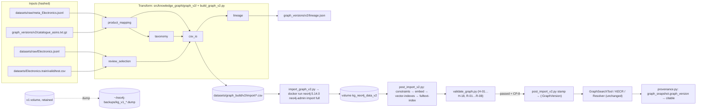

# Technical Specification: Graph v2 — Rebuild of the Knowledge Graph from the Raw Amazon Reviews 2023 Electronics Files

**Date**: 2026-10-19
**Author**: Product Manager Agent (@pm-specs)
**Status**: Approved 2026-10-19 (Gate #2); amended post-audit 2026-10-19 (§13, A-1 … A-6). Implementation Plan item F4 approved and added 2026-10-19.
**Audit**: `production_artifacts/Audit_Report_Graph_Rebuild.md` (PASS WITH FIXES); outcomes accepted by the user on 2026-10-19.
**Related Research**: `production_artifacts/Research_Report_Graph_Rebuild.md` (approved 2026-10-19 at Gate #1, decisions G-1 … G-12)
**Vision decisions**: 2026-10-19-018 (rebuild), 2026-10-19-019 (K-2 amendment), 2026-10-19-020 (C1 amendment), 2026-10-19-021 (correction note). Context: 2026-10-18-014 and 2026-10-18-015 (R2b, evaluation protocol).
**Settled user decisions**: K-1, K-2 (amended), K-3, K-7, K-11, K-12 in `_bmad-output/brainstorming/brainstorm-kg-attribute-problems-2026-10-18/brainstorm-intent.md`
**Separate file**: `production_artifacts/Technical_Specification.md` is the active R2a specification and is not touched by this work.

---

## 1. Executive Summary

The v1 graph holds 265,307 `ParentProduct` nodes. 104,281 of them are ghosts: no title, price or category, plus an embedding of the blank template. This specification rebuilds the graph as **version v2** from `datasets/raw/meta_Electronics.jsonl` and `datasets/raw/Electronics.jsonl`. The build has three stages:
1. A pure-Python transform, unit-testable without Neo4j, writes node and relationship CSVs and `graph_versions/v2/lineage.json`.
2. `neo4j-admin database import full` loads the CSVs into a **new** Docker volume, using a throw-away `neo4j:5.14.0` container.
3. Online post-import steps add constraints, embeddings (v1 templates), vector indexes (5.14 procedure form) and a full-text index. A validation gate runs next, and a `GraphVersion` node is written only if it passes.

V2 keeps every label, relationship, property and embedding template that the current readers use, with v1 semantics. `GraphSearchTool`, `KnowledgePathExtractor` and `ResolverService` therefore run unchanged. The v1 → v2 baseline delta measures the data fix and nothing else.

New structures use new names:
- the category tree (`Taxon`, `BROADER`, `IN_TAXON`);
- listing text (`p.features`, `p.details_json`, `p.details_text`);
- `product_fulltext_index`.

`src/evaluation/provenance.py` records the `GraphVersion` node, and a live run against a graph without one is not citable.

Every outward or hard-to-reverse step needs explicit user approval (checkpoints CP-1 … CP-9, §6.3). These steps are: stopping v1, the dump, creating and switching volumes, the import, and the stamp. **Code work may start now. No graph operation runs until the start gate CP-2 is passed.**

---

## 2. Requirements

**Terms used below.**
- *Catalogue*: the 265,307 v1 `parent_asin`s frozen in `graph_versions/v2/catalogue_asins.txt.gz`.
- *Graph operation*: any step that stops, dumps, imports into, writes to, or switches a Neo4j volume. Read-only Cypher queries against a running v1 are not graph operations.

### 2.1 Functional Requirements

#### A. Pre-flight and freeze

| ID | Requirement | Priority | Description |
|----|-------------|----------|-------------|
| FR-001 | Pre-flight measurement | Must | `scripts/graph_ingestion/preflight_v2.py` runs the measurements P-01 … P-10 (§6.2). It is read-only on raw files, the split CSVs and the running v1 graph, and writes `graph_versions/v2/preflight_report.json` (§5.4). Review counts come from running the transform in `--dry-run` mode (FR-017), so the pre-flight and the build share one code path. |
| FR-002 | Approved build parameters | Must | After CP-1 the user-approved gate parameters are written to `graph_versions/v2/build_params.json` (§5.4) and committed: `accepted_untitled_count`, `accepted_catalogue_missing`, `expected_review_count`, `expected_embed_reviews`, `review_embedding_scope`, memory profile, and the pre-flight report hash. `validate_graph.py` reads its thresholds only from this file. |
| FR-003 | Catalogue and v1 snapshot export | Must | `scripts/graph_ingestion/export_v1_snapshot.py` (read-only on v1) writes three files. (1) `graph_versions/v2/catalogue_asins.txt.gz`: all `ParentProduct.parent_asin` values, sorted ascending, one per line, `\n`-terminated, gzip with `mtime=0` and no file name. (2) `graph_versions/v1/snapshot.json`: v1 counts as in §5.4. (3) `graph_versions/v1/benchmark_targets.json`: title, price, brands, categories and review count of each `live_eval_dataset.json` target on v1. `--verify-only` recomputes all three and exits 1 on any difference. It runs at R-3, just before the dump. |
| FR-004 | v1 offline dump | Must | `import_graph_v2.py dump` builds the `neo4j-admin database dump neo4j --to-path=/backups` command for a `docker run --rm` container on the v1 volume. It runs only with `--execute --confirm-volume <v1 volume>` and refuses if any running container mounts the volume. It writes `graph_versions/v1/DUMP.json` (§5.4) with the dump's SHA-256 and size. The dump file itself stays outside git (`GRAPH_BACKUP_DIR`, default `~/neo4j-backups/`). |
| FR-004a | Dump restore test | Should | `import_graph_v2.py restore-test` loads the dump into the scratch volume `kg_v1_restore_test` (`neo4j-admin database load neo4j --from-path=/backups --overwrite-destination=true`). It starts the volume, compares node and relationship counts with `graph_versions/v1/snapshot.json`, records the result in `DUMP.json` (`restore_test`), and then removes the scratch volume. All of this needs user approval (CP-4). |

#### B. Transform (`src/knowledge_graph/graph_v2/`, CLI `scripts/graph_ingestion/build_graph_v2.py`)

| ID | Requirement | Priority | Description |
|----|-------------|----------|-------------|
| FR-005 | Verified inputs | Must | Before reading any data, the transform checks the SHA-256 of `meta_Electronics.jsonl` and `Electronics.jsonl` against `datasets/raw/SHA256SUMS`. It hashes `datasets/Electronics.{train,valid,test}.csv` and the uncompressed catalogue content. Any mismatch or missing file exits 2 before any output is written. There is no bypass flag; tests supply their own fixture `SHA256SUMS`. |
| FR-006 | Products only from metadata | Must | One `ParentProduct` row per catalogue ASIN found in raw metadata. The first metadata line for a `parent_asin` wins; later duplicates are counted (`duplicate_parent_asin`) and, if their content differs, listed in the lineage. Catalogue ASINs with no metadata line are counted (`catalogue_missing_in_meta`) and get no node. Property mapping is in §5.1.1. No other code path creates a product. |
| FR-007 | Brand (v1 rule, G-11) | Must | Brand name = `store` if it is a string that is not blank after stripping; otherwise `details["Brand"]` under the same test; otherwise no brand. The name is stored exactly as in the source, without stripping or case folding. One `Brand` node per distinct exact name and one `HAS_BRAND` edge per product. Names that differ only in case stay separate nodes and are listed in the lineage (`brand_case_duplicate_groups`). |
| FR-008 | Category (v1 rule) | Must | One `Category {name}` node per distinct non-blank `main_category`, and one `BELONGS_TO_CATEGORY` edge per product that has one. `Category` gets no `level` or `path` property and has no `SUBCATEGORY_OF` edges. |
| FR-009 | Attributes (G-3) | Must | For the keys `Material`, `Color`, `Style` and `Size` (exact, case-sensitive) in raw `details`: if the value is a string that is not blank after stripping, add `(:Attribute {attribute_name, attribute_value})` and `HAS_ATTRIBUTE`. Values are stored exactly as in the source. A non-string value is skipped and counted. Nodes are de-duplicated on `(attribute_name, attribute_value)`. No `numeric_value` is written. |
| FR-010 | Taxon tree (K-7, G-3) | Must | Built from raw `categories` (§5.1.2). `taxon_id` is the levels joined with `" > "`, case kept. Each product gets one `IN_TAXON` edge to its deepest level, which may be an inner node. An empty list gives no edge and is counted per `main_category`. `BROADER` points child → parent. Multiple roots are allowed. If two different level tuples produce the same `taxon_id`, the transform aborts (exit 2). There are no `Taxon` embeddings and no runtime flag. |
| FR-011 | Review selection (K-11, K-12, G-6) | Must | **Pass 1** streams `Electronics.jsonl` and drops, in this order and with a counted reason: JSON errors; lines missing `user_id`, `parent_asin` or `asin` (`missing_ids`); products not in the written product set (`not_in_catalogue`, `product_missing`); and `(user_id, parent_asin)` pairs in `Electronics.valid.csv` ∪ `Electronics.test.csv` (`valid_test_pair`). It computes `review_id = md5(f"{user_id}-{asin}-{timestamp}")` (hex; the v1 formula with the real timestamp). Per `parent_asin` it keeps the best 20 by the rank key `(helpful_vote DESC, verified_purchase DESC, timestamp DESC, review_id ASC)`. Lines with the same `review_id` collapse to one: the better rank key wins, then the earlier byte offset (`duplicate_review_id`). Everything else is `beyond_cap`. **Pass 2** reads the selected lines by sorted byte offset and writes the rows. Missing `helpful_vote` counts as 0, missing `verified_purchase` as false, and a missing `timestamp` as 0 (counted as `missing_timestamp`). |
| FR-012 | Review properties | Must | `review_id`, `review_title`, `review_body`, `rating`, `verified` (v1 names), plus `timestamp` (unix ms), `helpful_vote`, `asin` (child), `in_train_split` (the pair is in `Electronics.train.csv`), `cap_rank` (1 … 20, in rank-key order) and `embed_rank` (1 … 5 for the first five reviews in `cap_rank` order whose title or text is non-blank, otherwise null). `in_train_split` is computed after selection, by streaming the train CSV once against the set of selected pairs. |
| FR-013 | Users | Must | One `User {user_id}` per distinct `user_id` among the kept reviews, and one `WROTE` edge per review. A user whose reviews were all dropped gets no node. |
| FR-014 | Import CSV format | Must | Format: UTF-8, no BOM, comma delimiter, `"` quote with doubled-quote escaping (`csv.QUOTE_MINIMAL`, `lineterminator="\n"`). Array fields are joined with U+001F. The text rules, applied to every string, are:<br>(a) U+0000 and U+001F are replaced by a space;<br>(b) `\r\n` and a lone `\r` become `\n`;<br>(c) a value that is blank after stripping is written as an empty field, which the importer treats as null (`--ignore-empty-strings=true`);<br>(d) empty array items are dropped.<br>Every replacement is counted (`sanitized_*`). Booleans are written as `true`/`false`, floats with `repr()`. Headers are exactly those in §5.2. Rows are sorted by the first ID column, then by every following column, so the output is byte-identical for identical inputs. |
| FR-015 | Lineage | Must | `graph_versions/v2/lineage.json` follows §5.3. It records source paths and hashes, the code commit and dirty flag, all parameters, the columns read and dropped per file, per-step counts with drop reasons, output row counts and SHA-256, and timings. Two invariants are checked before the file is written, or the run exits 2: (1) for each source, `lines = sum(drop reasons) + kept`; (2) every relationship endpoint exists in a node file. |
| FR-016 | Pilot sample mode | Must | `--sample-mod N` keeps only catalogue ASINs with `int(sha256(parent_asin).hexdigest(), 16) % N == 0` (about 5% at N = 20). All rules apply unchanged inside the sample. Output goes to `datasets/graph_build/v2_pilot/` and `graph_versions/v2/pilot/lineage.json`. |
| FR-017 | Dry run | Must | `--dry-run` runs both passes, the taxonomy builder and all counters, but writes no CSV. It returns the lineage counts for the pre-flight. |
| FR-018 | Clean-tree requirement | Must | `--require-clean` (used for the full build) refuses to run if `src/` or `scripts/` have uncommitted or untracked changes. It reuses `collect_git_provenance` from `src/evaluation/provenance.py`, and the lineage records `git_commit` and `git_dirty`. |

#### C. Import and runtime configuration

| ID | Requirement | Priority | Description |
|----|-------------|----------|-------------|
| FR-019 | Import wrapper | Must | `scripts/graph_ingestion/import_graph_v2.py import` builds the command in §4.1.6 (`neo4j-admin database import full` in `docker run --rm neo4j:5.14.0`, with `--overwrite-destination=true --bad-tolerance=0 --skip-bad-relationships=false --skip-duplicate-nodes=false --multiline-fields=true --array-delimiter=U+001F --ignore-empty-strings=true --id-type=string --report-file=…`). By default it only logs the command. Safety guards: it runs only with `--execute --confirm-volume <same name>`; it refuses (exit 2) if the volume equals `NEO4J_DATA_VOLUME_V1`, if `--execute` is given while `NEO4J_DATA_VOLUME_V1` is unset or empty (fail closed; without `--execute` it only warns), if a running container mounts the volume, or if a required CSV is missing. Before reading the environment, `main` loads the repository `.env` with `load_dotenv(REPO_ROOT / ".env", override=False)` (`python-dotenv`), so a value exported in the shell wins and the guard sees the same values as compose (amendment A-2). It writes `import_run.json` (§5.4) with the exit code, duration, a hash of the report file, and the store size measured with `du -sk /data` in a throw-away container. |
| FR-020 | Volume selection and memory via env (G-2, G-7) | Must | In `src/knowledge_graph/docker-compose.yml`, the data volume becomes an **external** volume named by `NEO4J_DATA_VOLUME`, which is required. Compose then cannot create or remove a graph volume, so `docker compose down -v` cannot delete one. Heap initial = max = `NEO4J_HEAP` (default `2G`). Page cache = `NEO4J_PAGECACHE` (default `2G`). Transaction timeout = `NEO4J_TX_TIMEOUT` (default `60s`) on the Neo4j 5 setting `db.transaction.timeout`. Transaction-log retention = `NEO4J_TX_LOG_RETENTION` (default `2 days`). Build profile: `NEO4J_HEAP=4G NEO4J_PAGECACHE=1G NEO4J_TX_TIMEOUT=600s NEO4J_TX_LOG_RETENTION="500M size"`. Runtime profile: the defaults. The new variables, plus `NEO4J_DATA_VOLUME_V1` and `GRAPH_BACKUP_DIR`, are documented in `.env.example`. |

#### D. Post-import online steps (`scripts/graph_ingestion/post_import_v2.py`)

| ID | Requirement | Priority | Description |
|----|-------------|----------|-------------|
| FR-021 | Wrong-graph guard and seal | Must | Every sub-command first checks three conditions: `count(:ParentProduct)` equals `lineage.counts.meta.products_written`; `count(:Taxon)` equals `lineage.counts.nodes["Taxon"]`; and no `GraphVersion` node exists. Otherwise it exits 2 with "connected graph does not match lineage or is sealed". This guards against writing to v1 or to a stamped graph. The Taxon condition is the v2-only signature (amendment A-1): v1 has no `Taxon` label, and when `catalogue_missing_in_meta = 0` v2 has the same product count as v1, so the product count alone cannot tell them apart. No post-import step changes Taxon counts. Implemented as `GUARD_TAXON_COUNT_QUERY` and `check_graph_guard` in `scripts/graph_ingestion/post_import_v2.py`. |
| FR-022 | Constraints | Must | `constraints` creates the 8 uniqueness constraints in §5.1.4 with `IF NOT EXISTS`. Creating a constraint fails on duplicate values, which is an extra integrity check. |
| FR-023 | Embeddings (G-4, G-5) | Must | `embed` writes `embedding` (384-d, `EmbeddingService`, `all-MiniLM-L6-v2`) using the template functions in `src/knowledge_graph/graphdb/embedding_templates.py` (§4.1.4). Labels run in the order `Attribute`, `Brand`, `Category`, `ParentProduct`, `Review`. Rules:<br>- Nodes are read by keyset pagination in ascending order of their unique key (`WHERE key > $after AND embedding IS NULL ORDER BY key LIMIT $batch`), which makes the run deterministic and resumable.<br>- `Review` is limited to `embed_rank IS NOT NULL`.<br>- A text builder that returns `None` (skip-empty) is never sent to the model, and the skip is counted.<br>- Writes use `UNWIND $rows AS row MATCH (n:<Label> {<key>: row.k}) SET n.embedding = row.e`.<br>Output: `graph_versions/v2/embedding_report.json` (§5.4). |
| FR-024 | Vector indexes (5.14 procedure form) | Must | `vector-indexes` creates the 5 indexes in `setup_indexes.INDEX_SPECS` (product, brand, category, attribute, review; 384, cosine) with `CALL db.index.vector.createNodeIndex(...)` through `setup_indexes.setup_indexes()`. It then calls `CALL db.awaitIndexes($timeout_s)`. A `CREATE VECTOR INDEX` DDL statement is never sent to 5.14 (D-4 unchanged). |
| FR-025 | Full-text index and smoke test | Must | `fulltext-index` runs `CREATE FULLTEXT INDEX product_fulltext_index IF NOT EXISTS FOR (p:ParentProduct) ON EACH [p.title, p.description, p.features, p.details_text] OPTIONS {indexConfig: {`fulltext.analyzer`: 'english'}}`, then awaits it. **Smoke test**: pick (seeded) a product whose `features` contain a token of 6 or more letters that does not occur in its title, description or `details_text`. Query `db.index.fulltext.queryNodes('product_fulltext_index', $token)` with a limit of 50, and the product must be in the results. **Fallback** if the test fails (LIST<STRING> not indexed on 5.14): write `p.features_text` (items joined with `\n`), drop and recreate the index over `[title, description, features_text, details_text]`, and test again. The outcome is recorded as `fulltext_fields`. |
| FR-026 | Validation gate (G-8) | Must | `scripts/graph_ingestion/validate_graph.py` runs the hard gates H-01 … H-18 and the report-only checks R-01 … R-08 (§5.5). It writes `graph_versions/v2/validation_report.json` and exits 0 (all hard gates pass), 1 (any gate fails) or 2 (input error). Its thresholds come only from `build_params.json` and `lineage.json`, and its samples use the fixed seed `--seed` (default `20261019`). **Pilot mode** (`--pilot`, amendment A-3): there is no pilot `build_params.json`; the pilot reads the full build's `graph_versions/v2/build_params.json`. Every expected *count* comes from the pilot lineage instead of build_params: H-01 uses the pilot `counts.meta.catalogue_missing_in_meta` in place of `accepted_catalogue_missing`, H-08 the pilot `counts.reviews.kept` in place of `expected_review_count`, and H-10 the pilot `counts.reviews.embed_selected` in place of `expected_embed_reviews`. These three are the only gates that read counts from build_params. Thresholds that are not counts still come from build_params: the H-03 upper bound `accepted_untitled_count` (a 5% subset cannot exceed the full-build count the user accepted), `review_cap` (H-07) and `product_content_rule` (Gate #3 D-8; H-10, H-11). The substitution is a pure function `pilot_build_params(build_params: BuildParams, lineage: Lineage) -> BuildParams` in `src/knowledge_graph/graph_v2/validation.py` (a `model_copy(update=…)` of the three count fields), applied by `run_validation` only when `--pilot` is set. The gate functions are unchanged, and `build_params_sha256` in the report is still the hash of the file read. H-15 only covers benchmark targets inside the sample. A pilot lineage without `--pilot` is an input error (exit 2). Pilot artefact paths are in §6.4. |
| FR-027 | `GraphVersion` stamp | Must | `stamp` writes one `(:GraphVersion)` node (§5.6), but only if all of these hold: the validation report has `passed: true`; its `lineage_sha256` matches the lineage file; its product and review counts equal the current graph counts; and the user approved the report at CP-8. After the stamp, every other `post_import_v2.py` sub-command refuses to run (FR-021). |

#### E. Provenance and citability (`src/evaluation/provenance.py`, `scripts/evaluate_retrieval.py`)

| ID | Requirement | Priority | Description |
|----|-------------|----------|-------------|
| FR-028 | Graph version in the snapshot | Must | `collect_runtime_provenance` adds three keys to `graph_snapshot`, each `None` on failure (logged):<br>- `graph_version`: `properties(g)` of the single `GraphVersion` node; `None` if there are 0 or more than 1 such nodes;<br>- `products_untitled`: `count` where `p.title IS NULL OR trim(p.title) = ''`;<br>- `reviews_embedded`: `count` where `r.embedding IS NOT NULL`. |
| FR-029 | Citable rule | Must | `evaluate_citable(..., graph: Optional[Mapping[str, Any]] = None)`. In mode `live` it adds `graph_version_unknown` when `graph` is `None` or has no `graph_version`, and `graph_version_not_validated` when `graph_version["validation_passed"] is not True`. Existing reasons and warnings are unchanged. Archived runs are never recomputed. `scripts/evaluate_retrieval.py` passes `runtime_provenance["graph_snapshot"]`. |
| FR-030 | Archive index field | Should | `scripts/archive_eval_run.py` copies `provenance.graph_snapshot.graph_version.version` into the `evaluations_archive/index.json` entry as `graph_version` (`null` for runs without it). Existing entries are not rewritten. |

#### F. Legacy guards and cleanup

| ID | Requirement | Priority | Description |
|----|-------------|----------|-------------|
| FR-031 | `batch_ingest.py` cannot create products from reviews | Must | In `run_ingest`, the review step finds the product with `OPTIONAL MATCH (p:ParentProduct {parent_asin: coalesce(row.parent_asin, row.asin)})` and continues with `WITH row, p WHERE p IS NOT NULL`. Only then does it `MERGE` the `Review`, the `ABOUT_PRODUCT` edge and the `User`, and it ends with `RETURN count(*) AS written`. Unmatched rows (`len(batch) - written`) are logged per batch and summed at the end. No `MERGE (p:ParentProduct` remains in the review query. A module docstring marks the script as the legacy v1 pipeline and points to `build_graph_v2.py`. |
| FR-032 | Skip-empty and deterministic order in `backfill_embeddings.py` | Must | The generators of `BackfillService` delegate to `embedding_templates`:<br>- `backfill_products` fetches `p.features`; product text is `None` when title, description and features are all blank, and the skip is counted and logged;<br>- `backfill_reviews` returns `None` when title and body are both blank;<br>- the product fetch orders attributes before `collect` (`WITH p, c, a ORDER BY a.attribute_name, a.attribute_value`).<br>`_process_batch` already skips falsy texts, and it now logs the number skipped per label. |
| FR-033 | Ordered category samples | Must | In `backfill_category_embeddings.py`, `query_fetch` keeps only titled products and orders them before `collect`: `WITH c, p ORDER BY coalesce(p.review_count, 0) DESC, p.parent_asin ASC WITH c, collect(p.title)[..5] AS sample_products`. The text comes from `embedding_templates.category_text_v1`. |
| FR-034 | 5.14-compatible index script | Must | `src/knowledge_graph/graphdb/create_vector_indexes.cypher` is rewritten in the 5.14 procedure form (`CALL db.index.vector.createNodeIndex('<name>', '<Label>', 'embedding', 384, 'cosine');`), with a header comment that cites D-4. `src/knowledge_graph/graphdb/create_indexes.py` is not used by the v2 runbook; its docstring gets a one-line note that it needs Neo4j ≥ 5.15. |
| FR-035 | `AmazonDataProcessor` (decision) | Must | **Fix the field names and mark the module deprecated for KG use; keep the rest.**<br>- `process_reviews_file` reads `helpful_vote` (falling back to `helpful_votes`) and `timestamp` (falling back to `sort_timestamp`). The output columns keep their names (`helpful_votes`, `sort_timestamp`), so CSV consumers keep working.<br>- `_filter_reviews` uses `sort_values(..., kind="mergesort")` (stable).<br>- The class docstring and `process_and_save_data` state that its sampling must not feed the KG, which is built by `build_graph_v2.py`. `process_and_save_data` logs a warning when `frac < 1.0`: metadata and reviews are sampled independently, which produces reviews without metadata.<br>- Sampling logic and defaults are unchanged; the module keeps serving the classic baselines. Meta-Phase C uses the official splits (2026-10-19-020). |
| FR-036 | Prompt cleanup (G-12) | Must | In `src/llm_interface/prompts/graph_cypher_prompt.py`:<br>- remove the `Variant` and `PriceRange` schema lines and `(pp)-[:IN_PRICE_RANGE]->(pr)`;<br>- replace the "abstract range" price rule with: "If abstract (e.g. 'budget', 'cheap'): do not invent a ceiling; keep products with a known price and sort by `pp.price ASC`.";<br>- rewrite the "budget headphones" example to `MATCH (pp:ParentProduct)-[:BELONGS_TO_CATEGORY]->(c:Category) WHERE ANY(cat IN $categories WHERE toLower(c.name) CONTAINS toLower(cat)) AND pp.price IS NOT NULL OPTIONAL MATCH (pp)-[:HAS_BRAND]->(b:Brand) RETURN pp.parent_asin as parent_asin, pp.title as title, pp.price as price, pp.avg_rating as avg_rating, b.name as brand, collect(DISTINCT c.name) as categories, 0 as score ORDER BY pp.price ASC LIMIT $limit`, with the same parameters.<br>Everything else is unchanged; `SUBCATEGORY_OF`, `main_category`, `normalized_value` and `c.path` are out of G-12 scope (note in §3.3). |
| FR-037 | Ingestion README | Should | `scripts/graph_ingestion/README.md` gets a "Graph v2 (current)" section with the runbook commands (§6.3). The existing content is kept under a "Legacy v1 pipeline (do not use for the KG)" heading. The R-7 row follows §6.3 and §6.4 as amended: pilot paths under `graph_versions/v2/pilot/` and `datasets/graph_build/v2_pilot/`, and the full build's `build_params.json` (no pilot build params file, amendment A-3). |

#### G. v2 baseline (runs after the rebuild)

| ID | Requirement | Priority | Description |
|----|-------------|----------|-------------|
| FR-038 | Benchmark grounding gate | Must | `validate_benchmark_graph_grounding()` (`scripts/evaluate_retrieval.py`, unchanged) is hard gate H-15 in `validate_graph.py`, where a connection error is a gate failure. It also runs at the start of each live evaluation as today. On v2 all 21 targets must pass. R-07 reports any v1 → v2 difference in target facts (`graph_versions/v1/benchmark_targets.json`). Environment (amendment A-5): loading `scripts/evaluate_retrieval.py` imports `src/evaluation/visualizer.py` and through it `seaborn`. `seaborn>=0.12` is declared in `requirements.txt` and installed in the project `.venv` (AI-13 done for seaborn), so `validate_graph.py`, including H-15, runs in `.venv`. |
| FR-039 | v2 baseline re-run | Must | Three live runs (r = 3) of legacy-21 on v2, with `--require-clean`, using the configuration recorded in `evaluations_archive/eval_2026-10-18_2340/manifest.json` (`k_values`, `strategies` including the five R1 arms, `RETRIEVAL_FUSION_ARM=rrf3`, `ORCH_CATEGORY_RECOVERY=1`, stats seed and resample count). They run at the baseline commit B defined in §6.6, then are archived with `scripts/archive_eval_run.py` and compared with the three archived v1 runs (§6.6). |

### 2.2 Non-Functional Requirements

| ID | Requirement | Target | Description |
|----|-------------|--------|-------------|
| NFR-001 | Determinism | Byte-identical CSVs | Same inputs and parameters → identical CSV bytes and identical lineage `counts` and `outputs` hashes (only `created_at` and `timing_s` may differ). Embeddings are reproducible on the same device and library versions, which are recorded. |
| NFR-002 | Transform memory | Target ≤ 3 GB peak RSS; measured at P-10, judged at CP-1 | Streaming passes. Held in memory: the catalogue set, the valid ∪ test pair set (about 2.83M; deleted after pass 1), at most 20 candidates per product (about 3.4M small tuples), and the selected-pair set for `in_train_split`. Product records are released once the product-side CSVs are written. After these audit fixes the estimated peak is about 3.3 GB, at the end of pass 1. The check is the measured value, not a hard fail at 3 GB (amendment A-4): pre-flight P-10 records the dry-run peak (`p10_timing.dry_run_peak_rss_bytes`, taken after the full dry run and before the embedding model loads), and the user judges it at CP-1. A peak slightly above 3 GB, in line with the 3.3 GB estimate, is accepted on the 16 GB host (2026-10-19). |
| NFR-003 | Transform time | ≤ 2 h on this Mac | Measured in pre-flight (P-10). If it exceeds 2 h, see Risk R4. |
| NFR-004 | Import safety | Zero writes to the v1 volume | Enforced by FR-019 (name guard, fail closed under `--execute` when `NEO4J_DATA_VOLUME_V1` is unset; A-2), FR-020 (external volumes) and FR-021 (wrong-graph guard with the product and Taxon counts; A-1). v1 stays restorable from the dump. |
| NFR-005 | Unit-testability | No Neo4j, Docker or raw files | All unit tests run on small fixtures in `tests/fixtures/graph_v2/`, with fakes for the Neo4j session, the embedder and the subprocess runner. |
| NFR-006 | Disk | ≥ 40 GB free before CP-6 | Import CSVs about 4–6 GB, v2 store 10–13 GB, dump 3–5 GB, pilot about 1 GB, plus headroom. Checked in P-07 and again by the import wrapper (exit 2 if below). |
| NFR-007 | Runtime memory | Fits the 8 GB Docker VM | Runtime: heap 2G, page cache 2G, about 3 GB left for the OS cache (vector indexes). Build: heap 4G, page cache 1G. |
| NFR-008 | Conventions | `.claude/rules/python-conventions.md` | Type hints, docstrings, `logging` (no `print`), parameterised Cypher (labels and keys come only from constants), specific exceptions, closed sessions. Pydantic v2 models for JSON artefacts; `typing.NamedTuple` for hot-path rows. |
| NFR-009 | Reader compatibility | No reader change | `graph_search_tool.py`, `kecr_tool.py`, `resolver_service.py`, the orchestrator and the Critic need no code change to run on v2 (§3.3). |

---

## 3. Architecture & Tech Stack

### 3.1 Technology Choices

| Layer | Technology | Justification |
|-------|-----------|---------------|
| Transform | Python 3.11 stdlib (`json`, `csv`, `hashlib`, `heapq`, `gzip`), Pydantic v2 | No new dependency. The code is pure and unit-testable (G-1). |
| Load | `neo4j-admin database import full` in `docker run --rm neo4j:5.14.0` | Community-supported offline full import. Nodes come only from node files, so ghosts cannot be created. `--bad-tolerance=0` aborts on any dangling edge (G-1). |
| Storage | New external Docker volume `kg_neo4j_data_v2`; the v1 volume is kept | Switching back is instant, and v1 stays runnable (G-2). |
| Backup | `neo4j-admin database dump` (offline) | K-2. Community dumps only offline. |
| Embeddings | `EmbeddingService` (`all-MiniLM-L6-v2`, 384-d), v1 templates | Keeps v1 → v2 comparable (G-4). K-6 stays an R3 arm (`p.embedding_feat`). |
| Vector indexes | `db.index.vector.createNodeIndex` (5.14) through `setup_indexes.py` | 5.14 has no `CREATE VECTOR INDEX` (N-4). D-4 is unchanged. This overrides the Cypher 25 line in `.claude/rules/python-conventions.md` for 5.14 only. |
| Full-text | `CREATE FULLTEXT INDEX … ON EACH […]`, `english` analyzer | For RS-12 and the RS-03 BM25 arm (not read yet). |
| Validation | Plain Python + Cypher checks, JSON report | No new framework (research §Q5). |

### 3.2 Component Architecture



### 3.3 Integration with the Existing System

**Readers that must keep working unchanged** (verified against the code):

| Reader | What it reads | v2 status |
|---|---|---|
| `src/tools/graph_search_tool.py` `DETAIL_QUERY`, `CONSTRAINT_FACTS_QUERY`, channel queries | `ParentProduct.{parent_asin,title,price}`, `HAS_BRAND`, `BELONGS_TO_CATEGORY`, `HAS_ATTRIBUTE` (`attribute_name`, `attribute_value`), `Review-[:ABOUT_PRODUCT]->`, `Review.review_title`, the 3 channel indexes | Same names and semantics. `numeric_value` is still absent, so numeric facts stay empty, as on v1. |
| `GraphSearchTool._build_filters` category clause `[:SUBCATEGORY_OF*0..3]` | Leaf `Category` | `*0..3` still matches the leaf itself. v2 has no `SUBCATEGORY_OF` type, so Neo4j logs an "unknown relationship type" notice. The behaviour is the same as v1, where 33 edges made the traversal effectively inactive (2026-10-19-021 point 3). |
| `GraphSearchTool.fetch_product_attributes` | `ORDER BY r.helpful_votes DESC, r.timestamp_iso DESC` | Neither property exists on v1 or v2, so the order is unchanged (unordered). AI-06 switches to `helpful_vote` later; this spec deliberately leaves it unchanged so the v1 → v2 delta stays data-only. |
| `GraphSearchTool.fetch_review_embedded_asins` | `Review.embedding IS NOT NULL` | Works. It returns about 265k ASINs on v2 instead of 5,715 (coverage confound removed). |
| `src/tools/kecr_tool.py` | `REVIEWS`, `BOUGHT_TOGETHER`, `r.timestamp_iso`, `c.level`, `HAS_ATTRIBUTE`, `BELONGS_TO_CATEGORY`, `HAS_BRAND` | The historical subquery still finds nothing (`REVIEWS` is dropped; it was already empty in effect). The other paths are unchanged. AI-03 becomes feasible (`timestamp`, `rating` and `verified` are on `Review`). |
| `src/knowledge_graph/graphdb/resolver_service.py` | `Brand.name`, `Category.{name,path}`, `Attribute.*`, the `brand`, `category` and `attribute` indexes | Same. `Category.path` is null, as on most v1 categories. |
| `src/evaluation/live_dataset_generator.py` | `User-[:WROTE]->Review-[:ABOUT_PRODUCT]->ParentProduct` | Same pattern. |

Semantic notes for readers:
- `ParentProduct.review_count` remains Amazon's `rating_number` (v1 semantics), not the number of `Review` nodes.
- `Review.helpful_vote` is the raw field name. v1 never stored `helpful_votes` on `Review`.

**Agents, tools and LLM interfaces**: no change. `graph_cypher_prompt.py` (FR-036) is used only by `ExternalLLMCypherGenerator` through `GraphQueryManager`, which `src/agents/`, `src/tools/` and `scripts/` do not import. The prompt change is therefore off the evaluation path. Out of G-12 scope, and recorded here only: the prompt also names `pp.main_category`, `a.normalized_value` and `c.path`, which exist on neither graph, and `SUBCATEGORY_OF`, which v2 drops.

**Downstream dependencies (not in this spec)**:
- G-9: the R2b spec redefines S1 as review-sparse (1–2 reviews in the graph) and simulates cold start by masking reviews at query time. R2b generates and freezes its benchmark on v2 only, after `GraphVersion` v2 exists.
- RS-02 evidence is collected on the v2 tuning split; the 4.7% condition no longer applies.
- Unblocked: AI-03 (KECR timestamps), AI-06 (order by `helpful_vote`), RS-12 and RS-03 (full-text over `features`).
- K-6 (`p.embedding_feat`) is an R3 arm and needs no rebuild.
- K-2's "idempotent write script with an undo script" is superseded by the volume switch (2026-10-19-019).

---

## 4. API / Interface Design

### 4.1 New Interfaces

All new library code lives in the new package `src/knowledge_graph/graph_v2/`. The scripts under `scripts/graph_ingestion/` are thin CLIs.

#### 4.1.1 `src/knowledge_graph/graph_v2/product_mapping.py`

```python
ATTRIBUTE_KEYS: Tuple[str, ...] = ("Material", "Color", "Style", "Size")
PRICE_PATTERN = re.compile(r"^\s*\d+(\.\d+)?\s*$")

class ProductRow(NamedTuple):
    parent_asin: str
    title: Optional[str]
    price: Optional[float]
    avg_rating: Optional[float]
    review_count: Optional[int]
    description: Optional[str]
    features: Tuple[str, ...]
    details_json: Optional[str]
    details_text: Optional[str]
    category_path: Tuple[str, ...]
    store: Optional[str]

class ProductRecord(NamedTuple):
    row: ProductRow
    brand: Optional[str]
    main_category: Optional[str]
    attributes: Tuple[Tuple[str, str], ...]   # sorted (name, value)
    levels: Tuple[str, ...]                    # normalised category levels

def parse_price(value: Any) -> Tuple[Optional[float], str]:
    """(price, status) with status in {"ok", "null", "unparseable"}; bool is never numeric;
    non-finite floats are "unparseable"; strings must match PRICE_PATTERN."""

def resolve_brand(store: Any, details: Mapping[str, Any]) -> Optional[str]: ...
def map_meta_record(raw: Mapping[str, Any], counters: "Counter[str]") -> ProductRecord: ...
```

#### 4.1.2 `src/knowledge_graph/graph_v2/taxonomy.py`

```python
TAXON_SEPARATOR = " > "

class TaxonRow(NamedTuple):
    taxon_id: str
    name: str
    path: Tuple[str, ...]
    depth: int                 # len(path); roots have depth 1
    product_count: int         # products assigned to this node or any descendant
    direct_product_count: int  # products whose IN_TAXON points here

def normalize_levels(value: Any) -> Tuple[str, ...]:
    """Strips each level, drops blank levels, keeps case and order; non-list -> ()."""

class TaxonomyBuilder:
    def add_product(self, parent_asin: str, levels: Sequence[str], main_category: Optional[str]) -> Optional[str]:
        """Registers every prefix of `levels`; returns the deepest taxon_id, or None for an empty path
        (counted per main_category). Raises TaxonIdCollisionError if a taxon_id maps to two paths."""
    def nodes(self) -> List[TaxonRow]: ...                       # sorted by taxon_id
    def broader_edges(self) -> List[Tuple[str, str]]: ...         # (child, parent), sorted
    def assignments(self) -> List[Tuple[str, str]]: ...           # (parent_asin, taxon_id), sorted
    def products_without_taxon(self) -> Dict[str, int]: ...       # by main_category ("" for none)
```

#### 4.1.3 `src/knowledge_graph/graph_v2/review_selection.py`

```python
class ReviewCandidate(NamedTuple):
    helpful_vote: int
    verified: bool
    timestamp: int
    review_id: str
    offset: int        # byte offset of the line in Electronics.jsonl
    has_text: bool     # title or text non-blank after stripping

def make_review_id(user_id: str, asin: str, timestamp: int) -> str:
    """md5(f"{user_id}-{asin}-{timestamp}").hexdigest() (v1 formula, real timestamp)."""

def rank_key(c: ReviewCandidate) -> Tuple[int, int, int, str]:
    """Ascending sort = best first: (-helpful_vote, -int(verified), -timestamp, review_id)."""

class TopKSelector:
    """Bounded per-product selection with review_id de-duplication (better rank_key, then lower offset)."""
    def __init__(self, cap: int = 20) -> None: ...
    def offer(self, parent_asin: str, cand: ReviewCandidate) -> None: ...
    def ranked(self) -> Dict[str, List[ReviewCandidate]]: ...   # best first, length <= cap
    @property
    def duplicate_count(self) -> int: ...
    @property
    def beyond_cap_count(self) -> int: ...

def select_top_reviews_reference(cands: Iterable[ReviewCandidate], cap: int) -> List[ReviewCandidate]:
    """Reference: dedupe by review_id (best rank_key, then lowest offset), sort by rank_key, take cap."""

def assign_embed_ranks(ranked: Sequence[ReviewCandidate], top_n: int = 5) -> List[Optional[int]]:
    """1..top_n for the first top_n candidates with has_text, else None."""

def load_pair_set(csv_paths: Sequence[Path]) -> Set[Tuple[str, str]]: ...   # (user_id, parent_asin)
```

#### 4.1.4 `src/knowledge_graph/graphdb/embedding_templates.py`

Pure functions that reproduce the v1 texts exactly. They are shared by `post_import_v2.py`, `backfill_embeddings.py` and `backfill_category_embeddings.py`.

```python
TEMPLATE_IDS: Dict[str, str] = {
    "ParentProduct": "product_v1", "Review": "review_v1", "Brand": "brand_v1",
    "Attribute": "attribute_v1", "Category": "category_v1",
}
REVIEW_MAX_CHARS = 800

def has_product_content(title: Optional[str], description: Optional[str], features: Optional[Sequence[str]]) -> bool: ...
def product_text_v1(title, category, attribute_pairs: Sequence[str], description, features) -> Optional[str]:
    """None if not has_product_content(...); else
    f"Product: {title or ''}. Category: {category or 'Unknown'}. Features: {', '.join(attribute_pairs[:5])}. Description: {description or ''}".
    `features` decides emptiness only; it is not part of the v1 text (K-6 deferred)."""
def review_text_v1(title: Optional[str], body: Optional[str]) -> Optional[str]:
    """None if both blank; else f"{title or ''}. {body or ''}"[:REVIEW_MAX_CHARS]."""
def brand_text_v1(name: str) -> str:            # f"Brand: {name}. Domain: consumer electronics"
def attribute_text_v1(name: str, value: str) -> str:   # v1 GENERIC_KEYS rule + AttributeNormalizer.normalize
def category_text_v1(name: str, path: Optional[Sequence[str]], sample_titles: Sequence[Optional[str]]) -> str:
    """v1 backfill_category_embeddings text: "Category: {name}. Context: ... . Related items: ...."
    (titles cut to 10 words; "Context: Root Category" when path has <= 1 element)."""
```

`category_v1` is the `backfill_category_embeddings.py` form. That script overwrites every category after `BackfillService.backfill_categories`, so it is the form most likely present on v1. Pre-flight P-09 checks this against the stored v1 vectors.

#### 4.1.5 `src/knowledge_graph/graph_v2/csv_io.py`, `lineage.py`, `models.py`

```python
ARRAY_DELIMITER = "\u001f"
HEADERS: Dict[str, List[str]]          # exactly §5.2, keyed by file name

def sanitize_text(value: Any, counters: "Counter[str]") -> Optional[str]: ...
def encode_array(items: Sequence[str], counters: "Counter[str]") -> Optional[str]: ...

class ImportCsvWriter:
    """Buffers rows, sorts them (FR-014), writes CSV, returns FileStats."""
    def __init__(self, path: Path, header: Sequence[str]) -> None: ...
    def add(self, values: Sequence[Any]) -> None: ...
    def close(self) -> "FileStats": ...   # rows, sha256, bytes
```

Reviews are written as about 3.4M rows. To keep NFR-002, `ImportCsvWriter` for reviews is fed in the already-sorted order (by `parent_asin`, then `cap_rank`), and it asserts the order instead of buffering. `models.py` holds the Pydantic models `Lineage`, `BuildParams`, `PreflightReport`, `EmbeddingReport`, `ValidationReport`, `GateResult`, `ImportRun` and `DumpRecord` (§5.3 – §5.5).

#### 4.1.6 Import command (`src/knowledge_graph/graph_v2/import_command.py`)

```python
NODE_FILES: List[Tuple[str, str]] = [("ParentProduct", "nodes_product.csv"), ("Review", "nodes_review.csv"),
    ("User", "nodes_user.csv"), ("Brand", "nodes_brand.csv"), ("Category", "nodes_category.csv"),
    ("Attribute", "nodes_attribute.csv"), ("Taxon", "nodes_taxon.csv")]
REL_FILES: List[Tuple[str, str]] = [("HAS_BRAND", "rels_has_brand.csv"), ("BELONGS_TO_CATEGORY", "rels_belongs_to_category.csv"),
    ("HAS_ATTRIBUTE", "rels_has_attribute.csv"), ("IN_TAXON", "rels_in_taxon.csv"), ("BROADER", "rels_broader.csv"),
    ("ABOUT_PRODUCT", "rels_about_product.csv"), ("WROTE", "rels_wrote.csv")]

def build_import_command(volume: str, import_dir: Path, report_dir: Path, image: str = "neo4j:5.14.0", heap: str = "2G") -> List[str]: ...
def build_dump_command(volume: str, backup_dir: Path, image: str = "neo4j:5.14.0") -> List[str]: ...
def build_load_command(volume: str, backup_dir: Path, image: str = "neo4j:5.14.0") -> List[str]: ...
def volume_in_use(volume: str, runner: "CommandRunner") -> bool: ...    # docker ps --filter volume=<v> -q
```

The import command it produces:

```
docker run --rm --volume=<volume>:/data --volume=<abs import_dir>:/import:ro --volume=<abs report_dir>:/reports
  --env HEAP_SIZE=2G neo4j:5.14.0
  neo4j-admin database import full neo4j
  --overwrite-destination=true --bad-tolerance=0 --skip-bad-relationships=false --skip-duplicate-nodes=false
  --multiline-fields=true --array-delimiter=U+001F --ignore-empty-strings=true --normalize-types=true --id-type=string
  --report-file=/reports/import.report
  --nodes=ParentProduct=/import/nodes_product.csv ... --relationships=WROTE=/import/rels_wrote.csv
```

#### 4.1.7 CLIs

| Script | Usage | Exit codes |
|---|---|---|
| `scripts/graph_ingestion/preflight_v2.py` | `--out graph_versions/v2/preflight_report.json [--throughput-texts 10000] [--throughput-batch-sizes 32 128 512] [--skip-v1] [--skip-docker]` | 0 / 2 |
| `scripts/graph_ingestion/export_v1_snapshot.py` | `--catalogue-out graph_versions/v2/catalogue_asins.txt.gz --snapshot-out graph_versions/v1/snapshot.json --benchmark live_eval_dataset.json --targets-out graph_versions/v1/benchmark_targets.json [--verify-only]` | 0 / 1 (mismatch) / 2 |
| `scripts/graph_ingestion/build_graph_v2.py` | `--meta datasets/raw/meta_Electronics.jsonl --reviews datasets/raw/Electronics.jsonl --sha256sums datasets/raw/SHA256SUMS --splits-dir datasets --catalogue graph_versions/v2/catalogue_asins.txt.gz --out-dir datasets/graph_build/v2 --lineage graph_versions/v2/lineage.json [--review-cap 20] [--embed-top-n 5] [--sample-mod N] [--dry-run] [--require-clean]` | 0 / 2 |
| `scripts/graph_ingestion/import_graph_v2.py` | `import --volume V --import-dir D --report-dir R [--heap 2G] [--execute --confirm-volume V]`; `dump --volume V1 --backup-dir B --record graph_versions/v1/DUMP.json [--execute --confirm-volume V1]`; `restore-test --dump F --volume kg_v1_restore_test [--execute --confirm-volume …]` | 0 / 1 (docker failure) / 2 (guard) |
| `scripts/graph_ingestion/post_import_v2.py` | `constraints` / `embed [--labels …] [--batch-size 256] [--report graph_versions/v2/embedding_report.json]` / `vector-indexes [--await-timeout 7200]` / `fulltext-index` / `all` (the four in order) / `stamp --validation-report … --lineage …`; all take `--lineage` | 0 / 1 / 2 |
| `scripts/graph_ingestion/validate_graph.py` | `--lineage --build-params --embedding-report --splits-dir datasets --catalogue --import-dir --benchmark live_eval_dataset.json --out graph_versions/v2/validation_report.json [--seed 20261019] [--pilot]` | 0 / 1 / 2 |

All Docker calls go through an injectable `CommandRunner = Callable[[Sequence[str]], Tuple[int, str]]`, following the `GitRunner` pattern in `provenance.py`, so tests use fakes.

### 4.2 Modified Interfaces

| File | Change |
|---|---|
| `src/evaluation/provenance.py` | `collect_runtime_provenance(orchestrator, popular_count)`: `graph_snapshot` gains `graph_version`, `products_untitled` and `reviews_embedded` (FR-028). `evaluate_citable(mode, sample_size, git, benchmark, llm=None, graph=None)` gains the parameter and the two reasons (FR-029). Docstrings updated. |
| `scripts/evaluate_retrieval.py` | Passes `graph=runtime_provenance.get("graph_snapshot")` to `evaluate_citable`. No other change. |
| `scripts/archive_eval_run.py` | Index entry gains `graph_version` (FR-030). |
| `scripts/graph_ingestion/batch_ingest.py` | Review query MERGE → guarded MATCH, unmatched count, docstring (FR-031). |
| `src/knowledge_graph/graphdb/backfill_embeddings.py` | Generators delegate to `embedding_templates`, skip-empty, ordered attributes, skip counts (FR-032). |
| `src/knowledge_graph/graphdb/backfill_category_embeddings.py` | Ordered, titled samples; text from `category_text_v1` (FR-033). |
| `src/knowledge_graph/graphdb/create_vector_indexes.cypher` | Procedure form (FR-034). |
| `src/knowledge_graph/graphdb/setup_indexes.py` | Unchanged logic. `INDEX_SPECS` moves to module level so `post_import_v2.py` can import it, and `setup_indexes(connector: Optional[Neo4jConnector] = None)` accepts an injected connector. |
| `src/utils/AmazonDataProcessor.py` | Field names, stable sort, deprecation note and warning (FR-035). |
| `src/llm_interface/prompts/graph_cypher_prompt.py` | G-12 cleanup (FR-036). |
| `src/knowledge_graph/docker-compose.yml`, `.env.example` | FR-020. |

`docker-compose.yml` after the change (the relevant parts):

```yaml
    environment:
      - NEO4J_server_memory_heap_initial__size=${NEO4J_HEAP:-2G}
      - NEO4J_server_memory_heap_max__size=${NEO4J_HEAP:-2G}
      - NEO4J_server_memory_pagecache_size=${NEO4J_PAGECACHE:-2G}
      - NEO4J_db_transaction_timeout=${NEO4J_TX_TIMEOUT:-60s}
      - NEO4J_db_tx__log_rotation_retention__policy=${NEO4J_TX_LOG_RETENTION:-2 days}
      # (dbms_lock_acquisition_timeout, plugins, logging, listen addresses unchanged)
volumes:
  neo4j_data:
    external: true
    name: ${NEO4J_DATA_VOLUME:?Set NEO4J_DATA_VOLUME to the graph volume (v1 or v2)}
  # neo4j_logs, neo4j_import, neo4j_plugins unchanged
```

Compose is run from the repository root with the root `.env`: `docker compose --env-file .env -f src/knowledge_graph/docker-compose.yml up -d`. The old `NEO4J_dbms_transaction_timeout` line is replaced, because Neo4j 5 names the setting `db.transaction.timeout`. P-07 records which name is effective on v1.

---

## 5. Data Model / State Management

### 5.1 Graph schema v2

#### 5.1.1 Nodes and properties

| Label | Properties (Neo4j type) | Source |
|---|---|---|
| `ParentProduct` | `parent_asin` (STRING, unique); `title` (STRING); `price` (FLOAT); `avg_rating` (FLOAT); `review_count` (INTEGER); `description` (STRING); **new**: `features` (LIST<STRING>), `details_json` (STRING), `details_text` (STRING), `category_path` (LIST<STRING>), `store` (STRING); after post-import: `embedding` (LIST<FLOAT>, 384) | `parent_asin`; `title`; `parse_price(price)`; `average_rating`; `rating_number`; `" \| ".join(description)` (a string is kept as is); `features` (order kept, blank items dropped); `json.dumps(details, sort_keys=True, ensure_ascii=False, separators=(",", ":"))` (null if empty); `"\n".join(f"{k}: {v}")` over the sorted keys whose value is str, int, float or bool (null if none); `normalize_levels(categories)`; `store` |
| `Review` | `review_id` (STRING, unique), `review_title`, `review_body` (STRING), `rating` (FLOAT), `verified` (BOOLEAN); **new**: `timestamp` (INTEGER, ms), `helpful_vote` (INTEGER), `asin` (STRING), `in_train_split` (BOOLEAN), `cap_rank` (INTEGER), `embed_rank` (INTEGER, null outside the top 5); `embedding` only when `embed_rank` is set | FR-011, FR-012 |
| `User` | `user_id` (STRING, unique) | FR-013 |
| `Brand` | `name` (STRING, unique), `embedding` | FR-007 |
| `Category` | `name` (STRING, unique), `embedding` | FR-008 |
| `Attribute` | `attribute_name`, `attribute_value` (STRING; unique together), `embedding` | FR-009 |
| `Taxon` (new) | `taxon_id` (STRING, unique), `name` (STRING, not unique), `path` (LIST<STRING>), `depth` (INTEGER), `product_count` (INTEGER, subtree), `direct_product_count` (INTEGER) | FR-010 |
| `GraphVersion` (new) | §5.6 | FR-027 |

Not present in v2: `Variant`, `Product`, `PriceRange`; `Attribute.numeric_value`; `Category.level` and `Category.path`.

#### 5.1.2 Relationships

`(ParentProduct)-[:HAS_BRAND]->(Brand)`, `(ParentProduct)-[:BELONGS_TO_CATEGORY]->(Category)`, `(ParentProduct)-[:HAS_ATTRIBUTE]->(Attribute)`, `(Review)-[:ABOUT_PRODUCT]->(ParentProduct)`, `(User)-[:WROTE]->(Review)`; new: `(ParentProduct)-[:IN_TAXON]->(Taxon)` (at most 1 per product, to the deepest level) and `(Taxon)-[:BROADER]->(Taxon)` (child → parent; exactly 1 for every non-root). Dropped: `RATED`, `REVIEWS`, `SUBCATEGORY_OF`, `IN_PRICE_RANGE`, `IS_VARIANT_OF`, `CHILD_OF`. No relationship properties.

Tree example: `["Electronics", "Television & Video", "Accessories", "Cables", "HDMI Cables"]` creates 5 `Taxon` nodes, from `Electronics` (depth 1) to `Electronics > Television & Video > Accessories > Cables > HDMI Cables` (depth 5), linked by 4 `BROADER` edges. The product's `IN_TAXON` points to the depth-5 node. A second product listed under `["Electronics", "Computers & Accessories", "Accessories"]` gets a different node whose `name` is also `"Accessories"`.

#### 5.1.3 Indexes

| Name | Kind | Target |
|---|---|---|
| `product_embedding_index`, `brand_embedding_index`, `category_embedding_index`, `attribute_embedding_index`, `review_embedding_index` | Vector, 384, cosine (`db.index.vector.createNodeIndex`) | `embedding` on `ParentProduct`, `Brand`, `Category`, `Attribute`, `Review` |
| `product_fulltext_index` | Full-text, `english` | `ParentProduct` `[title, description, features, details_text]` (fallback `features_text`, FR-025) |
| Backing indexes of the constraints | Range | §5.1.4 |

#### 5.1.4 Constraints (created by `post_import_v2.py constraints`)

```
CREATE CONSTRAINT product_id IF NOT EXISTS FOR (p:ParentProduct) REQUIRE p.parent_asin IS UNIQUE
CREATE CONSTRAINT review_id IF NOT EXISTS FOR (r:Review) REQUIRE r.review_id IS UNIQUE
CREATE CONSTRAINT user_id IF NOT EXISTS FOR (u:User) REQUIRE u.user_id IS UNIQUE
CREATE CONSTRAINT brand_id IF NOT EXISTS FOR (b:Brand) REQUIRE b.name IS UNIQUE
CREATE CONSTRAINT category_id IF NOT EXISTS FOR (c:Category) REQUIRE c.name IS UNIQUE
CREATE CONSTRAINT taxon_id IF NOT EXISTS FOR (t:Taxon) REQUIRE t.taxon_id IS UNIQUE
CREATE CONSTRAINT attribute_key IF NOT EXISTS FOR (a:Attribute) REQUIRE (a.attribute_name, a.attribute_value) IS UNIQUE
CREATE CONSTRAINT graph_version_id IF NOT EXISTS FOR (g:GraphVersion) REQUIRE g.version IS UNIQUE
```

The first five constraint names match `batch_ingest.py`. The pilot checks that Community 5.14 accepts the composite uniqueness constraint. If it does not, `attribute_key` is replaced by gate H-18's duplicate check, and the change is recorded in the pilot report.

### 5.2 Import CSV files (`datasets/graph_build/v2/import/`, git-ignored)

| File | Header |
|---|---|
| `nodes_product.csv` | `parent_asin:ID(ParentProduct),title,price:double,avg_rating:double,review_count:long,description,features:string[],details_json,details_text,category_path:string[],store` |
| `nodes_review.csv` | `review_id:ID(Review),review_title,review_body,rating:double,verified:boolean,timestamp:long,helpful_vote:long,asin,in_train_split:boolean,cap_rank:int,embed_rank:int` |
| `nodes_user.csv` | `user_id:ID(User)` |
| `nodes_brand.csv` | `name:ID(Brand)` |
| `nodes_category.csv` | `name:ID(Category)` |
| `nodes_attribute.csv` | `:ID(Attribute),attribute_name,attribute_value` (ID = `sha1(name + "\u0000" + value)` hex; not stored as a property) |
| `nodes_taxon.csv` | `taxon_id:ID(Taxon),name,path:string[],depth:int,product_count:long,direct_product_count:long` |
| `rels_has_brand.csv` | `:START_ID(ParentProduct),:END_ID(Brand)` |
| `rels_belongs_to_category.csv` | `:START_ID(ParentProduct),:END_ID(Category)` |
| `rels_has_attribute.csv` | `:START_ID(ParentProduct),:END_ID(Attribute)` |
| `rels_in_taxon.csv` | `:START_ID(ParentProduct),:END_ID(Taxon)` |
| `rels_broader.csv` | `:START_ID(Taxon),:END_ID(Taxon)` |
| `rels_about_product.csv` | `:START_ID(Review),:END_ID(ParentProduct)` |
| `rels_wrote.csv` | `:START_ID(User),:END_ID(Review)` |

Relationship types and node labels are set on the command line (§4.1.6), so the files carry no `:TYPE` or `:LABEL` column.

### 5.3 `graph_versions/v2/lineage.json` (git-tracked)

```json
{
  "schema_version": 1,
  "graph_version": "v2",
  "created_at": "2026-10-2xT..Z",
  "code": {"git_commit": "…", "git_dirty": false, "script": "scripts/graph_ingestion/build_graph_v2.py"},
  "sources": {
    "meta":    {"path": "datasets/raw/meta_Electronics.jsonl", "sha256": "5eb4dabd…5d93", "verified_against": "datasets/raw/SHA256SUMS", "lines": 1610012},
    "reviews": {"path": "datasets/raw/Electronics.jsonl", "sha256": "bf11cf9c…8de8e", "verified_against": "datasets/raw/SHA256SUMS", "lines": 43886944},
    "splits":  {"train": {"path": "…", "sha256": "…", "rows": 12191484}, "valid": {"…": "…"}, "test": {"…": "…"}, "combined_sha256": "…"},
    "catalogue": {"path": "graph_versions/v2/catalogue_asins.txt.gz", "sha256_content": "…", "count": 265307}
  },
  "parameters": {
    "review_cap": 20,
    "rank_key": ["helpful_vote DESC", "verified_purchase DESC", "timestamp DESC", "review_id ASC"],
    "duplicate_rule": "same review_id: better rank_key, then lower byte offset",
    "review_id": "md5(f'{user_id}-{asin}-{timestamp}')",
    "exclusion_rule": "(user_id, parent_asin) in Electronics.valid.csv ∪ Electronics.test.csv",
    "embed_top_n": 5, "embed_rule": "first 5 non-blank reviews in cap_rank order",
    "attribute_keys": ["Material", "Color", "Style", "Size"],
    "brand_rule": "store if non-blank else details['Brand'] if non-blank; exact name",
    "taxon_separator": " > ", "array_delimiter": "U+001F",
    "text_normalization": ["U+0000->space", "U+001F->space", "\\r\\n|\\r->\\n", "blank->null"],
    "sample_mod": null
  },
  "columns": {
    "meta":    {"read": ["parent_asin", "title", "price", "average_rating", "rating_number", "description", "features", "details", "categories", "main_category", "store"], "dropped": ["images", "videos", "bought_together", "subtitle", "author"]},
    "reviews": {"read": ["user_id", "parent_asin", "asin", "timestamp", "helpful_vote", "verified_purchase", "rating", "title", "text"], "dropped": ["images"]}
  },
  "counts": {
    "meta":    {"lines": 0, "json_errors": 0, "not_in_catalogue": 0, "duplicate_parent_asin": 0, "products_written": 0, "catalogue_missing_in_meta": 0,
                "title_empty": 0, "description_empty": 0, "features_empty": 0, "content_empty": 0, "categories_empty": 0, "main_category_empty": 0,
                "price_null": 0, "price_unparseable": 0, "price_non_positive": 0, "brand_missing": 0, "attribute_non_string": 0},
    "reviews": {"lines": 0, "json_errors": 0, "missing_ids": 0, "not_in_catalogue": 0, "product_missing": 0, "valid_test_pair": 0,
                "duplicate_review_id": 0, "beyond_cap": 0, "kept": 0, "kept_in_train_split": 0, "kept_no_split": 0,
                "missing_timestamp": 0, "empty_text": 0, "embed_selected": 0},
    "nodes": {"ParentProduct": 0, "Review": 0, "User": 0, "Brand": 0, "Category": 0, "Attribute": 0, "Taxon": 0},
    "relationships": {"HAS_BRAND": 0, "BELONGS_TO_CATEGORY": 0, "HAS_ATTRIBUTE": 0, "IN_TAXON": 0, "BROADER": 0, "ABOUT_PRODUCT": 0, "WROTE": 0},
    "taxonomy": {"roots": 0, "max_depth": 0, "inner_node_assignments": 0, "products_without_taxon_by_main_category": {}},
    "brand_case_duplicate_groups": 0,
    "sanitized": {"nul": 0, "unit_separator": 0, "carriage_return": 0, "blank_to_null": 0, "empty_array_items": 0}
  },
  "duplicates": {"parent_asin_conflicting": [], "brand_case_groups": [["Anker", "ANKER"]]},
  "outputs": {"nodes_product.csv": {"rows": 0, "bytes": 0, "sha256": "…"}},
  "timing_s": {"pass1_reviews": 0.0, "meta": 0.0, "pass2_reviews": 0.0, "train_mark": 0.0, "write": 0.0}
}
```

The zeros are placeholders. Lists that can be long (`duplicates.*`) are capped at 200 entries, and the full count is kept in `counts`.

### 5.4 Other JSON artefacts (all git-tracked except where noted)

| File | Model | Key fields |
|---|---|---|
| `graph_versions/v2/preflight_report.json` | `PreflightReport` | `created_at`, `git_commit`, `p01_meta_coverage` (the meta counts of §5.3, plus a histogram of the top 100 `details` keys and per-key counts for the 4 attribute keys and `Brand`), `p02_review_funnel`, `p03_embed_scope`, `p04_throughput` (device, batch size, texts/s, extrapolated minutes per label), `p05_taxonomy`, `p06_brand_isbn`, `p07_environment`, `p08_v1_snapshot`, `p09_template_conformance`, `p10_timing` |
| `graph_versions/v2/build_params.json` | `BuildParams` | `accepted_untitled_count` (int), `accepted_catalogue_missing` (int), `expected_review_count` (int), `expected_embed_reviews` (int), `review_embedding_scope` (`"top5_nonblank_by_cap_rank"`), `review_cap` (20), `embedding_device` (str), `build_profile` (dict of the 4 env values), `preflight_report_sha256`, `approved_by` (`"user"`), `approved_on` (date). One file only, for the full build. The pilot reads it too and takes its counts from the pilot lineage (FR-026, A-3); there is no `graph_versions/v2/pilot/build_params.json` |
| `graph_versions/v2/embedding_report.json` | `EmbeddingReport` | per label: `template_id`, `eligible`, `embedded`, `skipped_empty`, `skipped_keys_sample` (≤ 50), `batches`, `seconds`, `texts_per_s`; plus `model`, `sentence_transformers_version`, `torch_version`, `device` |
| `graph_versions/v2/import_run.json` (and `pilot/import_run.json`) | `ImportRun` | `volume`, `image`, `command`, `started_at`, `ended_at`, `exit_code`, `report_file_sha256`, `report_file_lines`, `store_kb` |
| `graph_versions/v2/pilot/pilot_report.json` | (free-form, documented in the file) | transform, import, embedding and validation times; store size; ×20 extrapolation; constraint and full-text smoke-test outcomes; fidelity result |
| `graph_versions/v1/snapshot.json` | — | v1 counts per label and relationship type, `products_untitled`, `reviews_embedded`, `review_embedded_products`, Neo4j version, taken at |
| `graph_versions/v1/benchmark_targets.json` | — | per query: `query_id`, `target_asin`, `title`, `price`, `brands`, `categories`, `review_nodes` |
| `graph_versions/v1/DUMP.json` | `DumpRecord` | `volume`, `dump_path` (absolute, outside git), `sha256`, `bytes`, `created_at`, `neo4j_version`, `restore_test` (`{passed, counts_match, at}` or null) |

The large build outputs (CSVs and `import.report`) live in `datasets/graph_build/` (git-ignored by `/datasets/*`).

### 5.5 `graph_versions/v2/validation_report.json` and the checks

```json
{
  "schema_version": 1, "graph_version": "v2", "created_at": "…", "pilot": false, "seed": 20261019,
  "lineage_sha256": "…", "build_params_sha256": "…", "embedding_report_sha256": "…",
  "graph_counts": {"ParentProduct": 0, "Review": 0},
  "passed": true,
  "hard_gates": [{"id": "H-01", "name": "product count", "expected": 265307, "observed": 265307, "passed": true, "detail": null}],
  "report_only": {"R-01": {}, "R-02": {}, "R-03": {}, "R-04": {}, "R-05": {}, "R-06": {}, "R-07": {}, "R-08": {}}
}
```

**Hard gates** (any failure → `passed: false`, exit 1, no stamp):

| ID | Gate | Check |
|---|---|---|
| H-01 | Product count | `count(:ParentProduct)` = `lineage.counts.meta.products_written`, and `products_written` = catalogue count − `accepted_catalogue_missing` |
| H-02 | Catalogue membership | Streamed `parent_asin` set ⊆ catalogue list; no null `parent_asin` |
| H-03 | Untitled products | `count` where `p.title IS NULL OR trim(p.title) = ''` = `lineage title_empty`, and ≤ `accepted_untitled_count` (0, or the pre-flight count accepted by the user) |
| H-04 | No ghost signature | `count` where `size([k IN keys(p) WHERE k <> 'embedding']) <= 1` = 0 |
| H-05 | Review integrity | `count(r)` where `COUNT { (r)-[:ABOUT_PRODUCT]->() } <> 1 OR COUNT { ()-[:WROTE]->(r) } <> 1` = 0; users without `WROTE` = 0 |
| H-06 | Split exclusion | Streamed `(u.user_id, p.parent_asin)` over `WROTE`/`ABOUT_PRODUCT`, tested against valid ∪ test: 0 hits. Seeded sample of 10,000 reviews: `in_train_split` = membership in the train pair set |
| H-07 | Cap | `max(COUNT { (:Review)-[:ABOUT_PRODUCT]->(p) })` ≤ 20; `cap_rank` values per product are exactly 1 … n |
| H-08 | Review count | `count(:Review)` = `lineage kept` = `build_params.expected_review_count` |
| H-09 | Constraints | `SHOW CONSTRAINTS` contains the 8 of §5.1.4 (or the recorded `attribute_key` fallback) |
| H-10 | Embedding coverage | Per label, `count(n.embedding IS NOT NULL)` = `embedding_report.embedded` = eligible count recomputed in Cypher. Products: content rule of FR-032. Reviews: `embed_rank IS NOT NULL`, and that count = `build_params.expected_embed_reviews`. Other labels: all nodes. Embeddings with `size(n.embedding) <> 384` = 0 |
| H-11 | No blank embeddings | (a) embedded products with no content = 0; (b) embedded reviews with blank title and body = 0; (c) for each blank-template vector (`product_text` with blank fields for each `Category.name` and `"Unknown"`; review `". "`), the top-1 score from `build_vector_search_query(index, 1)` is < 0.9999 |
| H-12 | Indexes online | `SHOW INDEXES`: the 5 vector indexes and `product_fulltext_index` exist, are `ONLINE`, and have `populationPercent = 100.0` |
| H-13 | Full-text smoke test | FR-025 test passes on the final index fields |
| H-14 | Import fidelity | Seeded sample: 2,000 products and 2,000 reviews, plus up to 500 sampled reviews whose CSV body contains `"`, `\`, `\n` or a non-ASCII character. Graph values (title, description, features, details_json, review_title, review_body, rating, timestamp, helpful_vote, verified) must equal the values parsed back from the import CSVs with Python `csv` and U+001F splitting |
| H-15 | Benchmark grounding | `validate_benchmark_graph_grounding(json.load(live_eval_dataset.json), connector)` raises nothing (21/21). A connection error fails the gate |
| H-16 | No legacy schema | 0 nodes labelled `Variant`, `Product` or `PriceRange`; 0 relationships of type `RATED`, `REVIEWS`, `SUBCATEGORY_OF`, `IN_PRICE_RANGE`, `IS_VARIANT_OF` or `CHILD_OF`; 0 `Attribute.numeric_value` |
| H-17 | Taxon integrity | Each `Taxon` with `depth > 1` has exactly one `BROADER` parent of depth − 1, and roots have none. Each product has ≤ 1 `IN_TAXON`. `count(IN_TAXON)` = lineage. `product_count` of a sample of 200 taxons = `COUNT { (:ParentProduct)-[:IN_TAXON]->(:Taxon)-[:BROADER*0..]->(t) }` |
| H-18 | Counts match lineage | Every node label and relationship type count = `lineage.counts.nodes` / `relationships`; 0 duplicate `(attribute_name, attribute_value)` pairs |

**Pilot mode** (`--pilot`, FR-026, amendment A-3): `accepted_catalogue_missing` (H-01), `expected_review_count` (H-08) and `expected_embed_reviews` (H-10) are replaced by the pilot lineage's `catalogue_missing_in_meta`, `kept` and `embed_selected`. The catalogue count in H-01 is the size of the sample. H-03 keeps the `accepted_untitled_count` bound from build_params. All lineage comparisons (H-01, H-03, H-08, H-17, H-18) use the pilot lineage.

**Report-only checks** (never block):

| ID | Check |
|---|---|
| R-01 | Coverage per `main_category`: share with title, price, brand, features, description, ≥ 1 and ≥ 5 `details` keys, ≥ 1 and ≥ 5 reviews |
| R-02 | The same coverage per root `Taxon` and per depth-2 `Taxon` |
| R-03 | Taxon depth distribution; inner-node assignments; products without a taxon per `main_category` |
| R-04 | Identical-embedding groups: seeded sample of 5,000 products, top-2 neighbour with score ≥ 0.99999 and a different `product_text_v1` |
| R-05 | Brand names that differ only in case (G-11), with product counts |
| R-06 | ISBN-like `parent_asin` (`^\d{9}[\dX]$`): count (90 expected) and list, flagged and kept per K-3 |
| R-07 | v1 → v2 differences in benchmark target facts (`graph_versions/v1/benchmark_targets.json`) |
| R-08 | v1 → v2 count comparison (`graph_versions/v1/snapshot.json`), review-embedding product coverage, untitled share |

### 5.6 `GraphVersion` node

One node, created by `CREATE (g:GraphVersion $props)` in `post_import_v2.py stamp`. Every value is a string, number, boolean or list of strings, so it serialises directly into the manifest.

| Property | Value |
|---|---|
| `version` | `"v2"` |
| `built_at` | ISO-8601 UTC string |
| `lineage_sha256`, `validation_report_sha256`, `embedding_report_sha256`, `build_params_sha256` | SHA-256 of the files |
| `source_meta_sha256`, `source_reviews_sha256` | from `SHA256SUMS` |
| `splits_sha256` | `lineage.sources.splits.combined_sha256` (SHA-256 of the canonical JSON `{"train": …, "valid": …, "test": …}`) |
| `catalogue_sha256` | SHA-256 of the uncompressed catalogue content |
| `code_commit` | `lineage.code.git_commit` (the build ran with `--require-clean`) |
| `stamp_commit` | `git rev-parse HEAD` when stamping |
| `embedding_model` | `"sentence-transformers/all-MiniLM-L6-v2"` |
| `template_ids` | `["ParentProduct=product_v1", "Review=review_v1", "Brand=brand_v1", "Attribute=attribute_v1", "Category=category_v1"]` |
| `review_embedding_scope` | `"top5_nonblank_by_cap_rank"` |
| `review_cap` | `20` |
| `fulltext_fields` | e.g. `["title", "description", "features", "details_text"]` |
| `neo4j_version` | from `dbms.components()` |
| `product_count`, `review_count`, `user_count`, `taxon_count` | graph counts |
| `validation_passed` | `true` |

### 5.7 Data flow

```mermaid
sequenceDiagram
  participant U as User (checkpoints)
  participant PF as preflight_v2.py
  participant EX as export_v1_snapshot.py
  participant B as build_graph_v2.py
  participant I as import_graph_v2.py
  participant N as Neo4j 5.14 (compose, volume via env)
  participant P as post_import_v2.py
  participant V as validate_graph.py
  PF->>PF: dry-run transform, throughput, env, v1 reads
  PF-->>U: preflight_report.json (CP-1) → build_params.json
  U-->>EX: CP-2 start gate passed
  EX->>N: read-only export (v1) + --verify-only
  U-->>I: CP-3 stop v1, CP-4 dump (+ restore test)
  B->>B: transform → CSVs + lineage (pilot, then full)
  U-->>I: CP-5 pilot volume, CP-6 v2 volume + full import
  I->>N: docker run neo4j-admin import full (offline)
  U-->>N: CP-7 switch NEO4J_DATA_VOLUME to v2 (build profile), start
  P->>N: constraints → embed → vector-indexes → fulltext-index
  V->>N: H-01…H-18, R-01…R-08 → validation_report.json
  U-->>P: CP-8 approve report
  P->>N: stamp GraphVersion
  U-->>N: runtime profile restart; v2 baseline runs (CP-9)
```

### 5.8 State changes

- No change to `ConversationState` or other agent state.
- The run manifest (`manifest["provenance"]["graph_snapshot"]`) gains `graph_version`, `products_untitled` and `reviews_embedded`.
- `citable_reasons` can contain `graph_version_unknown` and `graph_version_not_validated`.
- `evaluations_archive/index.json` entries gain `graph_version` (FR-030).

---

## 6. Implementation Phases and Operational Runbook

### 6.1 Phases

| Phase | Scope | Dependencies | Graph operation? | Effort |
|---|---|---|---|---|
| 1 | `src/knowledge_graph/graph_v2/` (mapping, taxonomy, selection, csv_io, lineage, models, import_command), `build_graph_v2.py`, fixtures and unit tests | none | No | 1.5–2 d |
| 2 | `embedding_templates.py`; FR-031 … FR-036 legacy guards and cleanup; tests | none | No | 0.5 d |
| 3 | `preflight_v2.py`, `export_v1_snapshot.py`, `import_graph_v2.py`, `post_import_v2.py`, `validate_graph.py`; provenance FR-028 … FR-030; compose and `.env.example`; README; tests with fakes | Phase 1 | No | 1.5 d |
| 4 | Runbook R-1 … R-11 (§6.3) | Phases 1–3 merged; CP-1 … CP-8 | **Yes** | about 0.5–1 d wall-clock |
| 5 | v2 baseline (§6.6) | Phase 4, CP-9 | Read-only | 0.5 d |

**Code work (Phases 1–3) may begin now.**

### 6.2 Pre-flight measurements (read-only, before CP-1)

| ID | Measurement | How | Feeds |
|---|---|---|---|
| P-01 | In-scope raw coverage over the catalogue: empty title, empty `categories`, empty `main_category`, null, unparseable and non-positive price, empty features, empty description, all three content fields empty, title and description empty with features present, catalogue ASINs missing in meta, duplicate meta lines, non-string attribute values, `details` key histogram, sanitisation counts | `build_graph_v2.py --dry-run` (meta counters) | H-01 (`accepted_catalogue_missing`), H-03 (`accepted_untitled_count`), OQ-1 |
| P-02 | Review funnel: lines, JSON errors, missing IDs, not in catalogue, valid/test pairs, duplicates, beyond cap, kept (compare with the measured 3,388,842), train vs no-split, distinct users, products with ≥ 1, ≥ 5 and ≥ 20 reviews | same dry run | H-08 (`expected_review_count`) |
| P-03 | Top-5 embed scope (`embed_selected`, about 1.1M expected) and empty-text reviews | same dry run | H-10 (`expected_embed_reviews`) |
| P-04 | Embedding throughput on 10,000 texts (5,000 `product_text_v1` and 5,000 `review_text_v1` texts built from raw records; batch sizes 32, 128, 512; device as chosen by `SentenceTransformer`) → minutes per label | `EmbeddingService.model.encode` timing | runbook timing, `embedding_device` |
| P-05 | Taxonomy: distinct paths, nodes, roots, max depth, inner-node assignments, collision check | dry run (`TaxonomyBuilder`) | H-17 |
| P-06 | Brand case-duplicate groups; ISBN-like count | dry run | R-05, R-06 |
| P-07 | Environment: Docker VM memory (`docker info`); free host disk; v1 data volume name (`docker inspect neo4j-recommendation` mounts) and size; effective v1 settings for heap, page cache, transaction timeout and tx-log retention (`CALL dbms.listConfig()`) | `CommandRunner` + read-only Cypher | FR-020, NFR-006, `NEO4J_DATA_VOLUME_V1` |
| P-08 | v1 counts (labels, relationship types, untitled, reviews, embedded reviews) | read-only Cypher | R-08 baseline |
| P-09 | Template conformance: rebuild the texts of 20 seeded titled v1 products with ≤ 1 attribute, plus all v1 categories, using the v1 templates (both category forms). Report the cosine similarity to the stored v1 embeddings (≥ 0.999 expected for the matching form) | read-only Cypher + `EmbeddingService` | confirms `product_v1` and `category_v1` |
| P-10 | Wall-clock time of each dry-run pass, and the dry-run peak RSS (`p10_timing.dry_run_peak_rss_bytes`, taken after the full dry run and before the embedding model loads) | timers; `peak_rss_bytes()` in `preflight_v2.py` | NFR-002 (judged at CP-1, A-4), NFR-003, runbook timing |

**How pre-flight results become gates.**
- `accepted_untitled_count` is 0 if P-01 finds no empty titles. Otherwise it is the measured count, and only if the user accepts it at CP-1.
- The same applies to `accepted_catalogue_missing`.
- `expected_review_count` is the P-02 `kept` value. If it differs from 3,388,842, the difference must be explained by the drop reasons before the user accepts it.

### 6.3 Runbook (ordered; **CP = explicit user approval, recorded in the session and in `graph_versions/v2/RUNBOOK_LOG.md`**)

| Step | Action | Command (from repo root) | Approval |
|---|---|---|---|
| R-0 | Phases 1–3 implemented, reviewed and merged | — | none |
| R-1 | Pre-flight (read-only) | `python scripts/graph_ingestion/export_v1_snapshot.py …` (catalogue needed by the dry run), then `python scripts/graph_ingestion/preflight_v2.py --out graph_versions/v2/preflight_report.json` | **CP-1**: user accepts the measured values, including the P-10 peak RSS against NFR-002. Then write and commit `build_params.json`, `preflight_report.json`, the catalogue and the v1 snapshot files |
| R-2 | **Start gate** | — | **CP-2**: user confirms (a) R2a is finished with v1, and the archived citable runs `eval_2026-10-18_2340`, `eval_2026-10-18_2349` and `eval_2026-10-18_2358` (commit `88cdbdf`, archived in `96874f3`) are the v1 reference set; (b) no in-flight work needs v1 writes. *Status at writing: the three runs are in `evaluations_archive/index.json` with `citable: true`. The research report's "not met" predates commit `96874f3`.* |
| R-3 | Re-verify the frozen catalogue just before the dump | `python scripts/graph_ingestion/export_v1_snapshot.py … --verify-only` (exit 0 required) | none |
| R-4 | Stop v1 | `docker compose --env-file .env -f src/knowledge_graph/docker-compose.yml stop neo4j` | **CP-3** |
| R-5 | Dump v1, record SHA-256, optional restore test | `python scripts/graph_ingestion/import_graph_v2.py dump --volume <v1> --backup-dir ~/neo4j-backups --record graph_versions/v1/DUMP.json --execute --confirm-volume <v1>`; then `restore-test …` | **CP-4** (includes creating and removing the scratch volume `kg_v1_restore_test`) |
| R-6 | Transform: pilot and full (no graph operation; can also run before R-4) | `python scripts/graph_ingestion/build_graph_v2.py … --sample-mod 20 --out-dir datasets/graph_build/v2_pilot --lineage graph_versions/v2/pilot/lineage.json --require-clean`; then the same without `--sample-mod`, with the full paths | none |
| R-7 | **Pilot**: scratch volume, import, start on it (build profile), `post_import_v2.py all`, `validate_graph.py --pilot`, measure, write `pilot_report.json`, then switch compose back and remove the scratch volume | `docker volume create kg_neo4j_data_v2_pilot`; `import_graph_v2.py import --volume kg_neo4j_data_v2_pilot --import-dir datasets/graph_build/v2_pilot/import --report-dir datasets/graph_build/v2_pilot/reports --record graph_versions/v2/pilot/import_run.json --execute --confirm-volume kg_neo4j_data_v2_pilot` (`NEO4J_DATA_VOLUME_V1` set in the shell or `.env`); `NEO4J_DATA_VOLUME=kg_neo4j_data_v2_pilot NEO4J_HEAP=4G NEO4J_PAGECACHE=1G NEO4J_TX_TIMEOUT=600s docker compose … up -d`; `post_import_v2.py all --lineage graph_versions/v2/pilot/lineage.json --build-params graph_versions/v2/build_params.json --report graph_versions/v2/pilot/embedding_report.json`; `validate_graph.py --pilot --lineage graph_versions/v2/pilot/lineage.json --build-params graph_versions/v2/build_params.json --embedding-report graph_versions/v2/pilot/embedding_report.json --splits-dir datasets --catalogue graph_versions/v2/catalogue_asins.txt.gz --import-dir datasets/graph_build/v2_pilot/import --benchmark live_eval_dataset.json --out graph_versions/v2/pilot/validation_report.json` (pilot counts from the pilot lineage, FR-026 / A-3; every path is explicit because the script defaults point at the full build) | **CP-5**: approve volume creation, then approve the full run based on the pilot's size and time extrapolation, then approve removal |
| R-8 | Create the v2 volume and run the full import (v1 stopped) | `docker volume create kg_neo4j_data_v2`; `import_graph_v2.py import --volume kg_neo4j_data_v2 --import-dir datasets/graph_build/v2/import --report-dir datasets/graph_build/v2/reports --execute --confirm-volume kg_neo4j_data_v2` | **CP-6** |
| R-9 | Switch compose to v2 (build profile); post-import; validate | set `NEO4J_DATA_VOLUME=kg_neo4j_data_v2` and the build profile in `.env`; `docker compose … up -d`; `python scripts/graph_ingestion/post_import_v2.py all --lineage graph_versions/v2/lineage.json`; `python scripts/graph_ingestion/validate_graph.py … --out graph_versions/v2/validation_report.json` | **CP-7** (the volume switch) |
| R-10 | Stamp | `python scripts/graph_ingestion/post_import_v2.py stamp --validation-report graph_versions/v2/validation_report.json --lineage graph_versions/v2/lineage.json`; commit `graph_versions/v2/*` | **CP-8**: user reviews `validation_report.json` (including R-01 … R-08) |
| R-11 | Runtime profile | remove the build overrides from `.env` (heap 2G, page cache 2G, 60s); `docker compose … up -d --force-recreate` | none (same volume) |
| R-12 | v2 baseline (§6.6) | — | **CP-9**: user reviews the v1 vs v2 comparison |

**Failure handling.**
- If any step fails, nothing is stamped.
- Fix the code, re-run the transform, and re-import into the same v2 volume (`--overwrite-destination=true`). That re-import needs CP-6 again.
- Post-import steps are resumable (FR-023).

**Rollback** at any point: stop the container, set `NEO4J_DATA_VOLUME=<v1 volume>`, and start. v1 is untouched. The dump is the second line of defence.

### 6.4 Pilot (5%) details

- **Goals**:
  - measure the transform, import, embedding and index-build times and the store size, and extrapolate ×20 against the 89 GB free-disk figure and the 8 GB VM;
  - smoke-test, against the real importer, the composite `attribute_key` constraint, LIST<STRING> full-text indexing, U+001F arrays, multiline fields and the empty-string → null rule (H-14 fidelity);
  - exercise the volume switch and the wrong-graph guard.
- **Pass criteria**: `validate_graph.py --pilot` exits 0, with its expected counts taken from the pilot lineage and its non-count thresholds from the full build's `build_params.json` (FR-026, A-3), and the extrapolated full store is ≤ 15 GB. Otherwise, stop and revisit G-5 (review-embedding scope) with the user.
- **Artefact paths** (amendment A-3):

  | Artefact | Path | Tracked |
  |---|---|---|
  | Import CSVs | `datasets/graph_build/v2_pilot/import/` | no (git-ignored) |
  | `neo4j-admin` import report | `datasets/graph_build/v2_pilot/reports/` | no (git-ignored) |
  | Lineage (written by R-6 with `--sample-mod 20`) | `graph_versions/v2/pilot/lineage.json` | yes |
  | Import run record | `graph_versions/v2/pilot/import_run.json` | yes |
  | Embedding report | `graph_versions/v2/pilot/embedding_report.json` | yes |
  | Validation report | `graph_versions/v2/pilot/validation_report.json` | yes |
  | Pilot report | `graph_versions/v2/pilot/pilot_report.json` | yes |
  | Build params | none; the pilot reads `graph_versions/v2/build_params.json` | — |
  | Scratch volume | `kg_neo4j_data_v2_pilot` (removed at the end of R-7, CP-5) | — |

- The pilot is never stamped.

### 6.5 Timing expectations (to be replaced by P-10 and pilot measurements)

| Step | Estimate |
|---|---|
| Dry run / transform (22.6 GB JSONL, stdlib `json`) | 45–90 min |
| Import (about 3.4M reviews, multiline) | 10–30 min |
| Embeddings (about 1.1M reviews + 265k products + about 120k others) | 20 min (MPS) to 90 min (CPU) |
| Vector and full-text index population | 10–30 min |
| Validation | 10–20 min |

### 6.6 v2 baseline re-run (after R-10)

- **Baseline commit B.** The v1 reference runs used commit `88cdbdf`. A literal re-run at `88cdbdf` would not record `GraphVersion` (G-8). B is therefore `88cdbdf` plus the graph v2 commits, and `git diff --name-only 88cdbdf B -- src scripts live_eval_dataset.json` may list only these allow-listed paths:
  - `src/evaluation/provenance.py`, `src/knowledge_graph/graph_v2/**`, `src/knowledge_graph/graphdb/{embedding_templates.py, backfill_embeddings.py, backfill_category_embeddings.py, setup_indexes.py, create_vector_indexes.cypher, create_indexes.py}`, `src/utils/AmazonDataProcessor.py`, `src/llm_interface/prompts/graph_cypher_prompt.py` (off the eval path, §3.3);
  - `scripts/graph_ingestion/**`, `scripts/evaluate_retrieval.py` (only the FR-029 call change), `scripts/archive_eval_run.py`.

  If the branch has other changes under `src/` or `scripts/` (for example later R2a work), cut `eval/graph-v2-baseline` from `88cdbdf` and cherry-pick only the graph v2 commits. `scripts/graph_ingestion/check_baseline_diff.py --base 88cdbdf` prints the diff list and exits 1 on any path outside the allow-list. See OQ-2.
- **Runs**: three live runs with `--require-clean`, the CLI configuration of `evaluations_archive/eval_2026-10-18_2340/manifest.json`, and the same `.env` values for `RETRIEVAL_FUSION_ARM` and `ORCH_CATEGORY_RECOVERY`. Each manifest must show `citable: true` and `provenance.graph_snapshot.graph_version.version == "v2"`. The grounding gate (FR-038) must log 21/21.
- **Archive and gate**: archive each run with `python scripts/archive_eval_run.py <run_id>`, then run `python scripts/check_eval_gate.py --runs <3 v2 runs> --max-spurious-clarify 0`, the R2a gate, applied for comparability. A spurious CLARIFY on v2 is reported, not hidden.
- **Comparison** (report to the user at CP-9; thesis text is out of scope here): per arm, HR@{5,10,20}, MRR and strict NDCG@10, for all queries and SEARCH-only, using the R2a paired statistics helper (v1 runs vs v2 runs, per-query means over r = 3). The report states that the direction of change is not predictable: 104k former ghosts are now real competitors.

---

## 7. File Structure

### New files

| Path | Purpose |
|---|---|
| `src/knowledge_graph/graph_v2/__init__.py` | Package |
| `src/knowledge_graph/graph_v2/product_mapping.py` | Meta record → product, brand, category, attributes (FR-006 … FR-009) |
| `src/knowledge_graph/graph_v2/taxonomy.py` | `TaxonomyBuilder` (FR-010) |
| `src/knowledge_graph/graph_v2/review_selection.py` | Review ID, rank key, `TopKSelector`, embed ranks, pair sets (FR-011, FR-012) |
| `src/knowledge_graph/graph_v2/csv_io.py` | Sanitisation, headers, `ImportCsvWriter` (FR-014) |
| `src/knowledge_graph/graph_v2/lineage.py` | Lineage assembly and invariants (FR-015) |
| `src/knowledge_graph/graph_v2/models.py` | Pydantic models for every JSON artefact |
| `src/knowledge_graph/graph_v2/transform.py` | Two-pass orchestration, dry run, sample mode (FR-011, FR-016, FR-017) |
| `src/knowledge_graph/graph_v2/import_command.py` | Docker command builders and the volume-in-use check (FR-004, FR-019) |
| `src/knowledge_graph/graph_v2/validation.py` | Gate definitions as pure functions over query results (FR-026) |
| `src/knowledge_graph/graphdb/embedding_templates.py` | v1 text templates and skip-empty rules (§4.1.4) |
| `scripts/graph_ingestion/preflight_v2.py` | FR-001 |
| `scripts/graph_ingestion/export_v1_snapshot.py` | FR-003 |
| `scripts/graph_ingestion/build_graph_v2.py` | Transform CLI |
| `scripts/graph_ingestion/import_graph_v2.py` | Import, dump and restore-test CLI |
| `scripts/graph_ingestion/post_import_v2.py` | FR-021 … FR-025, FR-027 |
| `scripts/graph_ingestion/validate_graph.py` | FR-026 |
| `scripts/graph_ingestion/check_baseline_diff.py` | §6.6 allow-list check |
| `graph_versions/v2/` (`catalogue_asins.txt.gz`, `preflight_report.json`, `build_params.json`, `lineage.json`, `embedding_report.json`, `import_run.json`, `validation_report.json`, `RUNBOOK_LOG.md`, `pilot/…`) | Versioned build record (tracked) |
| `graph_versions/v1/` (`snapshot.json`, `benchmark_targets.json`, `DUMP.json`) | v1 freeze record (tracked) |
| `tests/graph_v2/conftest.py`, `tests/graph_v2/test_product_mapping.py`, `test_taxonomy.py`, `test_review_selection.py`, `test_csv_io.py`, `test_transform.py`, `test_lineage.py`, `test_import_command.py`, `test_post_import.py`, `test_validation.py`, `test_embedding_templates.py`, `test_validate_graph_collectors.py` (AC-048, A-6) | Unit tests (no Neo4j, Docker or raw files) |
| `tests/fixtures/graph_v2/` (`meta.jsonl`, `reviews.jsonl`, `Electronics.{train,valid,test}.csv`, `catalogue.txt`, `SHA256SUMS`) | Hand-written deterministic fixtures with synthetic IDs (`T…`, `U…`) |
| `tests/test_legacy_ingest_guards.py` | FR-031 … FR-035 |
| `tests/test_graph_cypher_prompt.py` | FR-036 |

### Modified files

| Path | Change |
|---|---|
| `scripts/graph_ingestion/batch_ingest.py` | FR-031 |
| `src/knowledge_graph/graphdb/backfill_embeddings.py` | FR-032 |
| `src/knowledge_graph/graphdb/backfill_category_embeddings.py` | FR-033 |
| `src/knowledge_graph/graphdb/create_vector_indexes.cypher` | FR-034 |
| `src/knowledge_graph/graphdb/create_indexes.py` | Docstring note only (FR-034) |
| `src/knowledge_graph/graphdb/setup_indexes.py` | Module-level `INDEX_SPECS`, injectable connector (§4.2) |
| `src/utils/AmazonDataProcessor.py` | FR-035 |
| `src/llm_interface/prompts/graph_cypher_prompt.py` | FR-036 |
| `src/evaluation/provenance.py` | FR-028, FR-029 |
| `scripts/evaluate_retrieval.py` | FR-029 call site |
| `scripts/archive_eval_run.py` | FR-030 |
| `src/knowledge_graph/docker-compose.yml`, `.env.example` | FR-020 |
| `scripts/graph_ingestion/README.md` | FR-037 |
| `tests/test_provenance.py` | `graph_snapshot` expectation (line 280) and new citable cases |

### Unchanged (must keep working on v2)

`src/tools/graph_search_tool.py`, `src/tools/kecr_tool.py`, `src/knowledge_graph/graphdb/resolver_service.py`, `src/knowledge_graph/graphdb/vector_search_helper.py`, `src/agents/orchestrator.py`, `src/agents/critic_agent.py`, `src/evaluation/live_dataset_generator.py`, and `live_eval_dataset.json`.

---

## 8. Acceptance Criteria

Unless a row says otherwise, verification is a unit test that runs with Neo4j and Docker stopped and `datasets/raw/` absent (fixtures only).

| ID | Criterion | Verification |
|----|-----------|--------------|
| AC-001 | Meta lines whose `parent_asin` is not in the catalogue produce no product row and are counted as `not_in_catalogue` | Unit |
| AC-002 | A catalogue ASIN with no meta line gets no product. Its reviews are dropped as `product_missing`, and no CSV row of any kind references it | Unit |
| AC-003 | Exclusion is per `(user_id, parent_asin)`: a valid/test pair is dropped even when the child `asin` differs; a train pair is kept with `in_train_split = true`; a no-split pair is kept with `false` | Unit |
| AC-004 | A fixture product with 25 reviews and designed ties on `helpful_vote`, `verified_purchase` and `timestamp` keeps exactly the expected 20 `review_id`s, with `cap_rank` 1 … 20 in the expected order | Unit |
| AC-005 | `TopKSelector` returns the same list as `select_top_reviews_reference` on 50 seeded random fixtures (including duplicates and ties) | Unit |
| AC-006 | `make_review_id` equals `md5(f"{user_id}-{asin}-{timestamp}")`. Two lines with the same ID collapse to one (better rank key, then lower offset) and are counted as `duplicate_review_id` | Unit |
| AC-007 | `embed_rank` is 1 … 5 for the first five non-blank reviews in `cap_rank` order. A blank review gets null and does not use a slot. A product with 3 non-blank reviews has exactly 3 embed ranks | Unit |
| AC-008 | Product mapping matches §5.1.1 for these fixture cases: title present or blank; price as float, int, `null`, `"12.99"`, `"$12.99"`, `"from 9.99"`, `NaN`, `true`; description as a list or a string; features with blank items; `details` with nested values (`details_text` keeps scalars only, sorted); `details_json` canonical | Unit |
| AC-009 | Brand rule: `store` is preferred; a blank `store` falls back to `details["Brand"]`; both missing gives no brand; `"Anker"` and `"ANKER"` give two nodes and one `brand_case_duplicate_groups` entry | Unit |
| AC-010 | Category is `main_category`; blank gives no `BELONGS_TO_CATEGORY` row | Unit |
| AC-011 | Attributes are produced only for exact keys `Material`, `Color`, `Style` and `Size` with non-blank string values (`"color"` is ignored; a list value is counted as `attribute_non_string`). They are de-duplicated across products, and `nodes_attribute.csv` has no `numeric_value` column | Unit |
| AC-012 | Taxonomy: (a) identical leaf names in two branches give two `Taxon` rows with different `taxon_id` and the same `name`; (b) a product listed at an inner level is assigned to that inner node; (c) an empty list gives no `IN_TAXON` and is counted under its `main_category`; (d) two roots are allowed; (e) `BROADER` goes child → parent with depth − 1; (f) `product_count` (subtree) and `direct_product_count` are correct; (g) levels `["A > B"]` and `["A", "B"]` raise `TaxonIdCollisionError` | Unit |
| AC-013 | A user whose only reviews are excluded or beyond the cap has no `User` row | Unit |
| AC-014 | CSV round trip: values with `"`, `,`, `\`, `\n`, `\r\n`, a lone `\r`, U+001F, U+0000, leading or trailing spaces and non-ASCII text are read back by Python `csv` (and U+001F splitting for arrays) as the sanitised originals. Each normalisation is counted, and blank values are written as empty fields | Unit |
| AC-015 | Every CSV header equals §5.2 exactly | Unit |
| AC-016 | Two transform runs on the same fixtures give byte-identical CSVs and identical lineage `counts`, `outputs` and `parameters` | Unit |
| AC-017 | Lineage validates against the `Lineage` model, and for each source `lines = sum(drop reasons) + kept`. A deliberately broken counter makes the run exit 2 | Unit |
| AC-018 | A `SHA256SUMS` mismatch, or a missing split file, exits 2 before any output file exists | Unit |
| AC-019 | `--sample-mod 4` selects products by the hash rule; every relationship row points to a sampled product; review selection inside the sample equals the full-run selection for those products | Unit |
| AC-020 | `--dry-run` writes no CSV and returns the same counts as a full run | Unit |
| AC-021 | The import command contains every flag in §4.1.6 and all 14 file arguments. Without `--execute` it only logs. It refuses (exit 2): a volume equal to `NEO4J_DATA_VOLUME_V1`; `--execute` with `NEO4J_DATA_VOLUME_V1` unset or empty (A-2; without `--execute` only a warning is logged); a volume in use (fake runner); a mismatched `--confirm-volume`; free disk below NFR-006 | Unit (`tests/graph_v2/test_import_command.py`, including `test_refuses_execute_without_v1_volume_name`) |
| AC-022 | `product_text_v1`, `review_text_v1`, `brand_text_v1`, `attribute_text_v1` and `category_text_v1` reproduce the v1 strings for fixtures. The product text is `None` when title, description and features are all blank; the review text is `None` when title and body are blank, and is cut at 800 characters | Unit |
| AC-023 | The embedding runner (fake session and fake embedder) never passes a `None` text to the embedder, reads in ascending key order, resumes after an interruption without re-embedding, writes only `Review` nodes with `embed_rank`, and reports `eligible`, `embedded` and `skipped_empty` correctly | Unit |
| AC-024 | `constraints` issues exactly the 8 statements of §5.1.4 | Unit |
| AC-025 | `vector-indexes` issues `db.index.vector.createNodeIndex` for the 5 specs, then `db.awaitIndexes`. No `CREATE VECTOR INDEX` statement is sent when the fake session reports Neo4j 5.14 | Unit |
| AC-026 | `fulltext-index`: when the fake smoke test fails, the fallback writes `features_text`, recreates the index over `[title, description, features_text, details_text]`, re-tests, and records `fulltext_fields` | Unit |
| AC-027 | Every post-import sub-command exits 2 when the product count differs from the lineage, when the `Taxon` count differs from `lineage.counts.nodes["Taxon"]`, or when a `GraphVersion` node exists. A v1-lookalike graph (product count equal to the lineage, 0 `Taxon` nodes, no `GraphVersion`) is refused by every sub-command (A-1) | Unit (`tests/graph_v2/test_post_import.py`: `test_guard_*`, `test_guard_v1_lookalike_graph`) |
| AC-028 | Table-driven: each gate H-01 … H-18 passes on a conforming fake result and fails on a minimal violating one (for example one ghost-signature product, one valid-pair review, a product with 21 reviews, an index at 99.5%) | Unit |
| AC-029 | `validation_report.json` validates against `ValidationReport`, has `passed: false` and exit 1 when any hard gate fails, and report-only findings never change `passed` | Unit |
| AC-030 | `stamp` refuses when the report has `passed: false`, when the lineage hash differs, or when graph counts differ from the report. On success it writes exactly the properties of §5.6 | Unit |
| AC-031 | `collect_runtime_provenance` puts `graph_version` (or `None` with 0 or 2 nodes), `products_untitled` and `reviews_embedded` into `graph_snapshot`; a failing query gives `None` and a warning | Unit (`tests/test_provenance.py`) |
| AC-032 | `evaluate_citable("live", …, graph=None)` and `graph={"graph_version": None}` include `graph_version_unknown`; `validation_passed: false` gives `graph_version_not_validated`; a valid v2 snapshot adds no reason; mode `offline` keeps only `mode_not_live: offline`; earlier reasons and warnings are unchanged | Unit |
| AC-033 | `evaluate_retrieval.py` passes the graph snapshot to `evaluate_citable`, and the manifest's `provenance.graph_snapshot` has the three new keys | Unit (existing manifest test pattern) |
| AC-034 | The review query in `batch_ingest.py` contains no `MERGE (p:ParentProduct`. With a fake session returning `written = 7` for a batch of 10, it logs 3 unmatched and sums them | Unit |
| AC-035 | `BackfillService` sends no blank product or blank review to the embedder, logs skip counts, and its product fetch query orders attributes before `collect` | Unit |
| AC-036 | The `backfill_category_embeddings.py` fetch query filters titled products and orders by `review_count DESC, parent_asin ASC` before `collect(...)[..5]` | Unit |
| AC-037 | `AmazonDataProcessor.process_reviews_file` on a 3-line raw fixture fills `helpful_votes` and `sort_timestamp` from `helpful_vote` and `timestamp`; `process_and_save_data(frac=0.5)` logs the KG warning (patched processor) | Unit |
| AC-038 | `create_vector_indexes.cypher` contains 5 `db.index.vector.createNodeIndex` calls and no `CREATE VECTOR INDEX` | Unit |
| AC-039 | `graph_cypher_prompt.prompt()` contains none of `Variant`, `PriceRange`, `IN_PRICE_RANGE`, `IS_VARIANT_OF`; it still contains `{context}`; the budget example orders by `pp.price ASC` | Unit |
| AC-040 | `docker compose --env-file .env -f src/knowledge_graph/docker-compose.yml config` succeeds with `NEO4J_DATA_VOLUME` set and fails with a clear message when it is unset. The data volume is external, and heap initial = max | Manual (R-1) |
| AC-041 | `preflight_report.json` contains P-01 … P-10, and P-10 contains `dry_run_peak_rss_bytes`, which the user judges against NFR-002 at CP-1 (A-4). `build_params.json` exists, carries the pre-flight hash and is committed after CP-1 | Manual |
| AC-042 | `graph_versions/v1/DUMP.json` records a non-empty dump with SHA-256. If the restore test ran, its counts equal `graph_versions/v1/snapshot.json` | Manual |
| AC-043 | Pilot: `validate_graph.py --pilot`, run with the pilot paths of §6.4 and the full build's `graph_versions/v2/build_params.json`, exits 0 on the scratch volume `kg_neo4j_data_v2_pilot`. `graph_versions/v2/pilot/validation_report.json` has `pilot: true`, and its H-01, H-08 and H-10 expected values equal the pilot lineage counts (A-3). `graph_versions/v2/pilot/pilot_report.json` records times, sizes, the extrapolation and the smoke-test outcomes | Integration (R-7) |
| AC-044 | Full build: `validate_graph.py` exits 0 with H-01 … H-18 passed; `GraphVersion {version: 'v2', validation_passed: true}` exists; `graph_versions/v2/*` is committed | Integration (R-9, R-10) |
| AC-045 | v2 baseline: three archived runs with `citable: true` and `graph_version.version == "v2"`; the grounding gate logs 21/21; `check_baseline_diff.py --base 88cdbdf` exits 0 for commit B | Integration (§6.6) |
| AC-046 | `python -m pytest tests/graph_v2 tests/test_legacy_ingest_guards.py tests/test_graph_cypher_prompt.py tests/test_provenance.py -v` passes with Neo4j and Docker stopped and `datasets/raw/` renamed; the full suite has no new failures | Unit run (CI-style) |
| AC-047 | Pilot thresholds (A-3). `pilot_build_params(build_params, lineage)` returns a copy in which `accepted_catalogue_missing`, `expected_review_count` and `expected_embed_reviews` equal the lineage's `catalogue_missing_in_meta`, `kept` and `embed_selected`, and every other field (`accepted_untitled_count`, `review_cap`, `product_content_rule`, …) is unchanged. `run_validation` is called with a fake session factory, fake connector and fake embedder, and with injected `ValidationInputs` that hold a pilot lineage (`sample_mod` set) and a full-build `BuildParams` whose three counts differ from the pilot lineage. In `--pilot` mode: (a) H-01, H-08 and H-10 pass when the fake graph matches the pilot lineage; (b) they fail when it matches the full-build counts instead; (c) H-03 still fails when the untitled count equals the lineage `title_empty` but exceeds `build_params.accepted_untitled_count`; (d) `build_params_sha256` is the hash of the file read. Without `--pilot`, the same `BuildParams` counts are used unchanged, and a pilot lineage is an input error (exit 2) | Unit (`tests/graph_v2/test_validation.py`) |
| AC-048 | Validation collectors (A-6). Fake-session unit tests exercise the Cypher collection code in `scripts/graph_ingestion/validate_graph.py` for every hard gate H-01 … H-18 and every report-only check R-01 … R-08. This covers `collect_h01_h04`, `collect_h05`, `collect_h06` (split files from fixtures), `collect_h07_h08`, `collect_h09`, `collect_h10`, `collect_h11` (fake embedder), `collect_h12_h13`, `collect_h14` (CSV read-back from a fixture import dir), `collect_h15` (fake connector), `collect_h16_h18` and `collect_report_only`. For each collector, a scripted fake session answers the queries it issues, and the test asserts the values it returns to the gate functions. One `run_validation` wiring test checks that each collector's output reaches the right gate ID, and that a collector exception yields a failed gate with that ID and `passed: false`. All of this runs without Neo4j, Docker or `datasets/raw/` (NFR-005) | Unit (`tests/graph_v2/test_validate_graph_collectors.py`) |

---

## 9. Risks & Mitigations

| # | Risk | Impact | Probability | Mitigation |
|---|---|---|---|---|
| R1 | The pre-flight finds empty titles or catalogue ASINs missing from the raw metadata | Medium | Medium | Measured in P-01. The gate uses the user-accepted counts (CP-1), never a silent tolerance |
| R2 | CSV escaping or multiline text breaks the import, or corrupts text silently | High | Medium | `--bad-tolerance=0`, the pilot, and the H-14 fidelity gate on sampled real rows, which picks quotes, backslashes and newlines |
| R3 | LIST<STRING> full-text or composite uniqueness not supported on 5.14 Community | Low | Medium | Pilot smoke tests with documented fallbacks (`features_text`; H-18 duplicate check) |
| R4 | The transform is slower than 2 h (stdlib `json` over 22.6 GB) | Low | Medium | Measured in P-10. The pass is one-off. If needed, add a pinned `orjson` dependency, after user approval |
| R5 | Memory pressure in the 8 GB VM during embedding or index build | Medium | Medium | Build profile (4G heap, 1G page cache), top-5 review scope (G-5), stop v1 during the build, pilot extrapolation, page cache trimmed at runtime |
| R6 | An operation runs against the wrong volume | High | Low | External volumes, `NEO4J_DATA_VOLUME` required, the import refuses the v1 name and refuses to execute without it (A-2), the wrong-graph guard with product and Taxon counts (FR-021, A-1), the seal after stamping, and the dump |
| R7 | v2 baseline moves every retrieval figure; thesis chapters 3, 7 and 10 need re-runs | Medium | High | Expected (2026-10-19-021). v1 evidence stays archived; the comparison is reported at CP-9 |
| R8 | After FR-029, live runs on v1 (rollback) are not citable | Low | High | Intended by G-8. v1 evidence is the archived R1/R2a runs. See OQ-3 |
| R9 | The v1 transaction-timeout setting name is silently ineffective | Low | Medium | P-07 records the effective settings; compose uses the Neo4j 5 name `db.transaction.timeout` |
| R10 | Embedding vectors differ slightly across devices (MPS vs CPU) | Low | Medium | Device and library versions recorded; comparisons are relative within one graph version |

---

## 10. Open Questions

| ID | Question | Recommendation |
|---|---|---|
| OQ-1 | The approved skip-empty rule (G-4) embeds a product when title, description **or features** are present. The v1 product template does not contain `features` (K-6 deferred), so a product with only features would be embedded as an almost blank text. | Keep G-4 as approved if P-01 counts 0 such products. If the count is above 0, skip embedding when title and description are both blank, and report those products (H-10 and H-11 use the same rule). The user decides at CP-1 with the number in hand. |
| OQ-2 | "Same commit as the archived R2a v1 run" cannot be literal: `88cdbdf` has no `GraphVersion`-aware provenance, so the run would skip G-8. | Use commit B = `88cdbdf` + graph v2 commits, with the allow-listed diff enforced by `check_baseline_diff.py` (§6.6), so the retrieval code is identical to the v1 reference runs. |
| OQ-3 | Should v1 get a retroactive `GraphVersion {version: 'v1', validation_passed: false}` stamp, so that rollback runs on v1 report a version instead of `graph_version_unknown`? | No. 2026-10-19-019 keeps v1 unchanged and reproducible from the dump, and v1 evidence is the archived runs. Either way such runs stay non-citable. |

---

## 11. Proposed Implementation Plan Item (needs explicit user approval; `Implementation_Plan.md` is not edited by this spec)

> ### F4 — Graph v2 Rebuild (Vision 2026-10-19-018 … 021)
> **Status (2026-10-19): spec drafted** (`production_artifacts/Technical_Specification_Graph_Rebuild.md`). Supersedes the curated-subset story of F2/F3 for the live graph.
> * [ ] **F4.1 Code**: transform package `src/knowledge_graph/graph_v2/` and `scripts/graph_ingestion/build_graph_v2.py` (catalogue-first products, K-11/K-12 review selection, `Taxon` tree, lineage); import, post-import and validation scripts; `embedding_templates.py`; legacy guards (`batch_ingest.py` MERGE → MATCH, skip-empty in `backfill_embeddings.py`, `AmazonDataProcessor` field names); G-12 prompt cleanup; `GraphVersion` in `provenance.py`; compose volume and memory via env.
> * [ ] **F4.2 Pre-flight** (read-only) and user-approved `graph_versions/v2/build_params.json`.
> * [ ] **F4.3 Start gate**: R2a v1 reference runs archived and confirmed (CP-2); catalogue frozen; v1 stopped and dumped (SHA-256 in `graph_versions/v1/DUMP.json`).
> * [ ] **F4.4 Pilot** (5%) on a scratch volume; size and time extrapolation approved.
> * [ ] **F4.5 Full import** into `kg_neo4j_data_v2`; post-import (constraints, embeddings with v1 templates, top-5 review embeddings, vector indexes in procedure form, full-text index).
> * [ ] **F4.6 Validation gate** H-01 … H-18 passed; `GraphVersion` v2 stamped; `graph_versions/v2/*` committed.
> * [ ] **F4.7 v2 baseline**: R1 arms on legacy-21, r = 3, at the allow-listed baseline commit; archived; v1 vs v2 comparison reviewed.
> * Unblocks: R2b benchmark freeze on v2 (with the G-9 S1 redefinition), AI-03, AI-06, RS-12, RS-03.

---

## 12. Key Items for the User at Gate #2

1. **Start gate status**: the three citable R2a runs (`eval_2026-10-18_2340/2349/2358`, commit `88cdbdf`) are already archived (commit `96874f3`). CP-2 only needs your confirmation that R2a is finished with v1, since R2a implementation is still active.
2. **Nine approval checkpoints** (§6.3): CP-1 pre-flight values, CP-2 start gate, CP-3 stop v1, CP-4 dump and restore test, CP-5 pilot volume and go/no-go, CP-6 v2 volume and full import, CP-7 volume switch, CP-8 validation report and stamp, CP-9 baseline comparison.
3. **Compose becomes stricter**: the data volume is external, and `NEO4J_DATA_VOLUME` is required. Runtime memory changes to heap 2G and page cache 2G. The transaction-timeout setting moves to the Neo4j 5 name.
4. **Small additive schema choices** that were not spelled out in the research: `Review.cap_rank` and `Review.embed_rank`; `Taxon.direct_product_count` (`product_count` = subtree); `details_text` included in the full-text index; text normalisation (NUL and U+001F → space, CR/CRLF → LF).
5. **`AmazonDataProcessor` decision**: fix the two field names and use a stable sort; mark the module deprecated for KG use; no other behaviour change.
6. **Open questions OQ-1 … OQ-3** (§10).

---

## 13. Amendments (post-audit, 2026-10-19)

Source: `production_artifacts/Audit_Report_Graph_Rebuild.md` (PASS WITH FIXES). The user accepted these outcomes on 2026-10-19. The body sections listed below were updated in place. No Vision Report decision is affected.

| ID | Audit | Change | Updated in | Code status |
|---|---|---|---|---|
| A-1 | H-2 | The post-import wrong-graph guard also requires `count(:Taxon)` = `lineage.counts.nodes["Taxon"]`. v1 has no `Taxon` nodes and can have the same product count as v2, so the product count alone cannot tell them apart. | FR-021, NFR-004, AC-027, R6 | Implemented: `scripts/graph_ingestion/post_import_v2.py` (`GUARD_TAXON_COUNT_QUERY`, `check_graph_guard`); test `test_guard_v1_lookalike_graph` |
| A-2 | H-1 | `import_graph_v2.py import --execute` refuses (exit 2) when `NEO4J_DATA_VOLUME_V1` is unset or empty (fail closed). `main` loads the repository `.env` with `override=False`, so a value exported in the shell wins. | FR-019, NFR-004, AC-021, R-7 command, R6 | Implemented: `scripts/graph_ingestion/import_graph_v2.py` (`load_dotenv`, `guard_import`); test `test_refuses_execute_without_v1_volume_name` |
| A-3 | M-3 (option a) | `validate_graph.py --pilot` reads the full build's `build_params.json` (there is no pilot build params file). Its expected counts come from the pilot lineage: `catalogue_missing_in_meta` (H-01), `kept` (H-08) and `embed_selected` (H-10). Non-count thresholds still come from build_params: the `accepted_untitled_count` bound (H-03), `review_cap` and `product_content_rule`. The substitution is a pure function, `pilot_build_params(build_params, lineage)` in `src/knowledge_graph/graph_v2/validation.py`. The pilot artefact paths are defined. | FR-026, FR-037, §5.4 `build_params.json` row, §5.5 pilot note, §6.3 R-7, §6.4, AC-043, **new AC-047** | Implemented 2026-10-19 (delta audit PASS). The README R-7 follow-up under FR-037 is done (2026-10-19, delta audit): `scripts/graph_ingestion/README.md` R-7 matches §6.3 and §6.4 |
| A-4 | M-2 | NFR-002 keeps the ≤ 3 GB target, but the check is now the measured peak, not a hard fail. The post-fix estimate is about 3.3 GB and is accepted on the 16 GB host. P-10 records `dry_run_peak_rss_bytes`, and the user judges it at CP-1. | NFR-002, §6.2 P-10, §6.3 R-1 (CP-1), AC-041 | Implemented: `transform.py` releases memory; `preflight_v2.py` records `peak_rss_bytes()` |
| A-5 | M-4 | `seaborn` is installed in the project `.venv` and declared in `requirements.txt` (`seaborn>=0.12`; AI-13 done for seaborn). `validate_graph.py`, including H-15, may run in `.venv`. | FR-038 | Done (environment). The `seaborn` note in `scripts/graph_ingestion/README.md` was removed (2026-10-19, delta audit) |
| A-6 | M-5 | Fake-session unit tests are required for the Cypher collectors in `scripts/graph_ingestion/validate_graph.py` (H-01 … H-18, R-01 … R-08), plus a `run_validation` wiring test. They must run without Neo4j. | §7 new files, **new AC-048** | Implemented 2026-10-19 (delta audit PASS) |

**New acceptance criteria**: AC-047 (A-3) and AC-048 (A-6). **Changed acceptance criteria**: AC-021 (A-2), AC-027 (A-1), AC-041 (A-4) and AC-043 (A-3). **Changed requirements**: FR-019, FR-021, FR-026, FR-037, FR-038, NFR-002 and NFR-004. No requirement or criterion was removed or renumbered.
