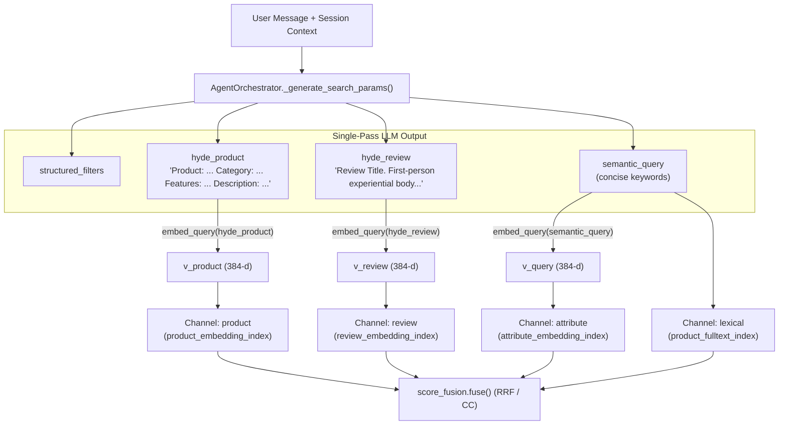

# Technical Specification: RS-08a & AI-10 — Dual-Channel Hypothetical Document Embeddings (HyDE) for Product and Review Vector Retrieval

**Date**: 2026-10-21
**Author**: Product Manager Agent (@pm-specs) & Full-Stack Engineer (@engineer)
**Status**: Approved Scope — Structure Review (Gate #3)
**Related Research**: `production_artifacts/Research_Report.md`, `production_artifacts/action_items/Retrieval_Score_Redesign_Roadmap.md` (RS-08, AI-10, D-3)
**Vision Alignment**: `production_artifacts/Vision_Report.md` §3.3 (Hybrid Semantic-Structural Retrieval), Decision `2026-09-28-006` (Single-Pass Structured Query Generation), Decision `2026-10-17-013` (Reciprocal Rank Fusion)
**Branch**: `feature/afp-002-vector-aggregation`

---

## 1. Executive Summary

In the Neo4j Knowledge Graph v2 (`265,307` `ParentProduct` nodes and `1,081,137` embedded `Review` nodes), vector representations are stored across two distinct semantic spaces using `sentence-transformers/all-MiniLM-L6-v2` (384 dimensions, 256-token window):
1. **`product_embedding_index`**: Populated via `product_text_v1` (`Product: {title}. Category: {category}. Features: {attrs}. Description: {description}`).
2. **`review_embedding_index`**: Populated via `review_text_v1` (`{review_title}. {review_body}` truncated to 800 characters).

Previously, `GraphSearchTool` embedded a single short `semantic_query` string into one vector and passed that identical vector to all vector indices. Because conversational requests (*"something quiet for coding late at night that won't wake my roommate"*) differ structurally from catalog metadata and stylistically from first-person customer reviews, single-vector asymmetric search suffers from representation mismatch and negation blindness (NevIR).

This specification integrates **Dual-Channel HyDE (`RS-08a` & `AI-10`)** into the production pipeline with zero additional LLM calls per turn:
1. **Single-Pass Dual HyDE Generation**: `SEARCH_GENERATION_PROMPT` and `AgentOrchestrator._generate_search_params()` are extended to emit `hyde_product` (catalog-formatted hypothetical product) and `hyde_review` (first-person experiential review with affirmative phrasing) alongside `structured_filters` and `semantic_query`.
2. **Per-Channel Vector Routing**: `GraphSearchTool` embeds `hyde_product` for the `"product"` channel (`product_embedding_index`), `hyde_review` for the `"review"` channel (`review_embedding_index`), and retains `semantic_query` for the `"attribute"` and `"lexical"` channels.
3. **Ablation & Evaluation Support (`AI-10`)**: `FusionConfig` and `FUSION_ARMS` in `src/tools/score_fusion.py` gain a `use_hyde: bool = True` switch plus explicit control/ablation arms (`rrf3_no_hyde`, `wrrf3_no_hyde`, `rrf4_no_hyde`, `wrrf4_no_hyde`, and `hyde_only`), enabling zero-variance paired evaluation via `eval_trace["search_request"]` replay.

---

## 2. Requirements

### 2.1 Functional Requirements

| ID | Requirement | Priority | Description |
|----|-------------|----------|-------------|
| **FR-HYDE-001** | Single-pass `hyde_product` and `hyde_review` prompt rules | Must | Extend `SEARCH_GENERATION_PROMPT` in `src/agents/orchestrator.py` (via `HYDE_GENERATION_RULE`) to instruct the LLM to generate:<br>• `hyde_product`: formatted as `"Product: <title>. Category: <category>. Features: <comma-separated specs>. Description: <concise description>"` (< 160 words / < 256 tokens), brand-agnostic unless the user stated a brand, converting negative constraints into affirmative specs.<br>• `hyde_review`: formatted as `"<Review Title>. <1-2 paragraph first-person review body>"` ($\le 800$ characters), focusing on subjective/experiential qualities in affirmative language.<br>• Both fields MUST be `null` when `product_type_decided` is `false`. |
| **FR-HYDE-002** | Template normalization & length guards | Must | Provide deterministic helpers `_normalize_hyde_product(raw_hyde, category)` and `_normalize_hyde_review(raw_hyde)` in `src/agents/orchestrator.py`:<br>• Strip null-like values (`None`, `""`, `"null"`, `"none"`, `"n/a"`).<br>• Ensure `hyde_product` starts with `"Product:"` (wrapping raw descriptions into the `product_text_v1` layout if needed) and is bounded to `HYDE_PRODUCT_MAX_CHARS = 1000`.<br>• Truncate `hyde_review` to `REVIEW_MAX_CHARS = 800` (`src/knowledge_graph/graphdb/embedding_templates.py`).<br>• Force both to `None` when `product_type_decided is False`. |
| **FR-HYDE-003** | Orchestrator forwarding & `eval_trace` capture | Must | In `AgentOrchestrator._execute_step()`, pass `hyde_product` and `hyde_review` in `search_kwargs` to `self.graph_tool.search(...)` when non-empty. Include them in `eval_trace["search_request"]` so `scripts/evaluate_retrieval.py` replays both HyDE and non-HyDE arms from the same LLM turn. |
| **FR-HYDE-004** | Per-channel vector routing in `GraphSearchTool` | Must | Extend `GraphSearchTool.search()`, `_execute_hybrid_search()`, `_execute_vector_search()`, and `_execute_fused_search()` in `src/tools/graph_search_tool.py` to accept `hyde_product: Optional[str] = None` and `hyde_review: Optional[str] = None`:<br>• Always compute `query_vector = self.embedder.embed_query(text)` as the base vector.<br>• When `config.use_hyde` is `True`:<br>  - If `hyde_product` is non-blank and `"product" in config.channels`, embed `v_product = self.embedder.embed_query(hyde_product)` and pass it as `$vector` to the `"product"` channel query.<br>  - If `hyde_review` is non-blank and `"review" in config.channels`, embed `v_review = self.embedder.embed_query(hyde_review)` and pass it as `$vector` to the `"review"` channel query.<br>  - The `"attribute"` channel uses `query_vector` and `"lexical"` uses `query_text`.<br>• Preserve `hyde_product` and `hyde_review` across all MACS progressive relaxation passes. |
| **FR-HYDE-005** | `FusionConfig.use_hyde` & ablation arms (`AI-10`) | Must | In `src/tools/score_fusion.py`:<br>• Add `use_hyde: bool = True` to `FusionConfig` and include `"use_hyde"` in `FusionConfig.to_dict()`.<br>• Add ablation arms to `FUSION_ARMS`: `rrf3_no_hyde`, `wrrf3_no_hyde`, `rrf4_no_hyde`, `wrrf4_no_hyde` (`use_hyde=False`), and `hyde_only` (`channels=("product", "review")`, `weights={"product": 0.70, "review": 0.30}`, `use_hyde=True`). |
| **FR-HYDE-006** | HyDE metadata telemetry | Must | Record `result["metadata"]["hyde"] = {"enabled": config.use_hyde, "product_used": bool, "review_used": bool, "hyde_product": ..., "hyde_review": ...}` in `GraphSearchTool._execute_fused_search()`. |

### 2.2 Non-Functional Requirements

| ID | Requirement | Target | Description |
|----|-------------|--------|-------------|
| **NFR-HYDE-001** | Zero extra LLM calls | 0 additional LLM calls per turn | `hyde_product` and `hyde_review` are generated inside the existing `_generate_search_params` JSON payload. |
| **NFR-HYDE-002** | Backward compatibility | 100% existing tests pass | When `hyde_product` and `hyde_review` are `None` or omitted (as in existing unit tests and mocks), `GraphSearchTool` calls `embed_query(text)` once and routes `query_vector` to all channels identically to pre-HyDE behavior. |
| **NFR-HYDE-003** | Embedding latency budget | $\le 15\text{ ms}$ local CPU/MPS overhead | Encoding two short texts (< 200 words) with `all-MiniLM-L6-v2` adds negligible local latency compared to LLM inference. |

---

## 3. Architecture & Tech Stack

### 3.1 Technology Choices

| Layer | Technology | Justification |
|-------|-----------|---------------|
| Hypothetical Document Generation | OpenAI `gpt-4o` (via `SimpleLLMHandler`) | Generates domain-accurate product specs and experiential review prose in a single JSON pass. |
| Dense Vector Encoding | `sentence-transformers/all-MiniLM-L6-v2` (`EmbeddingService`) | Matches the exact 384-d space of `product_embedding_index` and `review_embedding_index` in Neo4j Graph v2. |
| Multi-Channel Score Fusion | Reciprocal Rank Fusion (`src/tools/score_fusion.py`) | Scale-free rank fusion combines `product` ($\vec{v}_{\text{prod}}$), `review` ($\vec{v}_{\text{rev}}$), `attribute` ($\vec{v}_{\text{query}}$), and `lexical` channels. |

### 3.2 Component Architecture



---

## 4. API / Interface Design

### 4.1 New Interfaces & Helpers (`src/agents/orchestrator.py`)

```python
HYDE_PRODUCT_MAX_CHARS: int = 1000
HYDE_REVIEW_MAX_CHARS: int = 800

def _normalize_hyde_product(raw_hyde: Any, category: Optional[str] = None) -> Optional[str]:
    """
    Validates and normalises a hypothetical product document to match product_text_v1
    ('Product: ... Category: ... Features: ... Description: ...') within HYDE_PRODUCT_MAX_CHARS.
    Returns None for blank or null-like inputs.
    """

def _normalize_hyde_review(raw_hyde: Any) -> Optional[str]:
    """
    Validates and truncates a hypothetical customer review to HYDE_REVIEW_MAX_CHARS (800 chars).
    Returns None for blank or null-like inputs.
    """
```

### 4.2 Modified Interfaces

1. **`FusionConfig` (`src/tools/score_fusion.py`)**:
   ```python
   @dataclass(frozen=True)
   class FusionConfig:
       name: str = DEFAULT_ARM
       method: str = "rrf"
       channels: Tuple[str, ...] = DEFAULT_CHANNELS_3
       weights: Dict[str, float] = field(default_factory=lambda: {c: 1.0 for c in DEFAULT_CHANNELS_3})
       rrf_k: int = 60
       channel_depth: int = 100
       ann_k_per_limit: int = 30
       soft_bonus_beta: float = 0.25
       use_hyde: bool = True
   ```

2. **`GraphSearchTool.search` (`src/tools/graph_search_tool.py`)**:
   ```python
   def search(
       self,
       semantic_query: Optional[str] = "",
       structured_filters: Optional[Dict[str, Any]] = None,
       limit: int = 5,
       query: Optional[str] = None,
       preferences: Optional[Dict[str, Any]] = None,
       soft_preferences: Optional[List[Dict[str, Any]]] = None,
       fusion_config: Optional[FusionConfig] = None,
       mask_review_asins: Optional[Sequence[str]] = None,
       hyde_product: Optional[str] = None,
       hyde_review: Optional[str] = None,
   ) -> Dict[str, Any]:
   ```

---

## 5. Data Model / State Management

### 5.1 Search Request & Telemetry Payload
- `eval_trace["search_request"]` includes optional `"hyde_product"` and `"hyde_review"` keys whenever generated.
- `search_result["metadata"]["hyde"]` records:
  ```json
  {
    "enabled": true,
    "product_used": true,
    "review_used": true,
    "hyde_product": "Product: ...",
    "hyde_review": "Quiet and comfortable. ..."
  }
  ```

---

## 6. Implementation Phases

| Phase | Scope | Dependencies | Estimated Effort |
|-------|-------|-------------|-----------------|
| 1 | `src/tools/score_fusion.py` — `FusionConfig.use_hyde` and ablation arms (`rrf3_no_hyde`, `wrrf3_no_hyde`, `rrf4_no_hyde`, `wrrf4_no_hyde`, `hyde_only`) | None | S |
| 2 | `src/tools/graph_search_tool.py` — Per-channel vector routing (`hyde_product` $\to$ `product`, `hyde_review` $\to$ `review`), MACS propagation, and metadata telemetry | Phase 1 | M |
| 3 | `src/agents/orchestrator.py` — `HYDE_GENERATION_RULE` in `SEARCH_GENERATION_PROMPT`, `_normalize_hyde_product`, `_normalize_hyde_review`, and `search_kwargs` wiring | Phase 2 | M |
| 4 | `tests/test_hyde_retrieval.py` — Unit & integration tests verifying prompt rules, normalization, per-channel vectors, MACS preservation, and ablation arms | Phases 1–3 | M |

---

## 7. File Structure

### New Files
- `production_artifacts/Technical_Specification_HyDE.md` — This specification document.
- `tests/test_hyde_retrieval.py` — Dedicated unit and integration test suite for Dual-Channel HyDE.

### Modified Files
- `src/tools/score_fusion.py` — Add `use_hyde: bool = True` to `FusionConfig` and register HyDE / non-HyDE ablation arms in `FUSION_ARMS`.
- `src/tools/graph_search_tool.py` — Accept `hyde_product` and `hyde_review`, compute per-channel embeddings when `config.use_hyde` is `True`, route channel-specific `$vector` parameters to Neo4j, and record `metadata["hyde"]`.
- `src/agents/orchestrator.py` — Add `HYDE_GENERATION_RULE` to `SEARCH_GENERATION_PROMPT`, add `_normalize_hyde_product` and `_normalize_hyde_review`, normalize HyDE outputs in `_generate_search_params`, and pass them to `self.graph_tool.search` in `_execute_step`.
- `production_artifacts/Implementation_Plan.md` — Update `RS-08` (`RS-08a` Dual-Channel HyDE + `RS-08b`) and `AI-10`.

---

## 8. Acceptance Criteria

| ID | Criterion | Verification Method |
|----|-----------|-------------------|
| **AC-HYDE-001** | `SEARCH_GENERATION_PROMPT` specifies `hyde_product` (`Product: ... Category: ... Features: ... Description: ...`) and `hyde_review` rules while keeping all existing `RS-23` rules intact. | Unit test (`tests/test_hyde_retrieval.py`, `tests/test_category_recovery.py`) |
| **AC-HYDE-002** | `_normalize_hyde_product` wraps bare strings into the `Product: ...` template, enforces `HYDE_PRODUCT_MAX_CHARS = 1000`, and returns `None` for null-like values; `_normalize_hyde_review` enforces `800` chars. | Unit test (`tests/test_hyde_retrieval.py`) |
| **AC-HYDE-003** | When `product_type_decided` is `False`, `_generate_search_params` sets `hyde_product` and `hyde_review` to `None`. | Unit test (`tests/test_hyde_retrieval.py`) |
| **AC-HYDE-004** | `GraphSearchTool.search` routes the `hyde_product` embedding to `product_embedding_index`, the `hyde_review` embedding to `review_embedding_index`, and the `semantic_query` embedding to `attribute_embedding_index`. | Unit test (`tests/test_hyde_retrieval.py`) |
| **AC-HYDE-005** | When `config.use_hyde` is `False` (e.g. `rrf3_no_hyde`), `GraphSearchTool` ignores `hyde_product` and `hyde_review` and uses `semantic_query` for all vector channels. | Unit test (`tests/test_hyde_retrieval.py`) |
| **AC-HYDE-006** | When `hyde_product` or `hyde_review` is `None`, `GraphSearchTool` falls back to `semantic_query` for that channel without extra `embed_query` calls. | Unit test (`tests/test_hyde_retrieval.py`) |
| **AC-HYDE-007** | MACS relaxation passes preserve `hyde_product` and `hyde_review` vectors across all cascade steps. | Unit test (`tests/test_hyde_retrieval.py`) |

---

## 9. Risks & Mitigations

| Risk | Impact | Probability | Mitigation |
|------|--------|-------------|-----------|
| LLM invents a specific brand in `hyde_product` when the user did not ask for one | Medium | Low | Explicit rule in `HYDE_GENERATION_RULE` forbidding brand/model names unless present in `structured_filters.brand`; hard Cypher filters and RRF agreement across channels further bound the candidates. |
| LLM returns `hyde_product` without the `"Product:"` prefix | Low | Medium | `_normalize_hyde_product` deterministically wraps bare text into the `Product: ... Category: ... Features: ... Description: ...` template. |
| Extra `embed_query` calls break existing unit tests that assert call count or single return value | Medium | Low | `hyde_product` and `hyde_review` are only embedded when non-blank and distinct from `text`; existing tests pass `None` and trigger only 1 `embed_query` call. |
