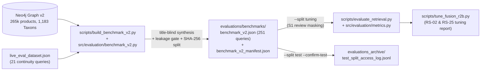

# Technical Specification: Release R2b — Stratified Benchmark v2 (RS-21), Review-Bias Redefinition, S1 Cold-Start Masking (G-9), and Fusion Tuning Protocol (RS-02 / RS-25)

**Date**: 2026-10-20
**Author**: Product Manager Agent (@pm-specs)
**Status**: Approved 2026-10-20 (Gate #1 & Gate #2)
**Related Research**: `production_artifacts/Research_Report.md` (§1–§7, including §7 R2b Graph v2 Empirical Amendment: decisions R2b-D1 … R2b-D4)
**Vision Alignment**: Decisions `2026-10-18-014` (Stratified Benchmark v2), `2026-10-18-015` (R2 Evaluation Protocol), `2026-10-19-018` item 9 / G-9 (S1 cold-start redefinition on Graph v2)
**Roadmap**: Release R2b of `production_artifacts/Implementation_Plan.md` (RS-21, RS-02 evidence, RS-25 fusion tuning)
**Branch**: `feature/afp-002-vector-aggregation`

---

## 1. Executive Summary

Release R2a delivered the dialogue metrics, spurious-CLARIFY recovery (`RS-23`), three-valued `constraint-satisfaction@K`, paired statistical tests, and citable run archiving. On 2026-10-20, **Graph v2** (`265,307` products, `0` ghost nodes, `3,382,248` reviews, `1,183` `Taxon` nodes, `99.995%` review-embedding coverage) and **Stage 0** (`GV2-01` … `GV2-06`) were completed.

**Release R2b** completes the evaluation foundation on Graph v2 in four parts:
1. **Stratified Benchmark v2 (`RS-21`)**: Replaces the underpowered 21-query popular-only fixture with **251 total queries** frozen on Graph v2:
   - **200 new stratified retrieval queries** (`40` per stratum `S0` Control, `S1` Cold/Review-Sparse, `S2` Sparse Title, `S3` Accessory Trap, `S4` Many-Feature Trade-off) across $\ge 15$ product categories / `Taxon` subtrees;
   - **30 ambiguous queries** (`Stratum A`, `gold_action = "CLARIFY"`, `type_explicit = false`) to measure clarification recall and precision;
   - **21 continuity queries (`legacy-21`)** assigned to `split = "tuning"` and `stratum = "legacy"`.
2. **S1 Cold-Start Simulation (`G-9`)**: Because `99.995%` of Graph v2 products have embedded reviews (only 8 priced products have 0 reviews), `S1` targets products with `1–2` reviews in the graph (`17,193` priced candidates) and masks their reviews at query time (`mask_review_asins`) in both the `review` vector channel and attribute enrichment.
3. **Bias Metric Redefinition on Graph v2 (`C-8..C-11`)**: Because binary `>= 1 embedded review` is `1.000` for every strategy on Graph v2, `popularity_bias@k` on Graph v2 measures **Graph Review-Cap Bias** (share of top-$K$ products at the 20-review ingestion cap, catalogue base rate `0.519`), supplemented by a new **`head_popularity_bias@k`** metric (share of top-$K$ products in the top decile of Amazon `p.review_count >= 1,241`, catalogue base rate `0.100`) and per-stratum breakdowns (`by_stratum`).
4. **Hashed Split Freeze & Tuning Protocol (`RS-02` & `RS-25`)**: Enforces a deterministic hashed grouped split (`sha256(salt + parent_asin) % 100 < 60` $\rightarrow$ `test`, else `tuning`), guards `--split test` behind `--confirm-test` with an audit log, and provides a deterministic channel-replay tuning script (`scripts/tune_fusion_r2b.py`) for `RS-02` (`rrf2` vs `rrf3`) and `RS-25` (`wrrf3` vs `rrf3`, channel weights, RRF $k$).

---

## 2. Requirements

### 2.1 Functional Requirements

| ID | Requirement | Priority | Description |
|----|-------------|----------|-------------|
| **FR-R2B-001** | Strata target selection on Graph v2 (`S0`–`S4`) | Must | `scripts/build_benchmark_v2.py` selects `40` distinct target `ParentProduct` nodes per stratum (`200` total, no `parent_asin` shared across strata or with `legacy-21`) from live Neo4j v2 across $\ge 15$ distinct `Taxon` leaves / categories, all satisfying `p.price > 0`, `p.embedding IS NOT NULL`, and `p.title IS NOT NULL`: • **`S0` (Control, 40)**: `graph_rev_count >= 5`, $\ge 2$ `HAS_ATTRIBUTE` edges, $\ge 3$ `p.features` bullets, $\ge 5$ non-boilerplate keys in `p.details_json`, and $\ge 5$ same-leaf `Taxon` peers with cosine similarity $\ge 0.55$. • **`S1` (Cold / Review-Sparse, 40, G-9)**: `graph_rev_count IN [1, 2]`, $\ge 3$ `p.features` bullets, $\ge 4$ keys in `p.details_json`. Marked with `"mask_target_reviews": true`. • **`S2` (Sparse Title, 40)**: title has $\le 4$ content tokens after removing brand tokens, alphanumeric model codes and stop words (and $\le 6$ raw words), while `size(p.features) >= 3` and `details_json` has $\ge 5$ keys. • **`S3` (Accessory Trap, 40)**: target sits in a primary device `Taxon` leaf whose head noun `T` has $\ge 30\%$ of whole-word title matches sitting in other `Taxon` leaves (verified set: `laptop`, `camera`, `monitor`, `keyboard`, `speaker`, `tablet`, `webcam`, `microphone`, `projector`, `tripod`, `router`, `mouse`, `headphones`, `charger`), and the category pool has $\ge 5$ accessory items containing `T` in their title. • **`S4` (Many-Feature Trade-off, 40)**: query specifies $\ge 4$ concrete requirements (price bound + brand/attributes/specs) where 0 products in the same `Taxon` leaf satisfy all 4 simultaneously on known values, and the target satisfies $\ge 3$ requirements as the top partial match. |
| **FR-R2B-002** | Ambiguous stratum (`A`, 30 queries) | Must | Include `30` ambiguous queries (`stratum = "A"`, `gold_action = "CLARIFY"`, `type_explicit = false`, `target_asin = null`, `ground_truth_asins = []`) covering three subtypes (`10` each): (a) open gift/use-case without product type (*"something electronic for a college dorm under $80"*), (b) undecided between two distinct categories (*"not sure whether to get a tablet or a portable monitor for travel"*), and (c) generic accessory/part mention without host device or type (*"I need a replacement cord for my setup"*). Split deterministically by `sha256(salt + query_id) % 100 < 60` (`~18` test, `~12` tuning). |
| **FR-R2B-003** | Title-blind utterance synthesis & gold constraints | Must | For each `S0`–`S4` target, generate a natural conversational request and its `gold_constraints` list **without passing `p.title` to the generator**. Input consists only of: product type noun (from `Taxon` leaf), `p.features` bullets, `p.details_json` specs, `HAS_ATTRIBUTE` pairs, and a budget computed as `round_nice(target.price * U(1.15, 1.45))` (for `budget_stated` items, ~75% of queries). `brand` is passed only when the item is in the `brand_anchored` slice (~25% of queries). Every `gold_constraint` in `S0`–`S3` must pass `judge(target_facts, constraint) != "violated"`. |
| **FR-R2B-004** | Automatic leakage & lexical-triviality verification | Must | `src/evaluation/benchmark_v2.py:check_query_leakage` computes for every `S0`–`S4` query: 1. `model_code_leak` (bool): whether any alphanumeric model token from `target_title` (having both letters and digits, $\ge 3$ chars, excluding standard units like `1080p`, `4k`, `65w`, `128gb`, `5ghz`, `usb3`, `wifi6`, `bluetooth5`) appears in the utterance; 2. `unflagged_brand_leak` (bool): whether `target_brand` appears in the utterance when `brand_anchored = false`; 3. `title_token_overlap` (float): fraction of `target_title` content tokens (excluding stop words, brand tokens, and the product-type head noun) present in the utterance; 4. `tfidf_target_rank` (int): 1-based rank of `target_title` when ranking all priced products in the target's `Taxon` leaf (or `Category`) by pure-Python TF-IDF cosine similarity between `utterance` and `p.title`. **Gate**: Every `S0`–`S4` item must have `model_code_leak == False`, `unflagged_brand_leak == False`, and `title_token_overlap <= 0.30`. Every `test`-split item must also have `tfidf_target_rank > 1` (not lexically trivial). |
| **FR-R2B-005** | Hashed grouped split & `legacy-21` continuity | Must | `assign_split(parent_asin, salt="crs_r2b_20261020")` assigns `"test"` if `int(sha256((salt + ":" + parent_asin).encode()).hexdigest(), 16) % 100 < 60` else `"tuning"`. All 21 items from `live_eval_dataset.json` are included in `benchmark_v2.json` with `stratum = "legacy"` and `split = "tuning"` (preserving their exact `query_id`, `utterance`, `target_asin`, and `gold_constraints`). |
| **FR-R2B-006** | Benchmark manifest & freeze | Must | `scripts/build_benchmark_v2.py` writes `evaluations/benchmarks/benchmark_v2.json` and `evaluations/benchmarks/benchmark_v2_manifest.json` (recording `sha256` of `benchmark_v2.json`, `salt`, `graph_version`, counts per stratum and split, category distribution, and leakage summary). |
| **FR-R2B-007** | Query-time review masking for `S1` (`G-9`) | Must | `GraphSearchTool.search` and `GraphSearchTool.fetch_product_attributes` accept an optional `mask_review_asins: Optional[Sequence[str]] = None` (default `None`). When non-empty: • In `_execute_hybrid_search` and `_execute_vector_search`, the `review` channel filters out any review node attached to `p.parent_asin IN $mask_review_asins` before ranking. • In `fetch_product_attributes`, the per-product review subquery returns no reviews (`WHERE NOT p.parent_asin IN $mask_review_asins`) for masked ASINs. • In `scripts/evaluate_retrieval.py`, when evaluating an item with `stratum == "S1"` (or `item.get("mask_target_reviews") is True`) and `--no-mask-s1-reviews` is not passed, `mask_review_asins=[target_asin]` is passed to `orchestrator` / `graph_tool` so the target simulates a 0-review cold-start product. |
| **FR-R2B-008** | Redefinition of `popularity_bias@k` & addition of `head_popularity_bias@k` | Must | • `GraphSearchTool.fetch_review_cap_asins(min_reviews: int = 20) -> List[str]` returns `ParentProduct` ASINs with $\ge 20$ `ABOUT_PRODUCT` reviews. • `GraphSearchTool.fetch_head_popular_asins(percentile: float = 0.90) -> Tuple[List[str], float]` computes the `percentile` threshold of `coalesce(p.review_count, 0)` over titled products (`P90 = 1,241` on v2) and returns the ASINs meeting that threshold plus the threshold value. • In `scripts/evaluate_retrieval.py`, when `graph_version == "v2"`, `popular_asins` (feeding `popularity_bias@k`) uses `fetch_review_cap_asins(20)` (titled base rate `0.519`), with metric label `"review-cap-bias@K (v2): share of top-K at the 20-review graph cap (5 embedded reviews)"`. When `graph_version != "v2"`, it falls back to `fetch_review_embedded_asins()`. • `src/evaluation/metrics.py` and `scripts/evaluate_retrieval.py` add `head_popularity_bias@k` (`HeadPopBias@K: share of top-K in top-10% catalogue review_count >= P90`), reported alongside `popularity_bias@k` in `aggregates_by_strategy` and `manifest.configuration`. |
| **FR-R2B-009** | Per-stratum aggregation (`by_stratum`) | Must | Each row in `per_query.jsonl` and `all_predictions` carries `stratum` (`"S0"`, `"S1"`, `"S2"`, `"S3"`, `"S4"`, `"A"`, `"legacy"`) and `split` (`"tuning"`, `"test"`). `aggregates_by_strategy[strat]` includes `by_stratum: {stratum: {n_all, n_search, hit@5, hit@10, hit@20, mrr@20, strict_ndcg@10, type_precision@5, cs_known@5, violation_free@5, popularity_bias@5, head_popularity_bias@5}}`. |
| **FR-R2B-010** | Split CLI flags & holdout protection (`--split`, `--confirm-test`) | Must | `scripts/evaluate_retrieval.py` adds `--split {all,tuning,test,legacy}` (default `"all"` for legacy 21-item file; when loading `benchmark_v2.json` without `--split`, defaults to `"tuning"` unless `--split` is explicitly specified). Running with `--split test` or `--split all` on `benchmark_v2.json` **requires** `--confirm-test` (exits with code 2 if omitted) and appends a JSON record (`timestamp`, `git_commit`, `split`, `query_count`, `strategies`) to `evaluations_archive/test_split_access_log.jsonl`. Provenance records `benchmark.split` in `manifest.json`. |
| **FR-R2B-011** | `RS-02` & `RS-25` tuning & channel-replay script | Must | `scripts/tune_fusion_r2b.py` accepts a tuning run directory (or runs live retrieval on `--split tuning` directly via `GraphSearchTool`) where per-channel candidate lists (`product`, `attribute`, `review`) are captured, and: 1. Evaluates the **RS-02 rule** (`rrf2` vs `rrf3` paired bootstrap 95% CI on $\Delta\text{HR@20}$, $\Delta\text{MRR@20}$, $\Delta\text{NDCG@10}$, and unique review finds share across `S0`–`S4` and `legacy`); 2. Evaluates **RS-25** (`wrrf3` vs `rrf3` paired randomization/bootstrap test, plus a deterministic grid search over weight triples $(w_{\text{prod}}, w_{\text{attr}}, w_{\text{rev}})$ and RRF constant $k \in \{20, 40, 60, 100\}$ on the tuning split only); 3. Writes `evaluations/benchmarks/r2b_tuning_report.json` with the empirical verdict and pre-registered comparisons. |

---

### 2.2 Non-Functional Requirements

| ID | Requirement | Target | Description |
|----|-------------|--------|-------------|
| **NFR-R2B-001** | Reproducibility | Deterministic given seed `20261020` | Candidate sampling, budget multipliers, split hashing, and TF-IDF leakage checks use explicit seed `20261020`. |
| **NFR-R2B-002** | Zero new dependencies | `requirements.txt` unchanged | TF-IDF, tokenization, and grid replay use pure Python and NumPy. |
| **NFR-R2B-003** | Backward compatibility | Existing tests pass (`100%`) | `live_eval_dataset.json` remains in the repository until R3 confirms on test; existing `evaluate_retrieval.py` invocations continue to work without breaking `tests/test_benchmark_alignment.py`. |
| **NFR-R2B-004** | Cypher parameterisation | `$params` only | All new queries in `GraphSearchTool` and `build_benchmark_v2.py` pass parameters via `$params`. |

---

## 3. Architecture & File Mapping

### Files to Create / Modify

1. **`src/evaluation/benchmark_v2.py` (NEW)**:
   - `BENCHMARK_V2_SALT = "crs_r2b_20261020"`
   - `assign_split(key: str, salt: str = BENCHMARK_V2_SALT, test_ratio: int = 60) -> str`
   - `extract_content_tokens(text: str, exclude_tokens: Set[str] = ...) -> List[str]`
   - `extract_model_codes(title: str) -> List[str]`
   - `compute_tfidf_target_rank(utterance: str, target_asin: str, pool_titles: Dict[str, str]) -> int`
   - `check_query_leakage(utterance: str, target_asin: str, target_title: str, target_brand: Optional[str], product_type: str, pool_titles: Dict[str, str], brand_anchored: bool = False) -> Dict[str, Any]`
   - `synthesize_title_blind_utterance(candidate: Dict[str, Any], stratum: str, rng: random.Random, brand_anchored: bool, budget_stated: bool) -> Tuple[str, List[Dict[str, Any]]]`
   - `filter_benchmark_by_split(items: Sequence[Dict[str, Any]], split: Optional[str]) -> List[Dict[str, Any]]`
2. **`scripts/build_benchmark_v2.py` (NEW)**:
   - Connects to live Neo4j v2, samples `S0` (40), `S1` (40), `S2` (40), `S3` (40), `S4` (40), generates `A` (30), merges `legacy-21` (`tuning`), runs leakage checks and live grounding verification, writes `evaluations/benchmarks/benchmark_v2.json` and `evaluations/benchmarks/benchmark_v2_manifest.json`.
3. **`src/tools/graph_search_tool.py` (MODIFY)**:
   - Add `fetch_review_cap_asins(self, min_reviews: int = 20) -> List[str]`
   - Add `fetch_head_popular_asins(self, percentile: float = 0.90) -> Tuple[List[str], float]`
   - Add `mask_review_asins: Optional[Sequence[str]] = None` to `search()`, `_execute_hybrid_search()`, `_execute_vector_search()`, and `fetch_product_attributes()`.
4. **`src/agents/orchestrator.py` (MODIFY)**:
   - Forward optional `mask_review_asins` from `state` / `run(..., mask_review_asins=...)` into `graph_tool.search` and `graph_tool.fetch_product_attributes`.
5. **`src/evaluation/metrics.py` & `scripts/evaluate_retrieval.py` (MODIFY)**:
   - Add `head_popularity_bias@k`, `by_stratum` breakdown, Graph v2 `fetch_review_cap_asins` switch for `popularity_bias@k`, `--split` / `--confirm-test` / `--no-mask-s1-reviews` CLI flags, and test-split access logging.
6. **`scripts/tune_fusion_r2b.py` (NEW)**:
   - Executes `RS-02` (`rrf2` vs `rrf3`) and `RS-25` (`wrrf3` vs `rrf3` + weight/$k$ grid) evaluation on the `tuning` split of `benchmark_v2.json` and outputs `evaluations/benchmarks/r2b_tuning_report.json`.
7. **`tests/test_r2b_benchmark_and_metrics.py` (NEW)**:
   - Comprehensive unit test suite verifying split determinism, leakage checks, S1 review masking, `popularity_bias@k` vs `head_popularity_bias@k`, `by_stratum` aggregation, `--confirm-test` guard, and `RS-02`/`RS-25` tuning logic.

---

## 4. Acceptance Criteria

- **AC-R2B-01**: `evaluations/benchmarks/benchmark_v2.json` contains exactly `251` items (`40` each of `S0`–`S4`, `30` of `A`, `21` of `legacy`), with `0` duplicate target `parent_asin`s across `S0`–`S4` and `legacy`, spanning $\ge 15$ categories / `Taxon` subtrees.
- **AC-R2B-02**: `100%` of `S0`–`S4` items pass `validate_benchmark_graph_grounding` against live Neo4j v2, `model_code_leak == False`, `unflagged_brand_leak == False`, `title_token_overlap <= 0.30`, and `100%` of `test`-split `S0`–`S4` items have `tfidf_target_rank > 1`.
- **AC-R2B-03**: `GraphSearchTool.search(..., mask_review_asins=[asin])` and `fetch_product_attributes(..., mask_review_asins=[asin])` completely exclude reviews of `asin` from the `review` channel and review snippets.
- **AC-R2B-04**: On Graph v2, `popularity_bias@k` uses `fetch_review_cap_asins(20)` (non-degenerate, $< 1.000$) and `head_popularity_bias@k` uses `fetch_head_popular_asins(0.90)`.
- **AC-R2B-05**: `evaluate_retrieval.py --split test` without `--confirm-test` exits with code 2 and does not execute queries; with `--confirm-test`, it logs an entry to `evaluations_archive/test_split_access_log.jsonl`.
- **AC-R2B-06**: `scripts/tune_fusion_r2b.py` produces `evaluations/benchmarks/r2b_tuning_report.json` on the `tuning` split with `RS-02` and `RS-25` statistical results.
