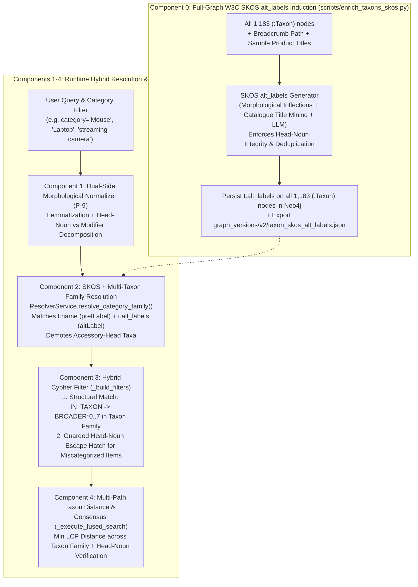

# Technical Specification: Release R3.2 — Domain-Agnostic Hybrid Product-Type Matching & W3C SKOS `alt_labels` Induction (`RS-24`)

**Document Version**: 1.1.0  
**Date**: 2026-10-22  
**Author**: @pm-specs (Product Manager — Spec Writer)  
**Status**: Approved for Implementation  
**Canonical Vision Reference**: `production_artifacts/Vision_Report.md` (Decision 2026-10-22-026), `production_artifacts/Research_Report.md` (§10)  
**Implementation Task**: `RS-24` from `production_artifacts/Implementation_Plan.md`

---

## 1. Executive Summary & Empirical Problem Statement

In Stage 1 (`GV2-07`) and Release R3.1 (`RS-03`, `RS-10`, `RS-07`), the retrieval engine transitioned to the 1,183-node Graph v2 `Taxon` hierarchy. In a parallel prototype session, `scripts/enrich_taxons_skos.py` was created and tested on 4 sample `Taxon` nodes (`Webcams`, `Traditional Laptops`, `Digital Cameras`, `Over-Ear Headphones`). However:
- **1,179 of 1,183 `:Taxon` nodes** in Neo4j still have `t.alt_labels = NULL`.
- `ResolverService` and `GraphSearchTool` in `src/` **do not yet query or consume `t.alt_labels`**.
- An empirical audit of target admission across the 105 retrieval tuning queries (`evaluations/benchmarks/benchmark_v2.json`) demonstrated that **13 of 105 target products (12.4% overall; 10 of 21 legacy queries = 47.6%) are hard-rejected by the Cypher category filter before vector or lexical scoring**:

1. **Accessory-Modifier Taxon Hijacking**:
   Queries for `"Laptop"`, `"Tablet"`, `"Phone"`, or `"Microphone"` match `Taxon` nodes via substring/word-boundary regex ordered by `product_count DESC`. Because `Laptop Accessories` ($4,912$ items), `Tablet Accessories`, `Phone & Tablet Accessories`, and `Headsets & Microphones` contain the query noun as a modifier and have higher product counts than the primary device leaves (`Traditional Laptops`, `Tablets`, `Microphones`), `ResolverService` resolves primary device queries to accessory subtrees, rejecting 100% of actual devices.
2. **Irregular Morphology & Inflection Blindness**:
   The hardcoded regex `(s)?` fails on irregular plurals (`Mouse` $\neq$ `Mice`), `-y`/`-ies` inflections (`Battery` $\neq$ `Batteries`), and invariant nouns (`Headphones`, `Glasses`, `Jeans`). For `"Mouse"`, `Mice` is missed and `Keyboard & Mouse Combos` is selected instead.
3. **Single-Taxon Collapse (`k=1`)**:
   `_normalize_single_category` collapses a broad product type (e.g., `"Charger"`, `"Laptop"`) into a single `Taxon` string, amputating parallel device branches (`Chargers & Adapters` vs `Power Adapters` vs `Power Converters` vs `Wall Chargers`; `Traditional Laptops` vs `2 in 1 Laptops`).
4. **Hard-Filter Cliff on Miscategorized Products**:
   Products miscategorized by sellers into promotional or coarse leaves (e.g., Samsung Galaxy S20+ in `samsung_tradein`, Logitech C920 in `Computers`, or `B0BRZ6VK9N` MacBook Air with empty taxon `[]`) are hard-rejected when the title fallback is blocked by `NOT EXISTS { (node)-[:IN_TAXON]->(:Taxon) }`.

Release R3.2 (`RS-24`) implements the complete **Domain-Agnostic Hybrid Product-Type Matching** architecture, uniting **full-catalog W3C SKOS `alt_labels` graph enrichment** (`scripts/enrich_taxons_skos.py` over all 1,183 `Taxon` nodes) with **dual-side morphological lemmatization (P-9)**, **head-noun vs. accessory-modifier awareness**, **multi-taxon family resolution**, **guarded lexical head-noun escape hatches**, and **bottom-up taxonomic consensus**.

---

## 2. Architecture & Component Design



---

### 2.1 Component 0: Full-Catalog W3C SKOS `alt_labels` Induction (`scripts/enrich_taxons_skos.py`)

Upgrade `scripts/enrich_taxons_skos.py` and execute it across **all 1,183 `:Taxon` nodes** in live Neo4j Graph v2:

1. **Refinements to `SKOSTaxonEnricher`**:
   - **Head-Noun Integrity Rule**:
     - When a `Taxon` is a pure device category (e.g. `Traditional Laptops`, `2 in 1 Laptops`, `Tablets`, `Mice`, `Microphones`, `Cell Phones`, `Bestselling Renewed Smartphones`, `Instant Cameras`, `Webcams`), its `alt_labels` include the bare singular/plural head noun (`"laptop"`, `"tablet"`, `"mouse"`, `"microphone"`, `"phone"`, `"smartphone"`, `"camera"`, `"webcam"`) plus natural buyer synonyms (`"notebook"`, `"portable computer"`, `"digicam"`, `"streaming camera"`, `"earbuds"`).
     - When a `Taxon` is an **accessory/bundle container** (`head_lemma` in `{"accessory", "case", "cover", "mount", "bag", "cable", "stand", "combo", "kit", "part", "protector", "sleeve", "strap", "skin"}` such as `Laptop Accessories`, `Tablet Accessories`, `Phone & Tablet Accessories`, `Keyboard & Mouse Combos`), it **must never** emit the bare modifier noun (`"laptop"`, `"tablet"`, `"phone"`, `"mouse"`) as an `alt_label`; every `alt_label` must preserve the accessory head noun (e.g., `"laptop accessory"`, `"tablet accessory"`, `"keyboard mouse combo"`).
   - **Noise Elimination in Catalogue Title Mining**:
     - Filter out token reduplication (`w1 == w2` or `lemma(w1) == lemma(w2)`, fixing `'webcam webcam'`).
     - Filter out plural nouns used as left modifiers (`'batteries camera'`, `'toys cameras'`) and brand leaks (cross-checking against `(:Brand)` names or proper-noun frequencies, fixing `'oladance headphones'`).
   - **Full-Graph Batch Execution & Provenance Artifact**:
     - Add `--all` flag to process all 1,183 `:Taxon` nodes in Neo4j.
     - Persist `t.alt_labels` onto all 1,183 `:Taxon` nodes in Neo4j via batched `UNWIND`.
     - Save deterministic snapshot to `graph_versions/v2/taxon_skos_alt_labels.json` so any Graph v2 rebuild can restore `t.alt_labels` without re-mining.

---

### 2.2 Component 1: Dual-Side Morphological Normalizer & Head-Noun Extractor (`src/knowledge_graph/graphdb/resolver_service.py`)

To obey Principle **P-9 (One normaliser, two sides)** without hardcoded domain regexes:

1. **Morphological Token Lemmatizer (`normalize_lemma(token: str) -> str`)**:
   - Uses NLTK's `WordNetLemmatizer` (when available) combined with a deterministic linguistic ruleset handling:
     - Irregular English plurals (`mice` $\to$ `mouse`, `men` $\to$ `man`, `women` $\to$ `woman`, `children` $\to$ `child`, `teeth` $\to$ `tooth`, `feet` $\to$ `foot`, `geese` $\to$ `goose`).
     - Invariant plurals preserved intact (`headphones`, `earbuds`, `earphones`, `glasses`, `sunglasses`, `eyeglasses`, `jeans`, `scissors`, `pants`, `shorts`, `trousers`, `leggings`, `goggles`, `binoculars`, `pliers`, `tweezers`, `stairs`, `clothes`, `electronics`, `accessories` $\to$ `accessory`).
     - Morphological suffixes: `-ies` $\to$ `-y` (`batteries` $\to$ `battery`, `accessories` $\to$ `accessory`), `-ves` $\to$ `-f`/`-fe` (`knives` $\to$ `knife`, `shelves` $\to$ `shelf`), `-ses`/`-xes`/`-zes`/`-ches`/`-shes` (`boxes` $\to$ `box`, `watches` $\to$ `watch`, `lenses` $\to$ `lens`), and standard `-s` stripping (excluding `-ss`, `-us`, `-is`).
   - Normalizes parenthetical qualifiers (e.g., `"laptop (MacBook Air)"` $\to$ head type `"laptop"`, modifier `"macbook air"`; `"smartphone (iPhone)"` $\to$ head type `"smartphone"`, modifier `"iphone"`).

2. **Head-Noun vs. Modifier Decomposition (`decompose_type_phrase(phrase: str) -> Dict[str, Any]`)**:
   - Strips parenthetical notes and splits on prepositions (`for`, `with`, `to`, `in`, `on`, `of`, `under`, `by`).
   - Identifies whether the phrase is a **compound conjunction** (contains `&` or `and`, e.g., `Keyboard & Mouse Combos`, `Chargers & Adapters`, `Headsets & Microphones`).
   - Extracts:
     - `lemmas`: tuple of lemmatized tokens in the main noun phrase.
     - `head_lemma`: the grammatical head noun of the main noun phrase (e.g., `Laptop Accessories` $\to$ `head_lemma = "accessory"`, `modifier_lemmas = ("laptop",)`; `Traditional Laptops` $\to$ `head_lemma = "laptop"`, `modifier_lemmas = ("traditional",)`).
     - `is_accessory_head`: boolean indicating whether `head_lemma` belongs to structural container/accessory nouns (`accessory`, `case`, `cover`, `mount`, `bag`, `cable`, `cord`, `stand`, `holder`, `protector`, `skin`, `sleeve`, `strap`, `dock`, `hub`, `combo`, `bundle`, `kit`, `part`, `replacement`, `supply`, `attachment`, `plate`, `bracket`, `cleaner`, `repair`, `savings`, `tradein`, `warranty`).

---

### 2.3 Component 2: SKOS `alt_labels` + Head-Noun Aware `Taxon` Resolution (`src/knowledge_graph/graphdb/resolver_service.py`)

1. **In-Memory Taxon Cache Enrichment (`_ensure_taxon_cache`)**:
   - Fetches all 1,183 `:Taxon` nodes (`name`, `path`, `product_count`, `depth`, `taxon_id`, `alt_labels`) once and precomputes `decompose_type_phrase(name)` plus lemmatized `alt_labels` for every `Taxon` in memory.
   - Also updates `_execute_waterfall` Tier 1 Cypher query for `Taxon` to check both `toLower(node.name) = toLower($text)` and `any(alt IN coalesce(node.alt_labels, []) WHERE toLower(alt) = toLower($text))` while respecting head-noun integrity.

2. **Deterministic SKOS + Morphological + Vector Scoring (`resolve_taxon(text: str, k: int = 5) -> List[Dict]`)**:
   Scores cached `Taxon` nodes using a principled 5-level hierarchy:
   - **Score $1.00$ (Exact `prefLabel` or Lemmatized `prefLabel` Match)**:
     The query's lemmatized tokens exactly equal the `Taxon` name's lemmatized tokens (e.g., `"Mouse"` == `"Mice"`, `"Tablet"` == `"Tablets"`, `"Webcam"` == `"Webcams"`, `"Microphone"` == `"Microphones"`).
   - **Score $0.96$ (Exact SKOS `alt_labels` Match on Non-Accessory Taxon)**:
     The query string (or its lemmatized form) exactly matches an entry in `Taxon.alt_labels` (e.g., `"streaming camera"` $\to$ `Webcams`, `"notebook"` or `"laptop"` $\to$ `Traditional Laptops`, `"digicam"` $\to$ `Digital Cameras`, `"smartphone"` $\to$ `Cell Phones` / `Bestselling Renewed Smartphones`).
   - **Score $0.92$ (Primary Head-Noun Match on Pure Device Taxon)**:
     The `Taxon`'s `head_lemma` equals the query's `head_lemma`, the `Taxon` is **not** a compound `&` container or accessory head (`is_accessory_head == False`), and modifier lemmas are compatible.
   - **Score $0.88$ (Compound Peer Taxon Sharing Primary Head Noun)**:
     The `Taxon` is a compound `&` category where one of the coordinated head nouns equals the query's `head_lemma` and is not an accessory container (e.g., query `"Charger"` matching `Chargers & Adapters` and `Batteries & Chargers`).
   - **Score $0.45$ (Accessory-Modifier Hijack Demotion)**:
     When the query does *not* ask for an accessory (`query.is_accessory_head == False`), but the `Taxon` has `is_accessory_head == True` and only contains the query's `head_lemma` as a modifier (`Laptop Accessories`, `Tablet Accessories`, `Phone & Tablet Accessories`, `Keyboard & Mouse Combos`), its lexical score is capped at $0.45$ ($< 0.70$).
   - **Tier 3 Vector Fallback (In-Memory Cosine Similarity)**:
     When lexical/SKOS/morphological matching yields no candidates $\ge 0.70$, falls back to in-memory vector similarity over `_taxon_embeddings` (also penalizing accessory-head taxa when the query is a primary device).

3. **Multi-Taxon Family Expansion (`resolve_category_family(text: str, query_text: Optional[str] = None, max_taxa: int = 6) -> List[Dict]`)**:
   - Resolves `text` (and, if `query_text` contains a more specific product head noun than a coarse filter like `"Camera"` $\to$ `"webcam"`, also resolves the specific head noun from `query_text`).
   - Returns all `Taxon` candidates with `score >= 0.85` (up to `max_taxa = 6`), or the single validated top candidate if `0.70 <= score < 0.85`.

---

### 2.4 Component 3: Guarded Lexical Head-Noun Escape Hatch in Cypher (`src/tools/graph_search_tool.py`)

In `GraphSearchTool`:
1. **`_normalize_filters(filters: Dict[str, Any], query_text: Optional[str] = None) -> Dict[str, Any]`**:
   - Uses `ResolverService.resolve_category_family(raw_val, query_text=query_text)` to populate `normalized["categories"]` (list of resolved `Taxon` names) while keeping `normalized["category"] = family[0]["name"]` for backward compatibility.
   - Extracts the canonical lemmatized head-noun pattern(s) (both singular and plural forms, e.g., `mouse|mice`, `smartphone|cell phone|iphone|phone`, `laptop|chromebook|macbook|notebook`, `webcam|camera`) into `normalized["_head_noun_regexes"]`.

2. **`_build_filters(filters: Dict[str, Any], raw_filters: Optional[Dict[str, Any]] = None)`**:
   - Replaces the brittle single-category clause with the **Hybrid Structural + Guarded Escape Hatch** clause:
     ```cypher
     (
         EXISTS {
             MATCH (node)-[:IN_TAXON]->(leaf:Taxon)-[:BROADER*0..7]->(ancestor:Taxon)
             WHERE ANY(cat_rx IN $categories_filter WHERE ancestor.name =~ cat_rx OR leaf.name =~ cat_rx)
         }
         OR (
             ANY(raw_rx IN $raw_categories_filter WHERE toLower(node.title) =~ raw_rx)
             AND NOT toLower(node.title) =~ $accessory_exclusion_regex
         )
     )
     ```
   - **How the Guarded Escape Hatch works**:
     - If a product is miscategorized by the seller (e.g., Samsung Galaxy S20+ in `['samsung_tradein']`, Logitech C920 in `['Computers']`, or Apple MacBook Air with `taxa = []`), the first branch (`IN_TAXON`) is false, **but** the second branch checks whether `node.title` matches the lemmatized head-noun regex (`$raw_categories_filter`) **AND** does not match `$accessory_exclusion_regex`.
     - `$accessory_exclusion_regex` rejects titles where the product is an accessory *for* the target device (e.g., `(?i).*\b(case|cover|protector|screen protector|cable|cord|mount|stand|holder|bag|sleeve|skin|strap|replacement)s?\b.*\b(for|compatible with|fits)\b.*`), unless the user explicitly requested one of those accessory types!

---

### 2.5 Component 4: Multi-Path Taxonomic Distance & Bottom-Up Consensus (`src/tools/graph_search_tool.py`)

In `GraphSearchTool._execute_fused_search`:
1. **Multi-Path Target Resolution**:
   - Collects `target_paths: List[List[str]]` for all `Taxon` nodes in the resolved category family.
   - Computes **Bottom-Up Category Consensus**: inspects the top-10 fused candidates; if $\ge 40\%$ of top candidates with valid `primary_taxon_path` share a leaf `Taxon` whose head noun matches the requested product type, that consensus `Taxon.path` is also included in `target_paths`.
2. **Minimum Family Distance & Escape-Hatch Verification**:
   - For each candidate with `cand_path`:
     $$\text{dist} = \min_{P \in \text{target\_paths}} \text{compute\_taxon\_distance}(P, \text{cand\_path})$$
   - If $\text{dist} \ge 5$ (or `cand_path` is empty/promotional like `['samsung_tradein']`), checks whether the candidate's title passes the Guarded Head-Noun verification (title contains the target head-noun lemma and is not an accessory trap):
     - If verified by title head-noun: assigns effective distance $1$ ($\text{multiplier} = 0.85$), preventing false demotion of miscategorized genuine devices.
     - If not verified (or is an accessory trap): retains $\text{multiplier} = 0.20$.

---

## 3. Acceptance Criteria & Verification Plan

| ID | Criterion | Verification Method |
|---|---|---|
| **AC-R3.2-00** | **Full-Graph W3C SKOS `alt_labels` Enrichment**: `scripts/enrich_taxons_skos.py --all` populates clean `t.alt_labels` across all 1,183 `:Taxon` nodes in Neo4j (zero token-reduplication noise like `'webcam webcam'`, zero bare-device labels on accessory taxa like `Laptop Accessories`) and writes `graph_versions/v2/taxon_skos_alt_labels.json`. | Live Neo4j query & JSON artifact verification |
| **AC-R3.2-01** | **Dual-Side Morphological Lemmatization (P-9)**: `ResolverService.normalize_lemma` and `decompose_type_phrase` accurately lemmatize irregular plurals (`mice` $\to$ `mouse`, `batteries` $\to$ `battery`), preserve invariant nouns (`headphones`, `glasses`, `jeans`), strip parenthetical brand notes (`laptop (MacBook Air)` $\to$ `laptop`), and distinguish primary head nouns from accessory heads (`Laptop Accessories` $\to$ head `accessory`, modifier `laptop`). | Unit test in `tests/test_r3_2_hybrid_product_type.py` |
| **AC-R3.2-02** | **SKOS + Anti-Hijacking Taxon Resolution**: `ResolverService.resolve_category` resolves `"streaming camera"` $\to$ `"Webcams"`, `"notebook"` $\to$ `"Traditional Laptops"`, `"digicam"` $\to$ `"Digital Cameras"`, `"Mouse"` $\to$ `"Mice"` (not `"Keyboard & Mouse Combos"`), `"Tablet"` $\to$ `"Tablets"` (not `"Tablet Accessories"`), `"Laptop"` $\to$ `"Traditional Laptops"` (not `"Laptop Accessories"`), `"Phone"` $\to$ `"Cell Phones"` (not `"Phone & Tablet Accessories"`), and `"microphone"` $\to$ `"Microphones"` (not `"Headsets & Microphones"`). | Unit & live integration test in `tests/test_r3_2_hybrid_product_type.py` |
| **AC-R3.2-03** | **Multi-Taxon Family Expansion**: `ResolverService.resolve_category_family` returns cohesive multi-branch families for broad product types (`"Charger"` includes `Chargers & Adapters`, `Power Adapters`, `Power Converters`, `Wall Chargers`; `"Camera"` with query `"streaming webcam"` includes `Webcams`). | Unit test in `tests/test_r3_2_hybrid_product_type.py` |
| **AC-R3.2-04** | **Guarded Lexical Head-Noun Escape Hatch**: `_build_filters` admits miscategorized genuine devices (`B08GNRGB67` Samsung Galaxy S20+ in `samsung_tradein`, `B0BRZ6VK9N` MacBook Air with `taxa = []`) while blocking accessory traps (`"Silicone Case Compatible with iPhone"` when searching for `"Phone"`). | Unit & live Cypher test in `tests/test_r3_2_hybrid_product_type.py` |
| **AC-R3.2-05** | **100% Target Admission on Tuning Benchmark (`n = 105`)**: On the 105 retrieval tuning queries of `evaluations/benchmarks/benchmark_v2.json`, Target-Admitting Category Rate increases from $87.6\%$ ($92/105$) to $100.0\%$ ($105/105$), recovering all 13 previously rejected targets. | Live diagnostic verification against Neo4j Graph v2 |
| **AC-R3.2-06** | **Zero Regression on Existing Test Suite**: All existing unit and integration tests (`test_stage1_taxon_and_lexical.py`, `test_r3_1_retrieval_refinements.py`, etc.) pass without regression. | `pytest` execution |
