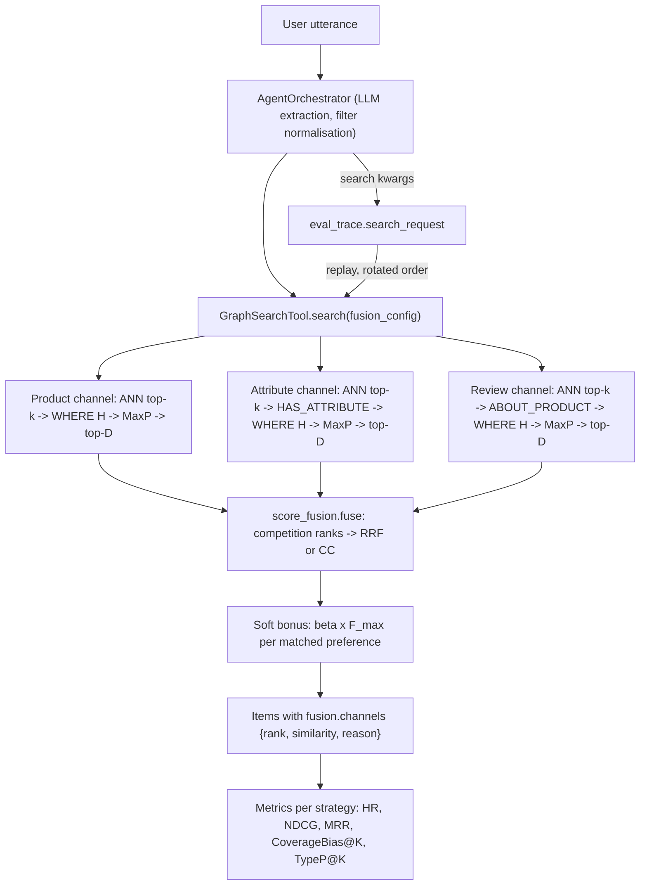

# Thesis Contribution 10: Fan-Out-Invariant Multi-Channel Fusion and Same-Request Fusion Ablation

**Document ID**: `10-doc-fusion-ablation`  
**Date**: 2026-10-18  
**Status**: Confirmed Master's Thesis Contribution (Methodological Artifact)  
**Git Scope**: Branch `feature/afp-002-vector-aggregation`, commits `99b8506` (code), `32f68cd` (decision, spec, audit), `9cbf426` (changelog), compared with `main`  
**Relevant Modules**: `src/tools/score_fusion.py` (new), `src/tools/graph_search_tool.py`, `src/agents/orchestrator.py`, `src/evaluation/metrics.py`, `scripts/evaluate_retrieval.py`  
**Design Sources**: `production_artifacts/Research_Report.md` (R1), `production_artifacts/Technical_Specification.md` (R1, incl. §11 amendments), Vision decision 2026-10-17-013, `production_artifacts/action_items/Proposed_Fix_Vector_Aggregation.md` (AFP-002), `production_artifacts/action_items/Retrieval_Score_Redesign_Roadmap.md`  
**Evidence**: `production_artifacts/Audit_Report.md` (PASS WITH FIXES); live runs `evaluations/eval_2026-10-17_1937` (primary) and `evaluations/eval_2026-10-17_1846` (replication); baseline `evaluations/eval_2026-10-09_1336` [Correction 2026-10-19: archived as non-citable legacy runs under `evaluations_archive/`; citable replication in `evaluations_archive/eval_2026-10-18_2340`, `_2349`, `_2358`; see C-2, C-3]  
**Relation to earlier contributions**: Replaces the unbounded vector term $S_{vec}$ of the additive scoring in `4-doc-hybrid-scoring.md`; extends the evaluation methodology of `7-doc-evaluation-framework.md` and `9-doc-pipeline-alignment.md`.

---

## Correction Note (2026-10-19, Thesis Evaluator)

The text below is kept as written on 2026-10-18. Numbers in it are **not** rewritten; places affected by this note are marked "[Correction 2026-10-19]". Sources: `production_artifacts/Audit_Report.md` (R2a audit, finding M-1; "R2a exit gate (2026-10-18)"), `production_artifacts/Technical_Specification.md` §13 A-10, Vision decision 2026-10-18-015, and `11-doc-evaluation-protocol.md`.

**C-1. Coverage-bias base rate.** The base rate used in §2.2, §4.1 and finding 2 (5,715 / 265,307 = 2.15%) counts every `ParentProduct` node. 104,281 of these nodes (39.3%) are ghost nodes with no title, no price and no category, only an embedding, and 4,874 of the 5,715 review-embedded products (85.3%) are ghosts. Over titled products the base rate is **841 / 161,026 = 0.52%**. The all-node rate is about 4.1 times the titled rate, so every "× base rate" statement in this document understates the bias about 4×. Both rates should be stated, with the titled rate as the main comparison (spec A-10). For the R1 values of Table 2 (`eval_2026-10-17_1937`):

| Arm | CovBias@5 | × all-node (2.15%) | × titled (0.52%) | CovBias@20 | × all-node | × titled |
|---|---:|---:|---:|---:|---:|---:|
| `sum_legacy` | 0.337 | 16× | 65× | 0.184 | 8.5× | 35× |
| `rrf3` | 0.212 | 9.8× | 41× | 0.146 | 6.8× | 28× |
| `rrf2` | 0.062 | 2.9× | 12× | 0.043 | 2.0× | 8.2× |
| `wrrf3` | 0.050 | 2.3× | 9.6× | 0.021 | 1.0× | 4.0× |
| `cc3` | 0.088 | 4.1× | 17× | 0.099 | 4.6× | 19× |

Consequences: finding 2's "about ten times the 2.15% base rate" for `rrf3` is about 41× the titled rate. The review-damped arms (`rrf2`, `wrrf3`), which looked close to the base rate, still over-represent review-embedded products 4–12× against titled products. Because `rrf2` has no review channel at all, that residual cannot come from the review channel. `11-doc-evaluation-protocol.md` §4.5 therefore uses the channel-off arm (`rrf2`) as the null for the review channel's own contribution.

**C-2. Status of the R1 evidence.** The runs cited in this document are now archived in git as **non-citable legacy evidence**: `evaluations_archive/eval_2026-10-17_1937`, `evaluations_archive/eval_2026-10-17_1846` and the baseline `evaluations_archive/eval_2026-10-09_1336`, all with `citable: false` and `legacy: true`. Their `git_commit` field does not reliably identify the evaluated code (989c1cd for the R1 runs, which ran uncommitted; 2fdf251 for the baseline, which records HEAD only with an unknown working-tree state), and their `per_query.jsonl` is reconstructed (`legacy_reconstructed: true`). Under Vision decision 2026-10-18-015 they may be cited as context only. The `evaluations/...` paths in the header are local, git-ignored copies.

**C-3. Citable replication (R2a).** The citable runs `evaluations_archive/eval_2026-10-18_2340`, `_2349` and `_2358` (commit `88cdbdf`) replay the same five arms on the same 21 queries. Extraction changed in R2a (all 21 queries now reach SEARCH, against 16–17 in R1; see `12-doc-clarification-gating.md`), so absolute values differ from Table 2. Where they measure the same quantity, cite them instead of the R1 runs:
- **$H_{1a}$ / $H_{1b}$ (coverage bias)**, cross-run mean, $n = 21$: CovBias@5 `sum_legacy` 0.502, `rrf3` 0.216, `cc3` 0.143, `rrf2` 0.054, `wrrf3` 0.038; CovBias@20 0.239, 0.192, 0.140, 0.051, 0.021. A post-hoc paired sign test against `sum_legacy` gives, for `rrf3`, 12–13/0 at $K = 5$ ($p \le 0.0005$) and 5/4 at $K = 20$ ($p = 1.0$) in every run; `rrf2` and `wrrf3` are 15–16/0 at both cutoffs. Finding 1 (fan-out removal cleans the head of the list only) and finding 2 (most residual bias is coverage bias) replicate.
- **$H_{1c}$ (ranking quality)**: the pre-registered primary comparison `rrf3` vs `sum_legacy` is not significant in any run (ΔRR +0.036 to +0.060, exact randomization $p \ge 0.47$; HR@20 discordant 1–1, McNemar $p = 1.0$). Finding 3 stands. `wrrf3` leads every metric and beats `sum_legacy` after Holm correction in all three runs, but its weights are untuned and the queries are tuning-side, so this is a hypothesis for R2b, not a result of this contribution.
- **$H_{1d}$ (replay fidelity)**: `hybrid == hybrid@rrf3` on 21 of 21 queries in each citable run (gate G-6).

**C-4. Target coverage, previously unmeasured.** §4.5 says that whether the benchmark targets belong to $P_{\text{rev}}$ was not measured. R2a measured it: 1 of the 21 targets (`charger_02`) is review-embedded, and every arm ranks it first.

**C-6. Graph version.** Vision decision 2026-10-19-021 (present in the working tree at the time of writing, not yet committed) records that the R1 results were measured on a v1 candidate pool containing 104,281 ghost products with identical blank-template embeddings, that they are valid as v1 evidence only, and that they will be re-baselined on graph v2 (2026-10-19-018). This applies to the R2a replication in C-3 as well, which also ran on v1.

**C-5. Rubric.** The scores in §6 are left as recorded on 2026-10-18. As of 2026-10-19, the reproducibility evidence for this contribution is the citable R2a replication (C-3), not the R1 runs, and the coverage-bias claims should be read with the titled base rate (C-1). The verdict (Methodological Artifact) is unchanged.

**C-7. Content of the v1 channels (added 2026-10-19, graph v2 evaluation, `13-doc-graph-integrity.md`).** Two v1 facts recorded in Vision 2026-10-19-021 limit what the channel comparisons can say:
- **Attribute channel.** Attributes hold only Material, Color, Style and Size, and no `numeric_value` exists (item 4). The attribute channel could therefore match colour, material, style and size, never a technical specification. Every statement here about the attribute channel's contribution concerns that channel. It is a lower bound for an attribute or specification channel in general (RS-03, RS-11).
- **Review channel.** The v1 review fields `helpful_votes` and `sort_timestamp` are 0 in all 1,630,273 rows (item 6). The v1 "20 most helpful reviews" sample was therefore ordered by `verified_purchase` only, and it was not a helpfulness sample. Together with C-1, the review channel of R1 and R2a is a v1-specific evidence set. Its $\text{rrf2}$ vs $\text{rrf3}$ differences do not transfer to v2.
- **Coverage-bias metric on v2.** Graph v2 embeds the top 5 reviews of every reviewed product (projected 265,294 of 265,307 products with at least one review). $P_{\text{rev}}$ will then cover nearly the whole catalogue, so coverage bias@K as defined in §3 stops discriminating. It must be redefined before it is reported on v2 (`13-doc-graph-integrity.md` §4.4, E-2). The v1 values in this document and in C-1 and C-3 remain valid as v1 evidence.

## Correction Note (2026-10-20, Thesis Evaluator, graph v2 executed)

The text above and below, including the 2026-10-19 note, is kept as written. Sources: `13-doc-graph-integrity.md` §7, `graph_versions/v2/baseline_comparison.json`, and the archived runs `evaluations_archive/eval_2026-10-18_2340`, `_2349`, `_2358` (v1, commit `88cdbdf`) and `eval_2026-10-20_1114`, `_1128`, `_1142` (v2, commit `4248d03`, `citable: true`, `GraphVersion` v2 validated). Benchmark, LLM snapshot and arm configuration are the same in all six runs.

**C-8. v1 → v2 re-baseline of the arms.** No arm changes significantly between the graphs (per-query mean over r = 3, paired randomization test, Holm across arms; all $p_{Holm} \ge 0.875$). MRR, v1 → v2:

| Arm | MRR v1 → v2 | Note |
|---|---|---|
| `rrf3` | 0.226 → 0.319 | +0.093, 95% CI [−0.004, +0.208] |
| `rrf2` | 0.237 → 0.206 | |
| `wrrf3` | 0.345 → 0.322 | |
| `cc3` | 0.298 → 0.288 | |
| `sum_legacy` | 0.176 → 0.144 | |

Finding 3 ($H_{1c}$, no detectable ranking difference between arms) is neither overturned nor confirmed on v2. The v2 arm order (`wrrf3` ≈ `rrf3` > `cc3` > `rrf2` > `sum_legacy`) is descriptive only. The full table, with NDCG@10, HR@K and discordant-query counts, is in `13-doc-graph-integrity.md` §7.4.

**C-9. Coverage bias@K no longer separates arms on v2.** This confirms the projection in C-7. $P_{\text{rev}}$ covers 265,294 of 265,307 products (0.99995; titled 0.99995). Review-coverage-bias@10 is **1.000 for every arm** in all three v2 runs (v1: 0.029–0.386). The $H_{1a}$/$H_{1b}$ results (Table 2, C-1, C-3) are v1-only evidence. On v2 the metric must be redefined before it is reported, for example as the share of top-K reached *only* through the review channel. The redefinition is pending before R2b.

**C-10. The RS-02 premise no longer holds.** The RS-02 rule (`rrf2` vs `rrf3`; Vision 2026-10-18-015 point 4) was stated to hold "only for the current 4.7% review-embedding coverage". On v2, review-embedding coverage is 99.995%, and 21 of 21 benchmark targets have embedded reviews (v1: 1 of 21, see C-4). An `rrf2` vs `rrf3` comparison on v2 therefore measures the review channel's *content*, not its *coverage*, and the rule must be restated before R2b. On legacy-21, v2 `rrf3` and `rrf2` reach MRR 0.319 and 0.206. This contrast is descriptive and untested, and it comes from tuning-side queries.

**C-11. Graph-level confounds for per-query comparisons across versions.** Two of them:
- **Category resolution.** Category nodes fall from 71 to 38, and Category embeddings changed. As a result, the category applied by the pipeline differs for 12 of 21 queries between v1 and v2 (`13-doc-graph-integrity.md` §7.5, O-4). A per-query v1 → v2 change in a filtered arm cannot be attributed to channel content alone. Candidate explanations are listed there as untested hypotheses (HYP-1 … HYP-4).
- **Ghosts in v1 top-K lists** (measured, `13-doc-graph-integrity.md` F-10). In the citable v1 runs, products without v1 metadata (ghost nodes) held 10.3% of `rrf3` top-10 slots, 14.4% for `sum_legacy`, 6.7% for `cc3`, 3.2% for `rrf2` and 2.4% for `wrrf3`. Because 85.3% of v1 review-embedded products were ghosts, part of the v1 coverage bias in Tables 2–3 and C-3 consisted of ranking data-less nodes. This qualifies the reading of $H_{1b}$ on v1. It does not change the measured values.

---

## 0. Scope of the Claim

This document claims a **methodological** contribution, not a ranking-quality improvement. Its claims are:

1. A formal diagnosis of hub bias in multi-index GraphRAG retrieval. Hub bias has two separable mechanisms: **fan-out bias** inside a channel and **coverage bias** between channels.
2. A fusion design that removes fan-out bias by construction: per-channel MaxP lists, ranking after the hard filters, and Reciprocal Rank Fusion.
3. An evaluation protocol that isolates the effect of fusion from LLM extraction variance: **same-request arm replay**.
4. A label-free metric that exposes a bias which HR@K and NDCG@K do not show: **coverage bias@K** (`popularity_bias@K` in code).
5. Channel-level retrieval provenance recorded on every candidate.

On the 21-query live benchmark the fusion arms lower coverage bias measurably. They do **not** change hit rate measurably. Section 4.4 reports both results.

---

## 1. Formal Research Context

### 1.1 Academic Problem Statement
Hybrid GraphRAG retrieval in this system queries three vector indexes: `ParentProduct` title embeddings, `Attribute` node embeddings and `Review` node embeddings. Attribute and review nodes are many-to-one with products. Before R1, the system unioned the three ANN result sets and ranked each product by the weighted **sum** of the similarities of all its matching nodes, with weights $\lambda = (1.0, 0.8, 0.9)$. Under this rule a product's score grows with the number of matching nodes it owns, so the score measures text volume rather than match quality. In `eval_2026-10-07_0222` one earbud product reached composite scores of 106–225 against target similarities of 0.75–0.85 (AFP-002 §1.2).

Standard IR evaluation hides this failure. HR@K and NDCG@K need a labelled target in the list. If the target is buried at rank 253, the metric records a miss, but it does not say why.

### 1.2 Formal Research Question (RQ)
$$\mathbf{RQ_{10}}: \text{"In multi-index GraphRAG retrieval where structural nodes fan out to products, to what extent does replacing volume-summing aggregation with per-channel max-pooling and rank-based fusion reduce hub bias in the top-}K\text{, and does this change ranking quality when the LLM-extracted request is held fixed?"}$$

### 1.3 Hypotheses
* $\mathbf{H_{1a}}$ **(fan-out)**: On identical requests, MaxP + RRF over three channels (`rrf3`) lowers coverage bias@K compared with the legacy sum (`sum_legacy`).
* $\mathbf{H_{1b}}$ **(coverage)**: Removing the review channel (`rrf2`) or down-weighting it (`wrrf3`) lowers coverage bias@K further than `rrf3`, because RRF does not remove the absent-channel effect.
* $\mathbf{H_{1c}}$ **(ranking quality)**: The fused arms improve HR@K / NDCG@K / MRR over `sum_legacy` on identical requests.
* $\mathbf{H_{1d}}$ **(replay fidelity)**: Replaying the recorded request through the default arm reproduces the orchestrator's own candidate list exactly.
* $\mathbf{H_0}$: Fusion method has no measurable effect on coverage bias@K or ranking quality.

---

## 2. State-of-the-Art Gap Analysis

### 2.1 Positioning in the Literature
* **Within-document aggregation.** Dai & Callan (2019) compared FirstP, MaxP and SumP for scoring a document from its passages, and found MaxP the most effective. MaxP has become the standard choice (Lin, Nogueira & Yates, 2021). In this system the product is the "document" and its attribute and review nodes are its "passages". The graph topology determines the fan-out, so the passage count per product ranges from zero to thousands.
* **Cross-list fusion.** Reciprocal Rank Fusion (Cormack, Clarke & Büttcher, 2009) fuses ranked lists by $\sum_c 1/(k + \text{rank}_c)$ with $k = 60$. It uses ranks only, so the lists need no score calibration. CombSUM and CombMNZ (Fox & Shaw, 1994) fuse scores and reward volume.
* **Counter-evidence.** Bruch, Gai & Ingber (2023) show that RRF is sensitive to its parameters and that a tuned convex combination (CC) of normalised scores beats RRF in and out of domain, with few labelled examples needed for tuning. R1 therefore runs CC as an ablation arm from the same per-channel lists rather than discarding it. Neither method is tuned before an R2 tuning/test split exists.

### 2.2 Gap
The fusion literature above studies lexical-plus-dense hybrid retrieval over one document collection. In that setting every list covers the same document space. In multi-index GraphRAG the channels are indexes over different node types, linked to products through graph edges with very uneven degree and coverage. Here only 5,715 of 265,307 products (2.15%) have any embedded review, because the review-embedding backfill was never finished (roadmap §2). [Correction 2026-10-19: over titled products the rate is 841 / 161,026 = 0.52%; see C-1.] This creates a second bias that score fusion alone cannot remove: a product absent from a channel receives nothing from it. The existing CRS and GraphRAG evaluations this project builds on report ranking metrics only, and those metrics do not show which subset of the catalogue the ranker favours.

### 2.3 Red Flag Defense (Novelty Justification)
* **What fails the anti-triviality filter.** RRF is a standard formula. It ships in common RAG frameworks, and `fuse()` is about 40 lines of code. The fusion code alone is **not** claimed as a contribution.
* **What passes.** (1) The decomposition of hub bias into fan-out and coverage mechanisms, with an ablation design (`rrf3` vs `rrf2` / `wrrf3`) that separates them empirically. (2) Same-request arm replay: the exact `GraphSearchTool.search` arguments produced by the live multi-agent pipeline are captured in `eval_trace["search_request"]` and re-executed through every arm. Differences between arms are then attributable to fusion alone. (3) A label-free bias metric with an explicit catalogue base rate. (4) The verbatim legacy ranker kept as a control arm (`sum_legacy`), so the before/after comparison runs on the same graph state in the same run.

---

## 3. Architecture & Algorithmic Formulation

### 3.1 Architectural Flow


### 3.2 Formal Specification
Let $C = \{\text{prod}, \text{attr}, \text{rev}\}$, let $v_q$ be the query embedding, let $H$ be the hard-filter predicate on products, and let $\pi_c$ map a node of channel $c$ to its product.

1. **Candidate nodes.** $A_c(q)$ = the top-$k$ ANN nodes of the channel's index, with $k = 30 \cdot L = 600$ for $L = 20$.
2. **Eligible nodes (filter before ranking).** $E_c(q) = \{\, n \in A_c(q) : H(\pi_c(n)) \,\}$.
3. **MaxP channel score.** $s_c(p) = \max_{n \in E_c(q),\ \pi_c(n) = p} \cos(v_q, v_n)$. Each product appears once per channel.
4. **Deterministic truncation.** $\mathcal{L}_c$ = the top $D = 100$ products ordered by $(s_c \downarrow, \text{parent\_asin} \uparrow)$.
5. **Competition rank.** $\text{rank}_c(p) = 1 + |\{\, p' \in \mathcal{L}_c : s_c(p') > s_c(p) \,\}|$, so tied products share the best rank (1, 2, 2, 4).
6. **RRF (default).** $F(p) = \sum_{c \in C',\ p \in \mathcal{L}_c} \dfrac{w_c}{k_{\text{rrf}} + \text{rank}_c(p)}$, with $k_{\text{rrf}} = 60$.
7. **Convex combination (ablation).** $F(p) = \sum_{c} \alpha_c \cdot \dfrac{s_c(p) - \min_c}{\max_c - \min_c}$, with $\alpha_c = w_c / \sum_{c'} w_{c'}$. A constant list maps to 1.0.
8. **Fused tie-break.** Order by $F \downarrow$, then number of channels matched $\downarrow$, then best similarity $\downarrow$, then `parent_asin` $\uparrow$.
9. **Legacy control.** $S(p) = \sum_{c} \lambda_c \sum_{n \in A_c(q),\ \pi_c(n) = p} \cos(v_q, v_n)$, with the filter applied after aggregation. The pre-R1 Cypher is kept unchanged as `_execute_legacy_sum_search`.

**Property 1 (fan-out invariance).** Under MaxP, adding further nodes of a product to a channel, none more similar than its best match, leaves $s_c(p)$, $\text{rank}_c(p)$ and $F(p)$ unchanged. Under $S$, $m$ matching nodes of similarity at least $\sigma$ give $S(p) \ge \lambda_c m \sigma$, which is unbounded in $m$. Unit test `test_fan_out_gives_no_extra_credit` checks this property (AC-001).

**Property 2 (bounded score).** $F(p) \le F_{\max} = \sum_{c \in C'} w_c / (k_{\text{rrf}} + 1)$: $3/61$ for `rrf3`, $2/61$ for `rrf2`, $1/61$ for `wrrf3`, and $1.0$ for `cc3` (AC-005).

**Property 3 (residual coverage bias).** A product absent from $\mathcal{L}_c$ receives 0 from channel $c$. Whenever $p \in \mathcal{L}_{\text{rev}}$, $F$ gains at least $w_{\text{rev}}/(k_{\text{rrf}} + D) = 1/160$ under `rrf3`. Only review-embedded products can collect this term, so RRF removes fan-out bias but **not** coverage bias. This motivates the arms in Table 1.

**Soft-preference bonus.** $F'(p) = F(p) + \sum_j \rho_j \cdot \beta F_{\max} \cdot \mathbb{1}[\text{match}_j(p)]$, where $\rho_j$ is the preference polarity and $\beta = 0.25$. For `rrf3` one matched preference is worth $0.0123$, as recorded in the run manifest. `sum_legacy` and the filter-only path keep the old unit of $0.2$.

**Table 1 — Ablation arms, all computed from the same per-channel lists.**

| Arm | Method | Channels | Weights | $F_{\max}$ | Isolates |
|---|---|---|---|---:|---|
| `rrf3` (default) | RRF | prod, attr, rev | 1 / 1 / 1 | 3/61 | fan-out removal |
| `rrf2` | RRF | prod, attr | 1 / 1 | 2/61 | + coverage removal |
| `wrrf3` | weighted RRF | prod, attr, rev | 0.60 / 0.25 / 0.15 | 1/61 | + coverage damping (AFP-002 weights) |
| `cc3` | convex combination | prod, attr, rev | equal | 1.0 | rank vs score fusion (Bruch et al.) |
| `sum_legacy` | UNION + `sum(score)` | prod, attr, rev | 1.0 / 0.8 / 0.9 | unbounded | control |

### 3.3 Key Implemented Classes & Interfaces
* `score_fusion.FusionConfig`, `FUSION_ARMS`: frozen arm presets. `max_fused_score()` and `soft_bonus_unit()` compute the bound and the bonus unit. `from_env()` reads `RETRIEVAL_FUSION_ARM`, and an unknown name falls back to `rrf3` with a warning.
* `score_fusion.competition_ranks`, `score_fusion.fuse`: pure functions with no I/O. Their output does not depend on input order (AC-003).
* `GraphSearchTool._build_channel_query`: one parameterised MaxP Cypher query per channel (`max(score)` per product, `WHERE` before ranking, `LIMIT $depth`). The code runs on Neo4j 5.14 through `db.index.vector.queryNodes`.
* `GraphSearchTool._execute_fused_search`: fuses the channel lists and attaches `fused_score`, `soft_bonus` and `fusion.channels[c] = {rank, similarity, reason}` to every item.
* `AgentOrchestrator._execute_step`: records `eval_trace["search_request"]`, the exact keyword arguments passed to `GraphSearchTool.search`.
* `metrics.compute_popularity_bias_at_k`, `metrics.compute_type_precision_at_k`, and per-strategy aggregates in `evaluate_retrieval_batch`. The earlier summary pooled all strategies into one mean.

---

## 4. Empirical Instrumentation & Reproducibility

### 4.1 Evaluation Metrics
| Metric | Definition | Needs label | Role |
|---|---|---|---|
| HR@K, strict NDCG@K, MRR | standard, $K \in \{1,3,5,10,20\}$ | yes | ranking quality ($H_{1c}$) |
| **Coverage bias@K** (`popularity_bias@K`) | $\lvert \text{top-}K \cap P_{\text{rev}} \rvert / \lvert \text{top-}K \rvert$, with $P_{\text{rev}}$ = the products that have at least one embedded review; base rate $\lvert P_{\text{rev}} \rvert / \lvert \text{catalogue} \rvert = 5{,}715 / 265{,}307 = 2.15\%$ [Correction 2026-10-19: titled base rate 0.52%; see C-1] | no | hub bias ($H_{1a}$, $H_{1b}$) |
| Type precision@K | share of the top-$K$ that satisfies the benchmark's requested category, using the production category predicate (`match_category`) | category only | accessory-trap check |
| p50 search latency | per arm; replay order rotated per query | no | feasibility (NFR-001: at most 1.5 × `sum_legacy`) |

Both label-free metrics return `None` for an empty list. Queries that end in CLARIFY therefore drop out of the bias means: the denominator is the queries that reached SEARCH, not all 21. This keeps an empty result from counting as unbiased.

**Naming note.** In code the metric is called `popularity_bias@K`. $P_{\text{rev}}$ is set by how far the embedding backfill got (76,814 embedded reviews), not by review counts. For that reason this thesis calls the metric **coverage bias**.

### 4.2 Same-Request Arm Replay
For every query that reaches SEARCH, `scripts/evaluate_retrieval.py --fusion-arms ...` reads `eval_trace["search_request"]` and calls `GraphSearchTool.search(**search_request, fusion_config=FUSION_ARMS[arm])` for each arm. Each result is scored as strategy `hybrid@<arm>`. The query embedding, hard filters, soft preferences and limit are therefore identical across arms. MACS relaxation runs inside each replay, so it belongs to the arm's own behaviour. The replay order rotates per query. Without rotation, the arm that always ran first measured 1107 ms against 723–751 ms for the other arms (audit M-2).

This design matters here because extraction varies between runs: the number of CLARIFY outcomes was 0 in `eval_2026-10-09_1336`, 4 in `_1846` and 5 in `_1937` (RS-23). A cross-run comparison mixes that variance with the fusion effect. Section 4.4 shows a case where it produces a spurious result.

### 4.3 Experimental Replication Protocol
```bash
# Offline: fusion properties, metric definitions, fused search path with a mocked Neo4j session (38 tests)
python -m pytest tests/test_score_fusion.py tests/test_retrieval_metrics_r1.py tests/test_graph_search_tool.py -v

# Live regression checks (Senso hub not ranked 1st for ret_001; C920 rank recorded for ret_021)
RUN_LIVE_TESTS=1 python -m pytest tests/integration/test_fusion_live_regression.py -v

# Live same-request ablation over all arms
python scripts/evaluate_retrieval.py --mode live --benchmark live_eval_dataset.json \
    --fusion-arms rrf3 rrf2 wrrf3 cc3 sum_legacy
```
The run directory records the arm configurations (`fusion_default`, `fusion_arms`), the size of $P_{\text{rev}}$ and the catalogue share in `manifest.json`, together with per-query candidate lists for every strategy (`retrieval_metrics.json`).

### 4.4 Empirical Results (live, 21 queries, Neo4j 5.14, GPT-4o extraction)

**Table 2 — `eval_2026-10-17_1937`, same-request arms.** HR, NDCG and MRR are computed over all 21 queries, with CLARIFY counted as a miss. Bias and type precision are computed over the 16 SEARCH queries.

| Arm | HR@1 | HR@5 | HR@20 | NDCG@5 | MRR | CovBias@5 | CovBias@20 | TypeP@5 | p50 search |
|---|---:|---:|---:|---:|---:|---:|---:|---:|---:|
| `sum_legacy` | 0.238 | 0.286 | 0.286 | 0.259 | 0.250 | 0.337 | 0.184 | 0.837 | 727 ms |
| `rrf3` | 0.238 | 0.286 | 0.286 | 0.262 | 0.254 | 0.212 | 0.146 | 0.863 | 757 ms |
| `rrf2` | 0.238 | 0.286 | 0.333 | 0.262 | 0.256 | 0.062 | 0.043 | 0.887 | 642 ms |
| `wrrf3` | 0.238 | 0.286 | 0.333 | 0.268 | 0.265 | 0.050 | 0.021 | 0.925 | 716 ms |
| `cc3` | 0.238 | 0.286 | 0.333 | 0.268 | 0.264 | 0.088 | 0.099 | 0.887 | 707 ms |

**Table 3 — Paired comparison of coverage bias against `sum_legacy`.** Two-sided sign test over the SEARCH queries whose values differ ("+" means the arm is less biased). This is a post-hoc analysis computed for this document from `retrieval_metrics.json`, with no correction for multiple comparisons.

| Run | Arm | CovBias@5: +/− (p) | CovBias@20: +/− (p) |
|---|---|---|---|
| `_1937` (n = 16) | `rrf3` | 7/0 (0.016) | 3/2 (1.00) |
| | `rrf2` | 8/0 (0.008) | 9/0 (0.004) |
| | `wrrf3` | 8/0 (0.008) | 9/0 (0.004) |
| | `cc3` | 8/0 (0.008) | 6/1 (0.125) |
| `_1846` (n = 17) | `rrf3` | 5/0 (0.063) | 2/2 (1.00) |
| | `rrf2` | 7/0 (0.016) | 8/0 (0.008) |
| | `wrrf3` | 7/0 (0.016) | 7/0 (0.016) |
| | `cc3` | 6/0 (0.031) | 5/1 (0.219) |

**Findings.**
1. **$H_{1a}$ partially supported.** `rrf3` lowers CovBias@5 from 0.337 to 0.212. No query moves the other way in either run, but the effect reaches $p < 0.05$ only in `_1937`. At $K = 20$ it is not distinguishable from `sum_legacy` in either run. Removing fan-out mainly cleans the head of the list.
2. **$H_{1b}$ supported, and it is the larger effect.** Removing or damping the review channel lowers coverage bias to 0.050–0.062 at $K = 5$ and 0.021–0.043 at $K = 20$, consistently in both runs. Even so, `rrf3` keeps a CovBias@5 of 0.212, about ten times the 2.15% base rate [Correction 2026-10-19: about 41× the titled base rate of 0.52%; see C-1]. This matches Property 3: most of the hub bias left after MaxP is coverage bias, not fan-out bias. Under a Bonferroni correction over the eight comparisons per run, only `rrf2` and `wrrf3` at $K = 20$ in `_1937` remain significant. The other $p$-values should be read as consistent direction, not as confirmatory tests.
3. **$H_{1c}$ not supported (inconclusive).** On identical requests the arms differ on only 2 of 21 queries. In `phone_02` the target moves from rank 4 to rank 3 (`rrf3`, `rrf2`) or rank 2 (`wrrf3`, `cc3`). In `mouse_03` the target enters the top 20 under `rrf2`, `wrrf3` and `cc3`, at ranks 19, 15 and 19. The HR@20 difference, 0.286 against 0.333, is therefore one query. HR@1 and HR@5 are identical across arms. A paired test cannot detect a change with one or two discordant queries. No arm is a winner, and the default `rrf3` is kept on design grounds, not on these numbers (spec §10, Q3). In `_1846`, `keyboard_03` also reached SEARCH, and its target moved from rank 19 (`sum_legacy`) to ranks 8–12 under the fused arms. That direction is consistent with the above, but it is still a single query.
4. **$H_{1d}$ supported.** In both runs the replayed `hybrid@rrf3` list equals the orchestrator's own `hybrid` list on 21 of 21 queries. The replay reproduces the live pipeline's retrieval exactly.
5. **Cross-run attribution counter-example.** Hybrid HR@1 rose from 0.048 (`eval_2026-10-09_1336`, hybrid rows only; the summary file there pools three strategies) to 0.238. `sum_legacy` also scores 0.238 in the same run, so the gain is **not** caused by fusion. It comes from extraction differences and commit `f7bbf81`. The cross-run comparison points the other way at HR@20, which dropped from 0.381 to 0.286, again with `sum_legacy` equal to `rrf3`. A before/after comparison across runs would have reported a fusion effect at both cutoffs that the same-request replay shows does not exist.
6. **Feasibility.** The median latency of `rrf3` is 1.04 × that of `sum_legacy`: four Neo4j round trips instead of one, within NFR-001.
7. **Type precision.** Type precision rises from 0.837 to 0.863–0.925, but only 3–4 queries differ ($p \ge 0.25$). This is descriptive only.

**The AFP-002 acceptance case (C920, `ret_021`).** The criterion that motivated the redesign was not met, and fusion could not have met it. The category filter rejects the Logitech C920 before any channel ranks it: the requested category is "Webcams", its title says "Webcam", and its only category is "Computers". When the product is made eligible, its title similarity of 0.547 ranks it 114th of 742 under exact scoring. The 0.773 reported in AFP-002 does not reproduce with the current embeddings. The criterion became a recorded diagnostic (spec §11.1), and the root cause is scheduled as RS-24 (domain-agnostic product-type matching). The acceptance case was a category-resolution problem that the volume-summing ranker made look like an aggregation problem.

### 4.5 Threats to Validity and Limitations
* **Sample size.** With $n = 21$ queries (16–17 reaching SEARCH), the benchmark has no statistical power for differences in hit rate. All ranking-quality conclusions wait for the stratified R2 benchmark with a tuning/test split (RS-21).
* **CLARIFY loss.** 5 of 21 queries in `_1937` (4 in `_1846`) end in CLARIFY because the parser misses an explicit category (RS-23). Every arm scores a miss on them. Measured on the 16 SEARCH queries only, HR@5 is 0.375 for all arms.
* **Coverage bias is a proxy.** $P_{\text{rev}}$ is an artefact of an unfinished embedding backfill, not a measure of item popularity. The metric shows whether the ranker favours products that the review channel can reach. It does not show whether those products are wrong for the query. Whether the benchmark targets belong to $P_{\text{rev}}$ was not measured. [Correction 2026-10-19: measured in R2a, 1 of 21; see C-4.]
* **Soft-bonus scale.** Under `rrf3` one matched soft preference ($0.0123$) is larger than the whole spread inside one channel between rank 1 and rank 100 ($1/61 - 1/160 = 0.0101$), and comparable to the contribution of a full channel. The bonus is bounded relative to $F_{\max}$, but under RRF's compressed range it is a strong signal. Each arm uses its own bonus unit, so arm differences include different soft-bonus influence.
* **Approximate search before filtering.** Filters apply after the top-$k$ ANN step ($k = 600$), so under tight filters a channel list can be short. Ranking after the filter keeps ranks honest, but it does not recover the lost recall (RS-07).
* **Attribute ties.** One attribute node can link up to 20,969 products. The cut at $D = 100$ inside a tie group falls back to `parent_asin` order (audit L-4, RS-03).
* **Provenance of the run.** Both live runs record `git_commit = 989c1cd` in `manifest.json`, because the R1 code was not yet committed when they ran; the code commit `99b8506` followed at 19:51. To replicate, check out `99b8506` or later. [Correction 2026-10-19: these runs are now formally non-citable; see C-2 and C-3.] The live graph and GPT-4o extraction are not frozen, so absolute numbers can drift between runs. Only same-run arm differences are controlled.
* **No parameter tuning.** $k_{\text{rrf}} = 60$, $\beta = 0.25$ and the `wrrf3` weights are fixed a priori. Bruch et al. (2023) predict that a tuned CC may beat RRF. This is untested until R2.

---

## 5. Explainability: Channel-Level Provenance
Every fused candidate carries `fusion.channels[c] = {rank, similarity, reason}` for each channel in which it appears, and `match_reasons` holds one reason per channel. Under `sum_legacy`, by contrast, `match_reasons` collected every matching node. The record is produced by the ranking computation itself, not reconstructed after the fact, so it is a faithful account of *why a product was retrieved*: which index matched, how strongly, through which attribute or review, and at what rank. It reaches `eval_trace.raw_candidates`, and the reasons are shown in the Chainlit UI. **Limitation**: the generation prompt does not yet consume the per-channel ranks. Turning this record into contrastive, uncertainty-aware explanations is scheduled as the evidence ledger (RS-18, R5). The explainability claim is therefore limited to retrieval provenance, and it is not yet measured by the Tier 2 judge.

---

## 6. Rubric Audit (Thesis Evaluator, 2026-10-18)

| # | Criterion | Score | Assessment |
|---|---|---:|---|
| 1 | Algorithmic & Architectural Novelty | 5/10 | MaxP and RRF are established. What is new is applying them to graph-node fan-out with filtering before ranking, the fan-out / coverage decomposition, and the bounded soft bonus. |
| 2 | Unexpected or Original Combination | 6/10 | Passage-aggregation theory applied to heterogeneous KG node indexes; label-free bias metric alongside paired same-request arms. |
| 3 | Problem Significance in Literature | 7/10 | Hybrid-retrieval fusion is an active topic (Bruch et al., 2023); hub bias directly affects groundedness and explainability (Vision §2, §3.3). |
| 4 | Red Flag Check | Conditional PASS | The fusion formula alone fails (standard RRF). The ablation methodology, the bias diagnosis and the provenance pass. |
| 5 | SOTA Gap Alignment | 6/10 | Fusion studies assume lists over one collection; unequal coverage across graph-derived channels is not addressed there. |
| 6 | Formal RQ Formulability | 8/10 | $RQ_{10}$ with four falsifiable hypotheses, three of them tested here. |
| 7 | Tangible Research Artifact | 8/10 | `score_fusion.py` (no I/O), five arms, two metrics, two live R1 runs plus the pre-R1 baseline run, 38 offline tests. |
| 8 | Empirical Instrumentation | 9/10 | Same-request replay, per-channel evidence, per-strategy aggregates, base rate in the manifest, latency de-biasing. |
| 9 | Measurable Metric Improvements | 4/10 | Coverage bias reduction replicates across two runs for the review-damped arms. No measurable hit-rate change; `rrf3` effect is weak at $K = 20$. |
| 10 | Scientific Reproducibility | 7/10 | Deterministic, with replay fidelity shown on 21 of 21 queries, offline tests and recorded configurations. Weakened by the commit mismatch in the manifests, a live graph that is not frozen, and run-to-run LLM extraction variance. |
| | **Total** | **60/90 + conditional pass** | **Verdict: QUALIFIES — Methodological Artifact** (not a Primary Academic Contribution: no ranking-quality gain is shown) |

---

## 7. Master's Thesis Chapter Mapping

* **Target Thesis Chapters**: Chapter 4 (Hybrid Semantic-Structural Retrieval: §3 formulation and properties) and Chapter 5 (Empirical Evaluation: §4.2 protocol, §4.4 results, §4.5 threats).
* **Key Claims to Make in Thesis Text**:
  1. Summing similarities over graph-node fan-out makes the retrieval score measure text volume. Per-channel MaxP with rank fusion makes it invariant to fan-out and bounded by $F_{\max}$.
  2. Hub bias in multi-index GraphRAG has two mechanisms. RRF removes fan-out bias. Coverage bias remains under RRF and is removed only by damping or dropping the channel with uneven coverage, or by completing its coverage.
  3. Hit rate and NDCG do not reveal this bias. On the same requests the arms are equal on hit rate, while coverage bias@5 varies between 0.337 and 0.050.
  4. Same-request replay is necessary for valid fusion ablations in an LLM-driven CRS. A cross-run before/after comparison would have credited fusion with an HR@1 gain from 0.048 to 0.238 that the replay attributes to extraction changes.
* **Claims NOT to make**: that RRF improves recommendation accuracy; that any arm is best; that R1 fixes the C920 case.
* **Suggested follow-up comparisons (R2)**: tuned CC against tuned RRF on a tuning/test split; coverage bias@K measured against the share of benchmark targets in $P_{\text{rev}}$; `rrf3` against `rrf3` with a completed review backfill, which would separate coverage bias from the review channel's genuine contribution.

### References
* Bruch, S., Gai, S., & Ingber, A. (2023). An Analysis of Fusion Functions for Hybrid Retrieval. *ACM Transactions on Information Systems*, 42(1), Article 20. https://doi.org/10.1145/3596512 (arXiv:2210.11934)
* Cormack, G. V., Clarke, C. L. A., & Büttcher, S. (2009). Reciprocal Rank Fusion Outperforms Condorcet and Individual Rank Learning Methods. In *Proceedings of the 32nd International ACM SIGIR Conference on Research and Development in Information Retrieval (SIGIR '09)*, pp. 758–759. https://doi.org/10.1145/1571941.1572114
* Dai, Z., & Callan, J. (2019). Deeper Text Understanding for IR with Contextual Neural Language Modeling. In *Proceedings of the 42nd International ACM SIGIR Conference on Research and Development in Information Retrieval (SIGIR '19)*, pp. 985–988. https://doi.org/10.1145/3331184.3331303
* Fox, E. A., & Shaw, J. A. (1994). Combination of Multiple Searches. In *The Second Text REtrieval Conference (TREC-2)*, NIST Special Publication 500-215, pp. 243–252.
* Lin, J., Nogueira, R., & Yates, A. (2021). *Pretrained Transformers for Text Ranking: BERT and Beyond*. Synthesis Lectures on Human Language Technologies, Morgan & Claypool. arXiv:2010.06467
