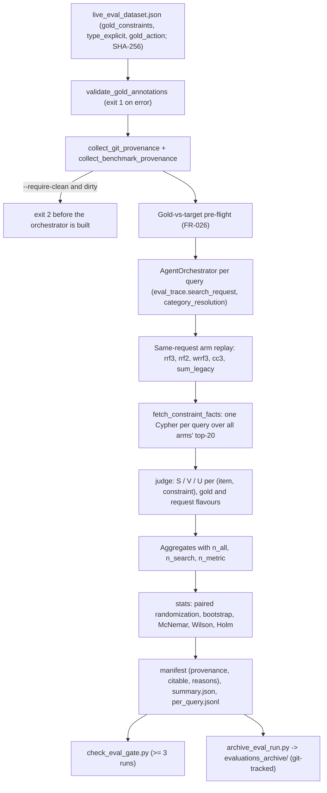

# Thesis Contribution 11: Claim-Bounded Evaluation Protocol for LLM-Driven GraphRAG Recommendation (Three-Valued Constraint Satisfaction, Pre-Registered Paired Statistics, Citable Runs)

**Document ID**: `11-doc-evaluation-protocol`  
**Date**: 2026-10-19  
**Status**: Confirmed Master's Thesis Contribution (Methodological Artifact)  
**Git Scope**: Branch `feature/afp-002-vector-aggregation`, release R2a, commits `5446dcf` (code), `f3ed804` (research, spec, audit, Vision decisions), `471d77c` (FR-007a re-audit fix), `88cdbdf` (spec amendments A-12, A-13; **gate commit**), `96874f3` (citable archive and gate report), compared with R1 at `9cbf426`  
**Relevant Modules**: `src/evaluation/constraint_satisfaction.py`, `src/evaluation/stats.py`, `src/evaluation/provenance.py`, `src/evaluation/dialogue_metrics.py`, `src/evaluation/metrics.py`, `scripts/evaluate_retrieval.py`, `scripts/check_eval_gate.py`, `scripts/archive_eval_run.py`, `src/tools/graph_search_tool.py` (`fetch_constraint_facts`, `match_category(..., raw_category)`), `live_eval_dataset.json` (gold annotations)  
**Design Sources**: `production_artifacts/Research_Report.md` (R2, Q2, Q5, Q7), `production_artifacts/Technical_Specification.md` (R2a FR-012 … FR-036, §4.4, §4.5, §13 A-4, A-8, A-10), Vision decision 2026-10-18-015  
**Evidence (citable)**: `evaluations_archive/eval_2026-10-18_2340`, `_2349`, `_2358` (`citable: true`, commit `88cdbdf`, benchmark SHA-256 `cbbf3621…`, `gpt-4o-2024-08-06`, Neo4j 5.14.0); `production_artifacts/Audit_Report.md`, section "R2a exit gate (2026-10-18)"  
**Context only (non-citable)**: `evaluations_archive/eval_2026-10-09_1336`, `_2026-10-17_1846`, `_2026-10-17_1937` (`citable: false`, `legacy: true`); dev runs `eval_2026-10-18_1449`, `_1705` (dirty tree, not archived)  
**Relation to earlier contributions**: Extends `7-doc-evaluation-framework.md` (Tier 1 metrics) and `9-doc-pipeline-alignment.md` (live-pipeline evaluation). Supplies the statistical and provenance layer that `10-doc-fusion-ablation.md` lacked (see its correction note of 2026-10-19). The dialogue-side metrics of R2a are documented in `12-doc-clarification-gating.md`.

---

## Correction Note (2026-10-19, Thesis Evaluator, graph v2 evaluation)

The text below is kept as written. No result in it is rewritten, and the archived runs keep `citable: true`. Sources: Vision decisions 2026-10-19-018 and 2026-10-19-021, `production_artifacts/Technical_Specification_Graph_Rebuild.md` (FR-028, FR-029, R8), and `13-doc-graph-integrity.md`.

**C-1. "Citable" certified provenance, not graph validity.** Claim 3 in §0 says the predicate binds every reported number to a graph snapshot. That snapshot recorded counts only (`products`, `categories`, `reviews`), and a count cannot detect property-level defects. The three citable runs recorded 265,307 products while 104,281 of them (39.3%) were ghost nodes with no title, price or category and an identical blank-template embedding. The predicate therefore admitted runs on a graph that contradicted the grounding premise of Vision §4. This qualifies claim 3; it does not invalidate the protocol. The limitation in §4.7 ("Graph not frozen") understated it.

**C-2. Predicate extended.** Since FR-028 and FR-029 (graph v2, uncommitted at the time of writing), `graph_snapshot` also records `graph_version`, `products_untitled` and `reviews_embedded`. A live run is citable only if the graph carries exactly one `GraphVersion` node with `validation_passed: true`, which is written only after 18 hard validation gates pass. Archived runs are never recomputed. `eval_2026-10-18_2340`, `_2349` and `_2358` therefore stay citable as **graph v1 evidence**. A new run on v1 would now be non-citable with reason `graph_version_unknown`.

**C-3. v1 figures in §4.4 and §4.5.** The price coverage of Table 3 (≈ 0.54), the base rates 2.15% and 0.52%, and Table 5 are v1 quantities. On v2, ghosts are removed and the top 5 reviews of every reviewed product are embedded. That changes the price-unknown share and makes review-coverage bias, as defined, close to uninformative (`13-doc-graph-integrity.md` §4.4, E-2). Findings 6 and 7 are statements about v1 and should be cited as such.

---

## 0. Scope of the Claim

This document claims a **methodological** contribution. It does **not** claim that any retrieval arm is better than another. Its claims are:

1. A **three-valued constraint-satisfaction metric** (satisfied / violated / unknown) for catalogues with incomplete attribute data, in two flavours that separate extraction errors from retrieval adherence. On the citable runs, the usual two-valued reading (unknown counted as violated) would report a different level and a different arm ordering, although no arm violated any known constraint.
2. A **pre-registered paired statistical protocol** for same-request arm replay: continuous per-query metrics with exact randomization tests and bootstrap CIs, HR@K with Wilson CIs and exact McNemar tests, and Holm correction for a secondary family. Every aggregate carries its denominator.
3. A **citable-run predicate and archive** that binds every reported number to a commit, a benchmark hash, a resolved model snapshot and a graph snapshot. It also downgrades earlier evidence that fails the predicate (the R1 runs).
4. A **reference-rate analysis** for review-coverage bias: the all-node base rate understates the bias about 4×, and the channel-off arm is a better null than any catalogue base rate.

The empirical results in §4 are from **21 type-explicit legacy queries on the tuning side**. This set has been examined repeatedly during development. It is not the frozen test split of Vision decision 2026-10-18-015, which does not exist yet (R2b).

---

## 1. Formal Research Context

### 1.1 Academic Problem Statement
Evaluations of LLM-driven conversational recommenders usually report point estimates from single runs, mix denominators, and score constraint adherence as if every item attribute were known. Each of these practices can produce conclusions the data do not support. This project has concrete cases of all three:
- **Run noise as large as the effect.** In R1 the number of CLARIFY outcomes was 0, 4 and 5 in three runs of the same 21 queries. The fusion arms disagreed on 2 of 21 queries. A cross-run before/after comparison would have credited fusion with an HR@1 gain that same-request replay attributes to extraction changes (`10-doc-fusion-ablation.md`, §4.4, finding 5).
- **Mixed denominators.** In R1, HR, NDCG and MRR were averaged over all 21 queries (CLARIFY = miss), while coverage bias and type precision were averaged over the 16 SEARCH queries, in the same table.
- **Missing attribute data.** On the live graph, 48,037 titled products have no price, 104,281 product nodes (39.3%) have no title, price or category, and **no `Attribute` node carries `numeric_value`**. A two-valued constraint metric would count every one of these as a violation.
- **Unverifiable provenance.** Both R1 runs record `git_commit 989c1cd`, but the evaluated code ran uncommitted and was committed later as `99b8506`. `evaluations/` is git-ignored, so the cited numbers existed only on one machine.

### 1.2 Formal Research Question (RQ)
$$\mathbf{RQ_{11}}: \text{"Which conclusions about multi-channel fusion and constraint adherence in an LLM-driven GraphRAG CRS remain supportable once arms are compared on identical requests with pre-registered paired tests, constraints are judged three-valued against utterance-derived gold, and only provenance-verified runs are admitted, compared with point-estimate reporting and two-valued constraint scoring?"}$$

### 1.3 Hypotheses
* $\mathbf{H_{11a}}$ **(power)**: On $n = 21$ queries, neither pre-registered primary comparison (`rrf3` vs `sum_legacy`, `rrf2` vs `rrf3`) reaches $p < 0.05$. This was predicted before the runs by the power analysis (Research Report R2, Q2).
* $\mathbf{H_{11b}}$ **(unknown ≠ violated)**: Scoring unknown verdicts as violations changes both the level of constraint satisfaction and the ordering of the arms.
* $\mathbf{H_{11c}}$ **(reference rate)**: The size of the review-coverage bias claim depends on the reference rate by a factor of about 4 (all nodes vs titled products).
* $\mathbf{H_{11d}}$ **(repeatability)**: At one citable commit, $r = 3$ runs reproduce every aggregate conclusion.
* $\mathbf{H_0}$: The protocol changes no conclusion compared with point-estimate, two-valued, single-run reporting.

---

## 2. State-of-the-Art Gap Analysis

### 2.1 Positioning in the Literature
* **Significance testing in IR.** Smucker, Allan & Carterette (2007) found that the randomization test, the bootstrap and the t-test agree with each other, and that the sign and Wilcoxon tests are less reliable. Urbano, Lima & Hanjalic (2019) measured Type I–III error rates at scale. Carterette (2012) addresses multiple comparisons across systems. Voorhees & Buckley (2002), Webber, Moffat & Zobel (2008) and Sakai (2016) relate topic-set size to error rates and power.
* **Incomplete judgments.** bpref (Buckley & Voorhees, 2004) and condensed lists (Sakai, 2007) score only judged documents instead of treating unjudged ones as non-relevant. The `cs_known@K` measure applies the same principle to constraint verdicts.
* **Reproducibility in recommender research.** Ferrari Dacrema, Cremonesi & Jannach (2019) could reproduce only a minority of recent neural recommendation results, and several reproduced methods were beaten by tuned simple baselines. The causes they report include unavailable code and data, and evaluation choices that were not documented.
* **Adaptive overfitting.** Dwork et al. (2015) show that repeated adaptive use of a holdout overfits it. This motivates the frozen test split and the "tuning side only" label on every result here.

### 2.2 Gap
The CRS evaluation protocols this project builds on, including iEvaLM (Wang et al., 2023), do not prescribe paired significance tests or record which model snapshot and code produced a score. Attribute-based CRS work (for example EAR, Lei et al., 2020) takes each item's attribute set as given, so "constraint satisfied" is two-valued by construction. In a real catalogue graph many values are missing. A two-valued metric then measures how many attribute values the returned items happen to carry, not how well the system respects the user's constraints. No evaluation design this project builds on separates the two.

### 2.3 Red Flag Defense (Novelty Justification)
* **What fails the anti-triviality filter.** The statistical functions in `stats.py` are textbook (sign-flip randomization, percentile bootstrap, exact binomial McNemar, Wilson interval, Holm). Hashing files and recording `git describe` is standard MLOps practice. Neither is claimed on its own.
* **What passes.**
  1. The three-valued verdict with two flavours, gold (from the utterance) and request (from the executed `search_request`). The gap between the flavours isolates extraction errors from retrieval adherence. §4.4 shows on citable data that the two-valued reading reverses the arm ordering.
  2. The combination of same-request replay (from R1) with a pre-registered primary family, an explicitly secondary Holm family, and an a-priori power statement. Together they turn "no arm is better" into a predicted result, not a disappointment, and they keep the one significant secondary result (`wrrf3`) labelled as a hypothesis.
  3. The citable predicate, which ties evidence admissibility to code state, benchmark hash and model snapshot, and was applied retroactively to downgrade the project's own earlier evidence.
  4. The reference-rate analysis of coverage bias, including the channel-off arm as an empirical null (§4.5).

---

## 3. Architecture & Formal Specification

### 3.1 Evaluation Flow


### 3.2 Three-Valued Constraint Satisfaction
Let $T_K(q)$ be the deduplicated top-$K$ list for query $q$, let $G(q)$ be the gold constraints annotated **from the utterance only** (never from the target), and let $\phi(i)$ be the facts of item $i$ read from the live graph (price, brand names, title, `numeric_value` of matching attributes). For each pair $(i, g)$:

$$v(i, g) = \begin{cases} \text{S} & \text{the fact exists and satisfies } g \\ \text{V} & \text{the fact exists and contradicts } g \\ \text{U} & \text{the fact is missing (price null or} \le 0\text{, no brand edge and title not decisive, no numeric value)} \end{cases}$$

Bounds are inclusive and the brand predicate mirrors the production Cypher filter (case-insensitive equality or mutual containment, or the value in the title), so the metric judges what the system was asked to enforce. With $N = |T_K| \cdot |G|$:

$$\text{cs\_sat} = \tfrac{\#S}{N},\quad \text{cs\_viol} = \tfrac{\#V}{N},\quad \text{cs\_unk} = \tfrac{\#U}{N},\quad \text{cs\_coverage} = 1 - \text{cs\_unk},\quad \text{cs\_known} = \tfrac{\#S}{\#S + \#V}$$

$$\text{violation\_free@}K = \tfrac{|\{ i \in T_K : \nexists g,\ v(i,g) = V \}|}{|T_K|}$$

`cs_known` is undefined (`None`) when no verdict is known. A query with no items or no constraints is excluded and counted out through `n_*`. **Principle P-2**: U is never counted as V. Category is excluded, because the category predicate inherits the word-regex flaw scheduled for RS-24; it is measured by type precision instead.

**Two flavours.** The *gold* flavour (`cs_*`) uses $G(q)$, so parser misses and MACS budget widening count against the system end to end. The *request* flavour (`cs_req_*`) derives constraints from the executed `search_request.structured_filters` (§4.4.3 of the spec), so it measures retrieval adherence to what was actually requested. Numeric specifications never reach the hard filters, so the request flavour has no numeric constraints.

### 3.3 Pre-Registered Paired Statistics (R2-D3)
For two arms $a, b$ replayed on the same requests, with per-query differences $d_q = m_a(q) - m_b(q)$ and $m_{\text{nz}}$ non-zero differences:
* **Randomization test**: two-sided sign flip. Exact over all $2^{m_{\text{nz}}}$ patterns when $m_{\text{nz}} \le 16$; otherwise seeded Monte Carlo with $p = (c + 1)/(R + 1)$, $R = 10{,}000$. The smallest attainable exact $p$ is $2 / 2^{m_{\text{nz}}}$, so with $m_{\text{nz}} = 3$ no difference can be significant.
* **Paired bootstrap**: percentile 95% CI of $\bar d$, seeded.
* **HR@K**: Wilson 95% CI per arm; exact McNemar on the discordant counts.
* **Families**: primary = {(`rrf3`, `sum_legacy`), (`rrf2`, `rrf3`)} on RR and NDCG@10, unadjusted. Secondary = the other 8 arm pairs on RR, Holm-adjusted within the family.
* **Population**: SEARCH-only, paired by `query_id`. Seed `20261018`.

The functions use NumPy and the standard library only. The audit checked them against SciPy `binomtest`, statsmodels Wilson and Holm, and brute-force enumeration (Audit Report, FR-027).

### 3.4 Denominators
Every strategy block carries `n_all` and `n_search` and a SEARCH-only sub-block. Every share metric that skips `None` carries `n_<metric>@k`. On the all-queries population, CLARIFY on a type-explicit query is a miss, and CLARIFY on a gold-CLARIFY query is a hit (`scored_as: "clarify_gold"`). For comparisons across runs, `search_intersection` returns the queries that were SEARCH in every run.

### 3.5 Citable-Run Predicate and Archive
A run is citable iff

$$\text{citable} = [\text{mode} = \text{live}] \wedge [\text{no sample size}] \wedge [\neg \text{dirty}(\texttt{src/}, \texttt{scripts/})] \wedge [\text{benchmark tracked} \wedge \neg \text{modified}]$$

Each failing condition is written to `citable_reasons`. The manifest records the commit, `git describe`, a diff hash, untracked files, benchmark path / SHA-256 / query count, the LLM alias and the **resolved** model IDs returned by the API, the Neo4j version and edition, a graph snapshot (products, categories, reviews, review-embedded products) and the Python executable. `--require-clean` exits with code 2 before the orchestrator is built. `archive_eval_run.py` copies the manifest, summary, CSV and a compact `per_query.jsonl` into the git-tracked `evaluations_archive/`, and records the SHA-256, size and line count of the git-ignored execution trace. Non-citable runs can be archived only with `--legacy --note`, and they stay `citable: false`. **Only archived citable runs may be cited in the thesis** (Vision 2026-10-18-015).

### 3.6 Key Implemented Classes & Interfaces
* `constraint_satisfaction.GoldConstraint`, `judge`, `verdict_matrix`, `cs_scores_at_k`, `constraints_from_search_request`, `validate_gold_annotations`: pure functions, no I/O.
* `GraphSearchTool.fetch_constraint_facts`: one parameterised Cypher per query over the union of all arms' top-20.
* `stats.paired_randomization_test`, `paired_bootstrap_ci`, `mcnemar_exact`, `wilson_ci`, `holm_correction`.
* `provenance.collect_git_provenance`, `collect_benchmark_provenance`, `collect_runtime_provenance`, `evaluate_citable`.
* `dialogue_metrics.build_query_record`, `compute_dialogue_metrics`, `search_intersection`.
* `scripts/check_eval_gate.py` (fails with fewer than 3 runs), `scripts/archive_eval_run.py`.

---

## 4. Empirical Instrumentation & Results

### 4.1 Replication Protocol
```bash
# Offline: verdict truth table, aggregates, statistics vectors, provenance, archive, gate checker
python -m pytest tests/test_constraint_satisfaction.py tests/test_eval_stats.py tests/test_provenance.py \
    tests/test_archive_eval_run.py tests/test_dialogue_metrics.py tests/test_retrieval_metrics_r2.py \
    tests/test_live_eval_gold_annotations.py tests/test_r2a_audit_fixes.py -v

# Live, at a clean commit (three sequential runs; every run made at the commit is reported)
python scripts/evaluate_retrieval.py --mode live --require-clean --fusion-arms rrf3 rrf2 wrrf3 cc3 sum_legacy
python scripts/check_eval_gate.py --runs <R_a> <R_b> <R_c> --max-spurious-clarify 0
python scripts/archive_eval_run.py <run_id>
```
At the gate commit the full suite gave 654 passed and 5 skipped (the live tests). The gate checker returned PASS, and the three runs were archived and committed in `96874f3`.

### 4.2 Population
All three runs: 21 queries, all type-explicit, all SEARCH (spurious CLARIFY 0/21, see `12-doc-clarification-gating.md`), so the all-queries and SEARCH-only populations coincide, $n = 21$. The cross-run SEARCH intersection is 21. The runs are almost deterministic: across 3 runs × 5 arms × 21 queries only three target ranks change (`phone_03` under `rrf3`, `laptop_02` under `sum_legacy`, `keyboard_02` under `wrrf3`).

### 4.3 Retrieval per Arm and Primary Comparisons

**Table 1 — Strict target hit, $n = 21$ per run.** HR hit counts are identical in all three runs. MRR and NDCG@10 are given per run, with the cross-run mean in parentheses.

| Arm | HR@10 (hits, Wilson 95%) | HR@20 (hits, Wilson 95%) | MRR R_a / R_b / R_c (mean) | NDCG@10 (mean) |
|---|---|---|---|---|
| `rrf3` (default) | 8/21 [0.208, 0.591] | 9/21 [0.245, 0.635] | 0.234 / 0.234 / 0.210 (0.226) | 0.259 |
| `rrf2` | 9/21 [0.245, 0.635] | 9/21 [0.245, 0.635] | 0.237 ×3 (0.237) | 0.280 |
| `wrrf3` | 11/21 [0.324, 0.717] | 12/21 [0.365, 0.755] | 0.361 / 0.337 / 0.337 (0.345) | 0.387 |
| `cc3` | 10/21 [0.283, 0.676] | 10/21 [0.283, 0.676] | 0.298 ×3 (0.298) | 0.340 |
| `sum_legacy` | 7/21 [0.172, 0.546] | 9/21 [0.245, 0.635] | 0.182 / 0.174 / 0.174 (0.176) | 0.208 |

**Table 2 — Pre-registered primary comparisons** (exact paired randomization; bootstrap 95% CI; seed 20261018).

| Comparison | Run | ΔRR [95% CI] | $p$ (RR) | ΔNDCG@10 | $p$ (NDCG@10) | HR@20 discordant, McNemar $p$ |
|---|---|---|---:|---:|---:|---|
| `rrf3` − `sum_legacy` | R_a | +0.052 [−0.099, +0.196] | 0.500 | +0.053 | 0.516 | 1–1, 1.0 |
| | R_b | +0.060 [−0.094, +0.209] | 0.469 | +0.059 | 0.492 | 1–1, 1.0 |
| | R_c | +0.036 [−0.109, +0.179] | 0.688 | +0.041 | 0.625 | 1–1, 1.0 |
| `rrf2` − `rrf3` | R_a | +0.003 [0.000, +0.006] | 0.250 | +0.016 | 0.250 | 0–0, 1.0 |
| | R_b | +0.003 [0.000, +0.006] | 0.250 | +0.016 | 0.250 | 0–0, 1.0 |
| | R_c | +0.027 [+0.000, +0.075] | 0.125 | +0.034 | 0.125 | 0–0, 1.0 |

**Secondary family (RR, Holm over 8 tests).** `wrrf3` vs `sum_legacy` is rejected in all three runs (ΔRR +0.180 / +0.164 / +0.164, $p = 0.0039$, $p_{\text{Holm}} = 0.031$). In R_c only, `wrrf3` also beats `rrf3` and `rrf2` ($p_{\text{Holm}}$ 0.031 and 0.047). No other secondary test is rejected.

**Findings.**
1. **$H_{11a}$ supported.** Neither primary comparison is significant in any run, as the power analysis predicted. For `rrf3` vs `sum_legacy`, 8 queries differ in RR and the HR@20 discordance is one query each way (`keyboard_03` found only by `rrf3`, `laptop_01` only by `sum_legacy`), the same pair in every run. For `rrf2` vs `rrf3`, only 3 queries differ in R_a and R_b, so the smallest attainable exact $p$ is 0.25 and the test cannot reject. ΔHR@20 is 0 in every run. This is tuning-side input to the RS-02 rule (Vision 2026-10-18-015 §4), which is decided on benchmark v2 in R2b and confirmed on the test split in R3.
2. **The point-estimate leader is not a claim.** `wrrf3` leads every retrieval metric in every run, and one secondary comparison survives Holm. Its weights (0.60 / 0.25 / 0.15) were fixed a priori from AFP-002, before R1, and were not tuned. But R1 already showed `wrrf3` ahead on the same 21 queries, so the R2a observation is not independent of the one that drew attention to it. The three runs are near-deterministic repeats on the same queries, so "significant in 3 of 3 runs" is **one** result observed three times, not three independent confirmations. Under the protocol it is a hypothesis for R2b. A point-estimate report would have named `wrrf3` the best arm.

### 4.4 Constraint Satisfaction: Three-Valued vs Two-Valued

Gold annotations: 17 of 21 queries carry constraints (12 price, 7 brand, 19 numeric; 38 in total). The gold-vs-target pre-flight found 0 violations and 19 unknowns, all numeric, in all three manifests.

**Table 3 — CS@20 per kind, `rrf3`, R_a** (verdicts over top-20 items × constraints).

| Kind | Satisfied / violated / unknown | Coverage R_a / R_b / R_c | Cause of unknowns |
|---|---|---|---|
| Price | 124 / 0 / 106 | 0.539 / 0.541 / 0.528 | null prices (ghost nodes and 48,037 titled products without price) |
| Brand | 130 / 0 / 0 | 1.000 ×3 | — |
| Numeric | 0 / 0 / 370 | 0.000 ×3 | no `Attribute.numeric_value` anywhere in the graph |

**Table 4 — The same verdicts read two ways, CS@20, gold flavour, $n = 17$ queries.** The two-valued columns are a counterfactual computed for this document from the archived `per_query.jsonl` verdict strings (unknown counted as violated).

| Arm | `cs_known` (three-valued) | `violation_free` (three-valued) | Two-valued satisfaction (= `cs_sat`) | Two-valued violation-free | Order under two-valued |
|---|---:|---:|---:|---:|---:|
| `rrf3` | 1.0 | 1.0 | 0.403 / 0.403 / 0.399 | 0.206 / 0.206 / 0.201 | 1 |
| `rrf2` | 1.0 | 1.0 | 0.393 / 0.393 / 0.392 | 0.191 / 0.191 / 0.189 | 2 |
| `cc3` | 1.0 | 1.0 | 0.382 / 0.381 / 0.381 | 0.188 / 0.188 / 0.190 | 3 |
| `sum_legacy` | 1.0 | 1.0 | 0.380 / 0.379 / 0.378 | 0.188 / 0.191 / 0.190 | 4 |
| `wrrf3` | 1.0 | 1.0 | 0.367 / 0.366 / 0.365 | 0.174 / 0.176 / 0.178 | 5 |

($n = 15$ for `cs_known`: two queries carry only numeric constraints, so no verdict is known.) The request flavour gives `cs_req_known@20 = 1.0` and `cs_req_violation_free@20 = 1.0` ($n = 15$).

**Findings.**
3. **$H_{11b}$ supported.** No arm violates any known constraint in any run. The two-valued reading instead reports that only 17–21% of the top-20 items are free of violations, and it ranks `rrf3` first and `wrrf3` last, the reverse of the rank-metric ordering in Table 1. The ranking reflects how many returned items carry a price, not constraint adherence. Hard filters let `price IS NULL` through, so arms that rank priced items higher score better under the two-valued reading. Coverage is therefore reported next to every CS value.
4. **The metric exposes a grounding limit of the graph.** All 370 numeric verdicts are unknown, so the system cannot verify a single numeric specification ("≥ 128 GB", "60 fps") against the Knowledge Graph. Vision §4 says the graph is the grounding layer. On the live graph that holds for price and brand only. This is evidence for RS-11 (typed feature vocabulary), not a defect of the metric.
5. **CS@K did not discriminate between arms here.** Price and brand are enforced as hard Cypher filters, and in these runs MACS widened no budget and extraction missed no price or brand. `cs_viol = 0` is therefore largely guaranteed by construction. The metric becomes informative when extraction misses a constraint or relaxation widens it; R2b's benchmark is designed to produce such cases.

### 4.5 Review-Coverage Bias: Choice of Reference Rate

Base rates from the manifests: 5,715 / 265,307 = **2.15%** of all `ParentProduct` nodes have an embedded review; 841 / 161,026 = **0.52%** of titled products do. 4,874 of the 5,715 review-embedded products (85.3%) are ghost nodes (no title, price or category, but embedded). The ratio of the two base rates is 4.1.

**Table 5 — `review-coverage-bias@K` (`popularity_bias@K` in code), cross-run mean, $n = 21$.** The last column subtracts the `rrf2` value: `rrf2` has no review channel, so it serves as the channel-off null.

| Arm | RCB@5 | × all-node / × titled base | RCB@20 | × all-node / × titled base | RCB@5 excess over `rrf2` |
|---|---:|---|---:|---|---:|
| `sum_legacy` | 0.502 | 23× / 96× | 0.239 | 11× / 46× | +0.448 |
| `rrf3` | 0.216 | 10× / 41× | 0.192 | 9× / 37× | +0.162 |
| `cc3` | 0.143 | 7× / 27× | 0.140 | 7× / 27× | +0.089 |
| `rrf2` | 0.054 | 2.5× / 10× | 0.051 | 2.4× / 10× | 0 |
| `wrrf3` | 0.038 | 1.8× / 7× | 0.021 | 1.0× / 4× | −0.016 |

**Post-hoc paired sign test against `sum_legacy`** (computed for this document from the archived `retrieval_metrics.csv`; not pre-registered; queries with equal values excluded; "+" = less biased than `sum_legacy`). In each of R_a / R_b / R_c: `rrf3` at $K = 5$ is 12/0, 13/0, 12/0 ($p \le 0.0005$), and at $K = 20$ it is 5/4 in every run ($p = 1.0$). `rrf2` and `wrrf3` are 15–16/0 at both cutoffs ($p \le 0.0001$). `cc3` is 11–12/0–1 at $K = 5$ ($p \le 0.0063$) and 10–11/1–2 at $K = 20$ ($p \le 0.039$). The `rrf3` result at $K = 5$ survives a Bonferroni correction over the 8 tests per run.

**Findings.**
6. **$H_{11c}$ supported.** Against the all-node rate, `rrf2` and `wrrf3` look close to unbiased (1–2.5×). Against the titled rate, which is the relevant catalogue for category-filtered queries, review-embedded products are still over-represented 4–10×.
7. **The channel-off arm is the better null.** `rrf2` cannot reach any product through reviews, yet its top-5 holds review-embedded products at 10× the titled base rate. The review-embedding backfill stopped partway, so the covered products need not be a random sample of the catalogue; they evidently differ from it in ways that also matter to the product and attribute channels. No catalogue-wide base rate is therefore a neutral reference. The excess over `rrf2` (+0.162 for `rrf3`, +0.448 for `sum_legacy`) estimates the bias the review channel itself contributes.
8. **The R1 hub-bias finding replicates on citable runs.** `rrf3` removes most of the bias at the head of the list (0.502 → 0.216 at $K = 5$), but not at $K = 20$ (0.239 → 0.192, 5/4 queries). This is the same pattern R1 reported on non-citable runs (`10-doc-fusion-ablation.md`, finding 1).
9. **Target coverage.** Only 1 of the 21 targets (`charger_02`) is review-embedded, and every arm ranks it first. The review channel can therefore help at most one query in this benchmark, which limits what any `rrf2` vs `rrf3` comparison on it can show.

### 4.6 Provenance

10. **$H_{11d}$ supported for aggregates.** All three runs are `citable: true` with empty `citable_reasons` and `citable_warnings`, the same commit, the same benchmark SHA-256, and the same resolved model (`gpt-4o-2024-08-06`). Every aggregate conclusion above holds in each run separately.
11. **The predicate changed what the thesis may cite.** The three R1-era runs were archived retroactively with `citable: false` and a note recording why: their `git_commit` field does not identify the evaluated code. R1 claims are now cited from the R2a runs where the R2a runs measure the same quantity (finding 8), and otherwise marked as context.
12. **A residual label inconsistency.** `git_describe` reads `88cdbdf-dirty` in all three manifests, while `git_dirty` is false and `git_dirty_paths` is empty. `git describe --dirty` looks at the whole repository, and the only tracked modification was a brainstorming file outside the `src/`, `scripts/` scope. The runs are correctly citable under the predicate, but a reader may misread the suffix (Audit L-14).

### 4.7 Threats to Validity and Limitations
* **Benchmark.** 21 hand-picked, type-explicit legacy queries from the 50 most-reviewed products per category, 7 of which name the target's brand or model line (Research Report R2, Q3). They sit on the tuning side and have been inspected throughout development. Absolute HR values are not estimates of system quality, and arm differences are relative and in-sample.
* **Repeated runs are not independent samples.** The runs share queries, graph and model snapshot, and are near-deterministic. They bound run-to-run noise; they do not add statistical power.
* **Gold annotation.** The constraints were annotated from the utterance text by the project (spec Appendix A) with one annotator and no agreement study. The normalisation rules N1–N4 decide, for example, that "Bluetooth 5.0" is a named feature and not a numeric constraint.
* **Graph not frozen.** The manifest records a graph snapshot (counts), not a dump. A later ingest can change results without any code change.
* **Coverage-bias reference.** Even the titled base rate is catalogue-wide, not conditional on each query's eligible pool. The channel-off null avoids this but depends on `rrf2` being otherwise comparable to `rrf3`.
* **Graph version.** Every result here is **graph v1** evidence. Vision decisions 2026-10-19-018 … 021 (present in the working tree at the time of writing, not yet committed) rebuild the graph as v2 from the raw Amazon Reviews 2023 files with zero ghosts, record v1 claims that do not hold (2026-10-19-021), and re-baseline all retrieval figures on v2. The R2a runs stay citable as v1 evidence: the rebuild starts only after they were archived (2026-10-19-019, point 3), and v1 is kept as an offline dump. On v1 the 104,281 ghost products share one blank-template embedding (2026-10-19-018), which is a further reason to prefer the titled base rate in §4.5. The absence of `numeric_value` (§4.4, finding 4) carries over to v2 by design.
* **What the statistics cannot fix.** Pre-registration covers the comparisons, not the benchmark: the queries were chosen before the protocol existed. That is why the frozen hashed test split (R2b) is required before any claim of superiority.

---

## 5. Rubric Audit (Thesis Evaluator, 2026-10-19)

| # | Criterion | Score | Assessment |
|---|---|---:|---|
| 1 | Algorithmic & Architectural Novelty | 4/10 | Each statistical tool is standard. The three-valued verdict with gold and request flavours is a modest adaptation of judged-only IR evaluation to constraint adherence. |
| 2 | Unexpected or Original Combination | 7/10 | Same-request replay + pre-registered paired families + three-valued constraints + commit-bound citability, applied to an LLM-driven CRS where extraction noise is as large as the effects. |
| 3 | Problem Significance in Literature | 8/10 | Reproducibility in recommender research (Ferrari Dacrema et al., 2019), significance testing in IR (Smucker et al., 2007; Urbano et al., 2019), evaluation with incomplete information (Buckley & Voorhees, 2004). |
| 4 | Red Flag Check | PASS | The stats helpers and hashing alone would fail. The verdict design, the demonstrated reversal under two-valued scoring, the power-predicted null, and the retroactive downgrading of evidence pass. |
| 5 | SOTA Gap Alignment | 6/10 | LLM-CRS evaluations rarely report paired tests or snapshot provenance; attribute-based CRS assumes complete attributes. The gap is real but partly a practice gap, not a theory gap. |
| 6 | Formal RQ Formulability | 7/10 | $RQ_{11}$ with four falsifiable hypotheses, all tested; $H_{11a}$ was stated before the runs. |
| 7 | Tangible Research Artifact | 9/10 | Four pure modules, three scripts, git-tracked archive with six runs (three citable), gold annotations, 654-test suite at the gate commit. |
| 8 | Empirical Instrumentation | 9/10 | Per-query JSONL with verdict strings and per-arm top-20, denominators on every aggregate, resolved model IDs, graph snapshot, trace fingerprints. |
| 9 | Measurable Metric Improvements | 5/10 | Not applicable as a ranking gain. Scored on whether the protocol changes conclusions: it does (two-valued reversal, 4× base-rate correction, `wrrf3` kept as hypothesis, R1 evidence downgraded), on a small tuning-side set. |
| 10 | Scientific Reproducibility | 9/10 | Citable runs at one commit, benchmark hash, model snapshot, seeded exact statistics. Weakened by an unfrozen graph and the `git_describe` suffix. |
| | **Total** | **64/90 + PASS** | **Verdict: QUALIFIES — Methodological Artifact** (no ranking-quality claim) |

---

## 6. Master's Thesis Chapter Mapping

* **Target Thesis Chapter**: Chapter 5 (Empirical Evaluation & Comparative Analysis), as the methodology section that precedes every reported result. §4.4 and §4.5 also belong in the discussion of groundedness (Vision §5.B).
* **Key Claims to Make in Thesis Text**:
  1. In a catalogue graph with missing attribute values, constraint adherence must be scored three-valued. On citable runs, the two-valued reading reports 17–21% violation-free top-20 lists and reverses the arm ordering, while no arm violates a known constraint.
  2. On the live graph, numeric specifications cannot be verified at all (0% coverage), so the grounding claim holds for price and brand only.
  3. With $n = 21$ and 1–8 discordant queries, no fusion arm can be shown better than another. This was predicted before the runs and confirmed in three citable runs.
  4. Coverage-bias magnitudes depend on the reference rate by a factor of 4. The channel-off arm is a better null than a catalogue base rate.
  5. Thesis evidence is limited to archived, provenance-verified runs. Earlier runs whose commit field is unreliable are cited as context only.
* **Claims NOT to make**: that `wrrf3` (or any arm) is the best fusion method; that the system satisfies user constraints in general (only price and brand are verifiable, and only on these 21 queries); that the results generalise beyond the Electronics graph or the legacy-21 set.
* **Follow-up (R2b, R3)**: frozen hashed split with `--confirm-test`; about 200 + 30 stratified queries; `wrrf3` tested as a pre-registered primary comparison on held-out data; CS@K on S4 trade-off queries and under MACS widening; scoping `git describe` to the citable paths.

### References
* Buckley, C., & Voorhees, E. M. (2004). Retrieval Evaluation with Incomplete Information. In *Proceedings of SIGIR 2004*, pp. 25–32.
* Carterette, B. (2012). Multiple Testing in Statistical Analysis of Systems-Based Information Retrieval Experiments. *ACM Transactions on Information Systems*, 30(1), Article 4.
* Dwork, C., Feldman, V., Hardt, M., Pitassi, T., Reingold, O., & Roth, A. (2015). The reusable holdout: Preserving validity in adaptive data analysis. *Science*, 349(6248), 636–638.
* Ferrari Dacrema, M., Cremonesi, P., & Jannach, D. (2019). Are We Really Making Much Progress? A Worrying Analysis of Recent Neural Recommendation Approaches. In *Proceedings of RecSys 2019*, pp. 101–109.
* Holm, S. (1979). A Simple Sequentially Rejective Multiple Test Procedure. *Scandinavian Journal of Statistics*, 6(2), 65–70.
* Lei, W., He, X., Miao, Y., Wu, Q., Hong, R., Kan, M.-Y., & Chua, T.-S. (2020). Estimation–Action–Reflection: Towards Deep Interaction Between Conversational and Recommender Systems. In *Proceedings of WSDM 2020*, pp. 304–312.
* McNemar, Q. (1947). Note on the sampling error of the difference between correlated proportions or percentages. *Psychometrika*, 12(2), 153–157.
* Sakai, T. (2007). Alternatives to Bpref. In *Proceedings of SIGIR 2007*, pp. 71–78.
* Sakai, T. (2016). Topic set size design. *Information Retrieval Journal*, 19(3), 256–283.
* Smucker, M. D., Allan, J., & Carterette, B. (2007). A Comparison of Statistical Significance Tests for Information Retrieval Evaluation. In *Proceedings of CIKM 2007*, pp. 623–632.
* Urbano, J., Lima, H., & Hanjalic, A. (2019). Statistical Significance Testing in Information Retrieval: An Empirical Analysis of Type I, Type II and Type III Errors. In *Proceedings of SIGIR 2019*, pp. 505–514.
* Voorhees, E. M., & Buckley, C. (2002). The Effect of Topic Set Size on Retrieval Experiment Error. In *Proceedings of SIGIR 2002*, pp. 316–323.
* Wang, X., Tang, X., Zhao, W. X., Wang, J., & Wen, J.-R. (2023). Rethinking the Evaluation for Conversational Recommendation in the Era of Large Language Models. In *Proceedings of EMNLP 2023*.
* Webber, W., Moffat, A., & Zobel, J. (2008). Statistical Power in Retrieval Experimentation. In *Proceedings of CIKM 2008*, pp. 571–580.
* Wilson, E. B. (1927). Probable Inference, the Law of Succession, and Statistical Inference. *Journal of the American Statistical Association*, 22(158), 209–212.
