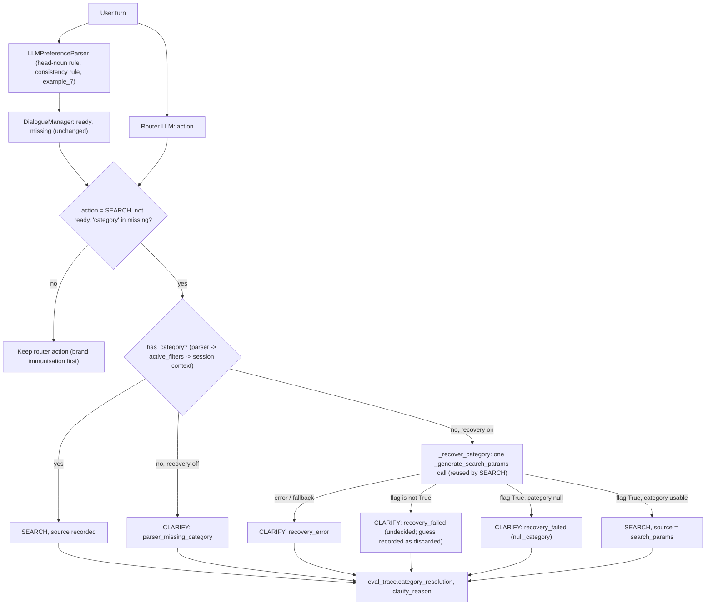

# Thesis Contribution 12: Attributing and Gating Clarification Decisions in an LLM-Orchestrated CRS (Spurious CLARIFY, Head-Noun Extraction, Fail-Closed Category Recovery)

**Document ID**: `12-doc-clarification-gating`  
**Date**: 2026-10-19  
**Status**: Confirmed Master's Thesis Contribution (Methodological Artifact, narrow)  
**Git Scope**: Branch `feature/afp-002-vector-aggregation`, release R2a (RS-23), commits `5446dcf` (code incl. FR-007a), `471d77c` (dead-return removal, re-audit), `88cdbdf` (gate commit), `96874f3` (citable archive), compared with R1 at `9cbf426`  
**Relevant Modules**: `src/llm_interface/prompts/preference_extract_prompt.py` (`PRODUCT_TYPE_RULE`, `CATEGORY_CONSISTENCY_RULE`, `LONG_MODIFIER_EXAMPLE`), `src/llm_interface/preference_parser.py` (`PRODUCT_TYPE_SCHEMA_HINT`), `src/agents/orchestrator.py` (`_decide_next_step` guardrail, `_recover_category`, `SEARCH_GENERATION_PROMPT`, `PRODUCT_TYPE_DECIDED_RULE`, `_resolution_for_trace`), `src/agents/state.py`, `src/evaluation/dialogue_metrics.py`  
**Tests**: `tests/test_category_recovery.py`, `tests/test_preference_prompt_r2.py`, `tests/integration/test_category_recovery_live.py` (AC-039 fresh vague set, §7.4 smoke check)  
**Design Sources**: `production_artifacts/Research_Report.md` (R2, Q1), `production_artifacts/Technical_Specification.md` (R2a FR-001 … FR-011, FR-014 … FR-018, §7.4, §13 A-1, A-11 / FR-007a, A-13), Vision decision 2026-10-18-016  
**Evidence (citable)**: `evaluations_archive/eval_2026-10-18_2340`, `_2349`, `_2358` (`citable: true`, commit `88cdbdf`); live diagnostics AC-039 and §7.4 reported in `production_artifacts/Audit_Report.md`, section "R2a exit gate (2026-10-18)"  
**Context only (non-citable)**: `evaluations_archive/eval_2026-10-09_1336`, `_2026-10-17_1846`, `_2026-10-17_1937` (pre-fix, `citable: false`); H-1 QA passes in the R2a audit (dirty tree)  
**Relation to earlier contributions**: Refines the readiness state machine of `1-doc-dialogue-state.md`. Uses the denominators and citable-run protocol of `11-doc-evaluation-protocol.md`. Removes the CLARIFY loss listed as a threat in `10-doc-fusion-ablation.md` §4.5.

---

## 0. Scope of the Claim

This document claims a narrow methodological contribution to Vision §2 (Active Clarification: "the system does not guess"):

1. A **causal diagnosis** of spurious clarification in a CRS whose dialogue policy combines an LLM router, an LLM extractor and a deterministic readiness check. A type-explicit request was turned into a question by three layers acting together, none of which failed on its own terms.
2. **Attribution instrumentation** that makes every clarification decision explainable after the fact: `clarify_reason`, `category_source`, recovery outcome, and category-extraction recall measured separately for the parser and for the whole pipeline.
3. A **fail-closed recovery gate** that uses a recovered category only when the same LLM call declares the product type decided, and a **pre-registered, contamination-controlled live check** of that gate.
4. A documented **negative result** (H-1): an instruction-level "never guess, return null" rule did not stop the model from guessing a category on a vague request.

It does **not** claim a measured gain in clarification quality. Clarification recall on genuinely ambiguous requests is not measured yet (R2b). The recovery path never ran in the citable gate runs, and the live evidence for the gate rests on 16 utterances and one before/after pair (§4.4).

---

## 1. Formal Research Context

### 1.1 Academic Problem Statement
A conversational recommender must decide, per turn, whether to search or to ask. Two errors are possible:
- a **spurious clarification**: asking about something the user already said;
- an **over-search**: guessing a product type the user has not chosen.

The clarification literature treats the decision as its own prediction task (Aliannejadi et al., 2019, 2020) and so does this project. An unnecessary question is a measurable error, not a safe default. In R1, 4–5 of 21 type-explicit queries ended as CLARIFY. The trace analysis (Research Report R2, Q1) found that in all five cases the product noun was the head of a long modified noun phrase ("compact 65W GaN **wall charger**", "pocket-sized tri-folding Bluetooth **keyboard**"). Three layers then acted together:
1. **Extraction.** `LLMPreferenceParser` moved every modifier into `soft_preferences` and left the head noun only in `situational_context`. Its own few-shot example 1 put `operating_system` into `hard_constraints`, against the prompt's taxonomy rule.
2. **Readiness override.** `DialogueManager._evaluate_dialogue_state` recomputed readiness deterministically with `category` as the critical attribute, overwriting the parser's own `ready = true` in two of the five cases.
3. **Guardrail.** The router chose SEARCH every time. The orchestrator guardrail switched it to CLARIFY because `category` was missing, ignoring the `has_category` value computed a few lines earlier. The second extractor (`_generate_search_params`), which would have found the category, runs only inside the SEARCH branch and never ran.

Each layer behaved as designed. The failure is a property of the composition, and no single component's metrics would show it.

### 1.2 Formal Research Question (RQ)
$$\mathbf{RQ_{12}}: \text{"In an LLM-orchestrated CRS where a deterministic readiness check can override the router, to what extent are clarification turns caused by extraction failure rather than genuine underspecification, and can a domain-agnostic extraction rule plus a fail-closed, self-declared decision flag remove spurious clarifications without making the system guess on underspecified requests?"}$$

### 1.3 Hypotheses
* $\mathbf{H_{12a}}$ **(diagnosis)**: Spurious CLARIFY on type-explicit requests is caused by head-noun extraction failure on long modified noun phrases, not by the router.
* $\mathbf{H_{12b}}$ **(extraction rule)**: A domain-agnostic head-noun rule removes spurious CLARIFY on the type-explicit set, with parser-only category-extraction recall (CER) at 21/21.
* $\mathbf{H_{12c}}$ **(null rule, negative)**: Recovery guarded only by an instruction to return `category: null` when the user is undecided still guesses on vague requests.
* $\mathbf{H_{12d}}$ **(decision flag)**: Requiring `product_type_decided = true` from the same call blocks guessing on vague requests while still recovering explicit product types.

---

## 2. State-of-the-Art Gap Analysis

### 2.1 Positioning in the Literature
* **Clarification need as a prediction task.** Aliannejadi et al. (2019) introduced asking clarifying questions in open-domain information-seeking conversation. ClariQ (Aliannejadi et al., 2020) labels the need for clarification per request and scores it as a classification task. Zamani et al. (2020) generate clarifying questions for web search. These works study *whether* and *what* to ask given a request. They do not study a system that asks because one of its own components failed to read the request.
* **LLM-based CRS.** LLM-driven recommenders (for example the iEvaLM setting, Wang et al., 2023) delegate the ask-or-recommend decision to the LLM. Hybrid designs like this one add deterministic guardrails on top. Failures that arise from the interaction between LLM extraction and a deterministic policy are rarely reported.
* **Head nouns.** Treating the syntactic head of a noun phrase as its semantic type is standard in linguistics and in product-query understanding. The rule here is applied by the LLM, without a parser, a lexicon or inflection rules.

### 2.2 Gap
CRS evaluations report how often a system asks, and sometimes whether the question was good. They do not attribute a question to its cause: a router decision, a deterministic override, a missing extraction, or a failed recovery. Without attribution, a run where the extractor silently drops the product type looks like a cautious system, and every retrieval metric on that query is a miss for reasons unrelated to retrieval. In R1 this cost every fusion arm the same 4–5 queries.

### 2.3 Red Flag Defense (Novelty Justification)
* **What fails the anti-triviality filter.** The head-noun rule and the consistency rule are prompt text. A boolean field in a JSON output, checked with `is True`, is routine. Neither is claimed as a contribution on its own.
* **What passes.**
  1. The three-layer causal diagnosis, which shows that spurious clarification in a hybrid LLM / deterministic policy is a composition failure.
  2. The attribution instrumentation: CER measured twice (parser-only, pipeline), `clarify_reason` ∈ {`router`, `router_fallback`, `parser_missing_category`, `recovery_failed`, `recovery_error`}, `category_source`, `recovery_outcome` ∈ {`found`, `undecided`, `null_category`, `error`} and the discarded category.
  3. The live-check protocol for a prompt guard: a fresh multi-domain vague set, committed (in `5446dcf`) before the reported run and lexically disjoint from the rule text, with a rule that any later prompt change turns the set into tuning data.
  4. The negative result H-1, recorded with its counts, which shows that a null instruction is not a guard.

---

## 3. Architecture & Formal Specification

### 3.1 Decision Flow


### 3.2 Formal Specification
Let $a_r$ be the router's action, $\rho$ the readiness flag and $M$ the missing-attribute set computed by `DialogueManager`, and $c^\ast$ the first usable category from the parser's hard constraints, then `active_filters`, then the session context. A value is usable if it is a string (or the first item of a list), not in `NULL_CATEGORY_VALUES` = {"", none, null, unknown, n/a, any}, and not under an `exclude` operator. Recovery returns $(\delta, c_{\text{rec}}, e)$: the raw flag, the category and an error indicator. The final action is

$$a = \begin{cases} \text{SEARCH} & a_r = \text{SEARCH} \wedge \big(\rho \vee \text{category} \notin M \vee c^\ast \neq \bot\big) \\ \text{SEARCH} & a_r = \text{SEARCH} \wedge \neg\rho \wedge \text{category} \in M \wedge c^\ast = \bot \wedge \text{rec} \wedge \neg e \wedge \delta \equiv \texttt{true} \wedge c_{\text{rec}} \neq \bot \\ \text{CLARIFY} & \text{otherwise, when the guardrail fired, with the reason of §3.1} \end{cases}$$

Here $\delta \equiv \texttt{true}$ is a strict identity test: `"true"`, `1`, `null` and a missing key all count as undecided. Brand immunisation (router CLARIFY with $c^\ast$ and an affirmative brand → SEARCH) is applied first and is unchanged except that it now requires a usable category.

**Properties** (unit-tested, `tests/test_category_recovery.py`):
* **P1, fail closed.** Every error shape (exception, fallback response, non-JSON, non-object JSON) leads to CLARIFY with `recovery_error`. Every non-`true` flag leads to CLARIFY.
* **P2, no extra cost.** A recovered SEARCH turn makes the same number of LLM calls as a normal SEARCH turn (3), because the recovery result is reused as the turn's search parameters (NFR-001, FR-008).
* **P3, contained scope.** The flag is read only by `_recover_category`. It never reaches `active_filters`, the catalogue partition or Cypher. A turn with a parser category searches whatever the flag says.
* **P4, domain-agnostic.** The rules contain no category names, no catalogue vocabulary and no inflection rules ("plural", "singular", "lemma"), checked by string tests. The worked examples in the extraction rule are deliberately outside the Electronics catalogue (dress, moisturiser, water bottle, hiking jacket). The decision-flag rule has no examples.

### 3.3 Attribution Metrics
Over items with gold `type_explicit = true` (all of legacy-21):
* **CER, parser-only**: share whose session hard constraints contain a category. This isolates the extractor and is the regression gate for AI-07.
* **CER, pipeline**: share with a category from any source after recovery.
* **Spurious-CLARIFY rate**: CLARIFY on type-explicit / type-explicit, broken down `by_reason`.
* **Target-admitting category rate**: share of SEARCH queries whose applied category filter admits the target (`match_category(..., raw_category=...)`), with MACS category drops counted. This catches "present but wrong".
* **Clarification recall / precision** on gold-CLARIFY items: defined, but $n = 0$ on legacy-21 (reported as `n/a (n=0)`).

---

## 4. Empirical Results

### 4.1 Replication Protocol
```bash
# Offline: guardrail outcomes, flag values, error shapes, call counts, prompt text constraints
python -m pytest tests/test_category_recovery.py tests/test_preference_prompt_r2.py -v

# Live: AC-039 (3 passes per set; calls _recover_category directly on a minimal state)
RUN_LIVE_TESTS=1 python -m pytest -s "tests/integration/test_category_recovery_live.py::test_decided_gate_fresh_vague_set"
RUN_LIVE_TESTS=1 python -m pytest -s "tests/integration/test_category_recovery_live.py::test_decided_gate_type_explicit_legacy"

# Live: §7.4 smoke check through the full orchestrator, recovery on and off
RUN_LIVE_TESTS=1 python -m pytest -s "tests/integration/test_category_recovery_live.py::test_ambiguous_smoke_recovery_on_and_off"

# Live: gate runs (see 11-doc-evaluation-protocol.md §4.1)
python scripts/evaluate_retrieval.py --mode live --require-clean --fusion-arms rrf3 rrf2 wrrf3 cc3 sum_legacy
```

### 4.2 Spurious CLARIFY on the Type-Explicit Set

**Table 1 — Legacy-21 (all 21 items type-explicit, gold action SEARCH).**

| Run | Status | Code state | Spurious CLARIFY | CER parser-only | CER pipeline | Recovery calls | Target-admitting category |
|---|---|---|---:|---:|---:|---:|---:|
| `eval_2026-10-09_1336` | legacy, non-citable | pre-R1 (`2fdf251`, tree state unknown) | 0/21 | 21/21 | — | — | — |
| `eval_2026-10-17_1846` | legacy, non-citable | R1, uncommitted | 4/21 | 17/21 | — | — | — |
| `eval_2026-10-17_1937` | legacy, non-citable | R1, uncommitted | 5/21 | 16/21 | — | — | — |
| `eval_2026-10-18_1449`, `_1705` | dev, non-citable (dirty) | R2a before FR-007a | 0/21, 0/21 | 21/21, 21/21 | 21/21, 21/21 | 0, 0 | 20/21, 20/21 |
| `eval_2026-10-18_2340` | **citable** | `88cdbdf` | **0/21** | **21/21** | 21/21 | 0 | 20/21 |
| `eval_2026-10-18_2349` | **citable** | `88cdbdf` | **0/21** | **21/21** | 21/21 | 0 | 20/21 |
| `eval_2026-10-18_2358` | **citable** | `88cdbdf` | **0/21** | **21/21** | 21/21 | 0 | 20/21 |

`category_source_counts` is `parser: 21` in every citable run. The one target-admitting miss in every R2a run is `camera_02`: the parser read the product type as "smart home security bundle", the filter did not admit the target, and MACS dropped the category.

**Findings.**
1. **$H_{12a}$ supported (trace evidence).** All five pre-fix failures share the long-modifier pattern, and in all five the router chose SEARCH. The guardrail, not the router, produced the CLARIFY.
2. **$H_{12b}$ supported on this set, with caveats.** With the head-noun rule, the parser extracted a category on 21/21 queries in all three citable runs (and both dev runs). The five queries that failed before are SEARCH in every R2a run. **The fix alone accounts for this**: recovery was never invoked in any R2a run on legacy-21.
3. **No significance test is reported** for the before/after change, on purpose. The pre-fix counts come from non-citable runs at different code states, one of which (pre-R1) also had 0/21 spurious CLARIFY. The fix was developed on these same 21 queries, which are tuning data (Vision 2026-10-18-015). The post-fix runs are near-deterministic repeats, not independent samples. The honest statement is descriptive: 9 spurious CLARIFYs in 42 pre-fix query-runs at R1, none in 63 citable post-fix query-runs, on the set the fix was designed on.
4. **Downstream effect.** Because all 21 queries now reach SEARCH, the all-queries and SEARCH-only populations coincide, and fusion arms are compared on 21 queries instead of 16 (`11-doc-evaluation-protocol.md` §4.2).

### 4.3 The Null-Rule Negative Result (H-1)

The first version of recovery relied on one instruction in `SEARCH_GENERATION_PROMPT`: set `category` to null if the user has not decided, and never guess. On the §7.4 smoke utterance "I need a gift for my dad who likes gadgets, around $50.", with recovery on, the dev-tree QA passes gave:

| Pass | Outcome with recovery on |
|---|---|
| Engineer | `recovery_failed` (null), CLARIFY |
| QA 1 | **SEARCH for `'gadget'`** |
| QA 2 | `recovery_failed` (null), CLARIFY |
| QA 3 | **SEARCH for `'gadget'`** |

With recovery off the turn always ended as `parser_missing_category`. The other four smoke utterances were router CLARIFYs in every pass, so recovery never ran on them.

5. **$H_{12c}$ supported (small sample).** The model followed the null instruction in 2 of 4 passes and guessed in the other 2. A null instruction lets the model turn the interest noun ("gadgets") into a category. This result motivated the decision flag (Audit H-1, option c; spec A-11).

### 4.4 The Decision Flag (FR-007a)

**Table 2 — AC-039, first and only run, 3 passes per utterance** (`_recover_category` called directly, so the router cannot pre-empt the test).

| Set | Items | Expected | Observed |
|---|---:|---|---|
| (i) fresh vague, 8 domains (cooking gift, bedroom décor, camping, farewell gift with budget, skincare, workwear, children's science with budget, new puppy) | 8 | `undecided` 3/3 each | **24/24 `undecided`**; flag `false` and `category: null` in every call; no discarded category |
| (ii) type-explicit legacy items, incl. the four historical failures | 8 | `found` 3/3 with expected token | **24/24 `found`**, flag `true` (charger, mouse, keyboard ×2, webcam, headphones, laptop, adapter) |

**Table 3 — §7.4 smoke check through the full orchestrator, once after each citable gate run.**

| After run | CLARIFY, recovery on | CLARIFY, recovery off | "gift … gadgets" with recovery on |
|---|---:|---:|---|
| `_2340` | 5/5 | 5/5 | `recovery_failed` (undecided) |
| `_2349` | 5/5 | 5/5 | `recovery_failed` (undecided) |
| `_2358` | 5/5 | 5/5 | `recovery_failed` (undecided) |

**Findings.**
6. **$H_{12d}$ consistent with the data, but weakly supported.** The H-1 symptom went from 2 of 4 passes to 0 of 3, and the fresh vague set was undecided in 24 of 24 calls with no loss on the explicit set. Four limits apply:
   - **The gate never had to block anything.** In every vague call the model returned `category: null` *and* `false`. No call returned a category with a `false` flag, so `recovery_discarded_category` was always empty. What the live data show is that adding the decision field changed the model's category output (a prompt effect, consistent with asking for the decision before the value). The fail-closed check itself is verified by unit tests only.
   - **No ablation on the fresh set.** The fresh set was never run with the null rule alone, so it is unknown whether the null rule would also have passed it. The only same-utterance before/after pair is the "gadgets" utterance: 2/4 → 0/3, which is not significant (Fisher exact $p \approx 0.43$).
   - **The fresh set may be easier than H-1.** Most of its utterances name a recipient, an occasion or a need. Only one ("what stuff should I bring") names a broad class, and none names an interest noun that could pass for a product type, as "gadgets" does.
   - **Same-call guard.** The flag comes from the same LLM call as the category, so it is a soft guard. A call that guesses a category can also declare the type decided (spec A-11 §8).
7. **Vision §2 is protected only diagnostically.** Clarification recall on a gold-ambiguous stratum is not measured. The 5-item smoke set is diagnostic, and 4 of its 5 utterances are clarified by the router before recovery could act. The formal gate (recall on the ambiguous stratum, recovery on vs off, not below the pre-fix value) is R2b, and A-13 (blocked guesses visible in `per_query.jsonl`) must land before it.

### 4.5 Threats to Validity and Limitations
* **In-sample.** The extraction rule was written for the failure pattern observed on legacy-21, and its success is measured on legacy-21.
* **Electronics only.** The rules are written to be domain-agnostic, and the fresh vague set spans 8 domains, but retrieval exists only for Electronics. Domain-agnosticism of the *extraction* is a design property; it is not tested on non-Electronics type-explicit requests.
* **Model dependence.** All results are for `gpt-4o-2024-08-06` at temperature 0. R1 showed that extraction varies between runs at the same settings (0 / 4 / 5 CLARIFY), so three citable runs bound the variance only loosely.
* **Two sources of truth remain.** The parser and `_generate_search_params` still extract categories independently. A recovered category is not written back to the session, so a follow-up turn triggers recovery again. Merging them is AI-07, with parser-only CER as its regression gate.
* **Graph version.** The dialogue results depend on the graph only through the target-admitting category rate. They are graph-v1 evidence; Vision decisions 2026-10-19-018 … 021 (working tree, not yet committed at the time of writing) rebuild the graph as v2 and re-baseline retrieval figures there.
* **"Present but wrong".** CER counts a category as present even when it is wrong (`camera_02`). The target-admitting rate catches this case but not its cause, which is product-type matching (RS-24).

---

## 5. Rubric Audit (Thesis Evaluator, 2026-10-19)

| # | Criterion | Score | Assessment |
|---|---|---:|---|
| 1 | Algorithmic & Architectural Novelty | 3/10 | Prompt rules and a strictly checked boolean. The design idea (decision before value, fail closed, reuse of the call) is small. |
| 2 | Unexpected or Original Combination | 5/10 | Deterministic readiness override + LLM recovery + self-declared decision flag, with per-decision attribution. |
| 3 | Problem Significance in Literature | 7/10 | Clarification need prediction is an established task (Aliannejadi et al., 2019, 2020); unnecessary questions and guesses are both errors. Directly tied to Vision §2. |
| 4 | Red Flag Check | Conditional PASS | The prompt text and the flag check alone fail. The composition diagnosis, the attribution metrics, the contamination-controlled live check and the negative result pass. |
| 5 | SOTA Gap Alignment | 5/10 | Attribution of clarifications to component failures is missing in CRS evaluation, but the gap is narrow and engineering-adjacent. |
| 6 | Formal RQ Formulability | 7/10 | $RQ_{12}$ with four hypotheses, one of them a negative result. |
| 7 | Tangible Research Artifact | 6/10 | Guardrail and recovery code, prompt constants, 31 FR-007a unit tests plus the R2a recovery tests, committed fresh vague set and smoke set. |
| 8 | Empirical Instrumentation | 8/10 | `clarify_reason`, `category_source`, recovery outcome, flag and discarded category in `eval_trace`; CER twice; target-admitting rate. Blocked guesses are not yet in `per_query.jsonl` (A-13). |
| 9 | Measurable Metric Improvements | 4/10 | Spurious CLARIFY 0/21 in 3 citable runs and CER 21/21, against non-citable baselines on the in-sample set. Recovery never ran in the gate runs; the flag never blocked a guess live; clarification recall is unmeasured. |
| 10 | Scientific Reproducibility | 7/10 | Citable runs, committed vague set (`git log` shows it was added in `5446dcf`, before the reported AC-039 run; the repository cannot prove that no earlier unreported live run happened, Audit re-audit note), pinned model snapshot. LLM non-determinism and small $n$ remain. |
| | **Total** | **52/90 + conditional pass** | **Verdict: QUALIFIES — Methodological Artifact (narrow).** Suitable as a section of the dialogue-policy chapter, not as a chapter of its own. |

---

## 6. Master's Thesis Chapter Mapping

* **Target Thesis Chapters**: Chapter 3 (Dialogue State Modeling: §1.1 diagnosis, §3 decision function) and Chapter 5 (Empirical Evaluation: §4 results and limits).
* **Key Claims to Make in Thesis Text**:
  1. In a CRS that combines an LLM router, an LLM extractor and a deterministic readiness check, spurious clarification can be a composition failure. Every component behaves as designed and the user is still asked for something they said.
  2. Clarification decisions should be attributed to their cause. Without attribution, extraction failures look like caution and are scored as retrieval misses.
  3. On the type-explicit legacy-21 set, a domain-agnostic head-noun rule raised parser-only CER from 16–17/21 to 21/21 and removed spurious CLARIFY (0/21 in three citable runs). This is an in-sample result.
  4. An instruction to return null when undecided did not stop the model from guessing (2 of 4 passes). A declared decision field was followed in every live call observed, but its fail-closed check was never exercised live.
* **Claims NOT to make**: that the system clarifies correctly on ambiguous requests (not measured); that category recovery improved any metric (it never ran in the gate runs); that the flag is an independent verifier; that the rules are shown to work outside Electronics.
* **Follow-up (R2b)**: ambiguous stratum A (about 30 queries, gold CLARIFY) with clarification recall and precision, recovery on vs off; A-13 blocked-guess counts; an ablation of the flag against the null rule on a new fresh set; a test of whether a separate verifier (parser agreement) adds anything over the same-call flag.

### References
* Aliannejadi, M., Zamani, H., Crestani, F., & Croft, W. B. (2019). Asking Clarifying Questions in Open-Domain Information-Seeking Conversations. In *Proceedings of SIGIR 2019*, pp. 475–484.
* Aliannejadi, M., Kiseleva, J., Chuklin, A., Dalton, J., & Burtsev, M. (2020). ConvAI3: Generating Clarifying Questions for Open-Domain Dialogue Systems (ClariQ). arXiv:2009.11352.
* Wang, X., Tang, X., Zhao, W. X., Wang, J., & Wen, J.-R. (2023). Rethinking the Evaluation for Conversational Recommendation in the Era of Large Language Models. In *Proceedings of EMNLP 2023*.
* Zamani, H., Dumais, S., Craswell, N., Bennett, P., & Lueck, G. (2020). Generating Clarifying Questions for Information Retrieval. In *Proceedings of The Web Conference 2020*, pp. 418–428.
