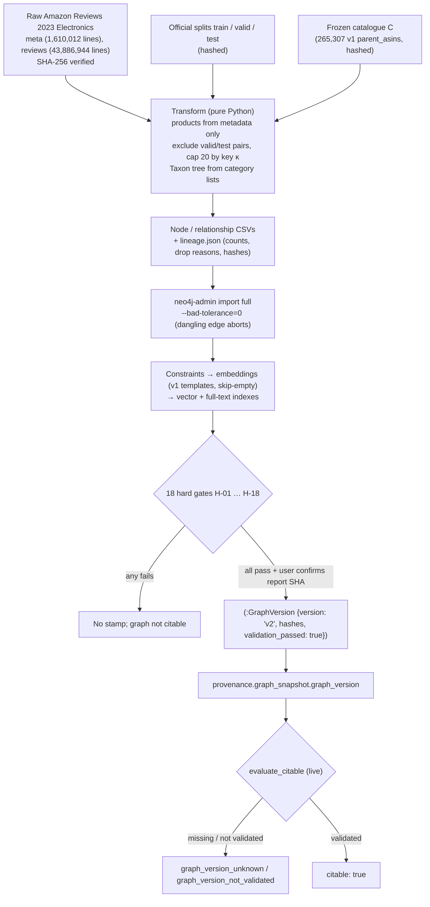

# Thesis Contribution 13: Integrity of the Grounding Knowledge Graph — Construction Defects, a Leakage-Safe Validated Rebuild, and Version-Bound Citability

**Document ID**: `13-doc-graph-integrity`  
**Date**: 2026-10-19  
**Status**: Confirmed Master's Thesis Contribution (Methodological Artifact; the method is built and unit-tested, but the graph is not built yet)  
**Git Scope**: Uncommitted working tree on branch `feature/afp-002-vector-aggregation` (HEAD `0791e35`). The graph v2 files are untracked or modified and are not yet committed.  
**Relevant Modules**: `src/knowledge_graph/graph_v2/` (`transform.py`, `product_mapping.py`, `review_selection.py`, `taxonomy.py`, `lineage.py`, `validation.py`, `csv_io.py`, `import_command.py`, `models.py`, `graph_queries.py`), `src/knowledge_graph/graphdb/embedding_templates.py`, `src/evaluation/provenance.py` (FR-028, FR-029), `scripts/graph_ingestion/{preflight_v2.py, export_v1_snapshot.py, build_graph_v2.py, import_graph_v2.py, post_import_v2.py, validate_graph.py, check_baseline_diff.py}`. Legacy guards are in `scripts/graph_ingestion/batch_ingest.py`, `src/knowledge_graph/graphdb/backfill_embeddings.py` and `src/utils/AmazonDataProcessor.py`.  
**Tests**: `tests/graph_v2/` (12 test modules, fixtures in `tests/fixtures/graph_v2/`), `tests/test_legacy_ingest_guards.py`, `tests/test_graph_cypher_prompt.py`, `tests/test_provenance.py`, `tests/test_archive_eval_run.py`  
**Design Sources**: `_bmad-output/brainstorming/brainstorm-kg-attribute-problems-2026-10-18/brainstorm-intent.md` (finding, K-1 … K-12), `production_artifacts/Research_Report_Graph_Rebuild.md` (N-1 … N-9, Q1 … Q8), `production_artifacts/Technical_Specification_Graph_Rebuild.md` (FR-001 … FR-039, H-01 … H-18), Vision decisions 2026-10-19-018 … 021  
**Audit**: `production_artifacts/Audit_Report_Graph_Rebuild.md`: **PASS WITH FIXES**. Two High findings (import guard, wrong-graph guard) were fixed. 155/155 targeted tests and 767 tests in the full suite pass, with no Neo4j and no Docker.  
**Evidence status**: There is **no v2 graph and no v2 run**. Every v2 figure in this document is either a guarantee of the construction rule (checked on fixtures) or a read-only projection from the raw files.  
**Relation to earlier contributions**: Supplies the data-validity layer that the citable-run predicate of `11-doc-evaluation-protocol.md` lacked. Invalidates or qualifies claims in `3-doc-robust-retrieval.md`, `4-doc-hybrid-scoring.md`, `6-doc-orthogonal-gating.md`, `7-doc-evaluation-framework.md`, `8-doc-catalog-stratification.md`, `10-doc-fusion-ablation.md` and `11-doc-evaluation-protocol.md`; each now has a dated correction note. Prepares the official-split comparison of Meta-Phase C.
**Update 2026-10-20**: Graph v2 has been built, validated (18/18 hard gates), stamped and re-baselined against v1, with three citable runs per graph. §7 records what is now measured, what the re-baseline found, and the revised rubric (54/90 → 60/90; verdict unchanged). The 2026-10-19 text in the header and in §§0–6 is kept as written. Where it says "not executed", "projected" or "open", §7.1 gives the current status.

---

## 0. Scope of the Claim

This document keeps three kinds of statement apart. Each paragraph in §4 is labelled with one of them.

* **(a) Measured facts about graph v1 and the raw data.** These are read-only measurements from the brainstorm (2026-10-18), the research report and this evaluation. They are results.
* **(b) The method.** It is a catalogue-first, leakage-safe, deterministic and gate-validated KG construction whose version is bound to run citability. It is implemented, audited and unit-tested on fixtures. It has **not** been executed against Neo4j or the full raw files.
* **(c) Expected effects.** These are hypotheses to be tested once v2 is built and the v1 baseline is re-run at a fixed code commit. **No v2 retrieval, coverage or quality result is claimed.**

The contribution is methodological. It shows that a GraphRAG recommender's grounding graph can be silently corrupted in ways that count-based provenance does not detect. It also gives a construction and validation protocol under which those defects cannot recur unnoticed. It is not a claim that v2 improves recommendation quality.

---

## 1. Formal Research Context

### 1.1 Academic Problem Statement
A GraphRAG conversational recommender treats its Knowledge Graph as the grounding layer. Vision §4 states: "the system cannot invent a product or its features." That guarantee covers only what the graph contains. If the graph holds product nodes with no data, the retriever can rank them and the explainer cannot explain them. If the graph holds the interactions an evaluation later uses as ground truth, comparisons with collaborative baselines leak. If the ingest silently zeroes fields, mechanisms that depend on them (temporal decay, helpfulness ordering) do nothing, and no test fails.

Graph v1 of this project had all three defects:

| # | Defect (v1) | Mechanism | Observable symptom |
|---|---|---|---|
| D-1 | **Ghost products**: 104,281 of 265,307 `ParentProduct` nodes (39.3%) carry only `parent_asin` and an embedding | Metadata and reviews were sampled independently (`AmazonDataProcessor.process_and_save_data`); the review step created products by `MERGE` (`batch_ingest.py`); `backfill_embeddings.py` embedded empty texts | All ghosts share one blank-template vector ("Product: . Category: Unknown. Features: . Description: "), with cosine ≈ 0.99999 on a 50-ghost sample |
| D-2 | **Zeroed review fields**: `helpful_votes = 0` and `sort_timestamp = 0` in all 1,630,273 rows of `processed_reviews.csv` | Preprocessing read `helpful_votes` / `sort_timestamp`; the raw fields are `helpful_vote` / `timestamp` | The "20 most helpful" cap sorted by `verified_purchase` only; `review_id = md5(user-asin-0)` can collapse repeat reviews; temporal decay has no input |
| D-3 | **No split hygiene**: v1 review evidence was not filtered against the official Amazon 2023 valid/test splits | None needed for v1's purpose; it becomes a leakage path once Meta-Phase C uses the official splits | Measured in §4.1 (F-8) |

None of these defects was detected by the R2a evaluation protocol. The citable-run predicate (Vision 2026-10-18-015) records a graph snapshot of counts (`products`, `categories`, `reviews`). A count cannot tell a filled product node from a ghost. The three R2a gate runs were therefore `citable: true` on a graph in which 39% of the product nodes were empty.

### 1.2 Formal Research Question (RQ)
$$\mathbf{RQ_{13}}: \text{"To what extent do silent construction defects in the grounding Knowledge Graph of a GraphRAG conversational recommender (data-less product nodes with identical embeddings, zeroed interaction fields, held-out interactions in the review evidence) distort coverage statistics and retrieval conclusions, and which of those conclusions change when the graph is rebuilt by a catalogue-first, split-aware, gate-validated and version-stamped construction while code, benchmark and LLM snapshot are held fixed?"}$$

### 1.3 Hypotheses

| ID | Hypothesis | Kind | Status (2026-10-19) |
|---|---|---|---|
| $H_{13a}$ | Count-based run provenance does not detect property-level KG defects. Runs on a defective graph pass the citable predicate. | (a) | **Supported** (measured). The R2a runs were citable with 104,281 ghosts present (§4.1 F-1, F-7). |
| $H_{13b}$ | The v1 defects distort published coverage figures by large factors, not marginally. | (a) | **Supported** (measured). Titled products with reviews: 12%, not 47%. 85.3% of review-embedded products are ghosts. The base rate differs 4.1× by definition (§4.1). |
| $H_{13c}$ | The construction rule makes ghosts, held-out pairs and over-cap products impossible, and its outputs are a deterministic function of hashed inputs. | (b) | **Supported on fixtures** (unit tests, byte-identical rebuild test AC-016). **Untested at full scale**: gates H-01 … H-18 run at build time. |
| $H_{13d}$ | With code commit, benchmark and model fixed, at least one pre-registered retrieval comparison or per-arm metric on legacy-21 changes between v1 and v2. | (c) | **Open.** The direction is not predicted (spec §6.6). Two-sided paired test. |
| $H_{13d,0}$ | No paired per-query difference between v1 and v2 runs for any arm (RR, NDCG@10, HR@{5,10,20}). | (c) | Open |
| $H_{13e}$ | On v2, review-coverage-bias@K loses its discriminating power, because the review-embedded set covers almost the whole catalogue. The RS-02 comparison (`rrf2` vs `rrf3`) then measures the review channel itself rather than its coverage. | (c) | Open; derived in §4.4 |

---

## 2. State-of-the-Art Gap Analysis

### 2.1 Positioning in the Literature
* **Data validation for ML pipelines.** Breck et al. (2019) argue for schema-based checks before data is used and for treating data like code. Schelter et al. (2018) express completeness, uniqueness and referential checks as declarative "unit tests for data". Sambasivan et al. (2021) document *data cascades*: upstream data defects that surface late, silently, in downstream results. Ghost products are a textbook data cascade. A sampling choice in March 2025 surfaced in October 2026 as a hub-bias and coverage-bias artefact.
* **Leakage and rigour in recommender evaluation.** Ferrari Dacrema et al. (2019), Sun et al. (2020) and Hidasi & Czapp (2023) show how evaluation choices and flaws change conclusions. Ji et al. (2023) show that information beyond the test point leaks into offline recommender evaluation. Kapoor & Narayanan (2023) catalogue leakage as a driver of irreproducible ML results.
* **Knowledge-graph quality.** Paulheim (2017) surveys KG completion and error detection, mostly for large open KGs and mostly after the fact. In this case the KG is built from a dataset, so the construction pipeline is the natural point to enforce validity.
* **GraphRAG.** GraphRAG systems (Edge et al., 2024; Peng et al., 2024 survey) evaluate retrieval and generation over a constructed graph. Construction validity is usually assumed rather than checked.
* **Dataset documentation.** Datasheets for Datasets (Gebru et al., 2021) recommend recording how a dataset was built. The lineage file here is a machine-checkable version of that practice.

### 2.2 Gap
LLM-based CRS and GraphRAG evaluations report metrics over a graph, but they rarely make the graph's validity a precondition for citing a result. Conversely, data-validation frameworks are rarely tied to the provenance of individual evaluation runs. Two practical gaps follow:
1. **Grounding validity.** A graph can satisfy its schema (every node has a key) and still contradict the grounding premise (nodes with nothing to ground).
2. **Interaction leakage into evidence.** A conversational recommender that retrieves over review text can see, as evidence, the very review that constitutes a held-out interaction. A CF baseline trained on the official train split never sees that review. This makes the "same dataset splits" comparison of Vision §4 unfair to the baseline.

### 2.3 Red Flag Defense (Novelty Justification)
* **What fails the red-flag test and is not claimed**: the `neo4j-admin database import` wrapper, Docker volume guards, CSV quoting, gzip determinism, memory settings and the 5.14 vector-index procedure form. These are engineering, and they are documented in the spec and audit, not here.
* **What passes**:
  1. A causal account of a KG-construction defect that propagated into retrieval metrics, with measured magnitudes (§4.1).
  2. A construction rule that removes the defect class *structurally*. Nodes come only from metadata, and a relationship to a missing node aborts the import (`--bad-tolerance=0`), instead of a query-time filter.
  3. A split-aware evidence rule that makes the KG and the Meta-Phase C baselines see the same training interactions.
  4. Validation gates that test domain semantics rather than schema. One is the ghost signature (H-04). Another is an ANN self-query that detects the blank-template vector (H-11c). Others are split exclusion (H-06) and benchmark grounding (H-15).
  5. Binding the validated graph version into the citable-run predicate, so that a result can be cited only if the graph it ran on passed those gates.
* **Core Scientific Contribution**: Grounding validity is made a checkable, versioned precondition of every citable recommendation result. A measured case shows why the precondition is necessary.

---

## 3. Architecture & Formal Specification

### 3.1 Construction and Citability Flow


### 3.2 Formal Specification

**The v1 defect (D-1).** Let $M$ be the products in the sampled metadata and $R$ the products referenced by the sampled reviews. v1 created $P_{v1} = M \cup R$, because reviews `MERGE`d their products. Its ghosts are $G = R \setminus M$. In the v1 input files, $|M| = 161{,}001$, $|R| = 123{,}720$ and $|M \cap R| = 19{,}414$, so $|R \setminus M| = 104{,}306$ and $|P_{v1}| = 265{,}307$. In the graph, 104,281 of these remain untitled. The 25-node difference was not traced. For every query embedding $q$, every ghost scores the same $\cos(q, e_{\text{blank}})$. Which ghost appears among tied candidates is therefore an artefact of index order.

**Catalogue-first products.** Let $C$ be the frozen catalogue and $\text{meta}$ the raw metadata records. Then
$$V_P = \{\, p \in C : p \in \text{meta} \,\},$$
with the first metadata line winning and conflicting duplicates reported. No other step creates `ParentProduct` nodes. Every `ABOUT_PRODUCT` endpoint is checked against $V_P$ before the lineage is written. The importer then rejects any dangling relationship.

**Split-aware review evidence.** Let $H = \{(u, p)\}$ be the user–product pairs of `Electronics.valid.csv` ∪ `Electronics.test.csv`. A raw review $r$ by user $u(r)$ on product $p(r)$ is eligible iff
$$p(r) \in V_P \;\wedge\; (u(r), p(r)) \notin H.$$
Train-split reviews and reviews by users outside the 5-core splits are kept (K-12). Neither is a held-out interaction.

**Bounded, deterministic selection.** Duplicates are removed by `review_id = md5(user_id-asin-timestamp)`, keeping the better key and then the lower byte offset. Then, per product, the first 20 reviews in ascending order of
$$\kappa(r) = \big(-\text{helpful\_vote},\; -\text{verified},\; -\text{timestamp},\; \text{review\_id}\big)$$
are kept (`cap_rank` 1 … n). The first 5 kept reviews with non-blank text get `embed_rank` and are embedded. Users are created only from kept reviews.

**Taxonomy.** For a raw category list $(\ell_1, \dots, \ell_d)$, every prefix becomes a `Taxon` with `taxon_id` $= \ell_1 \,\text{" > "}\, \cdots \,\text{" > "}\, \ell_k$. `BROADER` links a prefix of length $k$ to its prefix of length $k-1$. The product gets one `IN_TAXON` edge to depth $d$. This is SKOS `broader` semantics. Two different level tuples with the same `taxon_id` abort the build.

**Content rule and ghost signature.** A product is embedded only if title, features or description is non-blank. Template scaffolding does not count. A node has the ghost signature iff
$$\big|\{k \in \text{keys}(p) : k \neq \texttt{embedding}\}\big| \le 1.$$

**Version-bound citability (FR-029).** For a live run with runtime graph snapshot $g$:
$$\text{citable}(run) = \text{citable}_{R2a}(run) \;\wedge\; \exists!\, v = g.\texttt{graph\_version} \;\wedge\; v.\texttt{validation\_passed} = \texttt{true}.$$
Archived runs are never recomputed. Live runs on v1, which has no stamp, are therefore no longer citable. v1 evidence is the archived R2a set.

**v1 semantics kept.** Every label, relationship, property and embedding template that a current reader uses keeps its v1 meaning. Examples: `Category` = `main_category`, the 4 attribute keys, no `numeric_value`, and the `product_v1` template. New structures use new names (`Taxon`, `p.features`, `p.details_json`, `product_fulltext_index`). With the code commit fixed (`check_baseline_diff.py` allow-list against `88cdbdf`), a v1 → v2 difference in a retrieval metric is therefore attributable to the data, not to representation or code.

### 3.3 Validation Gates (hard; any failure blocks the stamp)

| Group | Gates | What they guarantee |
|---|---|---|
| Catalogue and ghosts | H-01 product count = lineage = catalogue − accepted missing; H-02 catalogue membership; H-03 untitled = lineage ≤ accepted pre-flight count; **H-04 ghost signature = 0** | Products come only from metadata and match the frozen catalogue |
| Reviews and leakage | H-05 exactly one `ABOUT_PRODUCT` and one `WROTE` per review; **H-06 no review's (user, product) in valid ∪ test**, plus `in_train_split` checked on a seeded sample; H-07 cap ≤ 20 and `cap_rank` contiguous; H-08 review count = lineage = approved | Split hygiene and the cap hold in the graph, not only in the transform |
| Embeddings and indexes | H-09 constraints; H-10 per-label embedding coverage = report = eligible, dimension 384; **H-11 no blank embeddings (content check plus ANN self-query of each blank-template vector: top-1 < 0.9999)**; H-12 indexes online at 100%; H-13 full-text smoke test | The blank-template vector cannot enter any vector index |
| Fidelity and grounding | H-14 seeded import-fidelity sample (2,000 products, 2,000 reviews, plus hard-quoting cases) equals the CSV values; **H-15 the 21 benchmark targets are grounded**; H-16 no legacy labels or `numeric_value`; H-17 Taxon tree integrity; H-18 all counts = lineage | The graph is the lineage, and the benchmark still resolves |

Report-only checks R-01 … R-08 record coverage per `main_category` and per taxon, the taxon depth distribution, identical-embedding groups, brand case duplicates, the 90 ISBN-like IDs, and v1 → v2 deltas for benchmark targets and counts.

### 3.4 Key Implemented Classes & Interfaces
* `graph_v2.transform.run_transform`: meta pass, two review passes in byte-offset order, train mark, lineage. A dry-run mode shares the code path with the pre-flight.
* `graph_v2.review_selection.TopKSelector`, `rank_key`, `assign_embed_ranks`, `load_pair_set`: bounded per-product selection with de-duplication. The tests check it against a reference implementation on 50 seeded cases.
* `graph_v2.taxonomy.TaxonomyBuilder`: the prefix tree with collision detection.
* `graph_v2.lineage.IntegrityTracker`, `assert_invariants`, `verify_raw_inputs`, `hash_splits`: endpoint integrity, source balance and input hashing.
* `graph_v2.validation`: pure gate functions H-01 … H-18 and `pilot_build_params`. `scripts/graph_ingestion/validate_graph.py` holds the Cypher collectors.
* `evaluation.provenance._graph_version`, `evaluate_citable(..., graph=...)`: version-bound citability, plus the `products_untitled` and `reviews_embedded` counts.
* `scripts/graph_ingestion/check_baseline_diff.py`: allow-list check that the baseline commit differs from `88cdbdf` only in graph v2 paths.

---

## 4. Empirical Instrumentation, Facts and Expected Effects

### 4.1 (a) Measured Facts about v1 and the Raw Data

| # | Fact | Value | Source |
|---|---|---|---|
| F-1 | Ghost products in v1 | 104,281 / 265,307 (39.3%); only `parent_asin` + embedding | Brainstorm 2026-10-18; Vision 018 |
| F-2 | Ghost embeddings | Identical blank-template vector; cosine ≈ 0.99999 across a 50-ghost sample | Brainstorm |
| F-3 | Titled products with ≥ 1 review | 19,439 / 161,026 (12%); the roadmap figure of 47% counted ghosts | Brainstorm; Vision 021 |
| F-4 | Review-embedded products that are ghosts | 4,874 / 5,715 (85.3%); titled base rate 841 / 161,026 = 0.52% vs all-node 2.15% | Brainstorm; doc 11 §4.5 |
| F-5 | Zeroed fields | `helpful_votes = 0`, `sort_timestamp = 0` in 1,630,273 / 1,630,273 v1 review rows; 1,629,426 `Review` nodes (847 fewer; collapse of repeat reviews likely, not verified) | Research Report N-1, N-2 |
| F-6 | Schema claims that did not hold | 0 `Attribute` nodes with `numeric_value`; attributes only Material, Color, Style, Size; 33 `SUBCATEGORY_OF` edges | Vision 021 items 3–4 |
| F-7 | Provenance blind spot | The three citable R2a runs record 265,307 products and `citable: true` | `evaluations_archive/eval_2026-10-18_2340/2349/2358` manifests; doc 11 |
| **F-8** | **Held-out interactions in v1 review evidence** | **204,352 of 1,630,273 rows (12.5%) of the v1 review input `processed_reviews.csv` are (user, parent_asin) pairs of the official valid ∪ test splits. They touch 72,337 of the 123,720 reviewed products.** | **Measured for this document** (read-only, pandas over `processed_reviews.csv` and `Electronics.{valid,test}.csv`, 2026-10-19). This is the ingest input, not a graph query. |
| F-9 | Raw review funnel for the frozen catalogue | 35,349,187 in-scope raw reviews; 2,828,276 are valid/test pairs; 32,520,911 remain (10,495,892 train-split, the rest outside the 5-core splits) | Brainstorm K-11 (read-only measurement) |

*Interpretation of F-8.* No reported result of this project used the official splits, so no published number is contaminated by F-8. The fact matters for Meta-Phase C. Any comparison of the KG system with CF baselines on the official test split would have given the KG system the review text of one in eight held-out interactions as retrievable evidence. That is exactly the kind of evaluation leakage described by Ji et al. (2023).

### 4.2 (b) Construction Guarantees and Their Current Verification

| Guarantee | Mechanism | Verified now | Verified at build |
|---|---|---|---|
| Zero ghosts | Products only from metadata; dangling edges abort import | Unit tests (`test_transform.py`, `test_lineage.py`), audit | H-01, H-02, H-04 |
| Zero held-out pairs | Pair-set exclusion before selection | `test_review_selection.py`, `test_transform.py` | H-06 |
| Cap ≤ 20, deterministic tie-break | `TopKSelector` with key $\kappa$ | Reference-equivalence on 50 seeded cases | H-07 |
| No blank-template vectors | Content rule; skip-empty in `BackfillService` | `test_embedding_templates.py`, `test_legacy_ingest_guards.py` | H-10, H-11 |
| Determinism | Sorted product-side files; byte-offset review order; gzip `mtime=0` | AC-016: byte-identical CSVs and lineage on repeated builds | Lineage SHA in `GraphVersion` |
| Legacy pipeline cannot recreate ghosts | `batch_ingest.py` review step `MATCH`es products; field names fixed | `test_legacy_ingest_guards.py` | n/a |
| Version-bound citability | FR-028/029 | `test_provenance.py` (AC-032, AC-033) | First v2 run manifest |

At this evaluation, `python -m pytest tests/graph_v2 tests/test_legacy_ingest_guards.py tests/test_graph_cypher_prompt.py tests/test_provenance.py tests/test_archive_eval_run.py -q` gives **195 passed**. `graph_versions/` does not exist yet: no catalogue export, lineage, pre-flight or validation report has been produced.

**Projected v2 counts** (read-only projection of the selection rule over the raw files; not a graph measurement):

| Quantity | v1 (measured) | v2 (projected) |
|---|---:|---:|
| `ParentProduct` | 265,307 | 265,307 (if every catalogue ID has raw metadata; checked for all 104,306 ghost IDs and all 161,001 v1 metadata products) |
| Ghost-signature products | 104,281 | 0 by construction (H-04) |
| Products with ≥ 1 review | 19,439 titled | 265,294 |
| Products with ≥ 5 / ≥ 20 reviews | not computed | 185,332 / 138,021 |
| Products with 0 reviews | — | 13 |
| `Review` nodes | 1,629,426 | 3,388,842 |
| Held-out pairs in review evidence | 204,352 input rows (F-8) | 0 (H-06) |
| Review `timestamp`, `helpful_vote` | 0 everywhere | Raw values |

The number of untitled products with raw metadata is unknown until pre-flight P-01. H-03 accepts that measured count, so "untitled = 0" is not guaranteed. "Ghost signature = 0" is guaranteed.

### 4.3 (c) Pre-Registered Re-Baseline Protocol
* **Fixed**: the code at commit B (`check_baseline_diff.py --base 88cdbdf` exits 0), benchmark legacy-21 (SHA-256 recorded), the LLM snapshot, the CLI configuration of `eval_2026-10-18_2340`, `RETRIEVAL_FUSION_ARM=rrf3`, `ORCH_CATEGORY_RECOVERY=1`, the stats seed, and r = 3.
* **Varied**: only the graph (v1 archived runs vs v2 runs).
* **Gate**: H-15 21/21; each v2 manifest has `citable: true` and `graph_version.version == "v2"`.
* **Analysis**: per arm, HR@{5,10,20}, MRR and NDCG@10 over all queries and SEARCH-only, compared on per-query means over r = 3 with the R2a paired statistics (two-sided; no direction predicted).

### 4.4 (c) Expected Effects to Be Tested (not results)
* **E-1 ($H_{13d}$).** 104k former ghosts become real competitors, often in the benchmark's own categories. Per-query ranks of targets can fall (more competitors) or rise (blank-template ties removed). The direction is not predicted.
* **E-2 ($H_{13e}$).** Under the top-5 embedding scope, the review-embedded set $P_{\text{rev}}$ approaches every product with at least one non-blank review, up to 265,294. Its base rate then approaches 1, so `review-coverage-bias@K` stops discriminating between arms. The RS-02 rule in Vision 2026-10-18-015 point 4 was conditional on 4.7% coverage, and that condition no longer applies. The metric needs redefining for v2 before it is reported, for example as the share of top-K reached *only* through the review channel.
* **E-3.** Stratum S1 "cold" (2026-10-18-014) has about 13 candidates on v2. It is redefined as review-sparse, with cold start simulated by masking (Vision 018 point 9).
* **E-4.** Mechanisms that had no valid input on v1 become testable once their readers are updated. These are temporal decay in KECR (AI-03), helpfulness-ordered review evidence (AI-06), and listing-text grounding (RS-12). This release changes no reader, so the v1 → v2 baseline does not test them.

### 4.5 Replication Protocol
```bash
# Offline (no Neo4j, no Docker): construction rule, gates, provenance
python -m pytest tests/graph_v2 tests/test_legacy_ingest_guards.py tests/test_graph_cypher_prompt.py \
                 tests/test_provenance.py tests/test_archive_eval_run.py -q

# F-8 (read-only): held-out pairs in the v1 review input
python - <<'EOF'
import pandas as pd
rv = pd.read_csv("datasets/processed_data/processed_reviews.csv", usecols=["user_id", "parent_asin"], dtype=str)
held = set()
for s in ("valid", "test"):
    d = pd.read_csv(f"datasets/Electronics.{s}.csv", usecols=["user_id", "parent_asin"], dtype=str)
    held.update(zip(d.user_id, d.parent_asin))
mask = [p in held for p in zip(rv.user_id, rv.parent_asin)]
print(sum(mask), len(rv), rv[mask].parent_asin.nunique(), rv.parent_asin.nunique())
EOF

# Build, with explicit user checkpoints CP-1 … CP-9 (scripts/graph_ingestion/README.md):
# preflight_v2.py → export_v1_snapshot.py → import_graph_v2.py dump → build_graph_v2.py (pilot, full)
# → import_graph_v2.py import → post_import_v2.py {constraints, embed, vector-indexes, fulltext-index}
# → validate_graph.py → post_import_v2.py stamp → three evaluate_retrieval.py --require-clean runs → archive
```

### 4.6 Threats to Validity and Limitations
* **Not executed.** No guarantee in §4.2 has yet been checked on the full data. The audit estimates peak transform memory at about 3.3 GB against a 3 GB target (NFR-002, M-2), which pre-flight P-10 will measure.
* **The catalogue is inherited, not designed.** $C$ is $M \cup R$ from v1, the union of a metadata sample and the products of an independent review sample, whose March 2025 parameters were not recorded. v2 is reproducible from the hashed list, but its population cannot be re-derived from a rule. It over-represents reviewed products relative to the full Electronics metadata (1.61M items). Results generalise to this catalogue, not to Amazon Electronics.
* **Split hygiene covers official held-out pairs only.** The project's own benchmark targets keep their reviews in the KG. That is a separate leakage question, tracked as the `target_review_embedded` slice of 2026-10-18-014.
* **Selection bias of the cap.** Ordering by helpfulness prefers visible, older and longer reviews. The review channel's evidence on v2 is the most-helpful slice, not a random sample.
* **F-8 is measured on the ingest input**, not on graph nodes (847 rows collapsed in the graph). The order of magnitude is unaffected.
* **v1 semantics by design.** v2 still has no numeric attributes and no features in the product embedding (K-6 deferred). The grounding limits of doc 11 §4.4 (numeric constraints unverifiable) carry over unchanged.
* **Single domain.** The method is domain-agnostic in construction, but it is exercised only on Electronics.

---

## 5. Rubric Audit (Thesis Evaluator, 2026-10-19)

| # | Criterion | Score | Assessment |
|---|---|---:|---|
| 1 | Algorithmic & Architectural Novelty | 3/10 | Catalogue-first construction, pair exclusion and validation gates are established practice. The new elements are the ghost signature, the ANN self-query check for blank vectors, and binding the graph version into run citability. |
| 2 | Unexpected or Original Combination | 6/10 | It joins KG construction validity, official-split leakage control for a review-retrieving CRS, and run-level citability into one predicate. These are usually treated separately. |
| 3 | Problem Significance in Literature | 8/10 | Data cascades (Sambasivan et al., 2021), leakage (Kapoor & Narayanan, 2023; Ji et al., 2023), and rigour in recommender evaluation (Ferrari Dacrema et al., 2019; Sun et al., 2020). It also bears directly on the grounding premise of Vision §4. |
| 4 | Red Flag Check | PASS (scoped) | The import wrapper, Docker guards and CSV handling fail and are excluded (§2.3). The measured defect analysis, the structural construction rule, the semantic gates and the citability binding pass. |
| 5 | SOTA Gap Alignment | 6/10 | GraphRAG and LLM-CRS evaluations rarely validate the graph or exclude held-out interactions from retrievable evidence. This is a practice gap more than a theory gap. |
| 6 | Formal RQ Formulability | 6/10 | $RQ_{13}$ has two measured hypotheses (supported), one construction hypothesis (supported on fixtures) and one pre-registered two-sided re-baseline (open). |
| 7 | Tangible Research Artifact | 8/10 | A reproducible build pipeline, a lineage schema, 18 hard gates plus 8 report-only checks, the `GraphVersion` stamp, the baseline allow-list and 12 test modules. |
| 8 | Empirical Instrumentation | 8/10 | Per-step drop counts with reasons, source and output hashes, a validation report, per-category coverage, v1 → v2 delta reports, and `products_untitled` / `reviews_embedded` in every manifest. |
| 9 | Measurable Metric Improvements | 2/10 | None yet. The v1 corrections (F-1 … F-8) are measured facts, not improvements. The v2 counts are projections. |
| 10 | Scientific Reproducibility | 7/10 | The graph is a pure function of hashed inputs, with a byte-identical rebuild test, `--require-clean` and a v1 dump. Lowered because nothing has run at scale and the catalogue is an unrecorded historical sample. |
| | **Total** | **54/90 + PASS** | **Verdict: QUALIFIES — Methodological Artifact.** It is not a Primary Academic Contribution until $H_{13d}$ is tested. |

---

## 6. Master's Thesis Chapter Mapping

* **Target Thesis Chapters**: Chapter 3 or 4 (Knowledge Graph construction: §3.2, §3.3); Chapter 5 (Experimental Methodology: data validity as a precondition of citability, §1.1, §4.1, §4.3); threats-to-validity sections of every results chapter that reports v1 numbers.
* **Key Claims to Make in Thesis Text**:
  1. In this project, 39% of the grounding graph's product nodes were data-less and shared one embedding. Count-based run provenance did not detect this, and runs on that graph were citable under the R2a predicate.
  2. The defect was a data cascade with three independent causes: independent sampling, product creation from reviews, and embedding of empty text. Each cause is removed at its source, not filtered at query time.
  3. 12.5% of the v1 review input consisted of official valid/test interactions. A split-aware evidence rule is required before the KG system can be compared with CF baselines on the official splits.
  4. After this change, a recommendation result is citable only if the graph it ran on passed 18 hard gates and carries a validated version stamp.
* **Claims NOT to make**: that v2 improves any retrieval, coverage or quality metric; that v2 has zero untitled products; that v1 results are wrong (they are valid as v1 evidence); that v1 results were inflated by leakage (none used the official splits); that the catalogue is a representative sample of Amazon Electronics.
* **Follow-up**: pilot (5%) and full build with the checkpoints; the v2 re-baseline (§4.3) reported against $H_{13d}$; redefinition of review-coverage-bias for v2 (E-2) before R2b; Meta-Phase C on the official splits with the same training interactions.

### References
* Breck, E., Polyzotis, N., Roy, S., Whang, S. E., & Zinkevich, M. (2019). Data Validation for Machine Learning. In *Proceedings of SysML (MLSys) 2019*.
* Edge, D., Trinh, H., Cheng, N., Bradley, J., Chao, A., Mody, A., Truitt, S., & Larson, J. (2024). From Local to Global: A Graph RAG Approach to Query-Focused Summarization. arXiv:2404.16130.
* Ferrari Dacrema, M., Cremonesi, P., & Jannach, D. (2019). Are We Really Making Much Progress? A Worrying Analysis of Recent Neural Recommendation Approaches. In *Proceedings of RecSys 2019*, pp. 101–109.
* Gebru, T., Morgenstern, J., Vecchione, B., Vaughan, J. W., Wallach, H., Daumé III, H., & Crawford, K. (2021). Datasheets for Datasets. *Communications of the ACM*, 64(12), 86–92.
* Hidasi, B., & Czapp, Á. T. (2023). Widespread Flaws in Offline Evaluation of Recommender Systems. In *Proceedings of RecSys 2023*.
* Hou, Y., Li, J., He, Z., Yan, A., Chen, X., & McAuley, J. (2024). Bridging Language and Items for Retrieval and Recommendation. arXiv:2403.03952.
* Ji, Y., Sun, A., Zhang, J., & Li, C. (2023). A Critical Study on Data Leakage in Recommender System Offline Evaluation. *ACM Transactions on Information Systems*, 41(3).
* Kapoor, S., & Narayanan, A. (2023). Leakage and the Reproducibility Crisis in Machine-Learning-Based Science. *Patterns*, 4(9), 100804.
* Paulheim, H. (2017). Knowledge Graph Refinement: A Survey of Approaches and Evaluation Methods. *Semantic Web*, 8(3), 489–508.
* Peng, B., Zhu, Y., Liu, Y., Bo, X., Shi, H., Hong, C., Zhang, Y., & Tang, S. (2024). Graph Retrieval-Augmented Generation: A Survey. arXiv:2408.08921.
* Sambasivan, N., Kapania, S., Highfill, H., Akrong, D., Paritosh, P., & Aroyo, L. M. (2021). "Everyone wants to do the model work, not the data work": Data Cascades in High-Stakes AI. In *Proceedings of CHI 2021*.
* Schelter, S., Lange, D., Schmidt, P., Celikel, M., Biessmann, F., & Grafberger, A. (2018). Automating Large-Scale Data Quality Verification. *Proceedings of the VLDB Endowment*, 11(12), 1781–1794.
* Sun, Z., Yu, D., Fang, H., Yang, J., Qu, X., Zhang, J., & Geng, C. (2020). Are We Evaluating Rigorously? Benchmarking Recommendation for Reproducible Evaluation and Fair Comparison. In *Proceedings of RecSys 2020*, pp. 23–32.
* W3C (2009). SKOS Simple Knowledge Organization System Reference. W3C Recommendation.

---

## 7. Update (2026-10-20): Graph v2 Executed, Validated and Re-Baselined

**Evaluator date**: 2026-10-20  
**Git scope**: `64ef49b` … `65a0ba0` on `feature/afp-002-vector-aggregation`. Build at clean commit `75c5c0a`, fixes `8306d9b`, `8b10a35`, `0a32604`, stamp commit `0a32604`, evaluation at clean commit `4248d03`, records committed in `65a0ba0`. The CP-9 acceptance line of `graph_versions/v2/RUNBOOK_LOG.md` is in the working tree and was not yet committed when this section was written.  
**Records used** (all git-tracked): `graph_versions/v2/RUNBOOK_LOG.md` (CP-1 … CP-9), `graph_versions/v2/validation_report.json` (SHA-256 `d8a68b7f…8af`), `graph_versions/v2/lineage.json` (SHA-256 `3f985952…86ec`), `graph_versions/v2/embedding_report.json`, `graph_versions/v2/preflight_report.json`, `graph_versions/v2/pilot/pilot_report.json`, `graph_versions/v2/baseline_comparison.json`, `graph_versions/v1/snapshot.json`, `graph_versions/v1/DUMP.json`, and the archived runs `evaluations_archive/eval_2026-10-18_2340`, `_2349`, `_2358` (v1) and `eval_2026-10-20_1114`, `_1128`, `_1142` (v2).  
**Measured for this update** (read-only, no Neo4j): F-10, O-1, O-4 and the per-query analyses in §7.5. They were computed from the archived `per_query.jsonl` files, the frozen catalogue and `datasets/processed_data/processed_metadata.csv`. The commands are in §7.8.

This section keeps the labelling of §0. Every statement below is marked **(a) measured**, **(b) method verified** or **(c) hypothesis**.

### 7.1 Status of the 2026-10-19 Statements

| 2026-10-19 statement | Status 2026-10-20 |
|---|---|
| Header "Evidence status": no v2 graph and no v2 run | **Superseded.** `(:GraphVersion {version: 'v2', validation_passed: true})` was written at 2026-10-20T08:20:05Z. Three citable v2 runs are archived. |
| §0 (b) the method has not been executed against Neo4j or the full raw files | **Superseded (b, measured).** The pilot (5%) and the full build ran with all checkpoints CP-1 … CP-9 approved. |
| §1.3 $H_{13a}$, $H_{13b}$ | Unchanged (supported). $H_{13b}$ is strengthened by F-10 (§7.4). |
| §1.3 $H_{13c}$ "untested at full scale" | **Supported at full scale (b, measured)**: 18/18 hard gates (§7.2). Byte-identical determinism is still shown only on fixtures (AC-016). The full build ran once. |
| §1.3 $H_{13d}$ / $H_{13d,0}$ | **Tested. $H_{13d,0}$ is not rejected** on legacy-21. No arm changes significantly (all $p_{Holm} \ge 0.875$). At n = 21 this is absence of evidence, not evidence of no effect (§7.4). |
| §1.3 $H_{13e}$ | **First half supported (a, measured)**: review-coverage-bias@10 = 1.000 for every arm in all three v2 runs (v1: 0.029 … 0.386). The second half, that RS-02 then measures the review channel itself, remains open. |
| §4.2 "Verified at build" column | **Measured**: H-01 … H-18 all passed (§7.2). |
| §4.2 projected v2 counts | Measured. Compared with the projection in §7.2. |
| §4.3 pre-registered re-baseline protocol | **Executed**, with one recorded amendment: the code commit is `4248d03`, not a commit equal to `88cdbdf` plus graph v2 paths. `check_baseline_diff.py --base 88cdbdf` first exited 1 on 5 documentation and compose paths. The allow-list was widened to documentation and `docker-compose` (amendment A-7, `012b780`, `4248d03`). It then accepted 37 changed paths. Benchmark SHA (`cbbf3621…`), LLM snapshot (`gpt-4o-2024-08-06`), fusion arms, category recovery and r = 3 match the v1 runs. |
| §4.4 E-1 direction not predicted | Measured: mixed, see §7.4. |
| §4.4 E-2 coverage-bias loses discriminating power | **Measured (a)**: see $H_{13e}$. |
| §4.4 E-3 about 13 cold candidates | **Measured (a)**: 13 products have no review (265,307 − 265,294). |
| §4.4 E-4 temporal decay, helpfulness ordering, listing-text grounding become testable | Inputs now exist (raw `timestamp`, `helpful_vote`; full-text index over title, description, features, details). The readers are still unchanged, so these remain untested. |
| §4.6 "Not executed"; peak memory about 3.3 GB vs 3 GB target | Resolved. Measured peak RSS: 3.6 GB in the pre-flight dry run and 4.2 GB in the full transform. The target was exceeded and the overrun accepted at CP-1. |
| §3.2 "a v1 → v2 difference … is attributable to the data, not to representation or code" | **Qualified by O-4 (§7.5).** The code was held fixed. The v2 graph changes the Category node set (71 → 38, by FR-008) and the Category embeddings (P-09: 40% identical, because the template's sample titles change once ghosts are filled). As a result, category resolution differs for 12 of 21 queries. A difference is attributable to the graph as a whole, not to ghost filling or review coverage alone. |
| §3.3 R-06 "the 90 ISBN-like IDs" | R-06 reports 213 IDs matching `^\d{9}[\dX]$`. The spec expected 90. The discrepancy is report-only and not explained here. |

### 7.2 Construction at Full Scale (a, b; measured)

**Review funnel** (`lineage.json`, `counts.reviews`). 43,886,944 raw lines → 8,537,757 outside the catalogue → 2,828,276 official valid/test pairs excluded → 60,521 duplicate `review_id`s collapsed → 29,078,142 beyond the cap of 20 → **3,382,248 kept**. Of the kept reviews, 1,269,946 are train-split pairs and 2,112,302 are by users outside the 5-core splits. 1,081,137 reviews were selected for embedding. 0 timestamps were missing.

**Products.** 265,307 written, 0 catalogue IDs missing in raw metadata, 8 with an empty title, 3 content-empty, 1 features-only. 265,303 were embedded; 4 were skipped by the `title_description` content rule decided at CP-1. 151,262 products (57%) have no price, and 17,254 have no category path. The Taxon tree has 1,183 nodes, 3 roots and a maximum depth of 7, with 248,053 `IN_TAXON` edges.

**Projection vs measurement** (§4.2):

| Quantity | Projected 2026-10-19 | Measured 2026-10-20 |
|---|---:|---:|
| `ParentProduct` | 265,307 | 265,307 (H-01) |
| Ghost-signature products | 0 by construction | 0 (H-04) |
| Untitled products | unknown until P-01 | 8 (H-03); share 0.393 → 0.00003 (R-08) |
| Products with ≥ 1 review | 265,294 | 265,294 |
| Products with ≥ 5 reviews | 185,332 | ≈ 184,960 (weighted from the four-decimal shares in R-01; not an exact count) |
| `Review` nodes | 3,388,842 | 3,382,248 (H-08). The projection did not fully account for the duplicates collapsed |
| Held-out pairs in review evidence | 0 (H-06) | 0 hits; `in_train_split` checked on 10,000 sampled reviews, 0 mismatches |
| Review-embedded product coverage | approaches 1 | 0.0215 → 0.99995 (R-08) |

**Hard gates** (`validation_report.json`, all passed). Among the observed values:
- H-07: at most 20 reviews per product, 0 bad `cap_rank`.
- H-10: embedded = report = eligible for every label (Attribute 36,187; Brand 49,663; Category 38; ParentProduct 265,303; Review 1,081,137), and 0 vectors with the wrong dimension.
- H-11: 0 empty products and 0 blank reviews embedded. The maximum ANN self-query score over 40 probes is 0.9955, below the 0.9999 threshold.
- H-13: the phrase smoke test ranked its product first.
- H-14: 4,203 values compared, 0 mismatches.
- H-15: all 21 benchmark targets are grounded.
- H-17: no taxon defects.
- H-18: every node and relationship count equals the lineage.

**Report-only findings.**
- R-04: 3 pairs of identical embeddings with different texts in a 5,000-product sample (score 1.0). This is not the ghost signature, but it is not zero either.
- R-05: 925 groups of brand names that differ only in case, kept as exact names under the v1 rule.
- R-07: 19 of 21 benchmark targets change, mostly in review-node count because of the cap (for example 472 → 20). `charger_02` gains the category "Apple Products".
- R-08: v1 → v2 counts:
  - Review: 1,629,426 → 3,382,248
  - User: 471,474 → 2,594,661
  - Brand: 40,998 → 49,663
  - Category: 71 → 38
  - Attribute: 47,335 → 36,187
  - `SUBCATEGORY_OF`: 33 → 0

  The fall in Attribute nodes is not analysed here.

**Cost** (measured). Transform: 10.5 min, 2.9 GB CSV. Import: 94 s, 4.0 GB store, 0 bad rows. Embedding on MPS at batch 32: about 2.5 h in total (reviews 7,679 s at 141 texts/s, products 1,234 s at 215 texts/s). The pilot had extrapolated 2.25 h.

### 7.3 Execution Findings Relevant to Method (a; one build, anecdotal)

These are records of one build, not a measured detection rate. They are reported because they bear on how far a pilot and the gates can be trusted.

| # | Finding | How it surfaced | Fix | Pilot |
|---|---|---|---|---|
| X-1 | **MPS memory.** Pre-flight P-04 crashed twice with MPS out-of-memory after the 9-minute dry run. Both times it lost every measurement, because the report was written only at the end. Encode batch 64 runs out of memory; batch 32 does not. | Pre-flight crash | `8306d9b`: each P-section is isolated and the report is always written; a resilient embedder halves the batch down to 8 and then falls back to CPU per chunk | n/a (before the pilot). The pilot and the full run then recorded 0 out-of-memory events and 0 CPU fallbacks |
| X-2 | **Single-token full-text smoke test does not scale.** At 265k products the chosen token matched 11,828 products, the target fell outside the top 50, and the step fell back to writing `features_text` on 215,032 products. | The post-import step's own smoke test | `8b10a35`: an escaped, quoted phrase from the product's own feature bullet; fallback recovery and an index rebuild | **Passed the pilot** (13,381 products; token "rangefinder", 7 hits). Scale-dependent |
| X-3 | **String-matched embedding write-back.** 2 Attribute nodes with unpaired UTF-16 surrogates were reported as embedded but not written, because the strings do not round-trip over Bolt. | During the full post-import. The records do not say whether a count check or a manual inspection found it. It is the report/graph mismatch that H-10 (embedded = report = eligible) is designed to catch. | `8b10a35`: write by `elementId`, count written rows, and fail the step on a mismatch | **Passed the pilot.** Data-dependent: 2 of 36,187 nodes, not in the 5% sample |
| X-4 | **Driver parameter clash.** The new smoke query passed `query=`, which collides with the first parameter of `Session.run`. | First live execution of the X-2 fix | `0a32604`: Cypher parameter `$search`; the unit-test fake now has the driver's signature | Not scale-dependent. It was a regression introduced by the X-2 fix and masked by a test double whose signature differed from the driver's |

**Methodological reading.**
1. The 5% pilot passed all 18 gates but exposed neither X-2 nor X-3. A pilot checks the procedure and estimates its cost (actual embedding time, about 2.5 h, was about 11% above the 2.25 h estimate). It does not certify correctness at full scale. Assertions inside each step plus full-scale gates are needed.
2. None of the four defects reached the stamped graph. The sequence fix → commit with tests → re-run (`embed --labels Attribute`, `fulltext-index`) → 18/18 validation → user-confirmed report SHA-256 → stamp held. Run citability therefore depends on a graph state that was validated after the fixes.
3. Test doubles must have the same interface as the real driver (X-4). This is general engineering practice, recorded here only because it affected the timeline of a citable artefact.

### 7.4 v1 → v2 Re-Baseline on Legacy-21 (a; measured)

Six runs: v1 `eval_2026-10-18_2340/_2349/_2358` at `88cdbdf`, and v2 `eval_2026-10-20_1114/_1128/_1142` at `4248d03`. All six are citable, use benchmark SHA `cbbf3621…` and `gpt-4o-2024-08-06`, and have 0/21 CLARIFY. The SEARCH-only slice therefore equals the all-queries slice (n = 21). Analysis (`baseline_comparison.json`): per-query mean over r = 3, a paired randomization (sign-flip) test, a paired bootstrap 95% CI of v2 − v1, and Holm correction across arms for MRR. "Discordant" counts queries whose per-query mean reciprocal rank differs. These counts are recomputed for this update from the archived `per_query.jsonl` files.

| Arm | MRR v1 | MRR v2 | Δ | 95% CI | p | $p_{Holm}$ | Δ NDCG@10 | HR@10 v1 → v2 | Discordant (up / down) |
|---|---:|---:|---:|---|---:|---:|---:|---|---|
| hybrid@rrf3 (default) | 0.226 | 0.319 | +0.093 | [−0.004, +0.208] | 0.129 | 0.875 | +0.101 | 0.381 → 0.492 | 9 (5 / 4) |
| hybrid@rrf2 | 0.237 | 0.206 | −0.031 | [−0.092, +0.014] | 0.344 | 1.000 | −0.039 | 0.429 → 0.365 | 6 (1 / 5) |
| hybrid@wrrf3 | 0.345 | 0.322 | −0.023 | [−0.103, +0.065] | 0.656 | 1.000 | −0.018 | 0.524 → 0.524 | 7 (2 / 5) |
| hybrid@cc3 | 0.298 | 0.288 | −0.011 | [−0.102, +0.088] | 0.875 | 1.000 | −0.015 | 0.476 → 0.460 | 7 (2 / 5) |
| hybrid@sum_legacy | 0.176 | 0.144 | −0.032 | [−0.124, +0.058] | 0.511 | 1.000 | −0.040 | 0.333 → 0.254 | 12 (5 / 7) |
| vector_only | 0.162 | 0.047 | −0.115 | [−0.276, +0.014] | 0.184 | 0.918 | −0.109 | 0.238 → 0.143 | 9 (4 / 5) |
| cypher_only | 0.148 | 0.056 | −0.093 | [−0.198, −0.011] | 0.125 | 0.875 | −0.080 | 0.190 → 0.143 | 4 (0 / 4) |

**Result.** $H_{13d,0}$ is not rejected for any arm. The R2 protocol predicted low power at this size: with 4 to 12 discordant queries per arm, split between both directions, effects of this size cannot reach significance. The rrf3 interval [−0.004, +0.208] is compatible both with no change and with a large gain.

**Points to report with the table.**
* **The rrf3 gain is concentrated in a few queries.** `keyboard_02` and `laptop_01` go from a miss to rank 1–2, `phone_01` from 5 to 1, and `charger_01` from 11 to 8. `keyboard_03` goes from 7 to a miss. Run-to-run variation is larger on v2: 4 of 21 queries change rank across the three v2 rrf3 runs, against 1 on v1. vector_only and cypher_only are deterministic in both.
* **cypher_only: the bootstrap CI excludes 0, but the primary test does not.** Only 4 queries are discordant. With 4 discordant pairs the exact sign-flip test cannot go below p = 2/16 = 0.125, and a percentile bootstrap over so few non-zero differences is anti-conservative. Under the pre-registered protocol (doc 11) the randomization test is primary, so this is **not** a finding.
* **The arms are not what their names suggest.** `vector_only` is not a single channel: it fuses all three channels with the default configuration (rrf3) and applies no hard filters. `cypher_only` applies the hard filters and ranks by a Bayesian rating × log-volume score read from `avg_rating` and `review_count` on the product node.
* **The within-v2 contrast rrf3 vs rrf2 (0.319 vs 0.206) is descriptive only.** Legacy-21 is tuning-side. The RS-02 rule is defined for the benchmark-v2 tuning split, and its premise of 4.7% review coverage no longer holds (§7.5 O-3).

**New measured fact about v1 (F-10, strengthens $H_{13b}$).** In the three citable v1 runs, products without a row in the v1 metadata input occupied a substantial share of top-10 slots: vector_only 35.2% (222/630), sum_legacy 14.4%, rrf3 10.3%, cc3 6.7%, rrf2 3.2%, cypher_only 3.0%, wrrf3 2.4%. These products are the 104,306 IDs of §3.2; 104,281 of them were untitled in the graph. Hit-based metrics scored these slots as ordinary non-target items. The citable v1 evidence therefore ranked nodes with no data for a user to see, and no metric in the R2a protocol recorded this.

### 7.5 Candidate Explanations (c; hypotheses, not findings)

**Measured observations** (a) that bear on them:
* **O-1, former ghosts in v2 top-10.** On v2 the same 104,306 IDs, now real products, occupy 44–73% of top-10 slots: rrf2 44.3%, wrrf3 49.5%, cc3 55.9%, rrf3 58.4%, cypher_only 61.7%, vector_only 63.3%, sum_legacy 72.9%. Their catalogue share is 39.3%.
* **O-2.** Benchmark targets with embedded reviews: 1/21 on v1, 21/21 on v2.
* **O-3.** Review-coverage-bias@10 = 1.000 for every arm on v2 (catalogue share 0.99995), so the metric is degenerate.
* **O-4, category resolution shift.** In all three run pairs, the applied category differs between v1 and v2 for the same 12 of 21 queries. On v1, requests resolved to legacy Category nodes such as "Mice", "Earbud Headphones", "Keyboards, Mice & Accessories", "Headphones & Earbuds", and to "Computers" and "Apple Products". On v2 the raw string ("mouse", "keyboard", "headphones", "MacBook Air", "iPhone") is applied. `camera_01` moves the other way: raw "webcam" becomes "Camera & Photo". Target admission is unchanged (20/21 on both graphs).
* **O-5, displacement** (one run pair, `2340` → `1114`). Where the target ranks worse on v2, the items that newly rank above it are mostly former ghosts: cypher_only 24/24, rrf3 22/26, vector_only 59/76, sum_legacy 76/107, cc3 17/20, wrrf3 24/28, rrf2 19/26. Where the target ranks better on v2, the items no longer above it are rarely v1 ghosts for the fused arms (rrf3 2/50, sum_legacy 1/60, cc3 0/21). vector_only is the exception, at 20/50.

**Hypotheses** (none tested):
* **HYP-1, review coverage.** rrf3 can gain because the review channel now reaches every product, including all targets (O-2). For: rrf3 rises and rrf2, which has no review channel, falls. On `keyboard_02` the three equal-weight arms with the review channel (rrf3, cc3, sum_legacy) go from a miss to rank ≤ 4, while rrf2 still misses. Against: cc3 (Δ −0.011) and vector_only (rrf3 fusion without filters, Δ −0.115) do not rise. Review coverage is therefore not a sufficient explanation.
* **HYP-2, ghosts became competitors.** Filling the 104k ghosts added real, often review-rich competitors to the benchmark's categories (O-1). They displaced targets in the arms that fell (O-5). The case is strongest for cypher_only. On v1 a ghost had no `avg_rating` or `review_count` and scored 0. On v2 it carries metadata ratings, and every item that newly outranks a target is a former ghost. O-5 is descriptive and comes from one run pair. It shows *which* items displaced targets, not that they were the cause.
* **HYP-3, category resolution.** O-4 changes the input of the hard filter for 12 queries, which can move filtered arms in either direction. The two largest rrf3 gains (`keyboard_02`, `laptop_01`) fall on queries whose resolution changed. rrf3's improvements are not explained by removing v1 ghosts (O-5: 2/50). vector_only applies no filters, so HYP-3 cannot explain its drop.
* **HYP-4, LLM noise.** Extraction noise differs between the two graphs. On v2, 4 of 21 queries vary across the rrf3 runs. Averaging over r = 3 reduces this noise but does not remove it.

**Tests that would separate these hypotheses** (not yet run):
1. Mask the former ghosts on v2 at query time (HYP-2).
2. Pin the category filter to its v1 value per query (HYP-3).
3. Run rrf3 against rrf2 on benchmark v2 with a larger n (HYP-1).

### 7.6 Consequences for Other Contributions

These consequences are now also recorded as dated notes (2026-10-20) in the affected documents: `8-doc-catalog-stratification.md` (C-4 … C-6), `10-doc-fusion-ablation.md` (C-8 … C-11) and `11-doc-evaluation-protocol.md` (C-4 … C-8).
* **Docs 10 and 11, review-coverage-bias@K.** The metric is uninformative on v2 (O-3) and must be redefined before R2b, for example as the share of top-K that only the review channel reaches. The RS-02 rule (Vision 2026-10-18-015 point 4) assumed 4.7% review coverage. That premise does not hold on v2.
* **Doc 8, stratum S1 "cold".** S1 has 13 candidates on v2 and needs the redefinition planned in G-9.
* **R1/R2a retrieval conclusions (docs 10, 11).** They are neither overturned nor confirmed on v2. No arm changed detectably, and the arm order on v2 (wrrf3 ≈ rrf3 > cc3 > rrf2 > sum_legacy) is descriptive.

### 7.7 Revised Rubric Audit (Thesis Evaluator, 2026-10-20)

| # | Criterion | 2026-10-19 | 2026-10-20 | Reason for change |
|---|---|---:|---:|---|
| 1 | Algorithmic & Architectural Novelty | 3/10 | 3/10 | No new method. Execution does not add novelty. |
| 2 | Unexpected or Original Combination | 6/10 | 6/10 | Unchanged. |
| 3 | Problem Significance in Literature | 8/10 | 8/10 | Unchanged. F-10 adds a concrete data-cascade instance (ghost nodes in citable top-10 lists) but no new problem class. |
| 4 | Red Flag Check | PASS (scoped) | PASS (scoped) | X-1 … X-4 are engineering and are not claimed as contributions. They are reported only for what they show about pilots and gates. |
| 5 | SOTA Gap Alignment | 6/10 | 6/10 | Unchanged. |
| 6 | Formal RQ Formulability | 6/10 | **7/10** | The pre-registered part of $RQ_{13}$ ran as registered (one recorded amendment, A-7) and returned a defined answer with intervals. Its first clause now has a measured instance (F-10). Not higher, because the answer to $H_{13d}$ is inconclusive at n = 21. |
| 7 | Tangible Research Artifact | 8/10 | **9/10** | The artifact now exists as a validated, stamped graph whose lineage, validation, embedding, import and pilot records are hash-bound into every run manifest (`graph_snapshot.graph_version`). Not 10: the store itself is not distributable, and the catalogue is inherited. |
| 8 | Empirical Instrumentation | 8/10 | **9/10** | The instrumentation ran at scale and produced every figure in §7.2–§7.5: gate values, report-only deltas, out-of-memory and fallback counts, write counts. Per-query traces allowed the displacement and category-shift analyses. Not 10: which check detected X-3 is not recorded, and there is no full-scale determinism probe. |
| 9 | Measurable Metric Improvements | 2/10 | **4/10** | Graph-validity metrics improved by large measured margins: untitled share 0.393 → 0.00003; ghost signature 104,281 → 0; review-embedded product coverage 0.0215 → 0.99995; held-out pairs 204,352 input rows → 0 graph hits; raw timestamps and helpful votes restored. Capped at 4 because these improvements are what the construction rule targets (largely true by construction), and no retrieval metric improved significantly; four arms point down. |
| 10 | Scientific Reproducibility | 7/10 | **8/10** | Full build from SHA-verified inputs at clean commits, a user-confirmed validation SHA before the stamp, six archived citable runs bound to graph-version hashes, and a v1 dump with SHA kept for rollback. Not higher: byte-identical determinism shown only on fixtures (one full build); the v1 dump restore test was not run (`restore_test: null`); embeddings depend on the device (P-09: 19/20 product embeddings reproduce v1 at ≥ 0.999); LLM run-to-run variation (§7.4); the catalogue is inherited. |
| | **Total** | **54/90 + PASS** | **60/90 + PASS** | **Verdict unchanged: QUALIFIES, Methodological Artifact.** |

**Why not a Primary Academic Contribution.** The 2026-10-19 condition was "until $H_{13d}$ is tested". It has now been tested, and the null hypothesis was not rejected. The contribution is a validity method and its measured necessity (F-1 … F-10). It does not establish a performance effect, and its novelty score (3/10) is below the "strong novelty" profile of a primary contribution.

### 7.8 Claims, Non-Claims and Replication (2026-10-20)

**Claims supported by this update:**
1. The catalogue-first, split-aware rebuild ran at full scale and passed 18/18 hard gates: ghost signature 0, held-out pairs 0, untitled products 104,281 → 8, and every count equal to the lineage.
2. In the citable v1 runs, products with no metadata occupied up to 35% of top-10 slots (vector_only) and 10% for the default arm (F-10).
3. With code (modulo the A-7 allow-list), benchmark and LLM snapshot held fixed, no retrieval arm changed detectably between v1 and v2 on legacy-21 (all $p_{Holm} \ge 0.875$). The study had low power, as predicted.
4. Review-coverage-bias@K is degenerate on v2.
5. A 5% pilot that passes every gate can still miss defects that appear only at full scale or in rare data (X-2, X-3).

**Not to be claimed:**
- that v2 improves retrieval;
- that rrf3 benefits from review coverage;
- that former ghosts or the category shift caused any per-arm change (HYP-1 … HYP-4);
- that cypher_only is significantly worse;
- that the v1 retrieval conclusions are confirmed on v2.

**Replication** (offline, no Neo4j):
```bash
python -m pytest tests/graph_v2 tests/test_legacy_ingest_guards.py tests/test_graph_cypher_prompt.py \
                 tests/test_provenance.py tests/test_archive_eval_run.py -q      # 226 passed on 2026-10-20

# F-10 / O-1: share of v1 metadata-less IDs in top-10, per arm and graph
python - <<'PY'
import gzip, json, pandas as pd
cat = {x.strip() for x in gzip.open("graph_versions/v2/catalogue_asins.txt.gz", "rt") if x.strip()}
meta = set(pd.read_csv("datasets/processed_data/processed_metadata.csv", usecols=["parent_asin"], dtype=str).parent_asin.dropna())
ghost = cat - meta                                   # 104,306 IDs
runs = {"v1": ["eval_2026-10-18_2340", "eval_2026-10-18_2349", "eval_2026-10-18_2358"],
        "v2": ["eval_2026-10-20_1114", "eval_2026-10-20_1128", "eval_2026-10-20_1142"]}
for g, rs in runs.items():
    tot, hit = {}, {}
    for r in rs:
        for line in open(f"evaluations_archive/{r}/per_query.jsonl"):
            for arm, s in json.loads(line)["strategies"].items():
                top = s["top20"][:10]
                tot[arm] = tot.get(arm, 0) + len(top)
                hit[arm] = hit.get(arm, 0) + sum(x in ghost for x in top)
    print(g, {a: round(hit[a] / tot[a], 3) for a in tot})
PY
# O-4: compare per_query.jsonl "applied_category.normalized" between paired v1/v2 runs.
# O-5: for each arm, compare top20[:target_rank-1] between eval_2026-10-18_2340 and eval_2026-10-20_1114.
```

### 7.9 Follow-Up
- Run the separating tests of §7.5 (ghost masking, pinned category filter).
- Redefine review-coverage-bias@K and S1 before the R2b benchmark freeze.
- Check full-scale determinism by rebuilding and comparing the lineage SHA.
- Test-restore the v1 dump.
- Run R2b on v2 with about 200 queries, so that effects of the size seen here become detectable.
