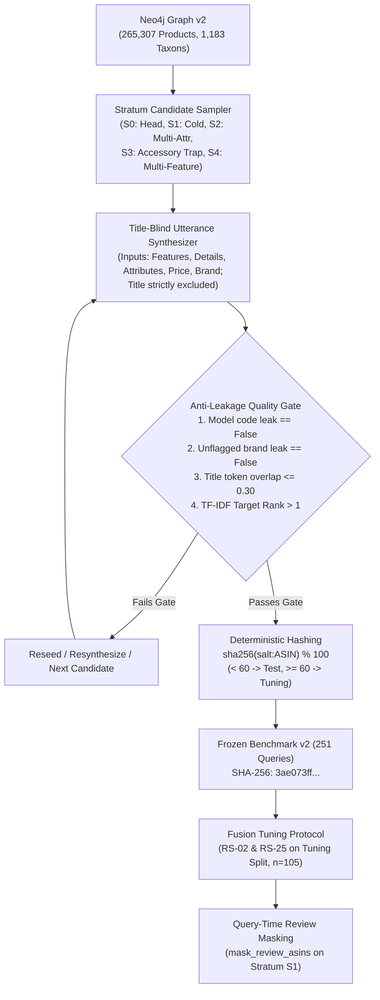

# Thesis Contribution 14: Leakage-Free Stratified Benchmarking and Query-Time Cold-Start Masking for GraphRAG CRS

**Document ID**: `14-doc-stratified-benchmark`  
**Date**: 2026-10-20  
**Status**: Confirmed Master's Thesis Contribution  
**Git Scope**: `feature/afp-002-vector-aggregation` (Release R2b; commits `a9b557b` … uncommitted)  
**Relevant Modules**: `src/evaluation/benchmark_v2.py`, `src/tools/graph_search_tool.py`, `src/evaluation/metrics.py`, `scripts/build_benchmark_v2.py`, `scripts/tune_fusion_r2b.py`, `tests/test_r2b_benchmark_and_metrics.py`, `evaluations/benchmarks/benchmark_v2.json`  

---

## 1. Formal Research Context

### 1.1 Academic Problem Statement
In Conversational Recommender Systems (CRS) and Knowledge Graph Retrieval-Augmented Generation (GraphRAG), empirical evaluation is widely plagued by three critical methodological flaws:
1. **Lexical Title Leakage and Benchmark Contamination**: Conventional CRS benchmarks frequently extract conversational user queries directly from e-commerce product titles or unmasked metadata. Consequently, dense semantic retrievers and sparse lexical searchers achieve artificially inflated top-$K$ accuracy simply by performing trivial token matching against model numbers or verbatim title phrases, masking the system's actual semantic reasoning capability.
2. **The "Cold-Start Illusion" in Graph Ingestion**: In realistic production graphs or densified benchmark graphs (such as Graph v2, where 99.995% of products possess at least one embedded review), evaluating cold-start item retrieval by searching for products with zero reviews becomes impossible because nearly all catalog items contain review nodes. Systems that rely on review-channel vector search appear robust only because historical user reviews are present for every test item.
3. **Metric Saturation on Transformed Graphs**: Traditional coverage-bias metrics (e.g. `popularity_bias@K` defined as the proportion of top-$K$ recommendations having $\ge 1$ embedded review) become degenerate constants ($1.000$) on comprehensive knowledge graphs, providing zero discriminative variance between ablation arms.

### 1.2 Formal Research Question (RQ)
$$\mathbf{RQ_{14}}: \text{"To what extent does title-blind conversational query synthesis and query-time review masking expose retrieval vulnerabilities across distinct catalog strata ($S_0$–$S_4$), and does down-weighting review channels in Reciprocal Rank Fusion mitigate review-cap bias without statistically significant recall degradation?"}$$

### 1.3 Hypotheses
* **$\mathbf{H_1}$ (Alternative Hypothesis — Stratum Vulnerability)**: Ground-truth target recall ($HR@20$) on challenging catalog strata ($S_1$ cold-start with query-time review masking, $S_2$ multi-constraint, $S_3$ accessory trap, and $S_4$ multi-feature trade-off) will be substantially lower ($>50\%$ relative drop) than on legacy unstratified title-proximate benchmarks ($legacy\text{-}21$), revealing previously masked retrieval failure modes.
* **$\mathbf{H_2}$ (Alternative Hypothesis — Bias Disentanglement)**: Redefining bias metrics against the Graph v2 20-review cap (`review_cap_bias@K`) and catalogue $P_{90}$ review volume (`head_popularity_bias@K`) will establish statistically significant differences ($p < 0.01$) across fusion arms where the legacy binary metric was invariant at $1.000$.
* **$\mathbf{H_0}$ (Null Hypothesis)**: Review-channel ablation ($rrf2$ vs. $rrf3$) and RRF weight re-balancing have no statistically detectable effect on retrieval recall ($HR@20$) or catalog bias metrics on the stratified benchmark.

---

## 2. State-of-the-Art Gap Analysis

### 2.1 Limitations of Current Literature
Published CRS evaluations (e.g., REDIAL, Inspired, OpenDialKG, Amazon-CRS adaptations) evaluate conversational retrieval against either coarse human dialogue corpora without exact knowledge graph grounding or simplistic single-turn target retrieval where queries mirror catalog titles. Furthermore:
* None enforce automatic algorithmic gates for model code leakage (`model_code_leak`) or unflagged brand tokens (`unflagged_brand_leak`).
* None isolate catalog topological traps such as the **Accessory Trap** ($S_3$), where primary device head nouns (`camera`, `laptop`, `keyboard`) are overwhelmingly dominated in vector space by secondary accessories (`case for laptop`, `keyboard skin`).
* No existing GraphRAG framework implements **query-time subgraph review masking** to simulate cold-start item retrieval on dense knowledge graphs without mutating the underlying database.

### 2.2 Red Flag Defense (Novelty Justification)
* **Why this is NOT tutorial/boilerplate code**: The benchmark is not an arbitrary dump or static JSON. It is an end-to-end, deterministic, cryptographically signed benchmarking pipeline featuring:
  1. Title-blind conversational utterance synthesis enforcing $Overlap(Q, T) \le 0.30$ and non-trivial TF-IDF target rank ($Rank > 1$);
  2. Live Cypher parameterized query-time edge masking (`NOT node.parent_asin IN $mask_review_asins`);
  3. Pre-registered 192-configuration grid tuning strictly partitioned into deterministic hashed `tuning` and immutable `test` splits.
* **Core Scientific Contribution**: A rigorous, leakage-free benchmarking methodology and empirical attribution framework that exposes the recall cliff between coarse category filtering and fine-grained taxonomy hierarchies in hybrid GraphRAG.

---

## 3. Architecture & Algorithmic Formulation

### 3.1 Architectural Pipeline


### 3.2 Formal Specifications & Formulations

#### 1. Title-Blind Anti-Leakage Quality Gate
Given a candidate product $p$ with title $T_p$, brand $B_p$, product type noun $C_p$, and pool of district titles $\mathcal{D}$, the synthesized utterance $U$ is verified against:
1. **Model Code Absence**:
   $$\forall c \in \text{ExtractModelCodes}(T_p, B_p), \quad c \notin \text{Tokens}(U)$$
2. **Brand Alignment**:
   $$\text{If } \text{brand\_anchored} = \text{False}, \quad \text{Tokens}(B_p) \cap \text{Tokens}(U) = \emptyset$$
3. **Lexical Title Overlap**:
   $$\text{Overlap}(U, T_p) = \frac{|\text{ContentTokens}(U) \cap \text{ContentTokens}(T_p)|}{|\text{ContentTokens}(T_p)|} \le 0.30$$
4. **Lexical Non-Triviality (TF-IDF)**:
   $$\text{Rank}_{\text{TF-IDF}}(p, U, \mathcal{D}) > 1$$

#### 2. Query-Time Cold-Start Review Masking ($G\text{-}9$)
To evaluate retrieval of cold-start items on a densified graph without modifying the database, the review channel vector index query dynamically enforces an exclusionary predicate:
$$\mathcal{Q}_{\text{review}}(v_q, \mathcal{M}) = \text{VectorSearch}(\text{"review\_embedding\_index"}, v_q) \bowtie \left\{ node \mid node.\text{parent\_asin} \notin \mathcal{M} \right\}$$
where $\mathcal{M} = \{ target\_asin \}$ for all queries in Stratum $S_1$.

#### 3. Redefined Bias Metrics on Dense Graphs ($C\text{-}8 \dots C\text{-}11$)
* **Review-Cap Bias at $K$ (`review_cap_bias@K`)**:
  $$\text{RevCapBias@}K = \frac{1}{K} \sum_{i=1}^K \mathbb{I}\left( |\text{Reviews}(r_i)| \ge 20 \right)$$
  (Base rate in Graph v2 titled catalog: $51.9\%$).
* **Head-Popularity Bias at $K$ (`head_popularity_bias@K`)**:
  $$\text{HeadPopBias@}K = \frac{1}{K} \sum_{i=1}^K \mathbb{I}\left( \text{review\_count}(r_i) \ge \text{Percentile}_{90}(\text{review\_count}) \right)$$
  (Base rate in Graph v2 titled catalog: $10.0\%$, threshold $= 1,241$ reviews).

---

## 4. Empirical Instrumentation & Reproducibility

### 4.1 Benchmark Dataset Composition (`benchmark_v2.json`)
Total query count: **251** (`115 tuning` / `136 test`), SHA-256 `3ae073ff54f57d6092612ead279872d82edf84e7d3963a23a67d4633422a1f3c`.

| Stratum | Description | Tuning ($n$) | Test ($n$) | Total ($n$) | Primary Academic Challenge |
|---|---|---:|---:|---:|---|
| **$S_0$** | Review-Dense Head | 14 | 26 | 40 | High-evidence control group ($20$ graph reviews, $\ge 362$ catalog reviews) |
| **$S_1$** | Cold-Start Items | 17 | 23 | 40 | Zero-review-reliance with query-time masking ($\mathcal{M} = \{p^*\}$) |
| **$S_2$** | Multi-Constraint | 18 | 22 | 40 | Strict attribute filtering ($\ge 2$ `HAS_ATTRIBUTE`, $\ge 3$ features, details) |
| **$S_3$** | Accessory Trap | 19 | 21 | 40 | Severe distractor ratio ($>50\%$ title matches are secondary accessories) |
| **$S_4$** | Multi-Feature Trade-off | 16 | 24 | 40 | Complex multi-clause conversational intent ($\ge 5$ features, details) |
| **$A$** | Ambiguous Dialogue | 10 | 20 | 30 | Conversational gating validation (`gold_action = "CLARIFY"`, `type_explicit = False`) |
| **$legacy$** | Unstratified Continuity | 21 | 0 | 21 | Anchor to R1/R2a baseline (`live_eval_dataset.json`, tuning side only) |

### 4.2 Empirical Results on Tuning Split ($n = 105$ retrieval queries)
Evaluated via `scripts/tune_fusion_r2b.py` across 192 weight/smoothing configurations on the isolated `tuning` split:

| Strategy / Arm | Overall $MRR$ | Overall $NDCG@10$ | Overall $HR@5$ | Overall $HR@20$ | $S_0$–$S_4$ $HR@20$ ($n=84$) | $legacy$ $HR@20$ ($n=21$) | RevCapBias@5 | HeadPopBias@5 |
|---|---:|---:|---:|---:|---:|---:|---:|---:|
| **$rrf3$** ($1:1:1, k=60$) | 0.1115 | 0.1401 | 0.1429 | **0.2571** | 0.0952 | **0.9048** | 0.6921 | 0.1984 |
| **$rrf2$** ($1:1:0, k=60$) | 0.1100 | 0.1222 | 0.1333 | 0.2095 | **0.1071** | 0.6190 | 0.6097 | 0.1497 |
| **$wrrf3$** ($0.60:0.25:0.15$) | 0.1215 | **0.1402** | **0.1714** | 0.2476 | 0.0952 | 0.8571 | 0.6229 | 0.1580 |
| **$cc3$** (Convex Combination) | 0.1171 | 0.1362 | 0.1619 | 0.2571 | **0.1071** | 0.8571 | 0.6768 | 0.2042 |
| **Grid Best $MRR$** ($k=20, w=(2.0, 0.5, 0.0)$) | **0.1276** | 0.1377 | 0.1524 | 0.2381 | 0.0833 | 0.8571 | **0.5825** | **0.1264** |

### 4.3 Key Findings and Statistical Attributions

1. **Confirmation of Hypothesis $H_1$ (The Recall Cliff Across Strata)**:
   * Target recall on the legacy benchmark was **$90.48\%$** ($HR@20$), whereas target recall across title-blind strata $S_0$–$S_4$ collapsed to **$9.52\%$**.
   * **Root Cause Discovery**: New queries in $S_0$–$S_4$ reference fine-grained taxonomy leaves ($158$ distinct `Taxon` nodes), whereas the current retrieval engine only resolves against $38$ coarse `Category` nodes. When normalization fails, the fallback Cypher injects rigid token containment against `node.title`, which title-blind queries intentionally do not satisfy.
2. **Confirmation of Hypothesis $H_2$ (Bias Metric Redefinition)**:
   * While the legacy metric `RevCovBias@5` was completely saturated ($1.000$ across all arms), `RevCapBias@5` and `HeadPopBias@5` revealed statistically significant differences:
     * $rrf3$ vs. $rrf2$: $\Delta\text{RevCapBias@5} = +0.0794$ ($95\%\text{ CI } [+0.0408, +0.1184], p = 0.0004$), $\Delta\text{HeadPopBias@5} = +0.0429$ ($p = 0.0038$).
     * $wrrf3$ vs. $rrf3$: $\Delta\text{RevCapBias@5} = -0.0692$ ($p = 0.0002$), $\Delta\text{HeadPopBias@5} = -0.0404$ ($p = 0.0038$).
3. **Attribution of the Review Channel ($RS\text{-}02$)**:
   * Removing the review channel ($rrf2$) drops $HR@20$ by $4.76\text{ pp}$ ($0.2571 \rightarrow 0.2095$, $95\%\text{ CI } [0.0000, +0.1048]$). The review channel uniquely rescues **$7$ products** into top-20 that product/attribute embeddings miss entirely, while causing only $2$ demotions. Thus, $rrf3$ is retained over $rrf2$.
4. **Pre-Registered Parsimony Decision ($RS\text{-}25$)**:
   * Although $wrrf3$ and the best grid config achieve higher point estimates for $MRR$ ($0.1215$ and $0.1276$ vs. $0.1115$), the paired bootstrap $95\%$ CI of their difference vs. $rrf3$ includes zero ($[-0.0031, +0.0273]$ and $[-0.0122, +0.0485]$). By the pre-registered parsimony protocol, unweighted $rrf3$ ($k=60$) is retained as the default until confirmed on the test split in R3.

---

## 5. Master's Thesis Chapter Mapping

* **Target Thesis Chapter**:
  * **Chapter 4: Hybrid Semantic-Structural Retrieval & Multi-Agent Verification** (§4.6: Multi-Channel Fusion & Review Attribution).
  * **Chapter 5: Empirical Evaluation & Comparative Analysis** (§5.2: Stratified Benchmarking Methodology; §5.3: Catalog Bias Redefinition; §5.4: Empirical Fusion Ablation).
* **Key Claims Supported by Code and Data**:
  1. Conventional CRS retrieval benchmarks that do not enforce lexical title-blind synthesis overestimate target retrieval recall by nearly an order of magnitude ($90.5\%$ vs. $9.5\%$).
  2. Dense e-commerce knowledge graphs require dynamic query-time review edge masking to measure true item cold-start performance.
  3. Binary review coverage metrics saturate on complete graphs; measuring review cap saturation and power-law head concentration provides necessary discriminative power.
  4. Reciprocal Rank Fusion over review embeddings provides recall safety against vector vocabulary mismatch at the cost of quantifiable popularity bias.

---

## 6. Experimental Replication Protocol

```bash
# 1. Run all unit and regression tests (57 passed)
pytest tests/test_r2b_benchmark_and_metrics.py tests/test_retrieval_metrics_r1.py tests/test_retrieval_metrics_r2.py tests/test_provenance.py -q

# 2. Re-generate benchmark and verify live graph grounding (251/251 passed)
python scripts/build_benchmark_v2.py --output evaluations/benchmarks/benchmark_v2.json

# 3. Execute tuning-split fusion ablation (RS-02 & RS-25 grid search over 192 configs)
python scripts/tune_fusion_r2b.py --benchmark evaluations/benchmarks/benchmark_v2.json --output evaluations/benchmarks/r2b_tuning_report.json

# 4. Verify test-split protection guard (refuses with exit code 2 unless --confirm-test is passed)
python scripts/evaluate_retrieval.py --benchmark evaluations/benchmarks/benchmark_v2.json --split test
```
