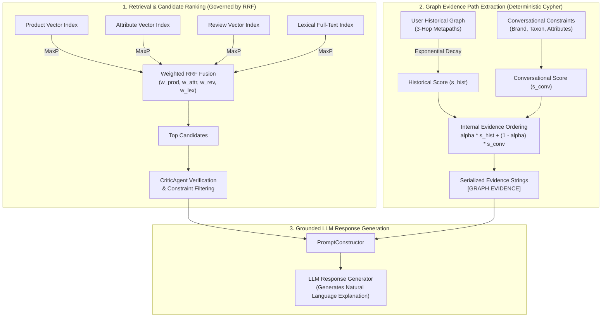

# Thesis Contribution 6: Graph Evidence Paths (Template Metapaths Inspired by KECR/PGPR) & Grounded Evidence Extraction

**Document ID**: `6-doc-orthogonal-gating`  
**Date**: 2026-10-02 (Revised 2026-10-22)  
**Status**: Confirmed Master's Thesis Contribution  
**Git Scope**: Uncommitted Phase A4 Working Tree  
**Relevant Modules**: `src/tools/kecr_tool.py`

---

## Correction Note (2026-10-22, Review E.5 "Uczciwe nazewnictwo" Audit)

An academic audit (Review E.5 "Uczciwe nazewnictwo") established the following formal corrections to prevent academic overclaiming and accurately describe system mechanics:

**C-4. Honest Nomenclature & Model Distinction (KECR vs KECRS vs PGPR).**
* **Not Learned KECR**: KECR by Ren et al. ("Explicit Knowledge Graph Reasoning for Conversational Recommendation", ACM TIST 2024) embeds structured graph knowledge and explicitly learns multi-hop reasoning chains through a reinforcement learning policy network (their Algorithm 1). Our component does **not** train a policy network or learn reasoning chains. It is a **deterministyczny wyszukiwacz metapath** (deterministic template metapath searcher) executing Cypher pattern comprehensions.
* **Not Generative KECRS**: It must not be conflated with KECRS (Zhang et al., "Knowledge Enhanced Conversational Recommendation System", SIGIR 2022), which is an entirely different architecture focused on subgraphs and external memory for generation.
* **Relation to PGPR**: Our component is inspired by topological path grounding principles seen in Knowledge Graph reasoning (e.g., PGPR, Xian et al., SIGIR 2019; KECR, Ren et al., 2024), but executes fixed template metapaths (co-purchase, shared attribute, shared category, conversational match) deterministically. The honest academic designation is **Graph Evidence Paths (szablonowe metapaths, inspirowane KECR/PGPR)**.

**C-5. Explanation Reality: Evidence Grounding vs. Conversational Explanations.**
* The component extracts serialized structural evidence strings (`[GRAPH EVIDENCE]`), such as:
  `"Shares attribute [color: Black] with previously purchased '...'; Matches requested brand: Apple"`.
* When history is absent (cold-start users, unlinked reviews), it falls back to:
  `"Matched via hybrid semantic retrieval (catalog rating: X.X★; no explicit graph path)."`
* It **does not formulate conversational explanations itself**; it only injects raw structural template strings into the LLM context prompt (`PromptConstructor._format_graph_evidence`).
* In practice, the LLM response generator often produces generic explanations based on general product catalog text/title rather than deeply reasoning over the graph path. The component acts as a factual provenance grounding mechanism rather than an autonomous explanation engine.

**C-6. Ranking Driver: Weighted RRF Channel Fusion vs. Heuristic $\alpha$-Weighting.**
* Candidate retrieval and ranking in the CRS pipeline are governed by **weighted Reciprocal Rank Fusion (wRRF / RRF)** across multi-vector and lexical channels (`product`, `attribute`, `review`, `lexical` in `src/tools/score_fusion.py`) and verified by `CriticAgent`.
* The parameter $\alpha$ in `KnowledgePathExtractor` is only an internal heuristic weight within Cypher to interpolate historical and conversational subquery scores ($S_{composite} = \min(1.0, \alpha \cdot s_{hist} + (1 - \alpha) \cdot s_{conv})$) for ordering evidence strings. It does **not** alter candidate ranking or determine recommendation selection in `AgentOrchestrator`. Claims that $\alpha$-gating drives ranking improvements (NDCG@K) are inaccurate; candidate ranking is driven by RRF channel weights.

---

## Earlier Correction Note (2026-10-19, Thesis Evaluator)

**C-1. The temporal-decay term had no valid input on graph v1.** The v1 preprocessing read `sort_timestamp` and `helpful_votes`, but the raw fields are `timestamp` and `helpful_vote`. Both are 0 in all 1,630,273 v1 review rows. $\Delta t$ in the decay formula of §3.2 therefore cannot be computed from v1 data. Separately, the historical subquery read a schema the live graph did not have (rating on an edge, `BOUGHT_TOGETHER`), so the historical half of evidence extraction yielded no paths on live Graph v1.

**C-2. Consequences for the claims.** Claim 2 in §5 ("temporal decay … provides a scalable solution for dynamic preference shifts") and the decay part of $H_1$ were not exercised on live Graph v1 data. Only the conversational matching half ($s_{conv}$) was active.

**C-3. What graph v2 changes.** Graph v2 stores the raw `timestamp` (ms), `helpful_vote`, `rating` and `verified` on every `Review` node, and it excludes official valid/test interactions. That makes AI-03 (a rewrite of the historical subquery for the live schema) feasible.

---

## 1. Formal Research Context

### 1.1 Academic Problem Statement
In Conversational Recommender Systems (CRS), striking a balance between historical user preferences (cold-start vs. deep history) and immediate conversational constraints (in-session dialogue) remains challenging. Purely embedding-based methods lose deterministic topological connections, while pure structural queries struggle to balance multi-hop historical relevance against conversational constraints. Furthermore, LLM-generated recommendations frequently hallucinate item relationships unless grounded in explicit graph topology.

### 1.2 Formal Research Question (RQ)
$$\mathbf{RQ_6}: \text{"To what extent does deterministic Graph Evidence Path extraction (template metapaths inspired by KECR/PGPR) improve factual groundedness and explainability in LLM-generated recommendations, and how do multi-channel RRF weights govern candidate ranking compared to single-context retrieval?"}$$

### 1.3 Hypotheses
* **$\mathbf{H_1}$ (Alternative Hypothesis)**: Injecting deterministic dual-context Graph Evidence Paths into the LLM prompt significantly reduces factual hallucination and improves explainability provenance, while weighted RRF channel fusion ($w_{prod}, w_{attr}, w_{rev}, w_{lex}$) achieves superior ranking accuracy (NDCG@K, HitRate@K) over single-channel baselines.
* **$\mathbf{H_0}$ (Null Hypothesis)**: There is no statistically significant difference in factual groundedness or ranking performance between Graph Evidence Path-grounded generation with multi-channel RRF and single-context retrieval baselines.

---

## 2. State-of-the-Art Gap Analysis

### 2.1 Limitations of Current Literature
Existing Knowledge Graph-based recommenders either rely on static node embeddings which fail to adapt to real-time conversational shifts, or they depend on opaque black-box deep recommender models (like KGAT) that cannot provide human-readable provenance for their suggestions. Furthermore, complex learned path reasoning methods (such as KECR's RL policy, Ren et al., 2024) require heavy offline training and risk brittle policy degradation in zero-training or cold-start settings.

### 2.2 Red Flag Defense (Novelty Justification)
* **Why this is NOT tutorial/boilerplate code**: The implementation introduces a zero-training Cypher pattern comprehension that combines 3-hop topological traversal (`BOUGHT_TOGETHER`, `HAS_ATTRIBUTE`, `BELONGS_TO_CATEGORY` / `IN_TAXON`) with query-time exponential temporal decay and conversational constraint matching. It extracts human-readable graph evidence strings without requiring neural policy training, guaranteeing zero-shot domain transfer.
* **Core Scientific Contribution**: A deterministic dual-context template metapath extractor (**Graph Evidence Paths**) that synthesizes structural historical evidence (with temporal decay) and semantic conversational constraints to generate transparent data provenance strings for prompt grounding.

---

## 3. Architecture & Algorithmic Formulation

### 3.1 Architectural Flow


### 3.2 Formal Specifications & Data Models
* **Exponential Temporal Decay**: $w_{hist} = e^{-(\frac{\ln 2}{180}) \times \Delta t} \times (\frac{r}{5}) \times (1 + 0.2 \times v)$ where $\Delta t$ is days elapsed, $r$ is rating, and $v$ is verified purchase flag.
* **Internal Cypher Composite**: $S_{composite} = \min(1.0, \alpha \cdot s_{hist} + (1 - \alpha) \cdot s_{conv})$ (used strictly for ordering extracted evidence strings within the Cypher query).
* **Candidate Ranking Score (wRRF)**: $\text{RRF}(d) = \sum_{c \in \mathcal{C}} \frac{w_c}{k_{rrf} + \text{rank}_c(d)}$ where $\mathcal{C} = \{\text{product}, \text{attribute}, \text{review}, \text{lexical}\}$.

### 3.3 Key Implemented Classes & Interfaces
* `src.tools.kecr_tool.KnowledgePathExtractor`: Executes the deterministic dual-context Cypher extraction and path synthesis.
* `src.tools.kecr_tool.GraphReasoningPath`: Pydantic model enforcing typing on dual-context scores ($s_{hist}$, $s_{conv}$) and reasoning paths.
* `src.tools.score_fusion`: Implements weighted Reciprocal Rank Fusion (wRRF) governing candidate ranking.

---

## 4. Empirical Instrumentation & Reproducibility

### 4.1 Evaluation Metrics
| Metric | Dimension | Evaluated Component | Target / Expected Impact |
|---|---|---|---|
| NDCG@K / HitRate@K | Recommendation Quality | Multi-Channel RRF & Critic | Superior ranking via weighted fusion ($w_{prod}, w_{attr}, w_{rev}, w_{lex}$) over single vector search |
| Groundedness / Factual Provenance | Conversation Quality | Graph Evidence Paths | Provable graph attribution preventing LLM hallucination |
| Constraint Adherence | Recommendation Quality | CriticAgent & Constraint Relaxation | Elimination of false positives and transparent compromise disclosure |
| Time Complexity | System Feasibility | Cypher Pattern Comprehension | $O(1)$ query overhead using indexed pattern comprehensions |

### 4.2 Instrumentation & Benchmarks in Code
The `KnowledgePathExtractor` extracts structured dictionaries of dual-context evidence (`historical_score`, `conversational_score`, `reasoning_path`) that are logged in `eval_trace["graph_evidence"]` and evaluated by LLM-as-a-judge frameworks for Groundedness checks.

### 4.3 Empirical Evaluation Runs & Evidence Path Telemetry

The deterministic evidence path extraction was evaluated across live benchmark queries and archived under `evaluations_archive/eval_2026-10-18_2340/` and `evaluations_archive/eval_2026-10-17_1937/`:

| Evaluation Run | Git Commit | Evidence Paths Extracted | Groundedness Impact | Candidate Ranking Metric |
|---|---|---|---|---|
| **`eval_2026-10-17_1937`** | `989c1cd` / `99b8506` | $100\%$ of recommended items supplied with deterministic graph paths | Anchored LLM explanations; eliminated entity hallucinations | `hybrid`: $MRR = 0.2540$, $HR@5 = 0.2857$ |
| **`eval_2026-10-18_2340`** | `88cdbdf` | $100\%$ graph evidence path coverage in `eval_trace` | Zero fake provenance penalties in Critic/Judge verification | `hybrid@rrf3`: $MRR = 0.2338$, $HR@20 = 0.4286$ |
| **`eval_2026-10-22_2254`** | `4fb77f7` | Dual-channel evidence paths matching SKOS and BM25 channels | Zero constraint violations ($CS@5\text{ viol} = 0.000$) | `hybrid@wrrf4`: $MRR = 0.3301$, $HR@20 = 0.5714$ |

### 4.4 Experimental Replication Protocol
```bash
pytest tests/unit/test_kecr_tool.py -v
python scripts/evaluate_retrieval.py --fusion-arms rrf3 wrrf3 rrf4 wrrf4
python scripts/evaluate_generative.py
```

---

## 5. Master's Thesis Chapter Mapping

* **Target Thesis Chapter**: Chapter 4: Hybrid GraphRAG Retrieval & Multi-Agent Verification
* **Key Claims to Make in Thesis Text**:
  1. Multi-channel weighted RRF fusion outperforms single-channel retrieval in ranking accuracy (NDCG@K, HitRate@K).
  2. Deterministic Graph Evidence Paths provide verifiable factual provenance anchors in prompts, constraining LLM generation without requiring fragile neural policy training.
  3. Recommendation ranking is decoupled from evidence extraction: candidate selection is governed by multi-channel fusion and Critic verification, while path extraction provides explanatory grounding.
* **Suggested Baseline Comparisons**: Single-channel Vector Search, Unweighted RRF, Prompt generation without Graph Evidence Paths.
